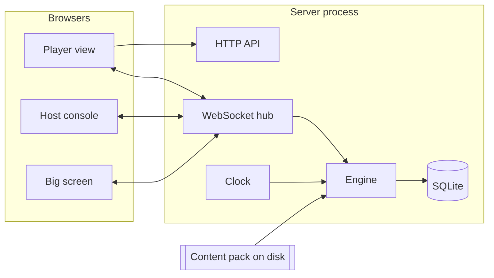

# Lab 02 game: engineering spec

This document says how the Lab 02 game is built. It covers the architecture, the content
format, the game rules as the engine runs them, the server, the player API, the screens, the art,
the tests, the deployment and the order of the build.

**Status.** Version 1. The foundation and Phase 1 are specified in full. Phase 2 and Phase 3 are
specified as far as the content format fixes them: their rules are complete, and their screens
are outlined. Section 16 lists what later steps add.

**This file is public and the game content is not.** The scenarios, the answer keys and the
tuned numbers live in a private content pack that never enters this repository. Nothing here
quotes that pack. Every example comes from the demo pack (section 5.7), which is set in a
library and shares nothing with the real scenarios.

Words used with a fixed meaning:

| Word | Meaning |
| --- | --- |
| Session | One run of the game with one room of players |
| Health system | One of the worlds a session holds. Every player belongs to one |
| Practice | What one player directs. A player and a practice are the same thing in the code |
| Host | An instructor with the host passcode |
| Big screen | The projector view |
| Phase | Planning, Development or Maintaining |
| Stage | One step of the session's timeline (section 6.3). A phase spans several stages |
| Game time | The session clock, in milliseconds. It stops when the host pauses |
| Pack | A folder of content files in the format of section 5 |
| Rung | One of the five levels of the automation ladder, from no software to an agentic system |

---

## 1. The game in mechanics

A session holds up to 150 players, each on a laptop or a phone. A player joins with a link,
names a practice and is assigned to a health system. The session then moves through three
phases. Each is played by everyone at once against a shared timer and is worth up to 1000 points.

1. **Planning.** The player sees a list of candidate problems and investigates the practice.
   An investigation holds part of the player's bandwidth for some seconds and then unlocks one
   evidence tile. Several can run at once while bandwidth is free, so time is the limit. The
   player reports which problems are real and puts each on a rung of the ladder. The top rung
   holds one problem.
2. **Development.** The player fills a board of choices to design a solution for one problem.
   Pilot runs score the design on four metrics (validity, reliability, cost, complexity) and
   return one traced failure. At the end, the submitted design is tested again on a second set
   of cases.
3. **Maintaining.** A simulated year runs on a shared clock. The player funds monitors, answers
   events and may change the system. The score is the health of the system over the year.

State resets between phases, and only points carry over. A live leaderboard runs throughout.
After each phase the players see what the right answers were.

---

## 2. Principles

1. **The server owns all state.** A browser shows what the server sends and asks for changes.
   It never decides an outcome.
2. **The engine is pure.** Game logic is a library with no clock, no network, no storage and no
   randomness. The same state and the same commands always give the same result.
3. **Content is data.** A new scenario, number or text needs no code change. Code never names a
   content id.
4. **Keys stay on the server.** A browser receives only what section 9 allows, built field by
   field from a whitelist.
5. **Nothing is lost.** A refresh, a dropped connection or a server restart returns every
   player to where they were.
6. **Small payloads.** Static content travels once per phase over HTTP. The live connection
   carries small views. Each browser animates its own scene.
7. **One API.** The browser, the scripted bots, the load test and the LLM agent players all use
   the player API of section 8.
8. **All waits are in game time.** A time scale speeds up tests and changes nothing else.
   **Nobody just waits.** No wait blocks the screen, waits are short, and while something runs
   the player can read, decide and start other work. This holds in every phase.
9. **Laptop first, phone must work.** Every action can be done by tapping. Drag is an extra.
10. **Develop on the Mac.** Nothing is built or tested on a server. `scripts/deploy.sh` ships a
    finished build.

---

## 3. Architecture



One Node process serves everything. It loads one pack at start, keeps every session in memory,
and writes commands and snapshots to SQLite. A reverse proxy in front of it terminates TLS.

**Packages and what each may import**

| Package | Holds | May import |
| --- | --- | --- |
| `content-schema` | Schemas of the pack files, the loader, the validation | nothing of ours |
| `protocol` | Wire messages, view types and their strict schemas, error codes, the reference connection class | nothing of ours |
| `engine` | State, commands, time, scoring, leaderboards, and the projection from pack to public views | `content-schema`, `protocol` |
| `server` | HTTP, WebSockets, the clock, persistence, auth, logs | all three |
| `client` | The React application for players, hosts and the big screen, and the scene | `protocol` only |

The client never imports `content-schema` or `engine`. A lint rule enforces this. The types
that describe a pack with its keys therefore cannot reach client code.

**Data flow of one player action**

1. The browser sends a command with a client id (`cid`).
2. The server checks the connection, the rate limit and the shape of the message.
3. The server reads the clock, calls `advance(state, now)`, then `apply(state, command, now)`.
4. An accepted command is written to the log in the same turn. A refused one is not.
5. The server sends an `ack`, then the new view to every player whose view changed.

---

## 4. Stack and layout

| Area | Choice |
| --- | --- |
| Runtime | Node 22, on the Mac and on the server |
| Language | TypeScript, strict mode, ES modules |
| Workspace | npm workspaces. No other package manager |
| Schemas | Zod. YAML parsed with the `yaml` package |
| HTTP and WebSocket | Fastify, with `ws` for the sockets |
| Storage | SQLite through the built-in `node:sqlite` module, WAL mode. It runs without a flag on Node 22 and prints an experimental warning. If Step 3 finds a problem on the server, `better-sqlite3` replaces it behind the same small storage interface |
| Client | React with Vite. Zustand for state. Plain CSS with custom properties |
| Scene | PixiJS 8, one canvas |
| Tests | Vitest for unit and integration tests. Playwright for browser tests, on the Mac only |
| Server bundle | esbuild, one file, so the server needs no `npm install` |

Use the latest stable release of each library at Step 3 and commit the lockfile.

```
game/
  CLAUDE.md                 rules for build sessions
  README.md                 how to run the demo on a laptop
  package.json              workspaces and the scripts of section 12
  docs/ENGINEERING_SPEC.md  this file
  packages/
    content-schema/
    protocol/
    engine/
    server/
    client/
  content-demo/             the demo pack
  scripts/                  deploy.sh, provision.sh, simulate, loadtest, parity, check-no-private
```

---

## 5. Content pack

### 5.1 Layout

The server reads one pack from the folder in `CONTENT_DIR`. The default is `content-demo`.

```
game.yaml                 global rules and numbers
palette.yaml              Phase 2 components
monitors.yaml             Phase 3 monitors
characters.yaml           the cast
systems/<id>-<slug>/
  system.yaml             premise, practice profile, calibration anchors
  problems.yaml           Phase 1 candidate problems
  insights.yaml           Phase 1 investigations and tiles
  build.yaml              Phase 2 board, cases, rules, offers
  maintain.yaml           Phase 3 start meters, actions, events
  story.yaml              briefs, letters, dialogue, announcements
teaching/
  help-slides.yaml        outlines of the slides the big screen renders
  report-card.yaml        rules and text of the personal report card
art/                      optional images that belong to the pack (section 11.4)
```

A pack may be partial. The loader requires `game.yaml`, `characters.yaml` and, for each health
system, `system.yaml`. A phase can be opened only when its files exist for every health system.
The host console shows which phases a pack can run. This lets a pack grow one phase at a time.

### 5.2 Conventions

- YAML, UTF-8. Ids are lowercase with hyphens and unique in the pack. Items inside a system
  carry the system id as a prefix.
- Text is plain. No Markdown and no HTML. A line break is `\n`. The client renders text as text.
- **Scores and meters** run from 0 to 100 and higher is better, for all four metrics. A high
  cost score means a cheap system. **Cost units and complexity points** are raw amounts on
  components and rules, and higher is worse.
- Every wait is in seconds of game time.

### 5.3 Public, key and mechanics

Every field of a pack belongs to one of three classes.

| Class | Where | Reaches a browser |
| --- | --- | --- |
| Public | Under a `public` field, plus the few fields listed in section 9.2 | When its trigger occurs |
| Key | Under a `key` field | Never, except the fields that a reveal sends (section 9.2) |
| Mechanics | Everything else | Never as written. Only computed results leave the server |

The projection code builds every outgoing object field by field. A field that nobody listed
cannot leak by being forgotten.

### 5.4 Loading and validation

The loader parses the files, validates them and returns one frozen `Pack` object with a content
hash. The object keeps the field names of the files, so the listings of section 5.5 describe
both. Validation has three layers.

1. **Shape.** Types, enums and required fields. It is strict wherever a typo would change a
   result: inside `public`, options, costs, effects, conditions and events, an unknown field is
   an error. Elsewhere an unknown field gives a warning with its path, and the server starts.
2. **References.** Every id that a file mentions exists: characters, problems, monitors, events,
   offers, components, choices and options inside conditions, source ids.
3. **Counts from `game.yaml`.** The number of problems, investigations and offers match what
   `game.yaml` states. Every investigation uses a bandwidth level that exists, with the seconds
   of that level, and one that its method allows. The work of all investigations of a system
   (bandwidth times seconds, summed) lies inside `total_work`.

A `key` block is read loosely. The loader types the fields that the engine or a reveal needs,
listed in section 5.5, and carries any other field without reading it. A private pack holds
more authoring fields than this document lists. A private checker, kept with that pack,
enforces the design rules: how hard the puzzle is, how the evidence fits together, how the
numbers balance. The public loader does not know those rules.

A setting that has one implemented value is validated to hold that value. For example
`join.assignment` must be `balanced`. A pack cannot ask for behavior that does not exist.

`npm run check:content` loads the pack in `CONTENT_DIR` and prints every error and warning.

### 5.5 Schema reference

The listings show the fields the code reads. `?` marks an optional field. `Text` is a plain
string. `SourceIds` is a list of ids from the `sources` registry of `game.yaml`.

**`game.yaml`**

```ts
type Game = {
  version: number
  game: { title: Text | null; phase_order: PhaseId[]; health_systems: SystemId[] }
  join: {
    assignment: 'balanced'; tie_order: SystemId[]
    practice_name: { min_chars: number; max_chars: number; unique_per_session: true;
                     filter_profanity: boolean; host_can_rename: boolean; host_can_remove: boolean }
    reconnect: 'token'
    late_join: { open_until: { phase: PhaseId; month?: number }; missed_phase_points: 0;
                 mid_phase: 'full_budget_remaining_clock';
                 maintaining_after_setup: 'inherit_do_nothing' }
  }
  clock: { time_scale_default: number; warnings_seconds_left: number[]; idle_seconds?: number;
           auto_submit_at_zero: true; pause_freezes: 'all' }
  run_of_show: { start: number; end: number; segment: string; driver: string }[]   // minutes
  story_time?: {                         // display strings only, see below
    planning?: { span: Text; investigation_stands_for?: Record<number, Text> }   // by bandwidth level
    development?: { span: Text; pilot_run_stands_for?: Text }
    maintaining?: { span: Text; tick_stands_for?: Text }
  }
  ladder: { rung: 1|2|3|4|5; id: string; label: Text; fits_when: Text; example: Text }[]
  scoring: {
    phase_max_points: number
    normalization: { floor_points: number; max_points: number }
    four_metric_score: { weights: Record<Metric, number> }
    score_bands: { id: string; min: number; max: number }[]
  }
  phases: { planning: PlanningRules; development: DevelopmentRules; maintaining: MaintainingRules }
  leaderboards: {
    columns: ['overall', ...PhaseId[]]; refresh_seconds: number; big_screen_rows: number
    tie_breaks: Record<'overall' | PhaseId, string[]>
    winners: { overall_top: number; per_system_top: number; top_system: number }
  }
  text_limits?: Record<string, number>   // words. Over the limit gives a warning
  sources: Record<string, { paper: string; locator: Text; gist: Text }>
  public_source_labels: Record<string, Text>     // by paper
}
type PhaseId = 'planning' | 'development' | 'maintaining'
type Metric = 'validity' | 'reliability' | 'cost' | 'complexity'

type PlanningRules = {
  label: Text; play_seconds: number; reveal_seconds: number
  candidates: number; report_slots: number; agent_rung_capacity: number
  investigations: { per_system: number
                    bandwidth: number                       // blocks a player can commit at once
                    levels: { bandwidth: number; seconds: number }[]
                    method_levels: Record<Method, number[]>  // bandwidth levels a method may use
                    total_work: { min: number; max: number } // sum of bandwidth x seconds
                    reachable_work: number                  // read by the private checker only
                    parallel: true; cancel: 'none' }
  live_leaderboard: { label: Text }
  scoring: { identify: { per_real: number; per_decoy: number; component_floor: number }
             ladder: { exact: number; adjacent: number }
             flagship: { bonus: number } }
}
type DevelopmentRules = {
  label: Text; play_seconds: number; reveal_seconds: number
  pilot: { runs: number; seconds: number; concurrent: 1 }
  offers: { per_system: number; announce_at_seconds: number[]; claim_window_seconds: number
            claim_fraction: number }
  live_leaderboard: { label: Text }
  scoring: { pilot_weight: number; heldout_weight: number }
}
type MaintainingRules = {
  label: Text; reveal_seconds: number
  setup_seconds: number; months: number; month_seconds: number; event_response_seconds: number
  credits: number; actions_per_month: number
  live_leaderboard: { label: Text }
}
```

`story_time` says what the play time stands for in the story, for example that a pilot run
stands for a two-week pilot. The client shows these strings next to the waits. They never affect
a score.

**`palette.yaml`**

```ts
type Palette = { components: Component[] }
type Component = {
  id: string                      // also the option id when the component sits in a slot
  public: { label: Text; short: Text; description: Text; icon: string }
  tags?: string[]
  cost?: { visible?: number; hidden?: number; year?: number }
  developers?: number; complexity?: number; delivery_runs?: number
  key?: object
}
```

The id `empty` is reserved for a slot with nothing in it, and `n/a` for a choice that does not
apply.

**`monitors.yaml`**

```ts
type Monitors = { monitors: Monitor[] }
type Monitor = {
  id: string
  public: { label: Text; description: Text; icon: string }
  credits: number
  upkeep?: Partial<Record<Metric, number>>     // meter deltas, applied once when funded
  key?: object
}
```

**`characters.yaml`**

```ts
type Character = {
  id: string; system: SystemId | 'all'
  public: { name: Text; role: Text; portrait: string }      // portrait is an art key
}
```

**`system.yaml`**

```ts
type System = {
  id: SystemId; slug: string
  public: { name: Text; setting: Text; premise: Text
            practice_profile: { label: Text; value: Text | number }[]
            baseline: { label: Text; value: Text | number; unit?: Text }[]
            cast: CharacterId[] }
  key: { flagship_problem: ProblemId; summary?: Text }
  calibration: Record<PhaseId, { zero: number | null; floor: number | null; ceiling: number | null
                                  provisional: boolean }>
}
```

**`problems.yaml`** is a list.

```ts
type Problem = {
  id: ProblemId
  public: { title: Text; description: Text }
  key: { real: boolean; tier: 1|2|3|4|5 | null; flagship: boolean; rationale: Text
         burden?: { kind: string; size: string; note: Text }
         source?: SourceIds }
}
```

Exactly one problem has `flagship: true`. It is real, and it equals `system.key.flagship_problem`.

**`insights.yaml`** is a list.

```ts
type Investigation = {
  id: InvestigationId
  method: 'interview' | 'data_pull' | 'audit' | 'observation'
  character: CharacterId | null          // required for an interview
  public: { title: Text; teaser: Text }
  bandwidth: number; seconds: number      // blocks held while it runs, and for how long
  tile: Tile
  key?: object
}
type Tile =
  | { type: 'stat';  headline: Text; body: Text
      data: { value: Text | number; unit?: Text; label: Text; comparison?: Text } }
  | { type: 'chart'; headline: Text; body: Text
      data: { kind: 'bar' | 'line'; x_label: Text; y_label: Text
              series: { name: Text; points: [Text | number, number][] }[]; note?: Text } }
  | { type: 'quote'; headline: Text; body: Text
      data: { speaker: CharacterId; text: Text } }           // bubbles split on "\n"
  | { type: 'audit'; headline: Text; body: Text
      data: { sample_size: number; findings: { label: Text; count: number }[]; note?: Text } }
```

The `tile` is mechanics until the investigation completes. Then it is sent to that player.
Only an interview fixes its tile type (`quote`). Every other method may give any tile type. An
`audit` tile also serves as the tally of an observation, and its findings may then count
different things, each with its own denominator in the label.

**`build.yaml`**

```ts
type Build = {
  problem: ProblemId
  board: { nodes: { id: string; label: Text; kind: 'system' | 'person' }[]
           flow: string[]                  // node ids and slot ids, in order
           links?: [string, string][] }    // extra arrows
  budget: { cost: { par: number; ceiling: number }; complexity: { par: number; ceiling: number } }
  team: { developers: number }
  choices: Choice[]
  rules?: { id: string; when: Condition
            effects: { cost?: number; cost_year?: number; complexity?: number; developers?: number }
            key?: object }[]
  advisories?: { when: Condition; trace: Text; priority: number; source?: SourceIds }[]
  cases: Case[]
  offers?: Offer[]
  key: { reference: { design: Design; rationale: Record<ChoiceId, Text>; public_summary: Text }
         traps?: { id: string; kind: 'overbuilt' | 'underbuilt' | 'shortcut'; design: Design }[] }
}
type Choice =
  | { id: ChoiceId; kind: 'slot'; public: { label: Text; prompt?: Text }
      options: SlotOption[] }
  | { id: ChoiceId; kind: 'link' | 'tool' | 'agent_setting' | 'setting' | 'resource'
      public: { label: Text; description?: Text }
      applies_when?: Condition; default: OptionId
      options: ListOption[] }
type OptionCosts = {
  cost?: { visible?: number; hidden?: number; year?: number }
  developers?: number; complexity?: number; delivery_runs?: number
  tags?: string[]; requires_offer?: OfferId | null
}
type SlotOption = OptionCosts & { component: ComponentId; public_note?: Text }
     // a missing cost, developers, complexity or delivery_runs falls back to the palette
type ListOption = OptionCosts & { id: OptionId; public: { label: Text; description?: Text }
                                  adds_developers?: number }
type Case = {
  id: CaseId; set: 'pilot' | 'heldout'; dimension: 'validity' | 'reliability'; weight?: number
  public: { title: Text; text: Text }
  fails_when?: { when: Condition; trace: Text; priority: number; source?: SourceIds }[]
  extra_cost?: { when: Condition; cost: number; note?: Text }[]
  key?: object
}
type Offer = {
  id: OfferId; index: number            // which announcement time of game.yaml it uses, from 1
  public: { title: Text; text: Text; trade_off: Text }
  pilot_runs: number                    // change to the claimer's pilot budget
  key?: { verdict?: 'take' | 'leave' | 'depends'; rationale?: Text }
}
type Design = Record<ChoiceId, OptionId>

type Condition = {                      // every key present must hold
  choice?: ChoiceId; is?: OptionId[]; is_not?: OptionId[]; has_tag?: string
  count_tag?: string; kind?: Choice['kind']; min?: number; max?: number
  has_offer?: OfferId
  all?: Condition[]; any?: Condition[]; not?: Condition
}
```

**`maintain.yaml`**

```ts
type Maintain = {
  start: Record<Metric, number>
  monitors?: Record<MonitorId, { public: { local_note: Text } }>
  actions: Action[]
  events: GameEvent[]
}
type Action = {
  id: ActionId; kind: 'look' | 'change'
  public: { label: Text; text: Text }
  credits: number; once?: boolean                 // default true
  months?: { from?: number; to?: number }
  reveals?: EventId[]; effects?: Partial<Record<Metric, number>>
  disarms?: EventId[]; arms?: EventId[]
  key?: { verdict?: 'good' | 'depends' | 'poor'; rationale?: Text }
}
type GameEvent = {
  id: EventId; archetype: string
  requires_trigger?: boolean
  onset: { month: number } | { after_trigger: number }
  detect: { loud?: boolean; monitors?: MonitorId[]; late_after_months?: number | null }
  drift?: Partial<Record<Metric, number>>         // per month while it runs
  public: { early: { title: Text; text: Text }; late: { title: Text; text: Text } }
  default_option: OptionId
  options: {
    id: OptionId; public: { label: Text; text: Text }
    available?: 'both' | 'early' | 'late'; requires_monitor?: MonitorId | null
    effects?: Partial<Record<Metric, number>>
    stops_drift?: boolean; restore?: number       // 0 to 1
    arms?: EventId[]; disarms?: EventId[]; grants_monitor?: MonitorId | null
    key?: { verdict?: 'best' | 'acceptable' | 'poor'; rationale?: Text }
  }[]
  key?: { teaches?: Text }
}
```

**`story.yaml`**. Nothing in this file affects a score.

```ts
type Story = {
  briefs?: Partial<Record<PhaseId, { from: CharacterId; title: Text; text: Text }>>
  letters?: Partial<Record<'planning_reveal' | 'development_reveal' | 'annual_review',
            { from: CharacterId; always: Text; variants: Record<BandId, Text> }>>
  dialogue?: { id: string; speaker: CharacterId; text: Text
               trigger: { phase: PhaseId; on: string } }[]
     // on: start | idle | insight:<id> | run_result | trace:<case id> | event:<id> | month:<n> | reveal
  announcements?: { id: string; phase: PhaseId; offer?: OfferId; at_seconds?: number | null
                    from: CharacterId; text: Text }[]
}
```

**`teaching/help-slides.yaml`** and **`teaching/report-card.yaml`**

```ts
type HelpSlides = {
  intro?: Slide[]
  breaks: Partial<Record<'after_planning' | 'after_development' | 'after_maintaining', Slide[]>>
  reflection_prompts?: Text[]
}
type Slide = { id: string; title: Text; bullets: Text[]; live_stat?: RoomStatId; notes?: Text }

type ReportCard = {
  sections: { id: string; title: Text
              lines: { when: Record<string, string | number | boolean>; text: Text
                       source?: SourceIds }[] }[]
  closing: Record<BandId, Text>
  links?: { label: Text; url: string }[]
}
```

### 5.6 The content hash

The loader computes a SHA-256 over the parsed pack in a canonical order. A session stores the
hash of the pack it started with. After a restart the server resumes a session only when the
pack on disk has the same hash. Changing content between two sessions is normal. Changing it in
the middle of one is refused.

### 5.7 The demo pack

`content-demo/` lets anyone run the game from this repository. It follows the format above and
is written from scratch for the purpose.

- **Setting.** Two public library networks. The player is the digital services director of one
  branch. No medical wording anywhere.
- **Size.** Two health systems. Per system: 6 candidate problems, 5 investigations, a board of
  8 to 10 choices, 4 pilot and 4 held-out cases, 1 offer, 4 events and 3 actions. Shared: 5
  components, 3 monitors, 4 characters. Short timers, so a full game takes about six minutes at
  time scale 1.
- **Coverage.** The pack uses every feature of the format at least once: all four investigation
  methods and all four tile types, an interview, every kind of choice, `applies_when`, an
  option that needs an offer, a rule with a developers effect, an option with `delivery_runs`,
  a design that the team cannot build, a year amount that differs from the pilot amount, an
  advisory, a case with `extra_cost`, a loud event and a silent one, an event that another
  option arms, `grants_monitor`, a one-time check, a change action with a month window, every
  dialogue trigger, letters with all bands, help slides with a live statistic, and a report card.
- **Calibration.** Its anchors are estimates marked provisional until `scripts/simulate`
  exists in Step 9. From then on they are measured.
- **Growth.** The pack grows with the build: the global files and Phase 1 in Step 3, Phase 2 in
  Step 7, Phase 3 and the teaching files in Step 9.
- **Sources.** Its source registry holds two invented entries.

---

## 6. Engine

### 6.1 Shape

```ts
createSession(pack, opts: { code, label, mode }): SessionState
advance(state, pack, now: GameMs): Outcome
apply(state, pack, command: Command, now: GameMs): Outcome & ({ ok: true } | { ok: false; error: ErrorCode })

playerView(state, pack, playerId): PlayerView            // section 8.4
phaseContent(state, pack, playerId, phase): PhaseContent  // section 8.3
hostView(state, pack): HostView
screenView(state, pack): ScreenView

type Outcome = { dirty: PlayerId[] | 'all'; events: EngineEvent[] }
```

- `SessionState` is plain JSON data. No class instances, maps, sets or dates. A snapshot is
  `JSON.stringify(state)`.
- `advance` and `apply` change the state they are given and return what happened. They read no
  clock and use no random numbers. `now` always comes from the caller.
- `advance` is path-independent. Calling it once with a late time gives the same state as
  calling it many times on the way. It processes every timer that is due in order of its due
  time, and by a fixed key when two are due together.
- `dirty` lists the players whose view changed. `events` are things the server announces or
  logs: a stage change, an offer, a dialogue line, a leaderboard beat, a month that ended.
- All code that turns pack data into something a browser may see lives in
  `packages/engine/src/project/`. No other code reads a pack and writes a protocol type.

### 6.2 Time

`GameMs` is an integer count of milliseconds on the session clock. The server maps wall time to
game time (section 7.4). The engine sees only game time, so a pause freezes every timer and a
time scale speeds everything up without any rule changing.

### 6.3 Stages

```
lobby → intro
→ planning.play → planning.reveal → break.planning
→ development.play → development.reveal → break.development
→ maintaining.setup → maintaining.year → maintaining.reveal → break.maintaining
→ reflection → winners → closed
```

| Stage | Length | Ends |
| --- | --- | --- |
| `planning.play`, `development.play` | `play_seconds` of that phase | By itself at zero, or on `end_now` |
| `maintaining.setup` | `setup_seconds` | By itself |
| `maintaining.year` | `months` × `month_seconds` | By itself |
| Every other stage | Untimed for the engine | On the host command `next` |

The untimed stages show a guide countdown to the host: `reveal_seconds` for a reveal, and the
length from `run_of_show` for the rest. When a play stage ends, the engine submits what each
player has, computes every score of that phase, the leaderboard and the room statistics, and
moves to the reveal.

Host commands: `next`, `pause`, `resume`, `extend` (30 or 60 seconds, added to the current timed
stage, or to the current month in `maintaining.year`), `end_now`, `rename_player`,
`remove_player`, `reset_stage` and `close`. Pause and resume act on the clock, not on the engine.
`reset_stage` puts every player back at the start of the current phase and exists only outside
`event` mode.

**Session modes**

| Mode | Time scale | Provisional anchors | `reset_stage` |
| --- | --- | --- | --- |
| `test` | Any | Allowed | Yes |
| `rehearsal` | 1 by default | Allowed, with a warning on the host console | Yes |
| `event` | 1 | Refused. The session cannot be created | No |

### 6.4 Joining

- `join` adds a player to the health system with the fewest active players. `join.tie_order`
  breaks a tie. A removed player does not count.
- The practice name is trimmed and checked for length and profanity by the server. A name
  that a practice of the session already has, compared without regard to case, is refused
  with `name_taken`. The engine never makes a second practice by adding a number, because the
  usual reason for a repeated name is a player who lost their browser and wants their practice
  back (section 7.7).
- `join` carries an `avatar`, the character the practice picked on the join page. The ids are
  a fixed list in `packages/protocol`, with at least eight characters. Two practices may pick
  the same one. A missing or unknown id is replaced by one picked from the list by a hash of
  the player id, so a bot can join without choosing. The avatar is display only and never
  enters a score.
- Joining stays open until `join.late_join.open_until`. A player who joins during a play stage
  gets the full budget of that phase and the time that is left. A phase that ended before the
  player joined scores 0. A player who joins during the year takes over a practice that did
  nothing in the earlier months (section 6.7), with the whole credit pool.

### 6.5 Phase 1: Planning

**State of a player**

```ts
type PlanningState = {
  done: { id: InvestigationId; atMs: GameMs }[]            // in order of completion
  running: { id: InvestigationId; startedAtMs: GameMs; completesAtMs: GameMs }[]
                                                            // free bandwidth = total - held by these
  picks: Record<ProblemId, 1|2|3|4|5>
  submittedAtMs: GameMs | null
  result: PlanningResult | null                             // set when the stage ends
}
```

**Commands**

| Command | Accepted when | Effect |
| --- | --- | --- |
| `planning.investigate {id}` | Stage is `planning.play`. Not submitted. The id is neither done nor running. Its bandwidth fits in what is free | The investigation holds its bandwidth and runs for its `seconds`. It cannot be cancelled |
| `planning.set_report {picks}` | Stage is `planning.play`. Not submitted. At most `report_slots` picks. At most `agent_rung_capacity` picks on rung 5. Every id exists | Replaces the draft |
| `planning.submit {}` | Stage is `planning.play`. Not submitted | Locks the report. The player waits for the stage to end |

When an investigation completes, its tile joins the player's view and its bandwidth is free
again. Any number may run at once while their bandwidth adds up to at most
`investigations.bandwidth`. Nothing is spent, so the play time is the limit. The rest of the
screen stays usable while they run.

**Interviews.** An interview has a `quote` tile whose text holds one line per speech bubble.
The engine releases the lines on a schedule, so the talk fills the wait and no text arrives
before its time. With `n` lines and a wait of `s` seconds, line `k` (from 1) is released at
`startedAt + k × s ÷ (n + 1)`. The tile completes at `startedAt + s`. The time before the first
line is the character's walk. Interviews that run at the same time release their lines
independently.

**At the end of the stage** the draft of every player who did not submit is submitted as it
stands. Investigations that are still running are dropped.

**Scoring.** `R` is the number of real problems in the report and `D` the number that are not
real.

```
identify = max(component_floor, per_real × R + per_decoy × D)
ladder   = for each real problem in the report: exact on the true rung, adjacent one rung off, else 0
flagship = bonus if the flagship problem is in the report on rung 5, else 0
raw      = identify + ladder + flagship
```

**Live column.** The number of tiles unlocked. Correctness stays hidden until the reveal.

**Reveal.** Each player receives the truth of every problem (section 9.2), their own picks
graded one by one, the three parts of the score, the points, the band and the letter.

### 6.6 Phase 2: Development

Everyone designs for the flagship problem of their health system (`build.problem`).

**A design** maps each choice id to an option id. Resolving a design:

1. Slots first. A slot holds a component its options allow, or `empty`.
2. Then every other choice in file order. When its `applies_when` is false the choice holds
   `n/a`, costs nothing and matches no `is` list. Otherwise it holds the chosen option, or its
   `default`.
3. An option with `requires_offer` can be chosen only by a practice that claimed that offer.

Each resolved option has tags, three money amounts (`visible`, `hidden`, `year`), developers,
complexity points and delivery runs.

**Conditions**

| Form | True when |
| --- | --- |
| `{choice: C, is: [...]}` | The option at C is in the list |
| `{choice: C, is_not: [...]}` | The option at C is not in the list |
| `{choice: C, has_tag: T}` | The option at C carries tag T |
| `{count_tag: T, min, max, kind?}` | The number of choices whose option carries T is in range. `kind` counts one kind of choice only |
| `{has_offer: O}` | The practice claimed offer O |
| `{all: [...]}`, `{any: [...]}`, `{not: {...}}` | As named |

**Developers.** Needed is the sum over chosen options and matching rules. Available is
`team.developers` plus the `adds_developers` of chosen options. A design that needs more than
is available is **not buildable**. It cannot be run, and if it is what gets submitted it scores 0.
The board shows both numbers as the player builds.

**Scoring a design on a case set** (`pilot` or `heldout`)

1. *Validity* is 100 × the weight of the validity cases that pass ÷ the weight of all validity
   cases in the set. A case passes when none of its `fails_when` entries matches.
   *Reliability* is the same over the reliability cases.
2. *Pilot cost* is the visible and hidden money of every option, plus the `cost` of every
   matching rule, plus the mean over the cases of the set of their matching `extra_cost`.
   *Year cost* adds the `year` amount of every option and the `cost_year` of every matching
   rule. The pilot set is priced on the pilot cost and the held-out set on the year cost.
3. *Complexity* is the points of every option plus the `complexity` of every matching rule.
4. The cost score is 100 at or below `budget.cost.par`, 0 at or above the ceiling, and linear in
   between. The complexity score works the same way.
5. The design score is the four-metric score of section 6.8.
6. A design that is not buildable scores 0 on everything.

**Pilot runs**

| Command | Accepted when | Effect |
| --- | --- | --- |
| `development.set_design {design}` | Stage is `development.play` | Replaces the draft. The view returns the resolved design, which choices apply, the money on the cards, the developers, and what the next run would use up |
| `development.run {}` | No run in progress. The draft is buildable. Enough runs are left | Uses up runs and starts a run of `pilot.seconds` on a copy of the draft |
| `development.choose_run {runId or null}` | The run is the player's own and finished | Marks the design to submit. `null` returns to the default |
| `development.claim_offer {offerId}` | The offer is open for this health system and places are left | The player gets the offer |

- A run uses up 1 run, plus the `delivery_runs` of every chosen option that this practice has
  not run before. After that the option is delivered.
- A finished run stores the design and its result: the four sub-scores, the design score, the
  pilot cost and the year cost with the visible and hidden parts, the complexity points, the
  developers, and one trace.
- **The trace.** Take the first matching `fails_when` entry of every failed pilot case and every
  matching advisory. Sort by priority, highest first. Show the first whose text this player has
  not been shown. When all were shown, show the highest. When nothing matches, the client shows
  a fixed line that says no failure was traced. The trace comes with the `public` of its case.
- **Submission.** The submitted design is the finished run with the highest design score, the
  earliest on a tie, unless the player chose another. A player with no finished run when the
  stage ends has the draft run and submitted as it stands.

**Offers.** Each offer is announced to its health system at its time from
`offers.announce_at_seconds`, counted from the start of the stage. It stays open for
`claim_window_seconds`. The places are `ceil(claim_fraction × active players of that system)`,
at least 1, counted at the announcement. Claims are served in the order the server receives
them. A claim adds `pilot_runs` to the player's budget and sets a flag that conditions and
options can test.

**Scoring.** `raw = 10 × (pilot_weight × pilot score + heldout_weight × held-out score)`, both of
the submitted design.

**Live column.** The best pilot design score so far.

**Reveal.** Each player receives the held-out sub-scores of the submitted design, the two
highest-priority held-out traces, the points and the letter, and then the reference design with
its summary (section 9.2).

### 6.7 Phase 3: Maintaining

Every player runs the same system, the reference design of their health system. The four
meters start at `maintain.start`. Each player's year is separate state on a shared clock.

**Setup.** For `setup_seconds` the player may fund any monitors the credit pool affords.

**The year.** Month `m` runs from `S + (m − 1) × L` to `S + m × L`, where `S` is the start of
the stage and `L` is `month_seconds`.

1. *Month start: drift.* Every event that is armed, has started and has not been stopped adds
   its `drift` to the meters. Meters stay within 0 to 100. The engine records what was really
   applied, per event and per month.
2. *Month start: reveals.* An event that has started and is not yet revealed is revealed now in
   mode `early` when it is loud, or the practice funds one of its monitors, or a one-time check
   found it. It is revealed in mode `late` when `late_after_months` have passed since its onset.
   Reveals are decided once, on the state at the start of the month. A monitor that is funded or
   granted during a month reveals what it watches from the next month.
3. *During the month.* A revealed event can be answered for `event_response_seconds`. An answer
   applies when it arrives. The player may also take `actions_per_month` action in each month.
   An action applies when it arrives.
4. *At a deadline.* An event that was not answered takes its `default_option`.
5. *Month end.* The health of the month is the four-metric score of the true meters.

Timers that fall on the same instant run in this order: deadlines, month end, month start. The
response window may be longer than a month. An answer or a default that lands in a later month
uses that month for everything below, and the drift of that month has already been applied.

**An option** acts at once: `effects` are added to the meters, `restore` gives back that share
of the harm this event has done so far, `stops_drift` ends its drift, `arms` sets the onset of
each listed event to this month plus its `after_trigger`, `disarms` cancels listed events that
have not started, and `grants_monitor` funds a monitor and applies its upkeep. An option is
available when its `available` field allows the reveal mode and the practice funds its
`requires_monitor`.

**Actions**

| Command | Accepted when | Effect |
| --- | --- | --- |
| `maintaining.fund {monitorId}` | Setup, or no action taken yet this month. Not funded. Credits suffice | Pays the credits. The upkeep applies now. The monitor watches from the next month, or from month 1 when funded in setup |
| `maintaining.act {actionId}` | No action taken yet this month. Credits suffice. Inside its `months` window. Not taken before when `once` | Pays the credits. `effects` move the meters for the rest of the year. `reveals` marks each listed event that is running and not revealed, so that it is revealed at the next month start in mode `early`. `disarms` and `arms` work as for an option |
| `maintaining.answer {eventId, optionId}` | The event is revealed, not answered, inside its window, and the option is available | Applies the option |

**What the player sees.** The meters in the view leave out the drift of events that are not
revealed. When an event is revealed, its drift appears for every month since its onset, and the
running score drops at once. For month `k`, a seen meter is the true meter at the end of month
`k` minus the drift that events still unrevealed now had applied up to month `k`.

**A practice that does nothing** funds no monitor, takes no action and answers no event, so
every default applies at its deadline. This is the zero anchor of the phase and the history of
a late joiner.

**Scoring.** `raw = 10 × mean of the monthly health values`, always on the true meters.

**Live column.** The points that the seen meters would give so far.

**Reveal.** Each player receives the true history, each event with its onset, how and when it
was revealed, the option taken and its verdict, the events that never surfaced, the points and
the letter.

### 6.8 Scores, points and bands

**The four-metric score** serves a design in Phase 2 and a month in Phase 3. `V`, `R`, `C` and
`X` are the validity, reliability, cost and complexity scores, and `w` the weights from
`game.yaml`.

```
score = w.validity × V + w.reliability × R + (V ÷ 100) × (w.cost × C + w.complexity × X)
```

**From raw to points.** Each health system carries three anchors per phase in `system.yaml`.

```
raw ≤ zero             points = 0
zero < raw < floor     points = floor_points × (raw − zero) ÷ (floor − zero)
floor ≤ raw < ceiling  points = floor_points + (max_points − floor_points) × (raw − floor) ÷ (ceiling − floor)
raw ≥ ceiling          points = max_points
```

Points are rounded half up (`floor(x + 0.5)`), once per phase. When an anchor is missing, which
only a provisional pack allows, points are the raw score rounded and kept within 0 and
`max_points`, and the host console marks them provisional. The band of a phase is the entry of
`score_bands` that holds its points.

**The reference scorer.** The private pack carries a Python module that is the executable
definition of these rules. The engine must return the same numbers. Section 12.2 says how the
two are compared.

### 6.9 Leaderboards

The page has four columns side by side: Overall, and one per phase. Each column is its own
ranking.

| Column | While its phase is in play | After its phase closed |
| --- | --- | --- |
| Phase 1 | Tiles unlocked | Phase points |
| Phase 2 | Best pilot design score | Phase points |
| Phase 3 | Points from the seen meters so far | Phase points |
| Overall | Sum of the closed phases | Sum of the closed phases |

- The column of the phase in play is marked provisional. The engine recomputes the whole board
  every `refresh_seconds` of game time, and at every stage change. Everyone sees the same board
  between two beats.
- A filter shows the same four columns inside one health system. A strip ranks the health
  systems. A system's score is the sum over closed phases of the mean points of its players who
  acted in that phase. A player acted when the engine accepted one command or more from them.
- Final rankings follow `leaderboards.tie_breaks`. A live column breaks ties by who reached the
  value first.
- A player's view carries their own rank overall, in their system and in the current phase,
  and the top three. The big screen carries the top `big_screen_rows` of each column.
- Every row carries the practice's name, avatar and health system.
- Removed players are in no ranking.

### 6.10 Room statistics

When a phase closes the engine computes the statistics the help slides can show, for the room
and per health system: `flagship_hit_rate`, `most_reported_decoy`, `rung_confusion`,
`median_pilot_runs`, `most_common_trace`, `pilot_to_heldout_drop`, `share_overbuilt`,
`monitors_funded`, `silent_events_caught_early`, `most_missed_event`. A slide names one in
`live_stat`. Each is a small typed object that the big screen knows how to draw. Step 11 fixes
their exact shapes.

### 6.11 Story hooks

- **Briefs** open with a phase. **Letters** arrive with a reveal: the `always` text and the
  variant for the player's band.
- **Dialogue.** The engine fires a line when its trigger occurs for a player, once per player.
  `idle` fires when the player has sent no command for `clock.idle_seconds` (45 when absent).
- **Announcements** go to one health system at their time, or with their offer.
- Story text reaches a player only when it fires. It never changes a score.

### 6.12 Report card

At `winners` each player gets a card: the points and band of each phase, the lines of
`report-card.yaml` whose conditions hold for that player, the closing text for the band of the
mean of the three phases, and the links. The engine computes a flat record of facts per player,
and a line's `when` is a set of fact values that must all match. Step 9 builds the card and the
facts that the scoring already produces. Step 11 fixes the full list of facts.

---

## 7. Server

### 7.1 Process

One Node process. On start it loads and validates the pack, opens the database, restores every
open session (section 7.6), and listens. It handles `SIGTERM` by writing a snapshot of every
session and closing.

### 7.2 HTTP

| Route | Who | Does |
| --- | --- | --- |
| `GET /` and client routes | Anyone | The client application. `index.html` is never cached. Assets have hashed names and are cached for a year |
| `GET /api/session/:code` | Anyone | Label, title, stage, whether joining is open, players per health system |
| `POST /api/join` `{code, name, avatar?}` | Anyone | Creates a player. Returns `{playerId, token, rejoinCode}`. Answers 409 `name_taken` when a practice of the session has that name |
| `POST /api/rejoin` `{code, rejoinCode}` | Anyone | Returns a new token for that player, in any stage of an open session. The old token stops working |
| `GET /api/content/:phase` | Player token | The static content of that phase for the player's health system (section 8.3). 403 until the phase opens. Carries an ETag |
| `GET /pack-art/:hash/*` | Anyone | Files under the pack's `art/` folder |
| `POST /api/host/login` `{passcode}` | Anyone | Returns a host token |
| `POST /api/host/session` | Host | Creates a session: label and mode |
| `GET /api/host/sessions` | Host | Lists sessions |
| `GET /api/host/export/:code` | Host | Results, commands and timing as JSON or CSV |
| `GET /api/host/key` | Host, passcode entered again in the last 5 minutes | The answer key page, from the file in `ANSWER_KEY_FILE` |
| `GET /healthz` | Anyone | Build id, uptime, open sessions, stage of each |

The root URL sends a visitor to the join page of the newest open session. The QR code holds
`PUBLIC_URL/j/<code>`.

### 7.3 WebSocket

One endpoint, `/ws`. The first message must be `hello` and must arrive within 5 seconds.

- Roles: `player`, `host`, `screen`. The token in `hello` decides the role.
- The server pings every 15 seconds and closes a socket that misses two.
- A message is at most 16 KB. Compression is off, because the messages are small.
- A second connection with the same player token takes over. The older one receives
  `superseded` and stops.
- A socket whose send buffer passes 1 MB is closed. The client reconnects and gets a fresh view.

### 7.4 Clock

The server keeps, per session, `gameMs`, `running` and `scale`. While running, game time
advances by wall time × scale. A tick every 250 ms of wall time calls `advance` and sends what
it returns. A command is stamped with the game time at which the server handles it.

- `pause` and `resume` stop and start the clock. Nothing else changes.
- The scale can change only in the lobby or while paused, and only outside `event` mode.
- Every 5 seconds, and at every change, the server sends `clock` to everyone. A browser counts
  down between two messages from the time it received the last one. It never trusts its own
  wall clock against the server's.
- The server decides every deadline. A browser saves drafts as the player works, so the server
  already holds what is on screen when a timer reaches zero.

### 7.5 Persistence

SQLite, one file under `DATA_DIR`, WAL mode.

| Table | Holds |
| --- | --- |
| `session` | Code, label, mode, content hash, created, closed |
| `clock` | Per session: game time, running, scale. Written every second while running |
| `command` | Every accepted command in order: sequence number, session, actor, game time, wall time, type, payload |
| `snapshot` | Session state as JSON, with the sequence number and game time it reflects |
| `auth` | Hashes of player and host tokens, the rejoin code of each player in readable form, the role and player each belongs to |
| `event_log` | What the engine announced, with game and wall time. Feeds the export and the timing report. Never used to rebuild state |

- A command is written in the same turn in which it is applied.
- A snapshot is written every 10 seconds when anything changed, at every stage change, and at
  shutdown. The newest five are kept, plus the one of each stage change.
- Tokens are stored as SHA-256 hashes. A snapshot holds no token.

### 7.6 Recovery

For each open session at start:

1. Check the content hash. On a mismatch the session stays closed to play, and the host console
   says why.
2. Load the newest snapshot.
3. Apply every later command in order: `advance` to its game time, then `apply`.
4. Set the clock from the `clock` row, `advance` to that time, and resume if it was running.

Time spent down is not played. The shared timers simply continue. Because the engine is pure,
the recovered state equals the state before the stop, up to the last second of clock time.

### 7.7 Reconnect

**A player never loses a practice by closing a browser.** The server holds everything a
practice has and has done: running investigations, tiles, picks, the design on the board, runs, months and
points. The browser holds only the token and the theme. Coming back, by any of the ways below,
returns the player to the stage the room is in, with all of it.

- **The same browser.** The player token lives in the browser's local storage. Opening the
  join link again, or any page of the game, returns the player to their practice without a
  question.
- **Another browser or device, or a browser that kept nothing** (a private window, cleared
  data, the camera's own browser after scanning the code). The player chooses "Rejoin with a
  code" on the join page and types the rejoin code of the practice. `POST /api/rejoin` gives
  a new token, and the old one stops working.
- **The rejoin code** has six characters from an alphabet without look-alikes (no 0, O, 1, I
  or L) and is typed without regard to case. The lobby shows it in large type right after
  joining, with a line that asks the player to keep it. It stays in the top bar menu for the
  whole game.
- **A lost code.** A host finds the practice by name in the host console and reads its code
  out. This is why rejoin codes are stored in readable form, unlike tokens.
- **The same name again.** A player who types the name of a practice that exists is not given
  a second practice. The join page says that the practice is already in the game and offers
  the rejoin field, or another name (section 6.4).
- Rejoining works in every stage until the session is closed, also after late joining has
  ended. Tokens and rejoin codes are in the database, so they survive a restart of the server.
- The client reconnects by itself, waiting 0.5 seconds at first and up to 5 seconds, with
  jitter. A banner says "Reconnecting". After `welcome` the client holds the full current view.
- Every command carries a `cid`. The server remembers the last 50 per player and answers a
  repeated one with the first answer, so a retry never acts twice.
- The clock keeps running for a player who is away. Timers that were running finish on the
  server, so an interview or a pilot run that ended in the meantime is waiting when the player
  returns. What the player did not do while away is not made up for.

### 7.8 Limits and logs

| Limit | Value |
| --- | --- |
| Players per session | 250 |
| Messages per connection | 20 in any 5 seconds. More are refused with `rate_limited` |
| Joins | 300 a minute per server. There is no limit per address, because a whole room shares one |
| Wrong host passcodes | Each one delays the next attempt by a second more, up to 30. No lockout |
| Rejoin attempts | 60 a minute per server, which is far too few to guess a code |

Logs are JSON lines on standard output. They never hold a token, a passcode or key content.

Responses carry a content security policy that allows only our own origin, plus
`X-Content-Type-Options: nosniff` and `Referrer-Policy: no-referrer`. The socket endpoint checks
the `Origin` header against `PUBLIC_URL`.

The game stores a practice name and what that practice did. It asks for no account, no email
and no real name, and it sets no cookie. The join page says that the practice name is shown to
the room.

### 7.9 Configuration

| Variable | Meaning | Default |
| --- | --- | --- |
| `PORT`, `HOST` | Where to listen | 3000, 127.0.0.1 |
| `CONTENT_DIR` | The pack | `./content-demo` |
| `DATA_DIR` | Database folder | `./data` |
| `HOST_PASSCODE` | Host passcode, at least 16 characters when `NODE_ENV` is `production`. The server refuses to start in production without one | `demo` in development |
| `PUBLIC_URL` | Base of the join link | `http://localhost:3000` |
| `ANSWER_KEY_FILE` | The generated answer key page | none |
| `LOG_LEVEL` | Log detail | `info` |

---

## 8. Player API

This is the contract for the browser, the bots, the load test and the LLM agent players.
`packages/protocol` holds the types below as strict Zod schemas and a small `GameConnection`
class that runs in a browser and in Node 22. Every client uses that class.

### 8.1 A session from a client's side

1. `POST /api/join`, keep the token.
2. Open `/ws`, send `hello`, receive `welcome`.
3. On every stage change that opens a phase, fetch `GET /api/content/<phase>`.
4. Send commands. Each returns an `ack`. Views arrive whenever the player's state changes.

### 8.2 Messages

Client to server:

| Message | Fields |
| --- | --- |
| `hello` | `token`, `build` (the client's build id) |
| `cmd` | `cid`, `type`, `payload`. The types are the commands of sections 6.5 to 6.7 |

Server to client:

| Message | When | Fields |
| --- | --- | --- |
| `welcome` | After `hello` | `protocol`, `build`, `me`, `session`, `system` (the `public` of the health system and its cast), `ladder`, `clock`, `view` |
| `ack` | After each `cmd` | `cid`, `ok`, `error?` |
| `view` | When the player's state changed | The whole `PlayerView` |
| `clock` | Every 5 seconds and on change | `gameMs`, `running`, `scale`, `stage`, `stageEndsAtMs`, `guideEndsAtMs` |
| `standing` | On each leaderboard beat | The player's ranks and the top three per column |
| `moment` | When something should be animated | `kind` and its data: `interview_line`, `dialogue`, `announcement`, `offer`, `tile`, `run_result`, `event`, `month`, `letter` |
| `reload` | The client's build is not the server's | none. The client reloads the page |
| `superseded` | The token connected elsewhere | none |

A `view` is always complete. A `moment` only tells the client to animate something that the
view already holds, so a client that misses one loses nothing. A bot can ignore moments.

**Error codes:** `bad_message`, `rate_limited`, `wrong_stage`, `already_submitted`, `busy`,
`unknown_id`, `already_done`, `no_bandwidth`, `not_enough_credits`, `invalid_report`, `invalid_design`,
`not_buildable`, `no_runs_left`, `offer_closed`, `offer_full`, `not_available`, `window_closed`,
`action_used`, `removed`.

### 8.3 Static content of a phase

Fetched once per phase. All of it is public by construction.

```ts
type PlanningContent = {
  brief: { from: CharacterId; title: Text; text: Text } | null
  rules: { bandwidth: number; reportSlots: number; agentRungCapacity: number }
  problems: { id: ProblemId; title: Text; description: Text }[]
  investigations: { id: InvestigationId; method: Method; character: CharacterId | null
                    title: Text; teaser: Text; bandwidth: number; seconds: number
                    storyTime: Text | null }[]
}

type DevelopmentContent = {
  brief: ...; problem: { id: ProblemId; title: Text; description: Text }
  rules: { pilotRuns: number; pilotSeconds: number }
  board: { nodes: {...}[]; flow: string[]; links: [string, string][] }
  team: { developers: number }
  components: { id: ComponentId; label: Text; short: Text; description: Text; icon: string }[]
  choices: { id: ChoiceId; kind: ChoiceKind; label: Text; prompt?: Text; description?: Text
             default?: OptionId
             options: { id: OptionId; label: Text; note?: Text; money: number      // visible cost
                        developers: number; addsDevelopers: number; deliveryRuns: number }[] }[]
}       // options that need an offer are left out. They arrive with the offer

type MaintainingContent = {
  brief: ...
  rules: { credits: number; months: number; monthSeconds: number; setupSeconds: number
           eventResponseSeconds: number; actionsPerMonth: number }
  monitors: { id: MonitorId; label: Text; description: Text; icon: string; credits: number
              localNote?: Text }[]
  actions: { id: ActionId; kind: 'look' | 'change'; label: Text; text: Text; credits: number
             once: boolean; months?: { from?: number; to?: number } }[]
  reference: { design: Design; summary: Text }       // the system everyone now runs
}
```

### 8.4 The player view

```ts
type PlayerView = {
  rev: number                                   // grows by one with every change
  me: { id: PlayerId; name: Text; avatar: AvatarId; system: SystemId; rejoinCode: string }
  stage: StageId
  points: { planning: PhasePoints | null; development: PhasePoints | null
            maintaining: PhasePoints | null; total: number }
  planning: PlanningView | null                 // present from the phase's first stage on
  development: DevelopmentView | null
  maintaining: MaintainingView | null
  inbox: { id: string; kind: 'brief' | 'letter' | 'announcement'; from: CharacterId
           title?: Text; text: Text; atMs: GameMs }[]
  reportCard: ReportCardView | null             // at winners
}
type PhasePoints = { points: number; band: BandId; provisional: boolean }

type PlanningView = {
  status: 'playing' | 'submitted' | 'closed'
  bandwidthFree: number
  running: { id: InvestigationId; startedAtMs: GameMs; completesAtMs: GameMs
             lines: Text[] }[]                  // interview lines released so far
  tiles: { investigation: InvestigationId; unlockedAtMs: GameMs; tile: Tile }[]
  picks: Record<ProblemId, 1|2|3|4|5>
  reveal: {
    problems: { id: ProblemId; real: boolean; tier: number | null; flagship: boolean
                rationale: Text; burden?: { kind: string; size: string; note: Text } }[]
    graded: { problem: ProblemId; rung: number; identify: number; ladder: number }[]
    identify: number; ladder: number; flagship: number; raw: number
  } | null
}
```

`DevelopmentView` and `MaintainingView` in outline. Steps 6 and 8 complete them.

```ts
type DevelopmentView = {
  design: Design                                // resolved, with 'empty' and 'n/a'
  applies: Record<ChoiceId, boolean>
  totals: { money: number; developersNeeded: number; developersAvailable: number
            buildable: boolean; nextRunUses: number }
  runsLeft: number
  running: { runId: string; startedAtMs: GameMs; completesAtMs: GameMs } | null
  runs: { id: string; atMs: GameMs; design: Design; used: number
          validity: number; reliability: number; cost: number; complexity: number; score: number
          costPilot: number; costYear: number; costVisible: number; costHidden: number
          complexityPoints: number
          trace: { text: Text; case: { title: Text; text: Text } | null } | null }[]
  submitRunId: string | null                    // what would be submitted now
  offers: { id: OfferId; title: Text; text: Text; tradeOff: Text; pilotRuns: number
            closesAtMs: GameMs; state: 'open' | 'claimed' | 'full' | 'closed'
            unlocks: { choice: ChoiceId; option: {...} }[] }[]
  reveal: { heldout: {...}; traces: {...}[]; raw: number
            reference: { design: Design; rationale: Record<ChoiceId, Text>; summary: Text } } | null
}

type MaintainingView = {
  part: 'setup' | 'year' | 'closed'
  month: number; monthEndsAtMs: GameMs | null
  creditsLeft: number; actionTakenThisMonth: boolean
  funded: { id: MonitorId; watchingFromMonth: number }[]
  meters: Record<Metric, number>                // as seen
  history: { month: number; meters: Record<Metric, number>; health: number }[]   // as seen
  events: { id: EventId; mode: 'early' | 'late'; title: Text; text: Text; revealedMonth: number
            deadlineMs: GameMs; options: { id: OptionId; label: Text; text: Text }[]
            answer: { option: OptionId; month: number; byDefault: boolean } | null }[]
  actionsTaken: { id: string; month: number }[]
  reveal: {...} | null
}
```

### 8.5 Host and big screen

A host socket receives `host_view` at most once a second: the session, the clock, the stage and
its guide timer, the schedule against `run_of_show`, a row per player (name, avatar, system, connected,
a one-line status for the phase, points, seconds since the last command), the leaderboard and
the room statistics. A host sends `hostcmd` messages: the host commands of section 6.3, plus
`rejoin_code`, `screen_scene`, `screen_theme`, `slide`, and `spotlight`. A host may also subscribe to one
player's `PlayerView` to spectate.

A screen socket receives `screen_view` on every beat and stage change: the stage, the clock,
the scene to show and its theme, the leaderboard, the counts per health system, and what the scene needs
(the slide and its statistic, the results of a reveal, the winners, or the view of the player
in the spotlight). It sends nothing but `hello`.

---

## 9. Keeping the keys

### 9.1 Rules

1. **Whitelist.** Projection code names every field it copies. It never spreads a pack object,
   never deletes fields from one and never passes one through.
2. **One place.** That code lives in `packages/engine/src/project/`. The server loads the pack
   and hands it to the engine. It never builds a message from pack data itself, and the client
   cannot import the pack types at all.
3. **Strict on the way out.** Every message to a player or to the big screen is parsed with its
   strict schema before it is sent, in production too. An unknown field stops the message and
   logs an error.
4. **Separate sockets.** Host messages go only to sockets that proved the host token. Host view
   types are in their own module of `protocol`.
5. **The answer key page** is served only by `GET /api/host/key`, only to a host who entered
   the passcode again in the last five minutes, and never to a screen socket. The host console
   opens it in a tab that the big screen route cannot reach.
6. **Not in the build.** The client bundle holds no pack data. The pack folder and the database
   are outside the folder that the web server serves.
7. **Not in the repository.** Section 12.5.

### 9.2 What reaches a browser, and when

| Content | Sent |
| --- | --- |
| Health system `public`, the `public` of its cast, the ladder, the game title | At join |
| Problem `public`. Investigation `public`, `method`, `character`, `bandwidth`, `seconds` | When Phase 1 opens |
| An interview line | At its scheduled time, to that player |
| A tile | When its investigation completes, to that player |
| Problem `key`: `real`, `tier`, `flagship`, `rationale`, `burden` | At the Phase 1 reveal |
| Board, choices, option `public`, visible cost, developers, `adds_developers`, `delivery_runs`, team size, component `public` | When Phase 2 opens |
| Totals of a run: sub-scores, design score, pilot and year cost, visible and hidden parts, complexity points, developers | In the player's own run result |
| One trace and the `public` of its case | In each run result |
| Offer `public`, `pilot_runs`, and the options it unlocks | At its announcement, to that health system |
| Held-out sub-scores and two traces | At the Phase 2 reveal |
| `key.reference`: `design`, `rationale`, `public_summary` | At the Phase 2 reveal |
| `maintain.start`. Monitor `public` and `credits`. Action `public`, `credits`, `once`, `months` | When Phase 3 opens |
| Event `public.early` or `public.late`, option `public` of the available options | When the event is revealed to that player |
| Meters and history as seen | Every month and on every change |
| True history, option `key.verdict` and `rationale`, event `key.teaches`, events never revealed | At the Phase 3 reveal |
| Briefs, letters, dialogue, announcements | When they fire |
| Report card lines and source labels | At winners, the player's own |

Never sent to a player or the big screen: conditions of any kind, tags, rules, advisories that
did not fire, `extra_cost`, case weights and which set a case belongs to, the hidden and year
cost of a single option, complexity points of a single option, monitor `upkeep`, event `drift`,
`detect`, `onset` before the reveal, option and action `effects`, `reveals`, `arms`, `disarms`,
`calibration`, source gists, and every `key` field not listed above.

Tags decide which choices apply, so the server computes that and sends the answer in `applies`.

### 9.3 Accepted limits

A player can join twice on two devices and so see more tiles than one budget buys. Neighbours
in the same health system can talk. Both are part of a room game. The host can remove a player.

---

## 10. Views

### 10.1 Shell and design system

One React application with three entry routes: `/` and `/j/:code` and `/play` for players,
`/host` for hosts, `/screen` for the big screen.

- **Sizes.** The player view is designed at 1280 × 720 and must work from 360 × 640. Breakpoints:
  phone below 768 px, tablet from 768, laptop from 1024. The big screen is designed at
  1920 × 1080 and scales as one block.
- **Themes.** A light and a dark theme (section 11.2). Every screen works in both.
- **Type.** A blocky game face for headings, buttons, the countdown and scores, never below
  18 px. A rounded sans-serif for any text longer than a label (section 11.3). Body text is at
  least 16 px on a phone and 15 px on a laptop.
- **Touch.** Every target is at least 44 px. Nothing depends on hover. Every drag has a tap
  equivalent. `touch-action: manipulation` on controls.
- **Motion.** Short and functional. `prefers-reduced-motion` turns scene movement and
  transitions off.
- **Contrast.** WCAG AA for text. Color is never the only signal: a health system has a color
  and a shape, a meter has a number, a state has an icon or a word.
- **Self-contained.** Every font, script and image comes from our server. The page makes no
  request to anyone else.
- **Copy.** Words of the interface live in one file of the client. Content text comes from the
  pack.
- **Wake lock.** The player view asks the browser to keep the screen on.

Shared components: button, card, chip, pips, countdown, meter, tabs, sheet, toast, speech bubble,
portrait, avatar, the four tile types, ladder legend, rung picker, leaderboard table, letter.

**The top bar** is on every player screen: the practice's character and name with the health
system badge, the
phase and its label, the countdown, the resource of the phase (bandwidth, pilot runs or the year's credits),
the rank chip that opens the standings, a connection dot and a menu (how to play, the ladder,
the rejoin code). The countdown turns amber and then red at the times in
`clock.warnings_seconds_left`.

### 10.2 Join and lobby

**Join.** A picture of the town, the game title, the session label, a row of characters to pick
from with one already picked, one field for the practice name with its length limits, and a
Join button. When the pack has no title yet, the session label stands alone. Errors appear under the field. A link opens "Rejoin with a code". A
closed or unknown session says so plainly.

**Lobby.** After joining, the player sees which health system they were assigned to, with a
short reveal, and the rejoin code of the practice in large type with the line "Keep this code.
It brings your practice back on any device." Then: the system's name, setting and premise, the practice profile and the
baseline numbers as a small table, the cast with portraits and roles, a three-step "how to
play", and the reading room at rest. A line says the host will start the game. The same screen
serves `intro`, with a note to look at the big screen.

### 10.3 The reading room

The reading room is a pixel-art scene of the department, drawn on one PixiJS canvas. It is
present in every phase, gives the game its place and shows what the numbers mean.

- **It never gates play.** Everything a player can do in the scene can also be done from the
  panels. If WebGL is missing, a still image and ordinary HTML bubbles take its place.
- **The browser animates it.** The server sends no positions and no frames. The scene derives
  what to show from the view and from moments.
- **Scale.** The scene is drawn at 320 × 180 with 16 px tiles and shown at the largest
  whole-number scale that fits its panel. On a phone the camera crops to the active area
  instead of shrinking the room.
- **Cast.** The characters of `system.public.cast` stand at fixed posts in cast order. A
  character without a sprite of their own gets one of the generic sprites, picked by a hash of
  the id.
- **The player.** The practice's own character (`me.avatar`) stands in the room with a "You"
  tag and walks to whatever the player starts.
- **Day and night.** The scene follows the theme (section 11.2).

Scene elements and what drives them:

| Element | Shows | Driven by |
| --- | --- | --- |
| Reading stations | Radiologists at work | Ambient |
| Cast | The people of the practice | `system.public.cast` |
| Meeting table | Where interviews happen, with the player's character seated | Running interviews |
| Wall board | Backlog and study mix | The practice profile at rest. The meters in Phase 3 |
| Speech bubbles | Interview lines, dialogue | Moments |
| Developer desks | The team of Phase 2 | Developers needed and available |
| Wall calendar and monitor lamps | The month and the funded monitors | Phase 3 view |
| Alarm light | Harm that surfaced late | A `late` reveal |

**An interview** plays like this. A character who has an interview to give carries a small
marker. The player clicks the character, or starts the interview from the list. The character
walks to the meeting table during the time before the first line. Each line appears as a bubble
over the speaker when its moment arrives and stays for at least 2.5 seconds. Two or three
interviews at once put two or three people at the table. When the wait
ends, the character walks back and the tile lands on the dashboard. The same lines appear in a
transcript strip under the scene, in the body font, for reading and for screen readers.

A bubble holds one line of dialogue. The scene queues bubbles so that two never overlap.

### 10.4 Phase 1 screens

**Laptop layout.** Three columns under the top bar.

```
┌────────────────────────────────────────────────────────────────────────────┐
│ practice ◆ system │ Phase 1 · Planning │ 08:12 │ bandwidth ■■□        │ rank │
├──────────────────────┬─────────────────────────┬───────────────────────────┤
│ Reading room         │ Evidence                │ Report        4 of 6  Send│
│ (scene)              │                         │ ladder summary            │
│                      │  tile   tile            │ ┌───────────────────────┐ │
│ transcript strip     │  tile   tile            │ │ problem card          │ │
├──────────────────────┤  tile                   │ │ [out][1][2][3][4][5]  │ │
│ Investigations       │                         │ └───────────────────────┘ │
│  row  row  row  …    │                         │  … 12 cards, scrolling    │
└──────────────────────┴─────────────────────────┴───────────────────────────┘
```

**Phone layout.** The top bar shrinks to the countdown and the bandwidth. Three tabs at the
bottom: Room (scene, transcript, investigations), Evidence, Report. A tab shows a badge when
something new is in it. The tablet layout puts Room on the left and Evidence and Report as two
tabs on the right.

**The brief.** When the phase opens, the brief of the phase appears as a card with the
sender's portrait. The player closes it and can open it again from the menu. The clock runs
while it is open.

**Investigations list.** One row per investigation, in pack order.

- A row shows the method icon, the title, the teaser, the bandwidth it holds as blocks, the
  wait in seconds with its story time, and a Start button. An interview row also shows the
  character's portrait and name.
- Start is one click, because nothing is spent. A started investigation cannot be cancelled,
  and the row says so before the first one is started.
- States: available, not enough free bandwidth (dimmed, says how many blocks it needs and when
  the next ones come free), running (a bar with the seconds left), done (a check and a link to
  its tile). Several rows can be running.
- The top bar shows the bandwidth as blocks, held and free. Blocks that come free flash once.
- After the report is sent, every row is locked.

**Evidence.** The unlocked tiles in order of arrival, two columns on a laptop and one on a
phone. Empty at first, with one line that says how to get the first tile.

| Tile | Shows |
| --- | --- |
| `stat` | The value and unit large, the label, the comparison under it |
| `chart` | A bar or line chart drawn as SVG, axis labels, a legend when there are two series or more, the note |
| `quote` | The speaker's portrait, name and role, and the lines |
| `audit` | The sample size, each finding as a labelled bar with its count, the note |

Every tile also shows its headline, its body, and the method and title of the investigation it
came from. A new tile arrives with a short highlight. Clicking a tile opens it large.

**Report.** The column header shows the slots used, the ladder summary and the Send button.

- The ladder summary lists the five rungs with their labels and, on each, the problems placed
  there as chips. Clicking a rung opens its `fits_when` and `example`.
- One card per candidate problem, in pack order. A card shows the title and the description,
  clamped to two lines until opened.
- Each card has one control with six positions: "Leave out" and the rungs 1 to 5. Choosing a
  rung puts the problem in the report on that rung.
- When all slots are used, the rungs of the other cards are disabled and say that the report is
  full.
- Rung 5 holds `agent_rung_capacity` problems. Choosing it on another card asks to move it, and
  the problem that held it leaves the report.
- A card has a "Ruled out" toggle that greys it. It is a note for the player, kept in the
  browser and never sent.
- On a laptop the chips of the ladder summary can also be dragged between rungs.
- Every change is saved to the server after 300 ms without typing or clicking.
- **Send** opens a sheet that lists the report by rung, says that empty slots are allowed, and
  asks to confirm. After sending, the column is locked and says the report was sent.

**End of the stage.** A full-width notice says that time is up and that the report was sent as
it stood. Two notices warn before, at the times in `clock.warnings_seconds_left`.

**Reveal.** One screen, top to bottom: the letter with the sender's portrait, the score (the
three parts, the points and the band), and the corrected report. The corrected report lists
every candidate problem with the player's rung, the true answer, a mark (right, one rung off,
reported but not real, real but missed) and the rationale on opening. The flagship problem is
marked. A closing line names the problem that everyone builds for next. The same screen stays
during the break, with a note to look at the big screen.

**Notes from the first full-size pack (Step 4).** The first real Phase 1 content was written
after this section. It asks for the following.

- **Practice numbers stay in reach.** Some evidence is read against a line of the practice
  profile or the baseline. During Phase 1 both are one tap away. On a laptop a "Practice" card
  sits at the top of the Evidence column, closed to its title until opened. On a phone it is the
  first card of the Evidence tab. The card lists every line of `practice_profile` and `baseline`
  with its unit. The wall board in the scene does not replace it.
- **Nothing a player needs is clamped.** A tile always shows its whole body, its findings and
  its note. A problem card shows its whole description on a laptop and a tablet, where a
  description runs to about 26 words, and clamps it only on a phone. The play time has no room
  for a click on every card.
- **Two inline marks.** The body and the note of a tile, a brief and a letter may carry
  `**bold**` and `*italic*`, so that a player can skim for the number that matters. The client
  renders these two marks and nothing else. Every other character is shown as text, and no
  HTML is ever interpreted. A pack uses them on two to four places in a tile.
- **Sizes to design for.** A headline has up to 10 words and a body up to 40. An `audit` tile
  has up to 7 findings with labels of up to 12 words and a note of up to 20 words. A `chart`
  tile has up to 3 series and up to 8 points in a series. An interview has 3 lines of up to 16
  words. An investigation row has a title of up to 9 words and a teaser of up to 13.
- **`audit` tiles.** The bars are scaled to the largest count on the tile and never to
  `sample_size`, because the findings of a tally can count different things. The sample size is
  a caption. A label wraps and is never cut.
- **`chart` tiles.** The x values are often text, such as quarters or the names of groups. A bar
  chart with several series is drawn as grouped bars with the value on each bar. A line chart
  starts its y axis at zero, and on a phone it may show every second x label. The note sits
  under the chart in body text.
- **`quote` tiles.** The body is one or two sentences about the speaker and comes before the
  lines. A bubble in the scene wraps a line of 16 words to three rows at most at the phone crop.
  The transcript strip always holds every line.
- **Reveal.** A rationale runs to about 90 words and a burden note to about 40. The corrected
  report keeps both behind the opening of a row and opens the row of the flagship problem by
  default.

### 10.5 Phase 2 screens (outline)

- **The dev board.** The nodes and slots of `board.flow` from left to right on a laptop and top
  to bottom on a phone, with the extra arrows of `board.links`. A link choice sits on the arrow
  between its two steps. Tool and setting choices sit under the slot they belong to and appear
  only when `applies` says so. Resource choices have their own strip.
- **Choosing.** Clicking a slot opens its options as cards. A card shows the label, the short
  text, money, developers and, when it has any, the delivery runs. Other choices open a list of
  their options with the same two prices.
- **The counters.** Money on the board, developers needed against developers available, runs
  left, and what the next run will use. When the design is not buildable the Run button is
  disabled and says why.
- **A run.** The button starts a run. The scene shows the pilot while it runs, and the board
  stays open, so the player keeps changing the draft for the next run. The result
  panel shows the four sub-scores as meters, the design score, the pilot bill and the projected
  year bill with their visible and hidden parts, the complexity points, and the trace with its
  case.
- **Run history.** Every run with its score. A run can be loaded back onto the board or chosen
  for submission. The one that would be submitted is marked.
- **Offers.** An announcement with a countdown and a Claim button. It then shows claimed, full
  or closed.
- **Reveal.** The letter, the pilot score against the held-out score, the two traces, the
  points, and the reference design next to the player's.

Step 6 completes this section when the board content exists.

### 10.6 Phase 3 screens (outline)

- **Setup.** The reference design as a reminder, the monitors as cards with their credits, the
  credit pool and a countdown.
- **The year.** The four meters with their numbers, the month on a twelve-step track, the
  credit pool, the funded monitors, and the two shelves of actions (look and change). One
  action a month, and the shelves say when it is used. Months are short, and every month
  brings every player news to read or a choice to make. The pack is checked for that.
- **Events.** A card per revealed event with its text, its options and the time left. A late
  reveal looks different from an early one and sets off the alarm in the scene. Answered events
  fold into a log.
- **History.** The health of each month as a small chart. A reveal that rewrites earlier months
  shows the change.
- **Reveal.** The letter, the seen year against the true year, each event with how it was found
  and the verdict on the option taken, and what never surfaced.

Step 8 completes this section when the Phase 3 content exists.

### 10.7 Standings, winners and the report card

- **Standings sheet.** Opened from the rank chip. The player's rank overall, in their health
  system and in the current phase, the top three of each column, and the ranking of the health
  systems.
- **Winners.** The player's final rank and points per phase.
- **Report card.** The points and band per phase, the lines that apply with their source
  labels, the closing text and the links.

### 10.8 Host console

Opened at `/host` with the passcode. One page, laptop only.

| Area | Holds |
| --- | --- |
| Session bar | Label, code, mode, stage, the clock, players and connections per health system |
| Stage controls | Next (labelled with the stage it leads to), Pause or Resume, +30 s, +60 s, End now |
| Schedule | The run of show against real time, and how far ahead or behind the session is |
| Players | A table that can be filtered by health system: character, name, system, connected, status, points per phase, total, time since the last command. Per row: spectate, rename, remove, rejoin code |
| Room | The leaderboard and, after each phase, the room statistics |
| Big screen | The scene it shows (automatic or chosen), its theme, slide back and forward, spotlight on a player |
| Answer key | Asks for the passcode again, then opens the answer key page |
| Export | Results and timing as JSON or CSV |
| Danger | Reset stage (not in `event` mode), close session. Both ask to confirm by typing the session code |

Creating a session asks for a label and a mode, and shows which phases the pack can run and
whether its anchors are provisional.

### 10.9 Big screen

Opened at `/screen` with a link from the host console. It follows the stage unless the host
chooses a scene.

| Scene | Shows |
| --- | --- |
| Lobby | The QR code, the join link, the game title, practices appearing by health system, the count |
| Intro | The title card |
| Play | The countdown, the four-column leaderboard, the health system strip, and a line of room activity |
| Reveal | The results of the phase for the room: the distribution of points and the first statistics |
| Help slides | The slides of the break from `help-slides.yaml`, one at a time, with their live statistic |
| Reflection | The reflection prompts |
| Winners | The top practices overall, the top practice of each health system, the top health system |
| Spotlight | One player's screen, read-only |

**The leaderboard.** Four columns side by side, each with the top `big_screen_rows` rows: rank,
the practice's character, practice name, health system badge, value. The live column has a "Live" tag and the label from
`live_leaderboard.label`. A column whose phase has not opened is empty. The arrow keys of the
big screen window move the slides as well.

---

## 11. Art direction

### 11.1 The look

A small, bright town drawn as pixel art and seen from above, in the manner of the 16-bit town
games. Each practice is a room in that town. The real pack shows a radiology reading room and
the demo pack shows a library branch. The light theme shows the town by day. The dark theme
shows the same town at night, with the windows and the monitors lit. The interface around the
scene is bold and plain, with saturated color, thick outlines and hard shadows, so that it
reads as part of the game and not as a dashboard.

- **Sprites.** A 16 px tile grid. A character is one tile, 16 × 16. Whole-number scaling only,
  nearest neighbour, no smoothing.
- **Characters.** Every member of the cast has a sprite with a face and stands at a post in the
  room. Every practice has a character of its own as well (section 6.4). It stands in the room
  and sits beside the practice name wherever that name is listed.
- **Animation.** Idle, and a two-frame walk in four directions. A speaker is marked by the
  bubble, not by a mouth. Ambient loops on screens and lamps.
- **Panels.** A 3 px outline in `--line`, square corners, and one hard shadow, 4 px down and
  4 px right in `--shade`, with no blur. No gradients. A panel that stands for a kind of thing
  has a colored header band: audit `--go`, data pull `--sun`, interview `--sky`, observation
  `--lav`.
- **Buttons.** The same outline and shadow. The main action of a screen is filled with `--go`
  and written in `--on`. A pressed button moves 2 px and loses its shadow.
- **Bubbles and tags.** A speech bubble is white with a dark outline in both themes. It opens
  with the speaker's initials in bold, then the line. Each cast member carries a small white
  tag with their initials. The player's own character carries a tag that says "You" on `--sun`.

### 11.2 Themes and color

There are two themes. The client follows `prefers-color-scheme` on the first visit, the menu
has a switch, and the choice is kept in the browser. The host sets the theme of the big screen
from the console. The tokens are CSS custom properties on the root element.

| Token | Use | Light | Dark |
| --- | --- | --- | --- |
| `--bg` | Page | `#e6e9fb` | `#17172e` |
| `--panel` | Panels and cards | `#ffffff` | `#262748` |
| `--inset` | Wells, tracks, idle buttons | `#f1f2fc` | `#1d1e3a` |
| `--ink` | Text | `#2b2d4f` | `#f1f0ff` |
| `--muted` | Secondary text | `#5c6278` | `#b3b2d6` |
| `--line` | Outlines | `#2b2d4f` | `#8f8cc4` |
| `--soft` | Quiet outlines, such as an unpicked choice | `#c9cdea` | `#3c3d68` |
| `--shade` | The hard shadow | `#a09cca` | `#0b0b1c` |
| `--bar` | The top bar | `#3a3c6e` | `#0f0f24` |
| `--go` | The main action, passing, done | `#2ec4a6` | `#38cbab` |
| `--sun` | The countdown, the player's own marks, a warning | `#ffb93c` | `#ffc145` |
| `--sky` | Interviews, what is running now | `#4fb4dc` | `#64c0e1` |
| `--lav` | Observations, quiet accents | `#a09cca` | `#8f8cc4` |
| `--good` | Text and outline of a good result | `#177a66` | `#42dfab` |
| `--bad` | Text and outline of a failure or harm, the last 30 seconds | `#b83a36` | `#ff8a80` |
| `--on` | Text on `--go`, `--sun`, `--sky` and `--lav` | `#1d2140` | `#1d2140` |

Each of `--go`, `--sun`, `--sky`, `--lav` and `--bad` has a pale background of its own for
chips and filled tracks. Light: `#d5f5ec`, `#fff0cf`, `#dbf1fa`, `#ebe9fa`, `#ffe1dc`. Dark:
`#173f3c`, `#453618`, `#1c3a52`, `#30315a`, `#4a2530`.

Health systems, each a color and a shape, used on badges and rows: blue circle `#4f8fe6`,
orange square `#f08a3c`, pink triangle `#e0609e`, green diamond `#3fb58f`. The four metrics have
fixed icons and always appear in the same order: validity, reliability, cost, complexity. A
meter is filled with `--go`, with `--sun` when it needs attention and with `#e2605a` when it is
failing.

The scene has a day and a night version of every room and street. Night is the same tile map
with a darker palette and a layer of lit windows, lamps and monitors. Step 3 checks every pair
of text and background in both themes against WCAG AA and adjusts a value that fails.

### 11.3 Type

Two typefaces, both under the SIL Open Font License and both served from our server as WOFF2
files with their license files beside them.

- **Jersey 25** for headings, buttons, tabs, the countdown and scores. It is a blocky game
  face with ordinary letter shapes and digits that cannot be mistaken for one another, which
  matters for scores and for the rejoin code. It is never set below 18 px.
- **Nunito** for everything a player has to read, and for the small labels: name tags, bubble
  initials and chips, in its extra bold weight.

The countdown and the score columns have a fixed width, so the digits do not move as they
change.

### 11.4 Assets and licenses

- The repository is MIT-licensed. Art in it is CC0 or made for this project. Fonts may be under
  the SIL Open Font License. Each third-party asset keeps its license file next to it, and
  `packages/client/ART.md` lists the source of every file.
- The first art set is the CC0 RPG Urban Pack by Kenney for characters and street tiles, with
  rooms drawn for this project in the same palette. A script builds the day and night scenes
  and the character images from the tile sheet, so a change of palette is one run.
- Art under a license that does not allow redistribution never enters the repository. It can
  only come from the `art/` folder of a pack that lives outside the repository.
- Art that belongs to a pack lives in the pack's `art/` folder: `art/portraits/<key>.png` for
  character portraits (48 × 48). Everything in that folder is public by definition.
- **Art never blocks content.** A missing portrait becomes the character's initials on a tile
  of their health system's color. A missing sprite becomes a generic one. A missing icon
  becomes a default.
- There is no sound.

---

## 12. Test plan

### 12.1 Commands

| Command | Runs | Where |
| --- | --- | --- |
| `npm run check` | Type check, lint, unit and integration tests on the demo pack | Mac, before every merge |
| `npm run e2e` | Playwright on the demo pack, at laptop and phone size | Mac |
| `npm run check:content` | The loader on `CONTENT_DIR` | Mac |
| `npm run test:parity` | Engine against the reference scorer on `CONTENT_DIR` | Mac, with the private pack |
| `npm run test:leak` | The leak scan on `CONTENT_DIR` | Mac, with the private pack |
| `npm run check:no-private` | Scans the repository for text of the private pack | Mac, before every merge |
| `npm run simulate` | Headless games with scripted strategies | Mac |
| `npm run loadtest` | Bot clients against a server | From the Mac, against the event server |

The repository has no hosted test runner, because this folder is one lab inside a shared
repository. The checks run on the Mac before each merge.

### 12.2 Engine

- **Parity with the reference scorer.** `packages/engine/test/vectors/reference.json` holds
  requests and expected results that the reference scorer computed on a neutral toy pack. It is
  generated by the private tool and committed. The engine must reproduce every vector: the same
  numbers within 1e-9, the same failing cases in the same order, the same rules, the same trace,
  and a refusal wherever the reference refuses. The reference marks its one fixed line, for a
  design that is not buildable, with a `kind`, and there the engine matches the kind and the
  two developer counts. `test:parity` does the same on the pack in
  `CONTENT_DIR` with random reports, designs and years, by sending requests to the scorer.
- **The year in real time.** The reference plays a year in whole months, in this order inside a
  month: answers to the events revealed that month in file order, late answers in file order,
  the action. The engine matches it when commands arrive in that order. Other orders have their
  own tests.
- **Path independence.** For random states and command lists, one `advance` to the end equals
  many small ones.
- **Rules.** Each command has a test for every refusal in its table. Late joining, the offer
  race, pause and extend, tie-breaks, rounding half up, missing anchors.
- **Property.** No points outside 0 to `max_points`. A meter never leaves 0 to 100.

### 12.3 Content and projection

- The demo pack loads without errors or warnings.
- A folder of broken packs, one fault each, fails with the right path in the message.
- Every projection output passes its strict schema. A snapshot test lists the field names of
  every outgoing type, so a new field shows up in review.
- **The leak scan.** The loader can list every string of a pack that must not leave the server,
  with the moment from which it may: never, or after a given reveal. The test plays whole games
  with bots, records every byte sent to player and screen sockets and every HTTP response to
  them, and fails if a listed string of 12 characters or more appears before its moment. It
  runs on the demo pack in `check` and on the private pack in `test:leak`.

### 12.4 Server

- **A whole game.** An in-process server and 40 headless clients play the demo pack from join
  to winners at time scale 50.
- **Restart.** The same game with the server stopped and started at random points gives the
  same final results as the game without stops.
- **Reconnect.** Clients drop and return in the middle of every stage and lose nothing. A
  repeated `cid` acts once.
- **Coming back.** In the middle of each phase a client throws its token away and rejoins with
  the code. Its view equals the view it had, apart from the clock, and the old token is
  refused. A join with a name that exists is refused with `name_taken` and creates nothing. A
  rejoin after a restart of the server works.
- **Limits.** Rate limit, oversized message, wrong token, a player command on a host socket.

### 12.5 Keeping the private pack out of the repository

`check:no-private` reads the private pack when `CONTENT_DIR` points to one, takes every text of
25 characters or more, and searches the working tree of the repository for it, including test
fixtures and snapshots. It also fails on any file under a `content` or `review` folder that is
not the demo pack. Screenshots and recordings of the real content are never committed and never
attached to a pull request.

### 12.6 Browser

Playwright plays the demo pack at 1280 × 720 and 390 × 844: join, lobby, each phase as it is
built, a refresh in the middle of a phase, a closed browser that returns with the rejoin code
in a fresh one, the host console driving the stages, and the big screen following. It checks that nothing overflows and that every action works by tap.

### 12.7 Load and timing

- **Load.** 150 bot clients on the event server play a full game at time scale 1 and again at
  4. Pass when no client is lost, the server's handling time per command stays under 20 ms at
  the 95th percentile, the ack arrives within 300 ms at the 95th percentile from the Mac, and a
  restart in the middle returns every client.
- **Timing.** The export gives, per player and stage: time to the first command, time between
  commands, the longest idle time, and whether the player finished before the timer. A fast
  test run and a real rehearsal use the same export.

---

## 13. Deployment

### 13.1 The event server

A dedicated VPS with Ubuntu 24.04. `scripts/provision.sh`, run once from the Mac over SSH, sets
it up: Node 22, Caddy as the reverse proxy with automatic TLS, a `lab02` user, a systemd unit,
a firewall that opens 22, 80 and 443, and automatic security updates.

```
/opt/lab02/
  releases/<time>/        server bundle and client build
  current -> releases/…   the release in use
  content/                the pack, readable only by the lab02 user
  private/answer-key.html
  data/                   the database
  env                     passcode and settings, mode 600
```

Neither the server's address nor any secret is in the repository. `deploy.sh` reaches the server
through the SSH host alias `lab02-event`.

### 13.2 `scripts/deploy.sh`

1. Runs `npm ci`, `npm run check` and `npm run check:no-private` on the Mac. Any failure stops.
2. Builds the server bundle and the client.
3. Copies the build to a new release folder. With `--content <folder>` it also copies a pack
   and, when present, the answer key page.
4. Switches `current`, restarts the service, and waits for `/healthz` to report the new build.
5. Keeps the last three releases. `--rollback` switches back to the one before.

It refuses to deploy while a session is in a play stage unless called with `--force`.
`--pull-data` copies the database to the Mac.

### 13.3 Running on a laptop

`npm run dev` starts the server with the demo pack and the client with hot reload. `npm start`
runs the built server. The same build serves a room from a laptop on a local network, which is
the fallback if the event server cannot be reached.

---

## 14. Performance budgets

| Item | Budget |
| --- | --- |
| First load of the player view, compressed | 700 KB of script and style, 1.5 MB of art |
| Everything a later phase needs | Loaded during the lobby |
| A `view` message | 16 KB at most, 3 KB typical |
| Static content of a phase, compressed | 30 KB |
| Server handling time per command | Under 5 ms typical |
| Scene | 60 frames a second on a 2020 laptop, 30 on a phone. It pauses when the tab is hidden |

---

## 15. Build order

Each step ends with `npm run check` passing, a merge and a play check by the lab director. A
step builds its part completely, on the demo pack first and then on the private pack.

**Step 3. Foundation**

1. Workspace, lint rules for the import limits, the scripts of section 12.1.
2. `content-schema`: all schemas of section 5.5, the loader, the three validation layers, the
   content hash, the list of protected strings. The demo pack: its global files and Phase 1.
3. `protocol`: messages, views, strict schemas, error codes, `GameConnection`.
4. `engine`: session, stages, joining, time, the leaderboard with its four columns and beats,
   normalization and bands. The phases as stubs that open and close.
5. `server`: HTTP, sockets, the clock with the time scale, persistence, recovery, reconnect,
   limits, host and screen sockets.
6. `client`: the shell and design system, join, lobby, the reading room at rest with the cast,
   the standings sheet, the host console (session, stage controls, players, export), the big
   screen (lobby with QR code, play with the leaderboard, winners).
7. `deploy.sh`, `provision.sh`, the first deploy.

Done when a laptop and a phone can join a session, see the lobby and the reading room, survive
a refresh and a server restart, and the host can drive every stage with the big screen following.

**Step 5. Phase 1**

The planning rules of section 6.5, the parity vectors for planning and normalization, the
screens of section 10.4, interviews in the scene, the brief, the letter and the reveal, the
live column, dialogue triggers for the phase, the big screen reveal.

Done when Phase 1 of the private pack plays from brief to reveal on a laptop and a phone, and
the leak scan and parity pass on it.

**Step 7. Phase 2**

The development rules of section 6.6, the parity vectors for designs, the screens of section
10.5 as completed in Step 6, offers, the held-out reveal and the reference design. The demo
pack gains its Phase 2 files.

Done when Phases 1 and 2 of the private pack play in a row on a laptop and a phone.

**Step 9. Phase 3 and the whole game**

The maintaining rules of section 6.7, the parity vectors for years, the screens of section 10.6
as completed in Step 8, the annual review, the winners screen, the report card, the help slides
on the big screen with the room statistics, and `scripts/simulate`. The demo pack gains its
Phase 3 and teaching files, and its anchors are measured.

Done when one full game of the private pack plays from join to winners.

**Step 12. Balance and playtests.** Scripted strategies in `simulate` measure the anchors of
every system and phase. LLM agent players connect through `GameConnection`, receive what a
player receives, and log why they chose what they chose. The timing export feeds the timing
report.

**Step 13. Load and failure tests.** Section 12.7, on the event server.

---

## 16. What later steps add to this document

| Step | Adds |
| --- | --- |
| 4 | Any Phase 1 screen note that the first real content calls for. Added at the end of section 10.4 and under `insights.yaml` in section 5.5 |
| 6 | Section 10.5 in full, and the final `DevelopmentView` |
| 8 | Section 10.6 in full, the final `MaintainingView`, the reveal payloads of Phase 3 |
| 11 | The shapes of the room statistics and the list of report card facts |

A build session that needs to depart from this document changes the document in the same pull
request and says why.
