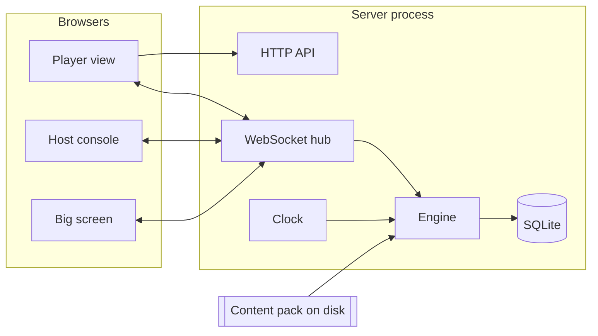

# Lab 02 game: engineering spec

This document says how the Lab 02 game is built. It covers the architecture, the content
format, the game rules as the engine runs them, the server, the player API, the screens, the art,
the tests, the deployment and the order of the build.

**Status.** Version 1.8. Phase 2 is now played on a canvas (Step 7, section 16): the player
builds a map on a grid and validates it, and the slot board of version 1.1 is gone. Version 1.4
added what the screen says to guide the player: a tour of each phase, a help panel, the reason
beside Validate, a sentence for every refusal, and the pack's `line_rules` and `required`.
Version 1.5 adds two rules of scoring: in Phase 1 the investigations a player did not start earn
a small part of the score (`scoring.economy`), and in Phase 2 a pool of people may rush in place
of refusing a map that asks too many minutes of it (`over: rush`). Version 1.6 adds three more
to the scoring of a map: a worker may know a fact without a line (`knows`), a tool may prepare a
source for the worker behind it (`prepares`), and a validation of a map whose people rush also
says what the map would reach with the time (`unhurried`). Version 1.7 frees the lines: a line
between two tiles may run in any direction and only a loop is refused, tiles are scored in the
order of the handoffs, and a tool that prepares turns a source into another kind of effort for
the worker behind it. Version 1.8 lets a line leave and enter a tile on any of its four sides,
scores tools that stand in a row, sizes the cells of the grid to their tiles, and runs a session
of one health system without a ranking of health systems. The
foundation, Phase 1 and Phase 2 are specified in full. Phase 3 is specified as far as its content
format fixes it, and its screens are outlined. Section 16 lists what later steps add.

**This file is public and the game content is not.** The scenarios, the answer keys and the
tuned numbers live in a private content pack that never enters this repository. Nothing here
quotes that pack. Every example comes from the demo pack (section 5.7), which is set in a
library and shares nothing with the real scenarios.

Words used with a fixed meaning:

| Word | Meaning |
| --- | --- |
| Session | One run of the game with one room of players |
| Health system | One of the worlds a session holds. Every player belongs to one |
| Practice | What one player directs. A player and a practice are the same thing in the code |
| Host | An instructor with the host passcode |
| Big screen | The projector view |
| Phase | Planning, Development or Maintaining |
| Stage | One step of the session's timeline (section 6.3). A phase spans several stages |
| Game time | The session clock, in milliseconds. It stops when the host pauses |
| Pack | A folder of content files in the format of section 5 |
| Rung | One of the five levels of the automation ladder, from no software to an agentic system |
| Class | One of the answers a player can give for a problem in Phase 1: not a real problem, real without AI, real with one AI model, real with an agentic system. A class covers the rungs listed for it in `game.yaml` |
| Deck | The one set of slides of a session, in sections, shown on the big screen and driven from the host console (section 6.13) |
| Controller | The one host console that may change a session at a given moment (section 7.10) |
| Extra | A person of a health system who has no interview and no letter, and who walks, talks and answers clicks like everyone else |

---

## 1. The game in mechanics

A session holds up to 150 players, each on a laptop or a phone. A player joins with a link,
names a practice and is assigned to one of the health systems of the pack. The event pack has
two. The session then moves through three
phases. Each is played by everyone at once against a shared timer and is worth up to 1000 points.

1. **Planning.** The player sees a list of candidate problems and investigates the practice.
   An investigation holds part of the player's bandwidth for some seconds and then unlocks one
   evidence tile. Several can run at once while bandwidth is free, so time is the limit. The
   player sorts every problem into a class: not a real problem here, real and no AI needed,
   real and one AI model is enough, or real and in need of an agentic system. The player is
   told how many problems each class holds, in a full pack two, two, two and one, and no
   class takes more.
2. **Development.** The player builds a map on a grid for one problem: sources of facts on the
   left, one result on the right, and workers between them (AI workers, fixed rules, people)
   joined by lines. Actions cost money, developers and time, and unlock more items or bring an
   insight. A validation returns the accuracy of the map, one case it missed and sometimes a
   note. The accuracy of the submitted map is the whole score of the phase.
3. **Maintaining.** Phase 2 played on, over a year in periods. One validated map is deployed.
   Every round ends with a report on the next period: how many results were right, how often
   the system ran at all, and what it cost. Events change the year. The player repairs, looks
   closer, builds and validates other maps, and deploys the one to run next. The score is the
   mean of the periods less everything spent.

State resets between Phases 1 and 2. From Phase 2 into Phase 3 a player keeps the submitted map,
the money left and what was unlocked. A live leaderboard runs throughout.
After each phase the players see what the right answers were.

The presenter's slides are part of the game. One deck serves the whole session. The big screen
shows it, the host console drives it, and between the phases every player's screen follows it.

---

## 2. Principles

1. **The server owns all state.** A browser shows what the server sends and asks for changes.
   It never decides an outcome.
2. **The engine is pure.** Game logic is a library with no clock, no network, no storage and no
   randomness. The same state and the same commands always give the same result.
3. **Content is data.** A new scenario, number or text needs no code change. Code never names a
   content id.
4. **Keys stay on the server.** A browser receives only what section 9 allows, built field by
   field from a whitelist.
5. **Nothing is lost.** A refresh, a dropped connection or a server restart returns every
   player to where they were.
6. **Small payloads.** Static content travels once per phase over HTTP. The live connection
   carries small views. Each browser animates its own scene.
7. **One API.** The browser, the scripted bots, the load test and the LLM agent players all use
   the player API of section 8.
8. **All waits are in game time.** A time scale speeds up tests and changes nothing else.
   **Nobody just waits.** No wait blocks the screen, waits are short, and while something runs
   the player can read, decide and start other work. This holds in every phase.
9. **Laptop first, phone must work.** Every action can be done by tapping. Nothing needs a drag.
10. **Develop on the Mac.** Nothing is built or tested on a server. `scripts/deploy.sh` ships a
    finished build.

---

## 3. Architecture



One Node process serves everything. It loads one pack at start, keeps every session in memory,
and writes commands and snapshots to SQLite. A reverse proxy in front of it terminates TLS.

**Packages and what each may import**

| Package | Holds | May import |
| --- | --- | --- |
| `content-schema` | Schemas of the pack files, the loader, the validation | nothing of ours |
| `protocol` | Wire messages, view types and their strict schemas, error codes, the reference connection class | nothing of ours |
| `engine` | State, commands, time, scoring, leaderboards, and the projection from pack to public views | `content-schema`, `protocol` |
| `server` | HTTP, WebSockets, the clock, persistence, auth, logs | all three |
| `client` | The React application for players, hosts and the big screen, and the scene | `protocol` only |

The client never imports `content-schema` or `engine`. A lint rule enforces this. The types
that describe a pack with its keys therefore cannot reach client code.

**Data flow of one player action**

1. The browser sends a command with a client id (`cid`).
2. The server checks the connection, the rate limit and the shape of the message.
3. The server reads the clock, calls `advance(state, now)`, then `apply(state, command, now)`.
4. An accepted command is written to the log in the same turn. A refused one is not.
5. The server sends an `ack`, then the new view to every player whose view changed.

---

## 4. Stack and layout

| Area | Choice |
| --- | --- |
| Runtime | Node 22, on the Mac and on the server |
| Language | TypeScript 6.0, strict mode, ES modules. Not 7.0: typescript-eslint supports TypeScript below 6.1 (Step 3) |
| Workspace | npm workspaces. No other package manager |
| Schemas | Zod. YAML parsed with the `yaml` package |
| HTTP and WebSocket | Fastify, with `ws` for the sockets |
| Storage | SQLite through the built-in `node:sqlite` module, WAL mode. It runs without a flag on Node 22 and prints an experimental warning. If Step 3 finds a problem on the server, `better-sqlite3` replaces it behind the same small storage interface |
| Client | React with Vite. Zustand for state. Plain CSS with custom properties |
| Scene | PixiJS 8, one canvas |
| Tests | Vitest for unit and integration tests. Playwright for browser tests, on the Mac only, in the Chrome installed on the Mac so no browser is downloaded |
| Server bundle | esbuild, one file, so the server needs no `npm install` |

Use the latest stable release of each library at Step 3 and commit the lockfile.

```
game/
  CLAUDE.md                 rules for build sessions
  README.md                 how to run the demo on a laptop
  package.json              workspaces and the scripts of section 12
  docs/ENGINEERING_SPEC.md  this file
  packages/
    content-schema/
    protocol/
    engine/
    server/
    client/
  content-demo/             the demo pack
  scripts/                  deploy.sh, provision.sh, simulate, loadtest, parity, check-no-private
```

---

## 5. Content pack

### 5.1 Layout

The server reads one pack from the folder in `CONTENT_DIR`. The default is `content-demo`.

```
game.yaml                 global rules and numbers
characters.yaml           the cast
systems/<id>-<slug>/
  system.yaml             premise, practice profile, calibration anchors
  problems.yaml           Phase 1 candidate problems
  insights.yaml           Phase 1 investigations and tiles
  build.yaml              the canvas of Phases 2 and 3: grid, sources, workers, models, places
                          to run, prompts, actions, cases, notes, the reference map
  maintain.yaml           Phase 3 start meters, actions, events
  story.yaml              briefs, letters, dialogue, announcements
teaching/
  deck.yaml               the one slide deck of the session, in sections
  report-card.yaml        rules and text of the personal report card
art/                      optional images that belong to the pack (section 11.4)
  room/                   the room of the practice and its layout
  slides/                 images that slides name
```

A pack may be partial. The loader requires `game.yaml`, `characters.yaml` and, for each health
system, `system.yaml`. A phase can be opened only when its files exist for every health system.
The host console shows which phases a pack can run. This lets a pack grow one phase at a time.

### 5.2 Conventions

- YAML, UTF-8. Ids are lowercase with hyphens and unique in the pack. Items inside a system
  carry the system id as a prefix.
- Text is plain. No Markdown and no HTML. A line break is `\n`. The client renders text as text.
- **Scores and meters** run from 0 to 100 and higher is better, for all four metrics. A high
  cost score means a cheap system. **Cost units and complexity points** are raw amounts on
  components and rules, and higher is worse.
- Every wait is in seconds of game time.

### 5.3 Public, key and mechanics

Every field of a pack belongs to one of three classes.

| Class | Where | Reaches a browser |
| --- | --- | --- |
| Public | Under a `public` field, plus the few fields listed in section 9.2 | When its trigger occurs |
| Key | Under a `key` field | Never, except the fields that a reveal sends (section 9.2) |
| Mechanics | Everything else | Never as written. Only computed results leave the server |

The projection code builds every outgoing object field by field. A field that nobody listed
cannot leak by being forgotten.

### 5.4 Loading and validation

The loader parses the files, validates them and returns one frozen `Pack` object with a content
hash. The object keeps the field names of the files, so the listings of section 5.5 describe
both. Validation has three layers.

1. **Shape.** Types, enums and required fields. It is strict wherever a typo would change a
   result: inside `public`, options, costs, effects, conditions and events, an unknown field is
   an error. Elsewhere an unknown field gives a warning with its path, and the server starts.
2. **References.** Every id that a file mentions exists: characters, problems, monitors, events,
   source ids, and every item, fact, pool, action and case of a build file (section 5.5).
3. **Counts from `game.yaml`.** The number of problems and investigations match what
   `game.yaml` states. The class of every problem exists, agrees with `real` and `tier`, and
   the number of problems in each class equals `class_mix` (section 5.5). Every investigation uses a bandwidth level that exists, with the seconds
   of that level, and one that its method allows. The work of all investigations of a system
   (bandwidth times seconds, summed) lies inside `total_work`.

A `key` block is read loosely. The loader types the fields that the engine or a reveal needs,
listed in section 5.5, and carries any other field without reading it. A private pack holds
more authoring fields than this document lists. A private checker, kept with that pack,
enforces the design rules: how hard the puzzle is, how the evidence fits together, how the
numbers balance. The public loader does not know those rules.

A setting that has one implemented value is validated to hold that value. For example
`join.assignment` must be `balanced`, `phases.planning.live_leaderboard.metric` must be
`progress`, and once `phases.development.board` is `canvas`, the submission rules and the live
column of Phase 2 must hold their one value each. A pack cannot ask for behavior that does not
exist.

**A pack on its way to the canvas.** A `game.yaml` that still carries the fields of the slot board
of version 1.1 (`pilot`, `offers`, `slots`, the four sub-scores) loads, with a warning for each,
so Phase 1 plays while the content catches up. Phase 2 can open only when
`phases.development.board` is `canvas` and every health system has a `build.yaml`. A build file
that exists while the board is not `canvas` gives a warning and is still checked, and the lines
of dialogue of Phase 2 are checked only once a build file exists.

`npm run check:content` loads the pack in `CONTENT_DIR` and prints every error and warning.

The loader can load a subset of the health systems (`SYSTEMS`, section 7.9). A play check uses it
while the private pack holds only some systems. The other folders still count toward the hash.
A field named `source` is accepted anywhere, because every scored item cites one.

### 5.5 Schema reference

The listings show the fields the code reads. `?` marks an optional field. `Text` is a plain
string. `SourceIds` is a list of ids from the `sources` registry of `game.yaml`.

**`game.yaml`**

```ts
type Game = {
  version: number
  game: { title: Text | null; phase_order: PhaseId[]; health_systems: SystemId[] }
  join: {
    assignment: 'balanced'; tie_order: SystemId[]
    choose_system_in_modes?: Mode[]      // session modes in which a player may pick the system (6.4)
    practice_name: { min_chars: number; max_chars: number; unique_per_session: true;
                     filter_profanity: boolean; host_can_rename: boolean; host_can_remove: boolean }
    reconnect: 'token'
    late_join: { open_until: { phase: PhaseId; round?: number }; missed_phase_points: 0;
                 mid_phase: 'full_budget_remaining_clock' }   // round: the last round of Phase 3 to join in
  }
  clock: { time_scale_default: number; warnings_seconds_left: number[]; idle_seconds?: number;
           auto_submit_at_zero: true; pause_freezes: 'all' }
  run_of_show: { start: number; end: number; segment: Segment; driver: string }[]   // minutes
  story_time?: {                         // display strings only, see below
    planning?: { span: Text; investigation_stands_for?: Record<number, Text> }   // by bandwidth level
    development?: { span: Text }                   // an action carries its own story time
    maintaining?: { span: Text; tick_stands_for?: Text }
  }
  ladder: { rung: 1|2|3|4|5; id: string; label: Text; fits_when: Text; example: Text }[]
  scoring: {
    phase_max_points: number
    normalization: { floor_points: number; max_points: number }
    four_metric_score: { weights: Record<Metric, number> }
    score_bands: { id: string; min: number; max: number
                   label?: Text }[]       // the name of the band that a player reads (6.8)
  }
  phases: { planning: PlanningRules; development: DevelopmentRules; maintaining: MaintainingRules }
  leaderboards: {
    columns: ['overall', ...PhaseId[]]; refresh_seconds: number; big_screen_rows: number
    tie_breaks: Record<'overall' | PhaseId, string[]>
    winners: { overall_top: number; per_system_top: number; top_system: number }
    projector?: {                        // what "Follow the game" shows while a phase is played (6.13)
      feed_rows: number                  // lines of room activity on the screen
      cards: number                      // how many practices the loop looks at, one per round
      programme: { show: 'activity' | 'phase_board' | 'player'; seconds: number }[]
    }
  }
  text_limits?: Record<string, number>   // words. Over the limit gives a warning. The loader
                                         // knows banter_line, click_line, slide_title and
                                         // slide_bullet among others
  sources: Record<string, { paper: string; locator: Text; gist: Text }>
  public_source_labels: Record<string, Text>     // by paper
}
type PhaseId = 'planning' | 'development' | 'maintaining'
type Mode = 'test' | 'rehearsal' | 'event'
type Segment = 'join' | 'intro_slides' | 'planning' | 'help_slides_1' | 'development' | 'help_slides_2'
             | 'maintaining' | 'help_slides_3' | 'reflection' | 'winners'   // each maps to stages (6.3)
type Metric = 'validity' | 'reliability' | 'cost' | 'complexity'

type PlanningRules = {
  label: Text; play_seconds: number; reveal_seconds: number
  candidates: number                                       // problems per health system
  classes: PlanningClass[]                                 // the answers a player can give
  class_order: ClassId[]                                   // the spectrum, every class once
  class_mix: Record<ClassId, number>                       // problems per class, in every system
  flagship_class: ClassId                                  // the flagship in this class earns the bonus
  show_class_mix: true                                     // the screen states the mix and counts each class
  investigations: { per_system: number
                    story?: number                          // read by the private checker only
                    bandwidth: number                       // blocks a player can commit at once
                    levels: { bandwidth: number; seconds: number }[]
                    method_levels: Record<Method, number[]>  // bandwidth levels a method may use
                    total_work: { min: number; max: number } // sum of bandwidth x seconds
                    reachable_work: number                  // read by the private checker only
                    parallel: true; cancel: 'none' }
  submission?: { letter_empty_below?: number }             // fewer problems sorted than this gets
                                                           // the `empty` line of the letter (6.11)
  live_leaderboard: { metric: 'progress'; label: Text }
  scoring: { classify: { exact: number; adjacent: number }
             flagship: { bonus: number }
             economy?: { max: number } }                    // the part for investigations not started
}
type PlanningClass = {
  id: ClassId; label: Text; short: Text      // `short` is the two-word name on sections and buttons
  fits_when: Text
  rungs: (1|2|3|4|5)[]                       // the ladder rungs the class covers
  capacity: number                           // the most problems the class may hold. Equals its class_mix
}
type DevelopmentRules = {
  label: Text; play_seconds: number; reveal_seconds: number
  board: 'canvas'                                          // required once a build.yaml exists
  action_groups: { id: string; label: Text }[]             // learn, build, buy, negotiate
  show_running?: boolean                                   // show what the draft would take to run. Default true
  money_unit?: Text                                        // written after a sum of money, such as "k$"
  submission?: { default: 'best_validation'                // by accuracy, the earliest wins a tie
                 player_may_choose: 'any_own_validation'
                 none_at_the_end: 'validate_the_draft_if_ready' }
  live_leaderboard: { metric?: 'best_validation_accuracy'; label: Text }
  scoring?: unknown; carries_over?: unknown                // read by the private checker only
}
type MaintainingRules = {
  label: Text; reveal_seconds: number
  rounds: number; round_seconds: number           // the play time is rounds × round_seconds
  play_seconds?: number                           // when given, it must equal that product
  action_groups?: { id: string; label: Text }[]   // shown after the groups of development
  live_leaderboard: { metric?: 'year_score_so_far'; label: Text }
}
```

The classes of Phase 1 follow four rules that the loader checks. Exactly one class has empty
`rungs`. It is the class of the problems that are not real, and `class_order` lists it first.
Every rung of the ladder belongs to exactly one class. `class_mix` names every class and adds up
to `candidates`. Every class has a `capacity`, the most problems a player may put in it, and it equals the
class's share of `class_mix`, so the capacities add up to the number of problems.
`flagship_class` is the class of the flagship problem. `class_order` lists it last, and its
capacity is one.

A band of `score_bands` may carry a `label`, such as "Strong". It is the only name of a band
that a player ever reads. The `id` is for letters, the report card and the code.

`story_time` says what the play time stands for in the story, for example that an investigation
of bandwidth 2 stands for a week. The client shows these strings next to the waits. They never affect
a score.

**`characters.yaml`**

```ts
type Character = {
  id: string; system: SystemId | 'all'
  public: { name: Text; role: Text; portrait: string }      // portrait is an art key
  extra?: boolean                 // true for a person with no interview and no letter
  click_lines?: Text[]            // what the person says when clicked. Three or more
  look?: { hair: string; hair_style: 'short' | 'long' | 'bald' | 'covered'
           skin: string; top: string; detail?: string }     // the input of the sprite (11.4)
}
```

`extra`, `click_lines` and `look` sit beside `public`. None of them is a key, and all three
travel with the cast at join. The people of a health system are the characters of
`system.public.cast` in that order, followed by every character of that system with
`extra: true` that the list does not name, in file order. A pack may list its extras in `cast`
or leave them out. The client receives all of them as one list and shows them the same way, so
nothing on a screen tells an extra from the rest. `look` holds free words. The sprite builder of
the client turns them into the person's own pixel character (section 11.4), and a word it does
not know falls back to a pick by a hash of the id. A click line is within
`text_limits.click_line` words. A character with fewer than three click lines gives a warning.

**`system.yaml`**

```ts
type System = {
  id: SystemId; slug: string
  public: { name: Text; setting: Text; premise: Text
            practice_profile: { label: Text; value: Text | number }[]
            baseline: { label: Text; value: Text | number; unit?: Text }[]
            cast: CharacterId[] }
  key: { flagship_problem: ProblemId; summary?: Text }
  calibration: Record<PhaseId, { zero: number | null; floor: number | null; ceiling: number | null
                                  provisional: boolean }>
}
```

**`problems.yaml`** is a list.

```ts
type Problem = {
  id: ProblemId
  public: { title: Text; description: Text }
  key: { real: boolean
         class: ClassId                    // the true answer of Phase 1
         tier: 1|2|3|4|5 | null            // the ladder rung of a real problem, null when not real
         flagship: boolean; rationale: Text
         burden?: { kind: string; size: string; note: Text }
         source?: SourceIds }
}
```

`class` is the id of one of `phases.planning.classes`. A problem that is not real has the class
with empty `rungs` and `tier: null`. A real problem has a `tier`, and its class is the one whose
`rungs` hold that tier. The number of problems in each class equals `class_mix`. Exactly one
problem has `flagship: true`. It sits in `flagship_class`, and it equals
`system.key.flagship_problem`. The rationale is read by the player at the reveal, so it says
what solves the problem and why the class below would fall short.

**`insights.yaml`** is a list.

```ts
type Investigation = {
  id: InvestigationId
  method: 'interview' | 'data_pull' | 'audit' | 'observation'
  character: CharacterId | null          // required for an interview
  public: { title: Text; teaser: Text }
  bandwidth: number; seconds: number      // blocks held while it runs, and for how long
  tile: Tile
  key?: object
}
type Tile =
  | { type: 'stat';  headline: Text; body: Text
      data: { value: Text | number; unit?: Text; label: Text; comparison?: Text } }
  | { type: 'chart'; headline: Text; body: Text
      data: { kind: 'bar' | 'line'; x_label: Text; y_label: Text
              series: { name: Text; points: [Text | number, number][] }[]; note?: Text } }
  | { type: 'quote'; headline: Text; body: Text
      data: { speaker: CharacterId; text: Text } }           // bubbles split on "\n"
  | { type: 'audit'; headline: Text; body: Text
      data: { sample_size: number; findings: { label: Text; count: number }[]; note?: Text } }
```

The `tile` is mechanics until the investigation completes. Then it is sent to that player.
Only an interview fixes its tile type (`quote`). Every other method may give any tile type. An
`audit` tile also serves as the tally of an observation, and its findings may then count
different things, each with its own denominator in the label.

**`build.yaml`** is the canvas of Phases 2 and 3, one per health system (section 6.6). Every
field under `key` and every number of quality stays on the server.

```ts
type Build = {
  problem: ProblemId                        // the flagship problem this map solves
  grid: { cols: number; rows: number       // cells between the sources and the result, at most 8 by 8
          columns?: { label: Text; hint: Text }[] }   // one per column: the stage of the work it
                                            // stands for, and one sentence on it. Names only.
                                            // Without it nothing stands above the columns
  efforts?: { id: string; key?: object }[]  // the kinds of effort a source may name. Never sent
  toolbox_groups?: { id: string; label: Text }[]   // the headings of the toolbox, in this order
  budget: { money: number; developers: number }
  validate: { runs: number; seconds: number }
  pools?: { id: PoolId; public: { label: Text }; max: number      // minutes per case the people can give
            over?: 'refuse' | 'rush' }[]    // a map that asks more: it cannot be validated (the
                                            // default), or these people rush (section 6.6)
  handoff: { keep: number }                 // what survives one line between two tiles, 0 to 1
  quality_cap?: number                      // a prompt cannot lift an AI worker above this. Default 1
  facts: { id: FactId
           miss: { missing: Text            // shown with a missed case: nothing on the map reaches it
                   weak: Text }             // the map reaches it and loses it too often
           key?: object }[]
  sources: { id: SourceId; public: { label: Text; description: Text; icon: string }
             gives: Record<FactId, number>  // trust, 0 to 1
             effort: string                 // how much digging a fact takes here: one of `efforts`,
                                            // or without that list easy, hard or another kind
                                            // that every worker has numbers for
             private_data: boolean          // it holds data that must be protected
             distracts?: number             // below 1, it lowers the judgment of an AI worker that reads it
             run?: number                   // money a month for every line from it
             key?: object }[]
  result: { id: string; public: { label: Text; description: Text } }
  workers: Worker[]
  models?: { id: ModelId; public: Part; run?: number             // money a month per call unit
             runs_on: ComputeId[]; key?: object }[]
  compute?: { id: ComputeId; public: Part; protects_private_data: boolean
              price_factor?: number         // multiplies the price of every model that runs here
              run_fixed?: number            // money a month while any tile runs here
              key?: object }[]
  prompts?: { id: PromptId                  // three or four formats. The first is the default
              public: { label: Text; description: Text
                        short?: Text        // the name on a tile, where the label would be cut
                        sample?: Text       // the opening of such a prompt, up to 35 words
                        samples?: { label: Text; text: Text }[] }   // several openings, each
                                            // under a label, shown in place of `sample`
              fetch?: number; decide?: number   // multiply the worker's fetching and judgment
              by_worker?: Record<WorkerId, { fetch?: number; decide?: number }>   // other numbers for one kind
              key?: object }[]
  actions?: { id: ActionId; group: string   // an id of phases.development.action_groups
              public: { title: Text; teaser: Text }
              money: number                 // paid when it starts
              developers: number            // held while it runs. May be 0
              seconds: number
              requires?: ActionId[]         // actions that must be done first
              unlocks?: ItemId[]            // an item that no action unlocks is open from the start
              insight?: Tile | null         // a tile in the format of insights.yaml
              story_time?: Text; key?: object }[]
  cases: { id: CaseId; weight: number
           public: { title: Text; text: Text }   // shown when the case is missed, and at the reveal
           needs: FactId[]; difficulty: 'plain' | 'hard'
           decision_miss: Text              // shown when the facts arrived and the judgment failed
           key?: object }[]
  notes?: { id: 'rushed' | 'private_data' | 'overloaded' | 'distracting' | 'prompt' | 'stray'; text: Text }[]   // in order of priority
  line_rules?: { from: SourceId | WorkerId    // a line the practice cannot draw (`refuse`), or
                 to: WorkerId                 // one that comes with advice. Its text reaches a
                 refuse: boolean; text: Text }[]  // player only with a matching line of theirs
  required?: { workers: WorkerId[]; text: Text }[]  // kinds of worker a map must have on the way
                                            // to the result; the text is said while it fails
  key: { reference: { map: PackMap; needs_actions: ActionId[]; public_summary: Text; rationale?: Text }
         traps?: { id: string; kind: 'overbuilt' | 'underbuilt' | 'shortcut'; map: PackMap }[] }
}
type Part = { label: Text; short: Text; description: Text; cost_line?: Text }
type Worker = {
  id: WorkerId; kind: 'ai' | 'fixed' | 'person'
  group?: string                            // an id of `toolbox_groups`, required when there are any
  public: { label: Text; short: Text        // short: the name on a tile, a chip, a part box
            task?: Text                     // a few words on the job it does, shown in the toolbox
            description: Text; icon: string; cost_line?: Text }
  needs_model: boolean                      // only an AI worker carries a model, a place to run and a prompt
  by_model?: Record<ModelId, Quality>       // with needs_model: one entry per model it may carry
  quality?: Quality                         // without needs_model
  load?: { free: number; factor: number }   // lines in beyond `free` each multiply the judgment by `factor`
  calls?: number                            // model calls per case, multiplies the price of the model. Default 1
  run?: number; complexity?: number
  pool?: PoolId                             // required for a person
  minutes?: { decide: number; check: number; per_line: Record<Effort, number> }   // required for a person
  prepares?: Record<Effort, { as: Effort; load?: number }>   // a `fixed` worker only: it prepares its
                                            // sources of these kinds of effort for the worker behind it
}
type Quality = { fetch: Record<Effort, number>; decide: { plain: number; hard: number }; catch?: number
                 knows?: Record<FactId, number> }   // what the worker holds of a fact without a line
type PackMap = { tiles: { id: string; kind: WorkerId; col: number; row: number
                          model?: ModelId | null; runs_on?: ComputeId | null; prompt?: PromptId | null }[]
                 lines: { from: string; to: string
                          from_side?: Side; to_side?: Side }[] }   // optional: where the line is drawn, never a score
type Side = 'top' | 'right' | 'bottom' | 'left'
```

The items that can be placed, chosen or unlocked (sources, workers, models, computes, prompts)
and the result share one namespace inside a build file, because `unlocks` names any of them. The
ids of a build file need not carry the system prefix of section 5.2: maps name them all the time.
A pack names an icon by one of these words, which the client draws: for a source `form`,
`catalog`, `mail`, `truck`, `chat`, `counter`, `file`, `image` (a picture or a scan), `ask` (a
person to ask), `search` (a search across records), `guide` (a guideline) and `web`; for a worker
`agent`, `step`, `rule`, `model`, `person`, `clerk`, `nurse` and `doctor`. Any other word gets the
icon of the worker's kind, or of a file (section 11.4).

The loader checks of a build file, beside the shape. Every id resolves: the facts a source gives
and a case needs, the models of `by_model`, the computes of `runs_on`, the workers of
`by_worker`, the pool of a person, the group of an action, `requires`, `unlocks` and
`needs_actions`. An id is used once in its namespace, and `requires` forms no loop. When
`efforts` is there, every source names one of them, and every worker has a `fetch` number, and
every person `per_line` minutes, for each of them; without it, the same holds for every effort
that a source names. When `toolbox_groups` is there, every worker has one of them as `group`.
`grid.columns`, when there, has one entry per column. A prompt has `sample` or `samples`. A line
rule starts at a source or a kind of worker and ends at a kind of worker; a second rule for the
same pair is a warning, because the first counts. Every kind of a `required` entry exists. A case needs
no fact that no source gives. A worker with `needs_model` is of kind `ai` and has `by_model`; one
without has `quality`. A person has a pool and minutes, and nobody else has either. An action
unlocks something or brings an insight, and needs no more developers than the practice has. The
reference map is accepted and ready (section 6.6) once its `needs_actions`, and the actions they
require, are done, and those actions cost no more than `budget.money`. A trap map that is not
accepted, a missing note, and a number of prompts other than three or four are warnings.

The map rules that `set_map` applies live in `packages/content-schema/src/canvas.ts`, so the
loader can check the reference map with them. The scoring is `evaluate` in
`packages/engine/src/canvas.ts`.

**`maintain.yaml`**: Phase 3 on the canvas (section 6.7). One file per health system, beside
`build.yaml`. Every number, every event and every `key` stays on the server.

```ts
type Maintain = {
  periods: { id: string; label: Text; short: Text }[]     // rounds + 1, in order
  grants?: { round: number; money: number }[]             // round 1 is the start of the phase
  validate: { runs: number; seconds: number }             // the validations of Phase 3, a count of its own
  baseline: { public: { label: Text }; map: PackMap }     // a practice with no deployed map
  score: { cost_per_point: number; pool: PoolId; extra_look?: number; rushed?: number }
  reliability: {
    workers?: Record<WorkerId, Unit>; default_worker?: Unit   // the risk of every placed tile
    sources?: Record<SourceId, Unit>                          // of every line from a source
    handoff?: Unit                                            // of every line between two tiles
    compute?: Record<ComputeId, Unit>                         // of every place in use, once
    connectors?: Record<WorkerId, Unit>   // a line into a tile of this kind carries this share of its risk
    new_map?: { risk: Unit; spared_by?: ActionId[] }          // a map that did not run in the period before
    hardening?: { action: ActionId; workers?: WorkerId[]; factor: number }[]
    interruption?: number                 // the share of a period that one interruption stands for (0.025)
  }
  lenses?: Partial<Record<Lens, ActionId[]>>                  // actions that make reports and validations say more
  workers?: Worker[]                      // tools that exist from Phase 3 on. As in build.yaml
  line_rules?: LineRule[]
  actions?: (Action & { repeat?: boolean; run?: number })[]   // run: money a month once it finished
  world?: Patch[]                         // hold in every period: the cases of a real year against the test set
  events?: YearEvent[]
  news?: { id: string; round: number; kind: 'letter' | 'announcement'
           from: CharacterId; title?: Text; text: Text }[]
  alarm_from?: CharacterId                // who says the alarm of an event
  incidents?: { workers?: Record<WorkerId, Text>; default_worker?: Text; sources?: Record<SourceId, Text>
                handoff?: Text; compute?: Record<ComputeId, Text>; new_map?: Text }
  report: {
    validity: { min: number; text: Text }[]        // the first band whose min is reached, highest first
    reliability: { min: number; text: Text }[]
    gap?: Text; gap_points?: number                // when the validity lies this far under the test set (2)
    radiologists?: { content: Text; extra_look: Text; rushed: Text }   // what the people of `score.pool` say
    steady?: Text; no_map?: Text
  }
  key?: { guide?: Record<WorkerId | ActionId, { best: Text; wrong: Text }>; strategy?: Text }
}
type Lens = 'fresh_test_set' | 'dry_run' | 'incident_log' | 'case_mix' | 'drift_alarm'
type YearEvent = {
  id: EventId
  from: number; to?: number               // the periods it acts in. `to` defaults to the last
  needs?: { workers?: WorkerId[]; sources?: SourceId[]; compute?: ComputeId[]
            flag?: 'private_data' | 'overloaded' | 'distracting' | 'prompt' | 'stray' | 'rushed' }
  patches?: Patch[]                       // validity and prices while it acts
  risks?: { sources?: SourceId[]; line?: Unit; behind_connector?: Unit
            workers?: WorkerId[]; tile?: Unit; all?: Unit }[]
  fine?: number                           // money counted as spent in every period it acts
  repaired_by?: ActionId[]
  symptom?: Text                          // what a report says when this is the worst change
  cause?: { lens: Lens; text: Text }      // what the report adds for a player who holds that lens
  alarm?: Text                            // said at once when an action of that lens finishes while it acts
  reveal?: { title: Text; text: Text }    // the lesson, at the reveal
  key?: { teaches?: Text; coach?: { holds: Text; say: Text } }   // coach: for the host's view of a player
}
type Patch =
  | { op: 'weights'; cases: Record<CaseId, number> }
  | { op: 'fetch_as'; effort: Effort; as: Effort; factor: number }
  | { op: 'worker'; worker: WorkerId; fetch?: Record<Effort | '*', number>
      decide?: Record<'plain' | 'hard' | '*', number>; catch?: number }
  | { op: 'knows'; fact: FactId; factor: number; workers: WorkerId[] }
  | { op: 'gives'; source: SourceId; fact: FactId; factor: number; unless_through?: WorkerId }
  | { op: 'compute'; compute: ComputeId; run_fixed?: number; price_factor?: number }
  | { op: 'model'; model: ModelId; run: number }
```

And in `build.yaml`, `key.references` lists every reference map: `{ id, public: { label,
summary }, map, needs_actions }`. They are shown at the reveal of Phase 2 and offered in Phase 3,
and the first is the map of `key.reference`. Without the list, `key.reference` is the only one.

The loader checks of a `maintain.yaml`, beside the shape (`checkMaintain` in
`packages/content-schema/src/maintain.ts`). It has `rounds` + 1 periods. Every id resolves: the
pool of `score`, every worker, source, place and action that `reliability`, `lenses`, a patch,
an event or the guide names, every character of a news item and of `alarm_from`. A grant, a
news item and an event lie inside the rounds and the periods. The map of `baseline` and every
reference map are accepted and ready on the board of Phase 3. A worker or an action that Phase 3
adds carries the prefix of its health system, is not in `build.yaml` already, and its group is
one of the groups of development or of `phases.maintaining.action_groups`. A new worker has a
`fetch` number for every kind of effort. The bands of the report reach down to 0 and are listed
from the highest down. An event with an alarm needs `alarm_from` and a cause. Warnings: an
event that changes nothing or has no symptom or no reveal text, a cause whose lens no action
holds, a repair by an action that cannot be done again, a part that can fail and has no
incident sentence, and a missing sentence of the report.

**`story.yaml`**. Nothing in this file affects a score.

```ts
type Story = {
  briefs?: Partial<Record<PhaseId, { from: CharacterId; title: Text; text: Text
                                     opening?: { hit: Text; missed: Text } }>>   // Phase 2 only
  letters?: Partial<Record<'planning_reveal' | 'development_reveal' | 'maintaining_reveal',
            { from: CharacterId; always: Text; variants: Record<BandId, Text> }>>
  dialogue?: { id: string; speaker: CharacterId; text: Text
               trigger: { phase: PhaseId; on: string } }[]
     // on: start | idle | insight:<id> | run_result | trace:<case id> | month:<n> | reveal
     // month:<n> fires in Phase 3 with the report of period n
     // insight:<id> names an investigation in Phase 1 and an action in Phase 2. run_result fires
     // when a validation lands, trace:<case id> when that case is shown as missed
  banter?: { id: string
             lines: { speaker: CharacterId; text: Text }[] }[]   // two or three lines an exchange
  announcements?: { id: string; phase: PhaseId; offer?: OfferId; at_seconds?: number | null
                    from: CharacterId; text: Text }[]    // no offer exists until Phase 3 names one
}
```

`briefs.development.opening` is a first paragraph of the Phase 2 letter that follows from Phase 1:
`hit` for a player whose Phase 1 board had the flagship problem in the flagship class, `missed`
for a player whose board had not, and neither for a player without a Phase 1 result. The engine
puts it before `text` in the letter the player receives, so the pop-up and the first card of the
insights carry it. Both are public. Each is within `text_limits.phase_brief_opening` words.

`briefs.planning` is the opening letter of Phase 1. It pops up when the phase starts and stays
as the first card of the evidence (section 10.4), so it states the task and explains the
bandwidth. A letter may carry the variant `empty` beside its bands. The planning reveal uses it
for a player who sorted fewer problems than `phases.planning.submission.letter_empty_below`
(section 6.11).

`banter` is small talk between the people of the practice. The scene plays one exchange at a
time (section 10.3). Every speaker is a person of that health system, an exchange has two or
three lines, and a line is within `text_limits.banter_line` words. Banter is flavor. It is sent
with the health system at join, so a pack keeps anything that bears on a score out of it. The
private checker enforces that for the private pack.

**`teaching/deck.yaml`** and **`teaching/report-card.yaml`**

The facts a line of the report card may name under `when` are listed in section 6.12. The demo
pack has a report card file.

```ts
type Deck = { sections: DeckSection[] }
type DeckSection = {
  id: string; title: Text
  stage: 'intro' | 'break.planning' | 'break.development' | 'break.maintaining' | 'reflection'
  slides: Slide[]                 // one or more
}
type Slide = { id: string; title: Text
               layout?: 'bullets' | 'title' | 'cards' | 'figures' | 'closing'   // 'bullets' when absent (10.9)
               subtitle?: Text
               bullets?: Text[]         // none is allowed on a slide that has other parts
               cards?: { title: Text; text?: Text; points?: Text[]   // up to 4 boxes side by side, each with up
                         tag?: Text; tone?: Tone                      // to 4 short points under its text
                         system?: SystemId }[]                        // a box of one health system: it takes that
                                                                      // system's color and shape (10.9)
               people?: { name: Text; role?: Text; photo?: string }[]               // who gives the session
               figures?: { image?: string; title: Text; caption?: Text; tone?: Tone }[]   // up to 3, one row each
               qr?: { show: 'join' | 'link'; url?: string; label?: Text }           // 'join' is the session's own link
               references?: Text[]      // lines to read later
               image?: string           // every picture is a path under art/, ending in .png or .webp
               live_stat?: RoomStatId | RoomStatId[]   // one room statistic, or two (6.10)
               notes?: Text             // for the host console only
               placeholder?: boolean }  // a slide whose text is still to be written
type Tone = 'go' | 'sky' | 'sun' | 'lav' | 'rose'   // a color of the design system. Boxes take them in turn when none is named

type ReportCard = {
  sections: { id: string; title: Text
              lines: { when: Record<string, string | number | boolean>; text: Text
                       source?: SourceIds }[] }[]
  closing: Record<BandId, Text>
  links?: { label: Text; url: string }[]
}
```

The deck is one list of slides for the whole session. It replaces `help-slides.yaml` and the
separate intro deck of earlier plans. The order of the slides is the order of the sections and,
inside a section, of its slides. `stage` is the id of the engine stage (section 6.3) in which
the deck opens at that section (section 6.13). It is one of the five stages that the run of show
gives to the presenter. A stage has one section at most, and a pack may leave a stage without
one. A slide title is within `text_limits.slide_title` words and a bullet within
`text_limits.slide_bullet`. `placeholder: true` marks a slide that stands in for one still to be
written. The host console counts the placeholders of a pack and shows the number, and an `event`
session can still be opened with them.

The loader checks of this round, beside the ones above. Every banter speaker exists and belongs
to the health system of the file or to `all`. Banter ids, section ids and slide ids are unique in
the pack. A section's `stage` is one of the five stage ids, and no two sections share one. A section
has one slide or more. Every picture of a slide (`image`, a `photo`, the `image` of a figure) is a file under `art/`, and a `live_stat` names a statistic that exists. A slide with the layout `cards` has cards and one with `figures` has figures. The `system` of a box is a health system of the pack. A `qr` that shows `join` carries no `url`: the link is the session's. The word limits are `slide_title` (titles, also of a box), `slide_bullet` (bullets, the subtitle and the points of a box) and `slide_card` (the text of a box and a caption). `letter_empty_below`
lies between 0 and `candidates`. Word limits give warnings, like everywhere.

### 5.6 The content hash

The loader computes a SHA-256 over the parsed pack in a canonical order. A session stores the
hash of the pack it started with. After a restart the server resumes a session only when the
pack on disk has the same hash. Changing content between two sessions is normal. Changing it in
the middle of one is refused.

### 5.7 The demo pack

`content-demo/` lets anyone run the game from this repository. It follows the format above and
is written from scratch for the purpose.

- **Setting.** Two public library networks. The player is the digital services director of one
  branch. No medical wording anywhere.
- **Size.** Two health systems. Per system: 6 candidate problems, 5 investigations, and a canvas
  of 4 by 5 cells with 5 sources (one locked, one that distracts, some without private data), 5
  kinds of worker (an agent, a fixed AI step, a rule, two kinds of person in two pools), 3 models,
  4 places to run (one that does not protect private data, two locked), 4 prompts (one that
  confuses, one with `by_worker`, two locked), 6 actions over the four groups (one with
  `requires`, three with an insight), 5 cases of both difficulties, every note, a reference
  map, an overbuilt and an underbuilt trap, and both letters. Phase 3 is not in the pack yet.
  Short timers, so a full game takes about seven minutes at time scale 1.
- **Coverage.** The pack uses every feature of the format that the build has reached at least
  once: all four investigation methods and all four tile types, an interview; in Phase 2 every
  kind of worker, a locked source, a distracting source, sources with and without private data,
  a model that runs only on GPUs, a place to run that does not protect private data, a prompt
  that confuses, one with `by_worker`, locked prompts, an action in every group, one with
  `requires`, actions with a stat, an audit and a quote as their insight, cases of both
  difficulties, every note, both traps; every dialogue trigger of Phases 1 and 2, letters with
  all bands and the `empty` line, band labels, banter, click lines and a `look` on every person,
  one extra in each system, a deck with a section for every slide stage, a slide with a live
  statistic, a slide with notes and a placeholder slide. The report card comes with Step 9.
- **Phase 1 rules.** Its `game.yaml` has the four classes, a `class_mix` that adds up to its 6
  problems and uses every class (2, 2, 1 and 1), a `capacity` on every class that equals its
  share, and `test` and `rehearsal` in `join.choose_system_in_modes`.
- **Calibration.** Its anchors are estimates marked provisional until `scripts/simulate`
  exists in Step 9. From then on they are measured.
- **Phase 2.** Written from scratch in the library setting: Riverbend builds the system that
  answers requests for books held by partner libraries, Lakeshore the one that writes the monthly
  grant report. The provider is an invented company, Acorn, with a large and a small model,
  beside a free model, Pine. The reference map of each system is one large agent with the goal
  prompt on the four good sources, checked by a person, at 96 percent. Random ready maps with the
  starting items average 11 percent.
- **Phase 3.** Written from scratch in the same setting: the year after each system went live,
  in six periods and five rounds of 30 seconds. Riverbend has every kind of patch and of risk:
  the partners change their mail (a source reads worse until its parser is reworked), the shared
  catalog is upgraded (direct lines break, lines through a records gateway hold), the card
  reader drifts on a new batch of cards (silent, with an alarm for whoever monitors), rented
  GPUs get dearer, the courier changes its timetable format (spared behind the gateway), an
  audit fines a map that sends patron data through the public API, and the partners rewrite the
  terms that a retired cataloguer knew by heart. It adds two tools, eleven actions (five lenses,
  three that may be done again), six news items and three reference maps. Lakeshore has a
  smaller year with a silent model update. Both have a baseline map, incident and report
  sentences, and a line of coaching for a host on most events.
- **Growth.** The pack grows with the build: the global files and Phase 1 in Step 3, the deck,
  the banter, the click lines and the extras in Step 5, Phase 2 in Step 7, Phase 3 and the
  report card in Step 9.
- **Sources.** Its source registry holds two invented entries.

---

## 6. Engine

### 6.1 Shape

```ts
createSession(pack, opts: { code, label, mode }): SessionState
advance(state, pack, now: GameMs): Outcome
apply(state, pack, command: Command, now: GameMs): Outcome & ({ ok: true } | { ok: false; error: ErrorCode })

playerView(state, pack, playerId): PlayerView            // section 8.4
phaseContent(state, pack, playerId, phase): PhaseContent  // section 8.3
hostView(state, pack): HostView
screenView(state, pack): ScreenView

type Outcome = { dirty: PlayerId[] | 'all'; events: EngineEvent[] }
```

- `SessionState` is plain JSON data. No class instances, maps, sets or dates. A snapshot is
  `JSON.stringify(state)`.
- `advance` and `apply` change the state they are given and return what happened. They read no
  clock and use no random numbers. `now` always comes from the caller.
- `advance` is path-independent. Calling it once with a late time gives the same state as
  calling it many times on the way. It processes every timer that is due in order of its due
  time, and by a fixed key when two are due together.
- `dirty` lists the players whose view changed. `events` are things the server announces or
  logs: a stage change, an offer, a dialogue line, a leaderboard beat, a month that ended.
- All code that turns pack data into something a browser may see lives in
  `packages/engine/src/project/`. No other code reads a pack and writes a protocol type.

### 6.2 Time

`GameMs` is an integer count of milliseconds on the session clock. The server maps wall time to
game time (section 7.4). The engine sees only game time, so a pause freezes every timer and a
time scale speeds everything up without any rule changing.

### 6.3 Stages

```
lobby → intro
→ planning.play → planning.reveal → break.planning
→ development.play → development.reveal → break.development
→ maintaining.year → maintaining.reveal → break.maintaining
→ reflection → winners → closed
```

| Stage | Length | Ends |
| --- | --- | --- |
| `planning.play`, `development.play` | `play_seconds` of that phase | By itself at zero, or on `end_now` |
| `maintaining.year` | `rounds` × `round_seconds` | By itself at zero, or on `end_now` |
| Every other stage | Untimed for the engine | On the host command `next` |

The untimed stages show a guide countdown to the host: `reveal_seconds` for a reveal, and the
length from `run_of_show` for the rest. When a play stage ends, the engine submits what each
player has, computes every score of that phase, the leaderboard and the room statistics, and
moves to the reveal.

Host commands: `next`, `pause`, `resume`, `extend` (30, 60 or 300 seconds, added to the current timed
stage; in `maintaining.year` this lengthens the round in progress, section 6.7), `end_now`, `rename_player`,
`remove_player`, `reset_stage`, `restart_game` and `close`. Pause and resume act on the clock,
not on the engine. The commands of the projector and the deck are in section 6.13. Only the
controlling host console may send a command that changes the session (section 7.10).

**Starting again and ending.** These three commands carry `confirm`, the join code of the
session, and are refused with `confirm_mismatch` without it.

- `reset_stage` starts one phase again for everyone and exists only outside `event` mode. The
  phase is the one on stage, or at a break the phase before it; in any other stage the command
  is refused with `wrong_stage`. Every active player loses the result, the work and the story
  items of that phase, the phase opens again and its play stage starts at once with its full
  time. The points of earlier phases stay.
- `restart_game` starts the whole game again in the same session and exists only outside `event`
  mode. Every player stays, with the same id, name, character, health system, token and rejoin
  code. Everything else of the game goes: results, the work of every phase, the inbox and the
  lines said. No phase is open or closed, the stage log starts again, the projector follows the
  game from the first slide, and the stage is `lobby`, where new players may join. A removed
  player stays removed. A closed session is refused with `wrong_stage`.
- `close` ends the session in any stage. The stage becomes `closed`, the clock stops, and from
  then on every player command and every join is refused. The views of the session stay
  readable for as long as the server process holds it (section 7.6).

The session counts how often a phase or the game started again in `run`, which starts at 0. It
is part of every player view (section 8.4), so that a browser knows that what it kept for the
run before is stale.

Three words about stages are used below. A *play stage* is `planning.play`,
`development.play` or `maintaining.year`. A *slide stage* is a stage that
the run of show gives to the presenter: `intro`, `break.planning`, `break.development`,
`break.maintaining` and `reflection`. A section of the deck names one of these five ids. The
interface names `intro` "Intro slides" and never "Starting soon".

**Session modes**

| Mode | Time scale | Provisional anchors | `reset_stage` and `restart_game` |
| --- | --- | --- | --- |
| `test` | Any | Allowed | Yes |
| `rehearsal` | 1 by default | Allowed, with a warning on the host console | Yes |
| `event` | 1 | Refused. The session cannot be created | No |

### 6.4 Joining

- `join` adds a player to the health system with the fewest active players. `join.tie_order`
  breaks a tie. A removed player does not count. With two health systems this sends players to
  A, B, A, B in order of arrival, so the two halves of the room differ by one player at most,
  and the balance repairs itself after the host removes someone.
- **Picking a health system.** `join.choose_system_in_modes` lists the session modes in which a
  player may choose. In a session of such a mode the join request may carry `system`, and the
  player goes there. A request without it is assigned as above, and the players who picked count
  toward the balance. An id that the session does not hold is refused with `unknown_system`. In
  a session of any other mode a `system` in the request is ignored and the player is assigned.
  The choice exists for play checks and rehearsals, where the person testing wants to play one
  side. The event pack lists `test` and `rehearsal`, so nobody picks at the event.
- The practice name is trimmed and checked for length and profanity by the server. A name
  that a practice of the session already has, compared without regard to case, is refused
  with `name_taken`. The engine never makes a second practice by adding a number, because the
  usual reason for a repeated name is a player who lost their browser and wants their practice
  back (section 7.7).
- `join` carries an `avatar`, the character the practice picked on the join page. The ids are
  a fixed list in `packages/protocol`, with at least eight characters. Two practices may pick
  the same one. A missing or unknown id is replaced by one picked from the list by a hash of
  the player id, so a bot can join without choosing. The avatar is display only and never
  enters a score.
- Joining stays open until `join.late_join.open_until`. A player who joins during a play stage
  gets the full budget of that phase and the time that is left. A phase that ended before the
  player joined scores 0. In Phase 3 `open_until.round` names the last round in which a
  player may still join. A player who joins during the year holds, for every period that ended
  before, the report of a practice with no map (section 6.7), and has the budget of the build
  file and the grants so far.

### 6.5 Phase 1: Planning

The player investigates and sorts every candidate problem into a class. The classes come from
`phases.planning.classes`, and `class_order` is the spectrum from "not a real problem" to the
class that asks for the most. Below, the *decoy class* is the class with empty `rungs`, the
*real classes* are the others, and the *flagship class* is `flagship_class`. A class holds at
most `capacity` problems, and the capacities of all classes add up to the number of problems.

**State of a player**

```ts
type PlanningState = {
  done: { id: InvestigationId; atMs: GameMs }[]            // in order of completion
  running: { id: InvestigationId; startedAtMs: GameMs; completesAtMs: GameMs }[]
                                                            // free bandwidth = total - held by these
  picks: Record<ProblemId, ClassId>                         // a problem without an entry is unsorted
  submittedAtMs: GameMs | null
  result: PlanningResult | null                             // set when the stage ends
}
type PlanningResult = {
  graded: { problem: ProblemId; picked: ClassId | null; points: number }[]   // every problem, in pack order
  classify: number; flagship: number; raw: number
}
```

**Commands**

| Command | Accepted when | Effect |
| --- | --- | --- |
| `planning.investigate {id}` | Stage is `planning.play`. Not submitted. The id is neither done nor running. Its bandwidth fits in what is free | The investigation holds its bandwidth and runs for its `seconds`. It cannot be cancelled |
| `planning.set_report {picks}` | Stage is `planning.play`. Not submitted. Every problem id and every class id exists. No class holds more problems than its `capacity` | Replaces the draft. A problem that the draft leaves out is unsorted |
| `planning.submit {}` | Stage is `planning.play`. Not submitted | Locks the board. The player waits for the stage to end |

A draft that breaks a rule is refused with `invalid_report` and changes nothing. A draft may be
empty, and any number of problems may stay unsorted.

When an investigation completes, its tile joins the player's view and its bandwidth is free
again. Any number may run at once while their bandwidth adds up to at most
`investigations.bandwidth`. Nothing is spent, so the play time is the limit. The rest of the
screen stays usable while they run.

**Interviews.** An interview has a `quote` tile whose text holds one line per speech bubble.
The engine releases the lines on a schedule, so the talk fills the wait and no text arrives
before its time. With `n` lines and a wait of `s` seconds, line `k` (from 1) is released at
`startedAt + k × s ÷ (n + 1)`. The tile completes at `startedAt + s`. The time before the first
line is the character's walk. Interviews that run at the same time release their lines
independently.

**At the end of the stage** the draft of every player who did not submit is submitted as it
stands. Investigations that are still running are dropped.

**Scoring.** Every sorted problem earns points by where the player put it.

```
points(problem) =
  exact     the picked class is the true class
  adjacent  the problem is real, the picked class is a real class, and the two classes are
            one step apart in class_order
  0         in every other case
classify = sum of points over the sorted problems
flagship = bonus if the flagship problem is in the flagship class, else 0
economy  = round(max × (classify + flagship) ÷ (candidates × exact + bonus)
                     × (total − started) ÷ total)       when the rules have scoring.economy, else 0
raw      = classify + flagship + economy
```

A real problem that is called not real, a problem that is not real and is put in a real class,
a real problem two steps from its class, and an unsorted problem all earn 0. Nothing earns less
than 0. The most a player can reach is `candidates × exact + bonus + max`, which a pack sets to
1000. Because every class is counted, a problem in the wrong class takes the place of another.

**Economy.** The same sorting with fewer investigations is better. `total` is
`investigations.per_system` and `started` is the number of investigations the player started,
done or still running when the board is scored. The part is paid in proportion to the sorting
points, so a board that is sorted badly earns little for having looked at nothing. The loader
refuses a pack whose `economy.max` is not below `exact − adjacent`: one more problem in its true
class is then always worth more than every investigation saved, so investigating is never a
mistake. Rounding is half up. Without `scoring.economy` the investigations do not count.

**Random play.** The floor anchor of a system (section 6.8) is the mean raw score of random
boards made like this: the problems are shuffled and dealt into the classes until every class
holds its `capacity`, every arrangement with equal chance, and no investigation is started.

**Live column.** `progress`: the number of insights unlocked plus the number of problems sorted.
Its largest value is `investigations.per_system + candidates`, and the column carries it, so a
row reads "17 of 22". A tie goes to the player who reached the value first. Every player can
reach the top, so the column shows who is how far and never who is right. Correctness stays
hidden until the reveal.

**Reveal.** Each player receives the truth of every problem (section 9.2), their own picks
graded one by one, the parts of the score (with the number of investigations started when the
pack has the economy part), the points, the label of the band and the
letter. The letter holds the `always` text and one more line. That line is the variant `empty`
when the letter has one and the player sorted fewer problems than
`submission.letter_empty_below`, and the variant of the player's band in every other case.

### 6.6 Phase 2: Development

Everyone builds for the flagship problem of their health system (`build.problem`). The player
builds a map on a grid: the sources stand on the left, the result on the right, and the player
places workers on the cells between them and joins everything with lines. Actions cost money,
developers and time, and return an insight, unlock items, or both. A validation returns the
accuracy of the map. The accuracy of the submitted map is the whole score of the phase. Money,
running cost, people's minutes and complexity are counted and shown, and Phase 3 scores them.
Phase 2 has no announcements and no offers.

What the phase teaches a player who has never written code: an agent is for the work whose path
cannot be fixed, a fixed step or a rule does the rest, every line is a permission, a worker with
too much on it gets worse, every handoff loses a little, a person who checks is worth more than a
person who does everything, a strong model belongs where the judgment is, and a prompt helps when
it is precise and hurts when it is long.

**Words**

| Word | Means |
| --- | --- |
| Grid | `cols` columns by `rows` rows of cells between the sources and the result. Columns count from 1 |
| Source | A fixed tile on the left, in column 0. A place where facts are |
| Result | The one fixed tile on the right, in column `cols + 1` |
| Worker | A kind of tile the player places: an AI worker (`ai`), a fixed rule (`fixed`) or a person (`person`) |
| Tile | One placed worker, with a cell and, for an AI worker, a model, a place to run and a prompt |
| Line | From a source to a tile ("may read this"), from a tile to a tile further right ("hands its work on"), or from a tile to the result ("signs the result") |
| Signer | The tile whose line enters the result |
| Live tile | A tile from which the result can be reached. Other tiles are strays |
| Fact | Something a case needs, given by one or more sources. Never shown as such |
| Case | A kind of work item of the validation set, with a weight, the facts it needs and a difficulty |
| Item | Anything that can be locked: a source, a worker kind, a model, a compute, a prompt |
| Action | Something the practice does once, for money, developers and time |

A map, as the engine and the protocol hold it:

```ts
type CanvasMap = { tiles: Tile[]; lines: Line[] }
// `fromSide` and `toSide`: the side of its tile where the player attached that end of the line.
// They change how the line is drawn and never a score. An end without one takes the side that
// faces the other tile. A source and the result have one place for a line and take no side
// (`bad_line_end` otherwise, as for a value that is not one of the four).
type Line = { from: string; to: string; fromSide?: Side; toSide?: Side }
type Tile = { id: string                     // made by the client, ^t[0-9a-z]{1,8}$
              kind: WorkerId; col: number; row: number
              model: ModelId | null; runsOn: ComputeId | null; prompt: PromptId | null }
```

**State of a player**

```ts
type DevelopmentState = {
  money: number                                              // starts at budget.money
  actionsDone: { id: ActionId; atMs: GameMs }[]
  actionsRunning: { id: ActionId; startedAtMs: GameMs; completesAtMs: GameMs }[]
  map: CanvasMap                                             // the draft
  validating: { id: string; startedAtMs: GameMs; completesAtMs: GameMs; map: CanvasMap } | null
  validations: Validation[]
  shownCases: CaseId[]; shownNotes: NoteId[]
  chosen: string | null                                      // a validation id, or the default
  result: { validation: string | null; accuracy: number; raw: number
            perCase: Record<CaseId, number>; map: CanvasMap | null } | null   // set when the stage ends
}
type Validation = {
  id: string; atMs: GameMs; map: CanvasMap
  accuracy: number                              // 0 to 1
  unhurried: number | null                      // what the map would reach if no pool rushed
  missed: { case: CaseId; reason: 'missing' | 'weak' | 'decision'; fact: FactId | null } | null
  note: NoteId | null
  running: { money: number; minutes: Record<PoolId, number>; complexity: number }
  rank: number | null; of: number               // the rank in the live column right after it
}
```

The unlocked items are computed: every item that no action unlocks, plus the `unlocks` of every
action that is done. Free developers are `budget.developers` minus the developers of the running
actions. Validation ids are `v1`, `v2` and so on.

**Commands**

| Command | Accepted when | Effect |
| --- | --- | --- |
| `development.set_map {map}` | Stage is `development.play`. The map passes every rule below | Replaces the draft |
| `development.act {id}` | Stage is `development.play`. The action exists, is neither done nor running, every action in `requires` is done, the money is there and enough developers are free | The money is paid. The developers are held for `seconds`. It cannot be cancelled |
| `development.validate {}` | Stage is `development.play`. No validation runs, at least one is left, and the draft is ready | Uses one validation and runs for `validate.seconds` on a copy of the draft |
| `development.choose {id or null}` | Stage is `development.play`. The validation is the player's own and finished | Marks the map to submit. `null` returns to the default |

Refusals: `wrong_stage`, `invalid_map`, `unknown_action`, `action_taken`, `requires_action`,
`not_enough_money`, `developers_busy`, `validation_running`, `no_validations_left`, `not_ready`,
`unknown_validation`, `line_refused`. Each has one plain sentence in the client (section 8.2).
`set_map` answers `line_refused` when the only fault of the map is a line that a rule of
`line_rules` refuses, with the line and the rule's text in the `data` of the answer. The client does not
offer a command that would be refused and says why beside the control.

**When an action ends** its developers are free, its items are unlocked and its insight joins the
player's view, with the moment `insight` and the dialogue trigger `insight:<action id>`. Any
number of actions may run at once while money and developers allow. The draft can be changed
while an action or a validation runs.

**When the stage ends** a running action ends at once with its full effect, because it was paid
for. A running validation ends at once with its result. A player with no validation whose draft is
ready has the draft validated. The submitted validation is then the chosen one, or the one with
the highest accuracy, the earliest on a tie. A player with none has raw 0 and no map, and the
letter of the reveal takes its `empty` line.

**What `set_map` refuses.** A map is refused as a whole, with `invalid_map`, when any of these
holds. `mapErrors` names each case.

1. A tile id is malformed or used twice. A tile's kind is not a worker, or is locked.
2. A tile is off the grid, or two tiles share a cell.
3. A tile of a worker without `needs_model` carries a model, a compute or a prompt.
4. A model, a compute or a prompt of a tile does not exist or is locked, or the worker has no
   numbers for that model (`by_model`). Each may be null.
5. A tile has a model and a compute, and the model cannot run there (`runs_on`).
6. A line is listed twice, or one of its ends does not exist. A line starts at a source or a tile
   and ends at a tile or the result.
7. A line starts at a locked source.
8. A line runs from a source straight to the result.
9. The lines between tiles form a loop, or a line joins a tile to itself (`line_loop`). A line
   between two tiles may run in any direction, also inside one column (version 1.7).
10. More than one line enters the result. More than 80 lines in all.
11. A line matches a rule of `line_rules` with `refuse: true` (`line_refused`). A line matches a
    rule when `from` is its source, or the kind of the tile it starts at, and `to` is the kind of
    the tile it ends at. A line into the result matches no rule, and the first rule that matches
    counts.

Lines never form a loop, because every line between tiles goes right.

**Ready to validate.** An accepted map is ready when all of this holds. The view carries the
reasons that fail, and the Validate button shows the first as a sentence.

1. A line enters the result (`nothing_reaches_result`).
2. At least one live tile has a line from a source (`no_source_connected`).
3. Every live tile that needs a model has a model and a compute (`tile_incomplete`). A prompt that
   is null counts as the default prompt.
4. For every entry `n` of `required` (counted from 0), a live tile is of one of its kinds
   (`required_missing:<n>`).
5. For every pool without `over: rush`, the minutes the map asks of it (below, every placed
   person counts) are at most its `max` (`too_many_minutes:<pool>`). A pool with `over: rush`
   never stops a validation: its people rush (below).

The reasons come in this order, each once. While nothing reaches the result,
`nothing_reaches_result` is the only one. The view carries each reason with what it names
(`ready.details`): every incomplete live tile with its missing parts, the text of a `required`
entry, the pool with the minutes asked and its limit and its person tiles. A stray tile does not
stop a validation. The view also carries the lines of the draft that a rule with `refuse: false`
matches, with the rule's text (`lineAdvice`), and the minutes a case each person tile asks
(`tileMinutes`, when the pack shows what a map takes to run), and the pools with `over: rush`
that the draft asks too much of, each with the minutes asked, its limit and its person tiles
(`rushed`), so that the screen can say before a validation that these people will rush.

**A validation.** When it completes, the engine scores the copy of the map (below), stores the
`Validation`, and adds its missed case and its note to `shownCases` and `shownNotes`, so the next
validation shows another when there is one. It fires the moment `validated`, the dialogue trigger
`run_result`, and `trace:<case id>` for the missed case.

**Scoring a map.** One pure function, `evaluate(map, tables)`, in `packages/engine/src/canvas.ts`,
where `tables` is everything of `build.yaml` that this section reads. Phase 3 will call it every
month with tables that its events have changed. Everything is an expected value. Nothing is
random, so one map always gets one score. The executable reference is the private scorer of the
canvas, and the parity vectors hold the engine to it (section 12.2).

*Quality of a tile.* For a live tile `n` with worker `w`:

- A worker without `needs_model` has the numbers of `w.quality`.
- A worker with `needs_model` has the numbers of `w.by_model[model]`, with `fetch` multiplied by
  the prompt's `fetch` and `decide` by the prompt's `decide`, each then held at `quality_cap`.
  `catch` is not changed by the prompt. When the prompt has an entry for this kind of worker under
  `by_worker`, the numbers of that entry are used in place of the prompt's own. A tile whose
  prompt is null carries the first prompt of the pack.
- `lines_in(n)` counts every line that enters `n`, from sources and from tiles.
- `mult(n)` starts at 1. When `w.load` exists and `lines_in > load.free`, it is multiplied by
  `load.factor` once for every line beyond `free`. For a worker of kind `ai`, it is also
  multiplied by the `distracts` of every source with a line into `n`.
- `fetch_n(effort) = fetch[effort]`. Load and distraction never touch a fetch.
- `decide_n(difficulty) = decide[difficulty] × mult(n)` and `catch_n = catch × mult(n)`.

*Facts, drafts and accuracy.* Live tiles are visited in order of column, then row. `keep` is
`handoff.keep`. For every fact `f`:

```
direct  = the largest fetch_n(s.effort) × s.gives[f] over the sources s with a line into n that give f
passed  = the largest A_u(f) × keep over the tiles u with a line into n
A_n(f)  = the larger of direct and passed, or 0 when there is neither
```

For every case `k`:

```
have    = the product of A_n(f) over the facts that k needs
own     = have × decide_n(k.difficulty)
up      = the largest D_u(k) × keep over the tiles u with a line into n, or 0
D_n(k)  = the larger of  own  and  up + (1 - up) × catch_n × own
```

A tile works from the facts it can fetch and the facts handed to it. When a draft arrives from
the left, the tile checks it, and what it catches it does again itself.

*People who rush.* For a pool with `over: rush` whose minutes in this map are above its `max`,
`hurry = max ÷ minutes`. A person tile of that pool gets through that share of the cases and does
its whole job on them. On the other cases it adds nothing and passes on what was handed to it:

```
A_n(f)  = hurry × (the larger of direct and passed) + (1 − hurry) × passed
D_n(k)  = hurry × (the D_n(k) above, with have taken over the unhurried facts) + (1 − hurry) × up
```

So a person who is asked to do everything alone in a quarter of the time solves a quarter of
what they would, and two looks by the same pool are each cut short. Every placed person counts
for the minutes, a stray one too. When some pool rushes, the evaluation also returns `unhurried`:
the accuracy of the same map with every `hurry` at 1. It is null when nobody rushes.

*What a worker knows.* `knows` gives, per fact, what a worker holds without a line to any source
(a person who has a rule by heart, a model that has read about it). The `direct` of a fact starts
at `knows(f)` in place of 0, so a line to the source only helps when the worker fetches there
better than it remembers.

*A tool that prepares.* A `fixed` worker with `prepares` reads nothing itself. It names kinds of
effort, and for each the kind it makes of them (`as`) and a weight (`load`, 1 when absent). When
its tile `u` hands to tile `n`, every source `s` with a line into `u` whose kind of effort `u`
names reaches `n` as if by a line of its own: `n` fetches it with its own number for the kind
`as`, and nothing is lost at the handoff. So a pack says for every worker how well it reads a
source raw and how well prepared, as two kinds of effort. For the load of `n` the tile `u` counts
as the sum of the weights of the sources it prepares (1 when it prepares none), so a tool that
only connects hides nothing from the worker behind it, and a tool that cuts a text down may
count for half. A person behind `u` pays `per_line` of the kind `as` for each such source. A
tool whose `as` is the same kind of effort is a plain connector.

*Tools in a row.* A tool that prepares may hand to another tool that prepares. A source that
reaches `u` through such a tile goes on through `u`: it gains one more candidate (`as`, `load`)
when `u` names its kind of effort, and passes unchanged when `u` does not. The candidates stand
in the order of the row, from the source to the reader. The tile behind the row takes one of
them for each source: the kind it fetches best, among equals the one with the lighter load,
among equals the first of the row. A person pays `per_line` of that kind. So a second tool on
the same source earns nothing and loses nothing in accuracy, and every tile and line of the
row still counts toward the complexity of the map (section 6.6, what the map takes to run).

*The order.* Tiles are scored in the order of the handoffs: a tile comes after every tile that
hands to it, and among tiles free to come next the one nearer the top left comes first (column,
row, id). Private data is followed along the lines in the same order. An overloaded worker's
judgment is multiplied by `factor` to the power of the lines beyond `free`, which may be a
fraction.

```
solved(k) = D_signer(k)
accuracy  = the sum of k.weight × solved(k), divided by the sum of the weights
raw       = 1000 × accuracy
```

*What the map takes to run*, counted over every placed tile and every line, live or stray:

- **Money a month** = for every tile `w.run`, plus for a tile with a model and a compute
  `w.calls × model.run × compute.price_factor`, plus `source.run` for every line from a source,
  plus `compute.run_fixed` once for every compute that at least one tile uses.
- **Minutes per case, by pool** = for every person tile, `minutes.check` when a tile has a line
  into it and `minutes.decide` when none has, plus `minutes.per_line[source.effort]` for every
  line from a source into it.
- **Complexity** = the `complexity` of every tile, plus 1 for every line, plus 1 more for every
  line between two tiles, plus the number of different models in use minus 1, plus the number
  of different computes in use minus 1 (neither below 0).

*Flags.* `private_data`: a tile whose compute has `protects_private_data: false` and that receives
private data, which it does when a source with `private_data: true` has a line into it, or a tile
that receives private data has. `overloaded`: a live tile with `lines_in > load.free`.
`distracting`: a live tile of kind `ai` with a line from a source whose `distracts` is below 1.
`prompt`: a live tile with a model whose prompt helps nothing and hurts something, so neither of
its two numbers for this worker is above 1, and at least one is below 1. `stray`: a tile that is
not live. `rushed`: every person tile of a pool with `over: rush` that the map asks more minutes
of than it has. Each flag has a note of the same name (`notes`).

*The missed case and the note.* The loss of a case is `weight × (1 - solved)`. Cases are ranked
by loss, highest first, pack order on a tie. The case shown is the first with a loss above 0 that
is not in `shownCases`, or the first of the ranking when all were shown. When no case has a loss,
nothing is shown. Its reason is read at the signer: when a needed fact has `A = 0`, the reason is
`missing` with the first such fact in the order of `needs`. Otherwise let `low` be the smallest
`A` among the needed facts (the first on a tie) and `dec = solved ÷ have`. When `low ≤ dec` the
reason is `weak` with that fact, otherwise `decision`. The player reads the `public` of the case
and `facts[f].miss.missing`, `facts[f].miss.weak` or the case's `decision_miss`. The note is the
first entry of `notes` whose flag is raised and that is not in `shownNotes`, or the first raised
one when all were shown, or none.

**A map that sends patron data through an open service** can be validated. It carries a warning
on the map and in the result, and Phase 3 brings the audit.

**Live column.** The best accuracy among the player's validations, as a percent. A tie goes to the
player who reached it first. **Tie-break of the phase column**: points, then fewer validations,
then the earlier submission (the time of the submitted validation).

**Reveal.** Each player receives the accuracy of the submitted map, the share solved of every case
with its `public`, beside the share the reference map solves, the points, the band label and the
letter, and the reference map with its `public_summary` and its accuracy.

**What goes into Phase 3.** The submitted map, the money left, the actions done, and `shownCases`
and `shownNotes` (`carriedIntoMaintaining` of the engine). Phase 3 is written and built in later
steps. The canvas, the shelves, the toolbox and the action list of the client take their content
and their state as inputs and do not know which phase shows them, so Phase 3 can use them again.
At the start of Phase 3 a player may take the reference map of the health system in place of
their own.

### 6.7 Phase 3: Maintaining

Phase 3 is Phase 2 played on. The board, the map, the actions and the validations work as in
section 6.6, on the **build file of Phase 3**: `build.yaml` with the `workers`, `line_rules` and
`actions` that `maintain.yaml` adds (`phase3Build`). The scoring of a map is `evaluate`,
unchanged. What is new is time: a year in periods, one map that is deployed, a report on every
period, and events that change the tables `evaluate` reads and the risk of the parts.

**The year.** `maintain.yaml` lists `rounds + 1` periods. The map a player chose in Phase 2 has
been running since the first. The phase has one play stage, `maintaining.year`, of `rounds`
rounds of `round_seconds`. Report 1 is made when the stage opens. A *round* is the time to act
before the next report: when round `r` ends, report `r + 1` is made. The last report is made
when the stage closes.

- The end of round `r` is `stage end − (rounds − r) × round_seconds`. An extension by the host
  therefore lengthens the round in progress and moves every later boundary with it. A boundary
  that has passed never moves. A pause freezes everything.
- `k`, the *reports held*, is the number of reports a player has (1 to `rounds` during play).
  The period in progress is `k + 1`.
- Every action records `started` and `done`: the reports held when it started and when it
  finished. An action of Phase 2 has both at 0. An action **counts for report `p`** when
  `done < p`.
- A report is made from the map that is deployed and the actions that have finished at that
  moment. Timers on the same instant run in this order: actions, the validation, the end of the
  round. So what finishes at the very moment a round ends still counts.
- When the stage closes, actions that run end with their full effect and a validation that runs
  ends with its result, and then every report that is left is made, from the same state. (A
  host who ends the stage early gets all of them at once.)

**What a player carries from Phase 2.** Every validation stays in the list, the chosen one is
deployed, the draft is the draft, and the money that was left, the actions done and what they
unlocked carry over. The account then takes the grants of `maintain.yaml`: a grant of round `r`
lands when that round starts (round 1 with the stage). A player with no Phase 2 state starts
with the budget of the build file, no map and nothing unlocked. The number of validations is
that of `maintain.yaml`, a fresh count.

**The list of maps and the deployed map.** The list holds the validations of Phase 2, the
validations of Phase 3 and the reference maps a player took. One of them is *deployed*: it is
the map that runs in the period in progress. A player may deploy any map of the list, or no
map, at any moment of a round.

**Commands.** All refuse `wrong_stage` outside `maintaining.year`.

| Command | Accepted when | Effect |
| --- | --- | --- |
| `maintaining.set_map {map}` | As `development.set_map`, on the build file of Phase 3 and what is unlocked | Replaces the draft. Refuses `invalid_map`, or `line_refused` with the line and the rule's words |
| `maintaining.act {id}` | The action exists (`unknown_action`). It is not running, and was not done before unless it is a `repeat` action (`action_taken`). Its `requires` are done (`requires_action`), the money is there (`not_enough_money`) and the developers are free (`developers_busy`) | As `development.act`. An action of `build.yaml` that was done in Phase 2 stays done. A `repeat` action is paid for every time |
| `maintaining.validate {}` | No validation runs (`validation_running`), one is left of the count of `maintain.yaml` (`no_validations_left`), the draft is ready (`not_ready`) | After `validate.seconds` the copy of the draft joins the list with its result (below) |
| `maintaining.adopt {id}` | `id` is a reference map of the pack (`unknown_id`) that this player has not taken (`action_taken`) | The map joins the list with its accuracy on the test set, and is deployed. Every action of its `needs_actions` that is neither done nor running is marked done (`started = done = k`), so its items are unlocked at once. Their price is not taken from the account: it is added to the money spent. It costs no validation and no wait. When the player's canvas is empty, the map is put on the canvas too, and a draft with a tile on it is never replaced |
| `maintaining.deploy {id or null}` | `id` is a map of the list (`unknown_validation`), or null | That map, or no map, runs from now on |

**A validation in Phase 3** is scored on the tables of the build file of Phase 3, the test set,
as in Phase 2. With the lens `fresh_test_set` it is scored on the tables of the period in
progress (below), and marked `fresh`. With the lens `dry_run` it also carries the reliability
the map would have in that period if it were deployed now, as a map that has not run before.

**The tables of a period.** For a player, a period `p` and a deployed map `m`:

1. An event is *in its window* when `from ≤ p ≤ to`.
2. It is *repaired* when the player holds an action of `repaired_by` with `started ≥ from` and
   `done < p`. A repair fixes what has broken: one that started before the player had seen the
   report of the event's first period repairs nothing.
3. It *touches the map* when it has no `needs`, or `m` has a placed tile of one of
   `needs.workers`, a line from one of `needs.sources`, a tile that runs at one of
   `needs.compute`, or raises `needs.flag` (a flag of `evaluate` on the build file of Phase 3).
4. It *acts* when 1 and 3 hold and 2 does not.

The tables are a copy of the build file of Phase 3 with, in order, the patches of `world` and
the patches of every acting event, in file order.

| `op` | What it does |
| --- | --- |
| `weights` | Sets the weight of each listed kind of case |
| `fetch_as` | For every worker and each of its models, `fetch[effort] = fetch[as] × factor` |
| `worker` | Multiplies numbers of one worker and each of its models: `fetch` by kind of effort, `decide` by difficulty (`*` is every key), and `catch` |
| `knows` | Multiplies what the listed workers know of a fact |
| `gives` | Multiplies what a source gives of a fact. Skipped when the source has a line in `m` and every line from it enters a tile of the kind `unless_through` |
| `compute` | Multiplies `run_fixed` and `price_factor` of a place |
| `model` | Multiplies the `run` of a model |

`validity = evaluate(m, tables).accuracy`, and `test = evaluate(m, build file of Phase 3).accuracy`.
The failed case and the note of a report are those of `evaluate` on the tables, with the
player's own lists of what Phase 3 has shown them.

**Reliability.** A list of risks, each between 0 and 1. An entry with no risk is left out.

- Every placed tile, live or stray: `reliability.workers[kind]` or `default_worker`, times the
  `factor` of every `hardening` whose action counts and that lists the kind (or lists none).
  One more entry for every acting event risk that names the kind (`tile`).
- Every line from a source into a tile whose worker is not a person:
  `reliability.sources[source]`, times `connectors[kind of the tile]` when the tile is a
  connector. One more entry for every acting event risk that names the source: `line`, times
  the connector's share behind a connector, or times `behind_connector` when the risk gives
  one. A line into a person carries no risk: a person reads a source with their own eyes.
- Every line between two tiles: `handoff`.
- Every place in use (a tile with a model and a place): `compute[place]`, once.
- `new_map.risk`, when `p ≥ 2`, the deployed map is not the one that ran in period `p − 1`, and
  no action of `spared_by` counts. A map is told by its id in the list, and no map is an id of
  its own.
- The `all` of every acting event risk.

`reliability` is the product of `1 − risk` over the list. The *part that failed most* is the
entry with the largest risk, the first in the order above on a tie. `interruptions =
round((1 − reliability) ÷ interruption)`, and at least 1 when the reliability is under 1.

**What an event cost.** For every acting event the scoring keeps what the period would have
been without it: `validity_loss` (the validity on the tables without its patches, minus the
validity), `reliability_loss` (the product without its entries, minus the product), `cost_loss`
(twice the difference in money a month) and its fine. Its *impact* is `validity_loss ×
reliability + reliability_loss × validity`. It was a *hit* when the impact is above 0.005, or
it cost money (a running cost or a fine): a loss too small to show in a report is not one. The
*worst change* of the period is the acting event with the largest impact, when that is above
0.005.

**The people who check.** `tiles` is the number of placed tiles whose worker is of `score.pool`,
and `hurry` the rush factor of that pool on the tables (1 when it does not rush). `off =
extra_look × max(0, tiles − 1) + rushed × (1 − hurry)`.

**Value, cost and the score of the year.**

```
value(p)    = 100 × validity × reliability − off
run_cost(p) = 2 × evaluate(m, tables).run_month + 2 × the `run` of every action of Phase 3 that counts
spent(p)    = run_cost(p) + the fines of the events acting in p
score       = mean of value(p) − (money paid + sum of spent(p)) ÷ cost_per_point
raw         = max(0, 10 × score)
```

`money paid` is the money of every action of Phase 2 and Phase 3 and of what the reference maps
taken needed. Running costs are never taken from the account: they only count here. The live
value of the phase is the same over the reports held so far, with the money paid up to now,
rounded to one decimal and never below 0.

**No deployed map.** The report is scored on `baseline.map` with the tables of the period:
`reliability = 1`, no part of the people, no running cost, no fine. This is also the report of
every period that ended before a late player joined.

**News and alarms.** A news item of `maintain.yaml` goes to the inbox of every player of the
health system when its round starts. When an action of a lens finishes while an event whose
`cause` asks for that lens was a hit in the player's last report, the event's `alarm` goes to
the inbox at once, from `alarm_from`, once per event.

**A report, as a player reads it.** The numbers above, the sentence of the validity band and of
the reliability band, the gap sentence when the validity lies more than `gap_points` under the
test set, what the people who check say, one failed case, at most one note, the part that
failed most with one sentence (the symptom of the event that added that risk, or else the
incident sentence of the part), and the symptom of the worst change. The cause of the worst
change is added only when the player held the lens it asks for when the report was made. With
the lens `incident_log` a report lists every part with the share of the cases it lost, and with
`case_mix` the share solved of every kind of case. The rank of a report is among the practices
that hold the report of the same period, by the score of the year after it.

**Scoring.** `close` returns `raw`. The anchors of `system.yaml` turn it into points (section
6.8): `zero` is 0, `floor` the raw score of a practice with no map all year, `ceiling` the best
year found.

**The reveal.** The parts of the score, every event that has a `reveal` text with the periods in
which it was a hit for this player, the year of each reference map left alone (the map, the
actions it needs and nothing else) and of a practice with no map, and the letter
(`letters.maintaining_reveal`, with the variant `empty` for a player whose map never ran).

**The reference scorer.** `tools/maintain_scoring.py` of the private folder is the executable
definition of the scoring of a period, a validation and a year. The engine's
`packages/engine/src/maintain.ts` must match it within 1e-9 (section 12.2).

### 6.8 Scores, points and bands

**The four-metric score** is kept for a pack that wants it (until version 1.2 a design in Phase 2, until version 1.3 a month of Phase 3). No phase uses it now. `V`, `R`, `C` and
`X` are the validity, reliability, cost and complexity scores, and `w` the weights from
`game.yaml`.

```
score = w.validity × V + w.reliability × R + (V ÷ 100) × (w.cost × C + w.complexity × X)
```

**From raw to points.** Each health system carries three anchors per phase in `system.yaml`.

```
raw ≤ zero             points = 0
zero < raw < floor     points = floor_points × (raw − zero) ÷ (floor − zero)
floor ≤ raw < ceiling  points = floor_points + (max_points − floor_points) × (raw − floor) ÷ (ceiling − floor)
raw ≥ ceiling          points = max_points
```

Points are rounded half up (`floor(x + 0.5)`), once per phase. When an anchor is missing, which
only a provisional pack allows, points are the raw score rounded and kept within 0 and
`max_points`. The band of a phase is the entry of `score_bands` that holds its points.

**What a player reads.** A player's screen shows the parts of a score, the points and the
`label` of the band. It never shows the word "raw", the word "provisional" or the id of a band.
A band without a label is not named to the player at all. Whether the anchors of a pack are
estimates is a matter for the host, so only the host console says that scores are not
calibrated yet.

**The reference scorer.** The private pack carries a Python module that is the executable
definition of these rules. The engine must return the same numbers. Section 12.2 says how the
two are compared.

### 6.9 Leaderboards

The page has four columns side by side: Overall, and one per phase. Each column is its own
ranking.

| Column | While its phase is in play | After its phase closed |
| --- | --- | --- |
| Phase 1 | Progress: insights unlocked plus problems sorted | Phase points |
| Phase 2 | Best validation accuracy, as a percent | Phase points |
| Phase 3 | Points from the seen meters so far | Phase points |
| Overall | Sum of the closed phases | Sum of the closed phases |

- The column of the phase in play is marked live. The engine recomputes the whole board
  every `refresh_seconds` of game time, and at every stage change. Everyone sees the same board
  between two beats.
- A live column may carry `of`, the largest value it can reach. Phase 1 sets it, and the page
  then shows a value as "17 of 22".
- A filter shows the same four columns inside one health system. A strip ranks the health
  systems. A system's score is the sum over closed phases of the mean points of its players who
  acted in that phase. A player acted when the engine accepted one command or more from them.
- Final rankings follow `leaderboards.tie_breaks`. A live column breaks ties by who reached the
  value first. The keys are `total_points`, `points`, `planning_points`, `development_points`,
  `maintaining_points`, `earlier_join`, `earlier_submit`, `fewer_validations` (Phase 2, with
  `fewer_pilot_runs` as its old name) and `higher_last_period_value` (Phase 3: the value of the
  last period of the year). Join order breaks any tie that remains.
- A player's view carries their own rank overall, in their system and in the current phase,
  and the top three. The big screen carries the top `big_screen_rows` of each column.
- Every row carries the practice's name, avatar and health system.
- Removed players are in no ranking.

### 6.10 Room statistics

When a phase closes the engine computes the statistics the slides can show, for the room
and per health system: `flagship_hit_rate`, `most_reported_decoy` (the problem that is not real and was most often
put in a real class), `class_confusion` (true class against picked class),
`median_pilot_runs`, `most_common_trace`, `pilot_to_heldout_drop`, `share_overbuilt`,
`monitors_funded`, `silent_events_caught_early`, `most_missed_event`. A slide names one in
`live_stat`, or two in a list. Each is a small typed object that the big screen knows how to
draw. Three are drawn so far. `flagship_hit_rate` is one number, the share of the room that
found the agent project. `sorting_by_class` is a set of bars, one per class from the agentic
class down to the class of problems that are not real: the share of the problems of that
class that the room put in it, both health systems counted together. `flagship_by_system` is
one bar per health system: the share of its practices that found the agent project. Before
the phase is scored a number reads "–" and a chart shows its bars empty with the line "Fills
in when the phase is scored", so a host who goes through the deck sees that a chart belongs
on the slide. The others show nothing. Step 11 fixes their exact shapes.

### 6.11 Story hooks

- **Briefs** open with a phase. The brief of Phase 1 is the opening letter. It pops up at the
  start of the phase and stays as the first evidence card (section 10.4).
- **Letters** arrive with a reveal. A letter is the `always` text and one variant. The variant
  is the one of the player's band, except that the planning reveal uses `empty` for a board
  with fewer problems sorted than `letter_empty_below` (section 6.5), the development reveal for
  a player who never validated, and the maintaining reveal for a player whose map never ran.
- **Banter and click lines** are played by the browser from what it received at join (section
  10.3). The engine does not know them, and no command or timer depends on them.
- **Dialogue.** The engine fires a line when its trigger occurs for a player, once per player.
  `idle` fires when the player has sent no command for `clock.idle_seconds` (45 when absent).
- **Announcements** go to one health system at their time, or with their offer.
- **News** of Phase 3 (`news` of `maintain.yaml`) goes to the inbox when its round starts, and
  an alarm when its lens action finishes (section 6.7).
- Story text reaches a player only when it fires. It never changes a score.

### 6.12 Report card

Every practice has a report card: one record, complete in itself, that says how the practice
did. `project.reportCard` builds it from the phases that are scored (`packages/engine/src/
project/reportCard.ts`, schema `ReportCard` in `packages/protocol/src/report.ts`).

- **What it holds.** The session (code, label, title, the day it was opened), the practice
  (name, character, health system, rejoin code), the total of the scored phases and the
  overall rank, the rank inside the health system when the session has more than one, and for
  each phase its points, the label of its band, its rank in the phase and a few facts.
  Phase 1: the problems in their true class, whether the agent project was found, the
  investigations run. Phase 2: the accuracy of the chosen map, the accuracy of the reference
  map, the validations used. Phase 3: the score of the year, the money spent, the periods in
  which a map ran, and for every period its validity, its reliability and its score. A phase
  that was not scored for the practice shows no points and no facts. `final` is true when every
  phase is scored. Until then the card is the result so far.
- **Nothing of a key.** A card holds what the reveals already sent to that player and nothing
  more: no class of a problem, no rationale, no map, no gist of a source. The papers behind the
  game stand under "Read more" by their public names (`public_source_labels`).
- **Lines of the pack.** When the pack has `teaching/report-card.yaml`, a line of it is on the
  card when every fact under its `when` has that value for the player, with the public name of
  the paper of its `source`. The closing text is the one for the band of the mean of the three
  phases, on a final card. The facts are listed below (`REPORT_FACTS` in `content-schema`), and
  the loader refuses a `when` that names another fact, gives a value of the wrong kind, or
  names a band the pack does not have. A pack without the file has cards without lines.
- **When a player sees it.** The player view carries `reportCard` at `winners` and in `closed`,
  never before. The route of section 7.2 answers once the first phase is scored.
- **A practice that was removed** has no card.

| Fact | Kind | True or counted when |
| --- | --- | --- |
| `final` | boolean | every phase is scored |
| `overall_band` | band | the band of the mean of the three phases. `none` before the end |
| `planning_band`, `development_band`, `maintaining_band` | band | the band of that phase. `none` when it was not scored |
| `flagship_found` | boolean | Phase 1: the agent project stood in the agentic class |
| `planning_exact` | number | Phase 1: problems in their true class |
| `investigations_started` | number | Phase 1 |
| `map_validated` | boolean | Phase 2: a map was validated |
| `map_beats_reference` | boolean | Phase 2: the chosen map scored at least what the reference map scores |
| `validations_used` | number | Phase 2 |
| `ran_a_map` | boolean | Phase 3: a map ran in the last period of the year |
| `map_all_year` | boolean | Phase 3: a map ran in every period |

### 6.13 The projector and the deck

The session holds what the big screen shows and where the deck stands.

```ts
type ScreenState = {
  scene: 'auto' | 'lobby' | 'intro' | 'play' | 'feed' | 'reveal' | 'slides' | 'reflection'
       | 'winners' | 'spotlight'
  theme: Theme
  slide: number                    // the slide shown last, counted from 0 over the whole deck
  mirror: boolean                  // players' screens show the current slide
  filter: SystemId | null          // the health system the leaderboard shows, null for everyone
  phase?: PhaseId | null           // the leaderboard shows this phase only, by health system
  spotlight: PlayerId | null
}
```

`auto` is "Follow the game". Any other scene is *pinned*. The projector then stays on it
through every stage change until the host picks `auto` again. The scene `help` of the first version is
now `slides`. The scenes `intro` and `reflection` are title cards, which `auto` falls back to
when the deck has no section for that stage. The host console offers six choices (section
10.8), which are Follow the game, Lobby, Leaderboard (`play`), Activity (`feed`), Slides and
Winners.

**What `auto` resolves to**

| Stage | The projector shows |
| --- | --- |
| `lobby` | The lobby |
| A slide stage that has a section in the deck | The slides |
| `intro` or `reflection` without a section | A title card with the name of the stage |
| A play stage | The programme of the pack, in a loop (below). Without a programme, the leaderboard |
| A break without a section | The leaderboard |
| A reveal | The results of the phase for the room |
| `winners`, `closed` | The winners |

**The programme of a play stage.** While a phase is played and the scene is `auto`, the
projector does not stand still. It runs the list `leaderboards.projector.programme` in a loop.
Each entry names a view and how many seconds it stays.

| `show` | The view |
| --- | --- |
| `activity` | The activity list: what practices just started, finished or sent, newest first, with the counts of the room beside it |
| `phase_board` | The leaderboard of the running phase, the health systems side by side |
| `player` | One practice at work. Each round of the loop shows the next of up to `cards` practices that acted in the phase |

The engine resolves `auto` to `play` as before and adds `programme` to the screen view. A screen
that receives a programme draws the entry whose turn it is. The turn comes from the session
clock, game time divided by the game speed, so the projector and the host's preview show the
same view, a faster rehearsal does not spin the loop, and a paused game holds it. A pinned
scene has no programme. The pure function `programmeSlot` in the client does the arithmetic.

**What the projector may say during play.** The room reads the projector while it is still
deciding, so nothing on it may help a neighbour.

- A line of the activity list names the practice, a verb (`started`, `finished`, `sent`, `validated`, `deployed`) and
  the public title of the investigation, "Count room bookings". It never carries a
  tile, a headline, a problem or a class.
- A practice card carries the titles of what runs now and counts: insights found, problems
  sorted, sent or not. It never carries a class, a pick or an insight.
- Each phase module supplies both through `feed` and `card` (section 6.4), read from the state
  it already keeps. Nothing new is stored, so a restored session shows the same list.
- **Phase 2.** A line of the activity list names an action that started or finished, or says that
  a practice validated a map, never its accuracy. The counts beside it are practices at work,
  actions done and practices that validated a map. A practice card shows the practice's draft
  map, drawn with the public names of its health system (`ScreenView.legends`), what runs now, the
  best accuracy so far, the validations used and the actions done. The room sees one map at a
  time, which is part of a room game.
- **Phase 3.** A line of the activity list names an action of the year that started or
  finished, or says that a practice validated or deployed a map (the kind `deployed`). The
  counts are practices at work, actions of the year done, and practices that changed what runs.
  A practice card shows the map that runs, the reports so far, the last period in two numbers
  and the score of the year so far. The legend of Phase 3 holds the tools the year adds.
- The server marks the screen for a new view whenever a player's state changes in a play stage,
  and sends at most one view a second.

**Announcements.** A story or game announcement cuts into the loop for a few seconds and the
loop then goes on. Phase 1 has none. The mechanism is built with the first phase that has one.

**The leaderboard has three kinds.** `filter` null and `phase` null: four columns for everyone.
`filter` set: the same four columns for one health system. `phase` set: one phase only, one
column per health system (`ScreenView.phaseBoard`), which the programme also uses for the
running phase.

**The deck.** There is one deck and one position in it. `slide` is the slide that was shown
last, and it starts at 0. Whenever the slides come up, by `auto` or by a pin, they show the
slide at that position. The host therefore always continues where they stopped. The one
exception is the entry into a slide stage. When the session moves into a slide stage that has a
section, the scene is `auto`, and the current slide lies outside that section, the position
moves to the first slide of the section. A host who was already inside the section stays where
they were, and a pinned projector is left alone.

**Commands.** All of them come from the controlling host console.

| Command | Refused when | Effect |
| --- | --- | --- |
| `screen_scene {scene, mirror?}` | `play` before any phase has opened, and `winners` before any phase is scored (`no_scores_yet`). `slides` in a pack without a deck (`no_deck`). `mirror` true with a scene other than `slides`, or in a play stage (`not_during_play`). `spotlight` with nobody in the spotlight (`unknown_player`) | Sets the scene. The mirror is on only when the scene is `slides` and `mirror` is true |
| `screen_mirror {mirror}` | Turning it on in a play stage, or while the projector does not show the slides (`not_during_play`) | Sets the mirror |
| `slide {delta}` | The pack has no deck (`no_deck`) | Moves the position by `delta`, which is 1 or -1. It stops at the first and at the last slide |
| `slide_to {index}` | The pack has no deck (`no_deck`). The index is past the last slide (`unknown_id`) | Moves the position there. The console uses it to jump to the first slide of a section |
| `screen_theme {theme}`, `spotlight {playerId}` | Never | As their names say |
| `screen_filter {system, phase?}` | An unknown health system (`unknown_id`) | Sets which leaderboard the scene `play` shows: everyone, one health system, or with `phase` one phase by health system |

`slide` and `slide_to` are accepted whether or not the slides are up, so a host can line up the
next slide before showing it.

**The mirror.** While the projector shows the slides and `mirror` is true, every player's view
carries the current slide, and the player's screen shows it in place of the game (section
10.9). The rules are few.

- In a play stage the mirror is always off. A host may still put the slides on the projector
  during a phase, and no player's screen is touched.
- When `auto` brings the slides up at the entry into a slide stage, the mirror turns on. The
  host can turn it off with `screen_mirror`.
- When the host pins the slides outside a play stage, the console asks first whether the
  players' screens should follow, and sends the answer as `mirror` in `screen_scene`.
- The mirror ends when the projector leaves the slides for any reason, and when a play stage
  starts. Every mirrored screen then returns to the game by itself.
- The mirror follows the host. A player cannot move the slides.

**Which scene the host may pick, by stage.** The host console shows an unavailable button as
such, with the reason beside it (section 10.8).

| Stage | Lobby | Leaderboard | Slides | Winners |
| --- | --- | --- | --- | --- |
| `lobby`, `intro` | Yes | No. No phase has opened, so there is nothing to rank | Yes. Asks about the mirror | No. No phase has been scored |
| `planning.play` | Yes | Yes | Yes, after a confirmation. Never mirrored | No. No phase has been scored |
| A later play stage | Yes | Yes | Yes, after a confirmation. Never mirrored | Yes, as the standings so far |
| A reveal, a break, `reflection` | Yes | Yes | Yes. Asks about the mirror | Yes, as the standings so far, and as the winners once every phase is scored |
| `winners` | Yes | Yes | Yes. Asks about the mirror | Yes, as the winners |

**Winners before the end.** The winners scene has two forms, and the view says which with
`final`. Until every phase of the session is scored it is titled "Standings so far" and shows
the overall ranking of the phases that are scored, with no podium and no fanfare. Its list of
health systems names every health system of the session, also one that has no points yet. Once every
phase is scored it is the podium of section 10.9. Before any phase is scored the scene is not
available.

**What leaves the server.** A slide is sent to the big screen, and to the players when
mirrored, only while it is the current slide and the slides are up. The host console receives
the current slide and the next one, with their notes and whether each is a placeholder. Notes
go to host consoles only. The help slides discuss the answers of the phase that just closed, so
a slide counts as protected text until it is shown (section 9.2).

---

## 7. Server

### 7.1 Process

One Node process. On start it loads and validates the pack, opens the database, restores every
open session (section 7.6), and listens. It handles `SIGTERM` by writing a snapshot of every
session and closing.

### 7.2 HTTP

| Route | Who | Does |
| --- | --- | --- |
| `GET /` and client routes | Anyone | The client application. `index.html` is never cached. Assets have hashed names and are cached for a year |
| `GET /api/session/:code` | Anyone | Label, title, mode, stage, whether joining is open, players per health system, and `pickSystem`: the health systems (id, index, name, setting) when a player may pick one in this session, else null |
| `GET /api/open?after=<code>` | Anyone | `{session}`: the code, label and title of the newest session that is not closed, or null. With `after`, only a session created later than that one counts. A browser whose game has ended asks with its own code, so it is led to the next game and never to an older session that was left open |
| `POST /api/join` `{code, name, avatar?, system?}` | Anyone | Creates a player. Returns `{playerId, token, rejoinCode}`. Answers 409 `name_taken` when a practice of the session has that name. `system` is honored only where section 6.4 allows a pick, is ignored elsewhere, and gives 400 `unknown_system` for an id the session does not hold |
| `POST /api/rejoin` `{code, rejoinCode}` | Anyone | Returns a new token for that player, in any stage of an open session. The old token stops working |
| `POST /api/result` `{session, rejoinCode}` | Anyone | `{card}`: the report card of a practice (section 6.12). `session` is the code of the session or its label, without regard to case, and `rejoinCode` the rejoin code of the practice. A session in memory answers from its state once a phase is scored. A session that is closed and no longer in memory, or one the server cannot resume, answers from the `result` table. 404 `not_found` for a wrong session, a wrong code, a removed practice and a session with no scored phase, always the same answer. At most 60 lookups a minute for the whole server, then 429 `rate_limited`. Never cached |
| `GET /api/content/:phase` | Player token | The static content of that phase for the player's health system (section 8.3). 403 until the phase opens. Carries an ETag |
| `GET /pack-art/:hash/*` | Anyone | Files under the pack's `art/` folder |
| `POST /api/host/login` `{passcode}` | Anyone | Returns a host token |
| `POST /api/host/session` `{label, mode, code?}` | Host | Creates a session. `code` is the session code, the last part of the join link, 4 to 8 letters or digits, typed without regard to case. Without it the server makes one. Answers 400 `code_invalid` for a code that breaks the rule, 409 `code_taken` for one in use, and 409 `provisional_anchors` for an `event` session while the anchors of the pack are estimates |
| `GET /api/host/sessions` | Host | Lists sessions, open and closed, each with `closed` and, for a session the server cannot resume, the reason. Also what the first page says about the pack: title, phases with content, health systems, whether the anchors are estimates, the number of placeholder slides, the pick modes and the fingerprint |
| `POST /api/host/session/:code/end` `{name?}` | Host | Ends an open test or rehearsal session from the list of sessions, without a console that holds control: the engine's `close`, logged as a host command and as the event `ended_from_list` with the host's name. Answers 409 `wrong_stage` for a session that has ended and 409 `event_session` for an event session, which is ended from its own console by the host in charge |
| `DELETE /api/host/session/:code` | Host | Deletes a closed session with its results and logs. Answers 409 `wrong_stage` for a session that is still open |
| `GET /api/host/export/:code` | Host | `what`: `results`, `cards`, `commands` or `timing`, as JSON or CSV. `results` has one row per practice with the raw score, the points, the band and the rank of each phase. `cards` has what each report card shows. A closed session that is no longer in memory answers both from its kept cards |
| `POST /api/host/screen-link` `{code}` | Host | Mints a screen token and returns `/screen#<token>`. The token sits in the fragment, so it never reaches a log. Typing `/screen` without it shows one line that says to open the big screen from the host console |
| `POST /api/host/key-ticket` | Host | A ticket valid for 5 minutes. The host token is enough: the console opens the key with one press (section 10.8). The ticket exists because the key opens in a window of its own, which cannot send the token |
| `GET /api/host/deck/:code` | Host | Every slide of the deck as a `SlideView`, with its notes, its placeholder mark and the id of its section, for a host who looks through the deck alone (section 10.8). Never cached. A player token and a screen token are refused |
| `GET /api/host/key?ticket=` | A valid ticket | The answer key page, from the file in `ANSWER_KEY_FILE` |
| `GET /healthz` | Anyone | Build id, uptime, and for each open session its stage and its number of players. Never a join code, a label or a name, because anyone can read this address |

The root URL sends a visitor to the join page of the newest open session. The QR code holds
`PUBLIC_URL/j/<code>`.

### 7.3 WebSocket

One endpoint, `/ws`. The first message must be `hello` and must arrive within 5 seconds.

- Roles: `player`, `host`, `screen`. The token in `hello` decides the role. A host token is not
  bound to a session, so a host's `hello` also names the session it drives. It carries the
  `name` of that host console, up to 40 characters, and `console`, a random id that the
  browser tab keeps (section 7.10).
- A browser sends `build` as `web-<build id>`. When it differs from the server's build, the server
  sends `reload`. A browser reloads at most once a minute, so a mismatch cannot loop. Bots send any
  other name and are never asked to reload.
- Close codes: 4001 unauthorized, 4002 superseded, 4003 removed, 4004 a session the server no
  longer holds, 4005 no `hello` in time, 4006 send buffer full. The client stops reconnecting on
  4001 to 4004. Its connection status is then `unauthorized`, `superseded`, `removed` or, for
  4004, `ended`. A session that the host ended stays in the server process, so its sockets stay
  open and show the `closed` stage. 4004 comes only after a restart of the server, which does
  not load ended sessions.
- The server pings every 15 seconds and closes a socket that misses two.
- A message is at most 16 KB. Compression is off, because the messages are small.
- A second connection with the same player token takes over. The older one receives
  `superseded` and stops.
- A socket whose send buffer passes 1 MB is closed. The client reconnects and gets a fresh view.

### 7.4 Clock

The server keeps, per session, `gameMs`, `running` and `scale`. While running, game time
advances by wall time × scale. A tick every 250 ms of wall time calls `advance` and sends what
it returns. A command is stamped with the game time at which the server handles it.

- `pause` and `resume` stop and start the clock. Nothing else changes.
- The scale can change only in the lobby or while paused, and only outside `event` mode.
- Every 5 seconds, and at every change, the server sends `clock` to everyone. A browser counts
  down between two messages from the time it received the last one. It never trusts its own
  wall clock against the server's.
- The server decides every deadline. A browser saves drafts as the player works, so the server
  already holds what is on screen when a timer reaches zero.

### 7.5 Persistence

SQLite, one file under `DATA_DIR`, WAL mode.

| Table | Holds |
| --- | --- |
| `session` | Code, label, mode, content hash, created, closed |
| `clock` | Per session: game time, running, scale. Written every second while running |
| `command` | Every accepted command in order: sequence number, session, actor, game time, wall time, type, payload |
| `snapshot` | Session state as JSON, with the sequence number and game time it reflects |
| `auth` | Hashes of player and host tokens, the rejoin code of each player in readable form, the role and player each belongs to |
| `event_log` | What the engine announced, with game and wall time. Feeds the export and the timing report. Never used to rebuild state |
| `result` | The report card of every practice of a session, as JSON (section 6.12). Written at every stage change once a phase is scored, and when a practice is renamed or removed after that. Emptied when the game starts again |

- A command is written in the same turn in which it is applied.
- A snapshot is written every 10 seconds when anything changed, at every stage change, and at
  shutdown. The newest five are kept, plus the one of each stage change.
- Tokens are stored as SHA-256 hashes. A snapshot holds no token.
- **Results outlive the game.** A closed session keeps every row, its cards included, until a
  host deletes it (`DELETE /api/host/session/:code`), which is the only thing that removes
  them. A card is complete in itself, so it can be read after a restart, when the closed
  session is no longer loaded, and after the content has changed.

### 7.6 Recovery

An ended session is not loaded at start. Its rows stay in the database for the downloads, the
list of the host console and the report cards of its players (`POST /api/result`), and a
browser that still holds one of its tokens is told that the game is gone (section 7.7).

For each open session at start:

1. Check the content hash. On a mismatch the session stays closed to play, and the host console
   says why.
2. Load the newest snapshot.
3. Apply every later command in order: `advance` to its game time, then `apply`.
4. Set the clock from the `clock` row, `advance` to that time, and resume if it was running.

Time spent down is not played. The shared timers simply continue. Because the engine is pure,
the recovered state equals the state before the stop, up to the last second of clock time.

### 7.7 Reconnect

**A player never loses a practice by closing a browser.** The server holds everything a
practice has and has done: running investigations, tiles, picks, the design on the board, runs, reports and
points. The browser holds only the token and the theme. Coming back, by any of the ways below,
returns the player to the stage the room is in, with all of it.

- **The same browser.** The player token lives in the browser's local storage. Opening the
  join link again, or any page of the game, returns the player to their practice without a
  question.
- **Another browser or device, or a browser that kept nothing** (a private window, cleared
  data, the camera's own browser after scanning the code). The player chooses "Rejoin with a
  code" on the join page and types the rejoin code of the practice. `POST /api/rejoin` gives
  a new token, and the old one stops working.
- **The rejoin code** has six characters from an alphabet without look-alikes (no 0, O, 1, I
  or L) and is typed without regard to case. The lobby shows it in large type right after
  joining, with a line that asks the player to keep it. It stays in the top bar menu for the
  whole game.
- **A lost code.** A host finds the practice by name in the host console and reads its code
  out. This is why rejoin codes are stored in readable form, unlike tokens.
- **The same name again.** A player who types the name of a practice that exists is not given
  a second practice. The join page says that the practice is already in the game and offers
  the rejoin field, or another name (section 6.4).
- Rejoining works in every stage until the session is closed, also after late joining has
  ended. Tokens and rejoin codes are in the database, so they survive a restart of the server.
- **A phase or the game that starts again.** The token and the rejoin code stay the same, so
  nobody joins again. The view carries a higher `run`. The browser then drops what it kept for
  the run before (the lines said, the marks of new cards, open sheets), shows the opening letter
  of the phase again, and says in one bar what happened and what was kept. The bar goes after 9
  seconds or on its ✕.
- **A game that has ended.** While the server process holds the ended session, the player's
  page shows the `closed` stage (section 10.7). After a restart of the server the socket is
  refused with 4004 and the page says that the game is no longer on the server. Both pages ask
  `GET /api/open?after=<own code>` every 8 seconds and show a button to join the next game as
  soon as the host has opened one. In a test or a rehearsal, the page of a game that is still
  open asks the same question outside the play stages, and the join page of such a game asks it
  too: both lead to the newer game with one button, and the player's practice stays in the older
  one. An event session never asks, so no player leaves the event by a slip. The browser keeps a small record of its last game in local
  storage: the session, the practice's name, character and health system, the points of each
  phase and the rank. It holds no answer. The page of a game that is gone shows this record,
  and the join page of another game shows it as "Your last game in this browser" and starts
  with that name and character filled in.
- **A result to come back to.** Once a card has been on its screen, the browser keeps the
  session, its label, the name of the practice and its rejoin code (`lab02.results`, the
  newest ten games). `/result/<session code>` shows that card again, in that browser with no
  question, days later and after later games. In another browser the same link asks for the
  rejoin code, and `/result` asks for the session (its code or its name) and the rejoin code.
  A rejoin code belongs to one session, so the result of an earlier game stays reachable
  after later games were played (section 10.7).
- The client reconnects by itself, waiting 0.5 seconds at first and up to 5 seconds, with
  jitter. A banner says "Reconnecting". After `welcome` the client holds the full current view.
- Every command carries a `cid`. The server remembers the last 50 per player and answers a
  repeated one with the first answer, so a retry never acts twice.
- The clock keeps running for a player who is away. Timers that were running finish on the
  server, so an interview or a pilot run that ended in the meantime is waiting when the player
  returns. What the player did not do while away is not made up for.

### 7.8 Limits and logs

| Limit | Value |
| --- | --- |
| Players per session | 250 |
| Messages per connection | 20 in any 5 seconds. More are refused with `rate_limited` |
| Joins | 300 a minute per server. There is no limit per address, because a whole room shares one |
| Wrong host passcodes | Each one delays the next attempt by a second more, up to 30. No lockout |
| Rejoin attempts | 60 a minute per server, which is far too few to guess a code |

Logs are JSON lines on standard output. They never hold a token, a passcode or key content.

Responses carry a content security policy that allows only our own origin, plus
`X-Content-Type-Options: nosniff` and `Referrer-Policy: no-referrer`. The socket endpoint checks
the `Origin` header against `PUBLIC_URL`.

The game stores a practice name and what that practice did. It asks for no account, no email
and no real name, and it sets no cookie. The join page says that the practice name is shown to
the room.

### 7.9 Configuration

| Variable | Meaning | Default |
| --- | --- | --- |
| `PORT`, `HOST` | Where to listen | 3000, 127.0.0.1 |
| `CONTENT_DIR` | The pack | `./content-demo` |
| `DATA_DIR` | Database folder | `./data` |
| `HOST_PASSCODE` | Host passcode, at least 16 characters when `NODE_ENV` is `production`. The server refuses to start in production without one | `demo` in development |
| `ALLOW_WEAK_PASSCODE` | `1` lets a production server start with a passcode shorter than 16 characters, for development weeks on the event server (Step 5, at the lab director's request). The server logs a warning at start. Never set at the event | unset |
| `PUBLIC_URL` | Base of the join link | `http://localhost:3000` |
| `ANSWER_KEY_FILE` | The generated answer key page | none |
| `LOG_LEVEL` | Log detail | `info` |
| `SYSTEMS` | Load only these health systems, comma separated. For play checks while the pack is incomplete | all |
| `CLIENT_DIR` | The client build to serve. The bundled server finds `../client` next to itself | none |
| `BUILD_ID` | Set at build time by `deploy.sh`. The browser and the server compare it | `dev` |

`npm run dev` runs the game server on port 3100, because 3000 is often taken on a laptop, and the
client's dev server on 5173.

### 7.10 One controlling host

Several people may open the host console of one session, each with the passcode. Only one of
those consoles changes the session at a time. The server keeps this rule, not the engine,
because it is about sockets.

- **A host has a name.** The sign-in page asks for the passcode and for the host's name, such as
  "Maya", up to 40 characters. The browser keeps the name, and
  each tab keeps a random console id. A host socket sends both in `hello`. The id lets the
  server know a console that comes back after a reload. Two tabs of one browser are two
  consoles.
- **The first console in holds control.** It is the *controller*. Every other console of that
  session is a *viewer*. A viewer sees everything the controller sees, live, and says at the
  top who is in charge ("Maya is in charge").
- **What a viewer may do.** Everything that changes nothing for the room: look at any player
  beside the key (`spectate`, section 8.5), read a rejoin code, open the answer key, go through
  the deck alone (`GET /api/host/deck/:code`), download the exports and read the manual. Every
  command that changes the session, the clock, the projector or the shared deck is refused for
  a viewer with `not_in_control`. The console does not offer those controls to a viewer, so the
  refusal is a guard and not the interface.
- **Taking charge.** The console names the controller as the host who is "in charge", by the
  name they signed in with. A viewer has a "Take charge" button in the session bar. It opens a
  dialog that names who would lose control and asks for the host passcode again, so that
  nobody takes charge by a slip of the hand. `take_control {passcode}` then makes that viewer
  the controller, and a wrong or missing passcode is refused with `wrong_passcode`. The
  controller is not asked. It becomes a viewer in the same moment. The server sends `control`
  with the two names to every console of the session, and the console that lost control shows
  a notice that stays until it is closed ("Sam took charge. You are watching now."). The
  notice also goes away by itself when that console holds control again. Control that is free
  (nobody holds it) is taken with one press and no passcode.
- **A controller that drops.** When the controller's socket closes, control stays with that
  console for 20 seconds of wall time, so that a reload or a short network loss changes
  nothing. During that time the viewers see "The controller is reconnecting". A viewer can
  still take control, with the confirmation. After 20 seconds control is free. A free control
  goes by itself to a console that is the only one connected. With two or more connected, each
  shows "Nobody is in charge" and "Take charge", which then needs no passcode.
- **The big screen is never a controller.** A screen socket sends nothing but `hello`. No key
  pressed in the projector window changes anything.
- **The first page** of the console (the list of sessions) is not under this rule. Any host
  may create a session, and any host may delete a closed one.
- Control is not stored. After a restart of the server the first console that reconnects holds
  it.

---

## 8. Player API

This is the contract for the browser, the bots, the load test and the LLM agent players.
`packages/protocol` holds the types below as strict Zod schemas and a small `GameConnection`
class that runs in a browser and in Node 22. Every client uses that class.

### 8.1 A session from a client's side

1. `POST /api/join`, keep the token.
2. Open `/ws`, send `hello`, receive `welcome`.
3. On every stage change that opens a phase, fetch `GET /api/content/<phase>`.
4. Send commands. Each returns an `ack`. Views arrive whenever the player's state changes.

### 8.2 Messages

Client to server:

| Message | Fields |
| --- | --- |
| `hello` | `token`, `build` (the client's build id), `session` (a host only) |
| `cmd` | `cid`, `type`, `payload`. The types are the commands of sections 6.5 to 6.7 |

Server to client:

| Message | When | Fields |
| --- | --- | --- |
| `welcome` | After `hello` | `protocol`, `build`, `me`, `session`, `system` (the `public` of the health system, its people with their click lines, and its banter), `ladder` (each rung with the id and the `short` label of the class it falls in), `clock`, `view` |
| `ack` | After each `cmd` | `cid`, `ok`, `error?`, `data?` (with `line_refused`: the line and the rule's text) |
| `view` | When the player's state changed | The whole `PlayerView` |
| `clock` | Every 5 seconds and on change | `gameMs`, `running`, `scale`, `stage`, `stageEndsAtMs`, `guideEndsAtMs` |
| `standing` | On each leaderboard beat | The player's ranks and the top three per column |
| `moment` | When something should be animated | `kind` and its data: `interview_line`, `dialogue` (with the line's id), `announcement`, `tile`, `insight` (an action of Phase 2 ended with one), `validated` (a validation has its result), `letter`, and in Phase 3 `report` (the report of a period has arrived, with its number) and `news` (a letter, a memo or an alarm is in the inbox, by its id there). The engine announces a moment by reference and the projection builds it |
| `reload` | The client's build is not the server's | none. The client reloads the page |
| `superseded` | The token connected elsewhere | none |

The `tile` of a view uses camel case like every other protocol type (`xLabel`, `sampleSize`), and
a quote carries its `lines` already split on `\n`.

A `view` is always complete. A `moment` only tells the client to animate something that the
view already holds, so a client that misses one loses nothing. A bot can ignore moments.

**Errors.** A refusal carries an error name. The name is for the code and the logs. **No
error name ever reaches a screen**, on the player screens, the join page, the host console or
the big screen. The client turns every name into one plain sentence from the table below, and
shows it at the field or the control that the refusal concerns: under the field for a form,
beside the button for a command. A sentence may name the thing at hand, such as the phase. A
name that the client does not know gets the sentence of `bad_message`. Where the client can
tell beforehand that a command would be refused, it does not offer the command and says why,
so most of these sentences are rarely seen.

| Name | Comes from | What the person reads |
| --- | --- | --- |
| `bad_message` | Any request that fails its schema | "That did not go through. Reload the page and try again." |
| `rate_limited` | Section 7.8 | "That was too fast. Wait a moment and try again." |
| `wrong_stage` | A command outside its stage | "That is not possible at this point of the game." |
| `already_submitted` | A change after sending | "You have already sent this. It can no longer be changed." |
| `unknown_id` | An id that the pack does not hold | "The game does not know that item. Reload the page." |
| `already_done` | An investigation started twice | "You have already done this investigation." |
| `no_bandwidth` | Section 6.5 | "Not enough free bandwidth. Wait for an investigation to finish." |
| `not_enough_credits` | Section 6.7 | "You do not have enough credits for that." |
| `invalid_report` | Section 6.5 | "That class is full. Move one of its problems out first." |
| `not_available` | Something the mode, the stage or the pack does not allow | "That is not available right now." The host console replaces it with the reason of section 6.13 or 10.8 |
| `window_closed` | An answer after its deadline | "The time to answer that has passed." |
| `action_used` | Section 6.7 | "You have already used that action." |
| `removed` | A player the host removed | "The host removed this practice from the game." |
| `invalid_map` | Section 6.6 | "That change breaks a rule of the map, so it was not saved." |
| `unknown_action` | Section 6.6 | "The game does not know that action. Reload the page." |
| `action_taken` | Section 6.6 | "That action is already done or under way." |
| `requires_action` | Section 6.6 | "Another action has to be done first." |
| `not_enough_money` | Section 6.6 | "There is not enough money left for that." |
| `developers_busy` | Section 6.6 | "Not enough developers are free. Wait for an action to finish." |
| `validation_running` | Section 6.6 | "A validation is still running. Wait for its result." |
| `no_validations_left` | Section 6.6 | "You have no validations left." |
| `not_ready` | Section 6.6 | "The map is not ready to validate yet." |
| `unknown_validation` | Section 6.6 | "The game does not know that validation. Reload the page." |
| `name_taken` | Section 6.4 | "A practice with that name is already in the game. If it is yours, rejoin with your code. If not, pick another name." |
| `name_invalid` | Section 6.4 | "A practice name needs 3 to 24 characters and no rude words." The two numbers come from `join.practice_name` |
| `join_closed` | Section 6.4 | "This game no longer takes new players." |
| `session_full` | Section 7.8 | "This game is full." |
| `unknown_player` | A host command on a player who is gone | "That player is no longer in the game." |
| `unknown_system` | Section 6.4 | "That health system is not part of this game." |
| `unknown_session` | A join code that no open session has | "There is no open game with that code. Check the code on the big screen." |
| `not_open` | Content of a phase before it opens | "That phase has not started yet." |
| `not_found` | A rejoin code that matches nobody | "That rejoin code does not match a practice in this game." |
| `unauthorized` | A missing or expired token | "Your sign-in has ended. Sign in again." |
| `wrong_passcode` | The host sign-in | "That passcode is not right." |
| `code_invalid` | A new session | "A link name needs 4 to 8 letters or digits." |
| `no_scores_yet` | Leaderboard or Winners on the projector too early | "There are no scores yet. The leaderboard opens with Phase 1, and the winners after the first phase is scored." |
| `no_deck` | Slides in a pack without a deck | "This content has no slides." |
| `not_during_play` | The mirror during a phase | "Players' screens stay on the game while a phase is running." |
| `confirm_mismatch` | Reset or end with the wrong code typed | "That is not the session code. Type it exactly to confirm." |
| `pause_first` | A change of the game speed while the clock runs | "Pause the game first, then change the speed." |
| `code_taken` | A new session | "Another session already uses that link name. Pick another one." |
| `provisional_anchors` | A new `event` session | "Scores are not calibrated yet, so an event session cannot be opened. Use rehearsal or test." |
| `not_in_control` | Section 7.10 | "Another host is in charge. Take charge first." |
| `wrong_passcode` | Signing in, and taking charge from another host | "That passcode is not right." |
| `no_answer_key` | The answer key | "This server has no answer key file." |
| `internal` | A fault of the server | "Something went wrong on the server. Try again, and tell the host if it happens twice." |

The first thirteen names, the ten of Phase 2, the six of joining and the six of the host console
(`not_in_control`, `no_scores_yet`, `no_deck`, `not_during_play`, `confirm_mismatch`,
`pause_first`) are the `ErrorCode` of the protocol. The rest come from HTTP routes.
`code_invalid` is new in this version. Until now a join code that broke the rule came back as
`bad_message`. All of the sentences live in the client's copy file, and a test fails when a name
has none (section 12.4).

### 8.3 Static content of a phase

Fetched once per phase. All of it is public by construction.

```ts
type PlanningContent = {
  brief: { from: CharacterId; title: Text; text: Text } | null    // the opening letter
  rules: { bandwidth: number
           economy: boolean                     // the score has the economy part (section 6.5)
           classes: { id: ClassId; label: Text; short: Text; fitsWhen: Text
                      rungs: number[]; capacity: number }[] }   // in class_order
  problems: { id: ProblemId; title: Text; description: Text }[]
  investigations: { id: InvestigationId; method: Method; character: CharacterId | null
                    title: Text; teaser: Text; bandwidth: number; seconds: number
                    storyTime: Text | null }[]
}

type DevelopmentContent = {
  brief: { from: CharacterId; title: Text; text: Text } | null   // the letter as written; the one a
                                                // player receives, with its opening, is in the inbox
  problem: { id: ProblemId; title: Text; description: Text }
  rules: { cols: number; rows: number; money: number; developers: number
           columns: { label: Text; hint: Text }[] | null   // the stages of the columns, or numbers
           validations: number; validateSeconds: number; showRunning: boolean
           moneyUnit: Text | null              // money_unit, written after every sum of money
           pools: { id: PoolId; label: Text; max: number }[]
           actionGroups: { id: string; label: Text }[]
           toolboxGroups: { id: string; label: Text }[] }   // empty: the toolbox is one list
  sources: { id: SourceId; label: Text; description: Text; icon: string; privateData: boolean }[]
  result: { id: string; label: Text; description: Text }
  workers: { id: WorkerId; kind: 'ai' | 'fixed' | 'person'; label: Text; short: Text
             task: Text | null; group: string | null
             description: Text; icon: string; costLine: Text | null; needsModel: boolean
             models: ModelId[]                  // the keys of by_model
             pool: PoolId | null
             minutes: { decide: number; check: number } | null }[]   // per_line stays on the server:
                                                // its keys, the efforts, say which source asks for what
  models: { id: ModelId; label: Text; short: Text; description: Text; costLine: Text | null
            runsOn: ComputeId[] }[]
  compute: { id: ComputeId; label: Text; short: Text; description: Text; costLine: Text | null
             protectsPrivateData: boolean }[]
  prompts: { id: PromptId; label: Text; description: Text   // the first is the default
             sample: Text | null                // null when the prompt has samples
             samples: { label: Text; text: Text }[] }[]
  actions: { id: ActionId; group: string; title: Text; teaser: Text; money: number
             developers: number; seconds: number; requires: ActionId[]; unlocks: string[]
             storyTime: Text | null }[]
}

/** What it takes to draw a map read-only: the projector card and the host's view of a player. */
type CanvasLegend = { cols: number; rows: number
                      columns: { label: Text; hint: Text }[] | null
                      sources: { id; label; icon; privateData }[]; result: { id; label }
                      workers: { id; kind; label; short; icon }[]; models: { id; label; short }[]
                      compute: { id; label; short; protectsPrivateData }[]; prompts: { id; label }[] }

/** A reference map as a player may see it: at the reveal of Phase 2 and in Phase 3. */
type ReferenceMap = { id: string; label: Text; summary: Text; map: CanvasMap; accuracy: number }

/**
 * Phase 3: everything DevelopmentContent holds, for the build file of Phase 3 (the tools and
 * actions it adds are in the lists, the groups of actions are those of both phases, and
 * `rules.validations` and `validateSeconds` are those of maintain.yaml), and the year.
 */
type MaintainingContent = Omit<DevelopmentContent, 'phase' | 'actions'> & {
  phase: 'maintaining'
  actions: (DevelopmentContent['actions'][number] & {
    repeat: boolean                               // it may be done again after it finished
    upkeep: number                                // money a month once it finished
  })[]
  year: { periods: { id: string; label: Text; short: Text }[]     // rounds + 1
          rounds: number; roundSeconds: number
          baselineLabel: Text                     // what a practice with no deployed map is called
          costPerPoint: number }                  // money that takes one point off the score of the year
  references: ReferenceMap[]
}
```

### 8.4 The player view

```ts
type PlayerView = {
  rev: number                                   // grows by one with every change
  me: { id: PlayerId; name: Text; avatar: AvatarId; system: SystemId; rejoinCode: string }
  stage: StageId
  run: number                                   // grows when a phase or the game starts again (6.3)
  points: { planning: PhasePoints | null; development: PhasePoints | null
            maintaining: PhasePoints | null; total: number }
  planning: PlanningView | null                 // present from the phase's first stage on
  development: DevelopmentView | null
  maintaining: MaintainingView | null
  inbox: { id: string; kind: 'brief' | 'letter' | 'announcement'; from: CharacterId
           title?: Text; text: Text; atMs: GameMs }[]
  slide: SlideView | null                       // set while the host mirrors the slides (6.13)
  reportCard: ReportCard | null                 // at winners and in closed (section 6.12)
}
type PhasePoints = { points: number
                     band: Text | null }        // the label of the band, null when it has none
type SlideView = {
  id: string
  index: number; count: number                  // "Slide 2 of 6" is index + 1 of count
  section: Text                                 // the title of its section
  layout: 'bullets' | 'title' | 'cards' | 'figures' | 'closing'
  title: Text; subtitle: Text | null; bullets: Text[]
  cards: { title: Text; text: Text | null; points: Text[]; tag: Text | null; tone: Tone
           system: number | null }[]            // the index of a health system of the session, or null
  people: { name: Text; role: Text | null; photo: string | null }[]        // photo: a URL under the pack's art
  figures: { image: string | null; title: Text; caption: Text | null; tone: Tone }[]
  qr: { show: 'join' | 'link'; url: string | null; label: Text | null } | null
                                                // 'join': the client draws the join link of its session.
                                                // 'link': its own URL, or null for a frame that waits for one
  references: Text[]
  image: string | null                          // a URL under the pack's art
  stat: { label: Text; value: Text } | null     // a live statistic that is one number, "–" until the room has it
  charts: { title: Text                         // live statistics that are bars, in percent. A bar has
            bars: { label: Text; value: number | null   // no value until its phase is scored
                    note: Text | null; tone: Tone
                    system: number | null }[] }[]       // a bar of one health system
}

type PlanningView = {
  status: 'playing' | 'submitted' | 'closed'
  bandwidthFree: number
  running: { id: InvestigationId; startedAtMs: GameMs; completesAtMs: GameMs
             lines: Text[] }[]                  // interview lines released so far
  tiles: { investigation: InvestigationId; unlockedAtMs: GameMs; tile: Tile }[]
  picks: Record<ProblemId, ClassId>             // a problem without an entry is unsorted
  reveal: {
    problems: { id: ProblemId; class: ClassId; tier: number | null; flagship: boolean
                rationale: Text; burden?: { kind: string; size: string; note: Text } }[]
    graded: { problem: ProblemId; picked: ClassId | null; points: number }[]   // every problem
    classify: number; flagship: number          // the parts of the score
    economy: number                             // 0 when the pack has no economy part
    investigations: { started: number; total: number }   // total 0 without the economy part
  } | null
}
```

`PhasePoints` carries neither `provisional` nor the id of a band since this version. A
player's client has no use for either, and the host view says once, for the whole pack, whether
the anchors are estimates. The reveal no longer carries `raw`. The screen adds the parts
itself and names the sum "Board score" (section 10.4). A bot that wants the raw score adds them
the same way.

`DevelopmentView` is complete since Step 7, `MaintainingView` since Step 9.

```ts
type DevelopmentView = {
  money: number
  developers: { total: number; free: number }
  unlocked: string[]
  actionsDone: { id: ActionId; atMs: GameMs }[]
  actionsRunning: { id: ActionId; startedAtMs: GameMs; completesAtMs: GameMs }[]
  insights: { action: ActionId; tile: Tile }[]          // Tile as in Phase 1
  map: CanvasMap                                        // the draft
  ready: { ok: boolean; reasons: string[]               // the reason ids of section 6.6
           details: ReadyDetail[] }                     // each with what it names
  lineAdvice: { from: string; to: string; text: Text }[]   // lines of the draft a rule advises on
  tileMinutes: Record<TileId, number>                   // a person tile's minutes a case, or {}
  rushed: { pool: PoolId; used: number; max: number; tiles: TileId[] }[]   // pools that will rush
  flags: { stray: string[]; incomplete: string[]; privateData: string[] }
  running: { money: number; minutes: Record<PoolId, number>; complexity: number } | null
  validationsLeft: number
  validating: { id: string; startedAtMs: GameMs; completesAtMs: GameMs } | null
  validations: { id: string; atMs: GameMs; map: CanvasMap; accuracy: number
                 unhurried: number | null               // set when people rushed: the accuracy with the time
                 rank: number | null; of: number        // the rank in the live column right after it
                 missed: { title: Text; text: Text; why: Text } | null
                 note: Text | null
                 running: { money: number; minutes: Record<PoolId, number>; complexity: number } | null }[]
  submitId: string | null                               // what would be submitted now, or was
  reveal: { accuracy: number; raw: number
            cases: { title: Text; text: Text; solved: number; reference: number }[]
            reference: { map: CanvasMap; summary: Text; accuracy: number }   // the first of `references`
            references: ReferenceMap[] } | null            // every reference map of the pack
}
```

`running` is null when `show_running` is false. `flags.incomplete` lists the tiles that need a
model and lack a model or a compute. A validation's `running` is null in the same case.

```ts
// Phase 3. Shares run 0 to 1, values and scores 0 to 100.
type MaintainingSpent = { phase2: number; actions: number; adoption: number; running: number
                          fines: number; total: number }
type MaintainingReport = {
  period: number; label: Text; short: Text; atMs: GameMs
  map: string | null                              // the validation that ran. Null: no map ran
  validity: number; test: number; reliability: number; interruptions: number
  value: number; off: number; runCost: number; fine: number
  spent: number; score: number                    // everything spent, and the score of the year, after this report
  rank: number | null; of: number                 // among the practices that hold this report
  sentences: { validity: Text | null; reliability: Text | null; gap: Text | null
               people: Text | null; steady: Text | null; noMap: Text | null }
  missed: { title: Text; text: Text; why: Text } | null
  note: Text | null
  worstPart: { label: Text; text: Text } | null   // the part that failed most, and what happened
  worstChange: { symptom: Text; cause: Text | null } | null   // the cause only with its lens
  parts: { label: Text; share: number }[] | null  // with the lens incidentLog
  kinds: { title: Text; solved: number }[] | null // with the lens caseMix
}
type MaintainingView = {
  // The draft, the actions and the validations, as in DevelopmentView:
  money; developers; unlocked; actionsRunning; insights; map; ready; lineAdvice; tileMinutes
  rushed; flags; running; validationsLeft; validating
  actionsDone: { id: ActionId; atMs: GameMs; phase: 'development' | 'maintaining' }[]   // a repeat action once per time
  validations: { id: string; atMs: GameMs; map: CanvasMap; accuracy: number
                 unhurried: number | null; missed: ... | null; note: Text | null; running: ... | null
                 origin: 'phase2' | 'phase3' | 'reference'
                 label: Text | null; reference: string | null   // of a reference map
                 fresh: boolean                    // scored on the cases of the period in progress
                 reliability: number | null }[]    // with the lens dryRun
  deployed: string | null                          // the map that runs now. Null: no map
  round: { index: number; of: number; endsAtMs: GameMs | null }
  seen: number                                     // the reports held
  reports: MaintainingReport[]
  adopted: string[]                                // ids of the reference maps taken
  lenses: { freshTestSet: boolean; dryRun: boolean; incidentLog: boolean; caseMix: boolean
            driftAlarm: boolean }
  spent: MaintainingSpent
  score: number                                    // the score of the year so far
  reveal: { score: number; raw: number; mean: number; values: number[]
            spent: MaintainingSpent; costPerPoint: number
            events: { id: EventId; title: Text; text: Text; from: number
                      acted: boolean; periods: number[] }[]
            references: { id: string; label: Text; values: number[]; validity: number[]
                          reliability: number[]; mean: number; spent: number; score: number }[]
            baseline: { label: Text; values: number[]; score: number } } | null
}
```

### 8.5 Host and big screen

A host socket receives `host_view` at most once a second: the session, the clock, the stage and
its guide timer, the schedule against `run_of_show`, a row per player (name, avatar, system,
connected, a one-line status for the phase, points, seconds since the last command), the
leaderboard and the room statistics. Since this version it also carries the following.

```ts
type HostViewAdditions = {
  screen: { scene: SceneId                       // what the host picked, 'auto' included
            shown: SceneId                       // what the projector shows now
            mirror: boolean                      // the slides are on every player's screen too
            slide: number; theme: Theme; filter: SystemId | null
            spotlight: PlayerId | null; screens: number
            available: { play: boolean; winners: boolean; slides: boolean } }
  preview: ScreenView                            // exactly what the projector draws
  deck: { count: number
          sections: { id: string; title: Text; stage: StageId; start: number; count: number }[]
          current: HostSlide | null; next: HostSlide | null }
  control: { you: boolean                        // this console holds control
             holder: Text | null                 // the name of the console that does, or nobody
             watchers: Text[] }                  // the names of the other consoles
  pickModes: Mode[]                              // modes in which players may pick a system
}
type HostSlide = { slide: SlideView; notes: Text | null; placeholder: boolean }
type HostDeck = { slides: (HostSlide & { section: string })[] }   // GET /api/host/deck/:code
```

`screen.pinned` is not sent. A scene other than `auto` is pinned. `available` says which scenes
the stage allows (section 6.13), and the console derives the reason from the stage. `deck.count`
is 0 in a pack without a deck. `control` is filled per console by the server.

A host sends `hostcmd` messages: the host commands of section 6.3, the commands of section
6.13, plus `rejoin_code`, `spectate`, `take_control {passcode?}` (section 7.10) and `set_scale`
(while paused or in the lobby, not in `event` mode). When control moves, every console of the
session receives `control {from, to}` with the two names.

**One player beside the key.** `spectate {playerId}` subscribes a console to one player, in
control or not, and `spectate {playerId: null}` ends it. The console then receives
`spectate {playerId, view}` at once and after every change of that player, where `view` is a
`HostInspect`:

```ts
type HostInspect = {
  id: string; name: Text; avatar: AvatarId; system: SystemId; connected: boolean
  points: { planning: number | null; development: number | null; maintaining: number | null; total: number }
  planning: {
    status: 'playing' | 'submitted' | 'closed'
    insights: number; investigations: number      // in hand, of how many
    running: Text[]; done: Text[]                 // titles of investigations
    classes: { id: ClassId; label: Text; short: Text; capacity: number }[]   // in class_order
    problems: { id: string; title: Text
                picked: ClassId | null            // the class held now, or as sent
                mark: 'right' | 'near' | 'wrong' | 'unsorted'   // by the scoring rule of 6.5
                truth: ClassId; tier: Rung | null; flagship: boolean; rationale: Text
                points: number | null }[]         // once the phase is scored
    classify: number | null; flagship: number | null; economy: number | null
  } | null                                        // null before the player has opened the phase
}
```

Phase 2 adds its part (Step 7):

```ts
  development: {
    status: 'playing' | 'closed'
    money: number; developers: { total: number; free: number }
    legend: CanvasLegend                          // to draw the maps
    actions: { id; title; group; state: 'open' | 'running' | 'done' }[]
    map: CanvasMap                                // the draft now
    ready: { ok: boolean; reasons: string[] }
    validations: { id; atMs; accuracy; map }[]; submitId: string | null
    key: { accuracy: number | null                // of the draft, when it is ready
           cases: { id; title; weight; solved: number | null }[]   // for the draft
           flags: { privateData; overloaded; distracting; prompt; stray; rushed }   // tile ids
           running: { money; minutes; complexity }
           reference: { map: CanvasMap; summary: Text; accuracy: number } }
  } | null
  // Phase 3: the year so far as numbers, the map that runs, and beside them the key.
  maintaining: {
    status: 'playing' | 'closed'
    money: number; developers: { total: number; free: number }
    legend: CanvasLegend; pools: { id; label; max }[]         // of the build file of Phase 3
    actions: { id; title; group; state: 'open' | 'running' | 'done'; times: number }[]   // times: finished in Phase 3
    map: CanvasMap; ready: { ok: boolean; reasons: string[] } // the draft
    validations: { id; atMs; accuracy; map; origin; label }[]
    deployed: string | null
    round: { index: number; of: number }
    reports: { period; short; map: string | null; validity; test; reliability; interruptions
               value; off; runCost; fine; score
               worstPart: Text | null                         // the label of the part that failed most
               events: { id; title; validityLoss; reliabilityLoss }[] }[]   // every event that was a hit
    spent: MaintainingSpent; score: number
    key: { references: { id; label; map; accuracy }[]
           guide: { id; best: Text; wrong: Text }[] }         // what Phase 3 adds, and the kinds on the map that runs
    glimpse: { holds: Text[]; say: Text[]; good: Text[] }     // a few lines for a host who helps
  } | null
```

It carries the key in every stage, so that a host can help a player who is stuck and can answer
"why" from the console. It is built by the projection like every outgoing object, goes only to
host sockets, and is never part of a `PlayerView` or a `ScreenView` (section 9). Phase 3 adds
its part in its step.

A screen socket receives `screen_view` on every beat, on every stage change and on every change
of the scene or the slide: the stage, the clock, the scene to show and its theme, the
leaderboard, the counts per health system, and what the scene needs. That is the current slide
as a `SlideView` while the scene is `slides`, the results of a reveal, the winners with `final`
(false for the standings so far), or the view of the player in the spotlight. It never carries
the notes of a slide. A screen socket sends nothing but `hello`.

---

## 9. Keeping the keys

### 9.1 Rules

1. **Whitelist.** Projection code names every field it copies. It never spreads a pack object,
   never deletes fields from one and never passes one through.
2. **One place.** That code lives in `packages/engine/src/project/`. The server loads the pack
   and hands it to the engine. It never builds a message from pack data itself, and the client
   cannot import the pack types at all.
3. **Strict on the way out.** Every message to a player or to the big screen is parsed with its
   strict schema before it is sent, in production too. An unknown field stops the message and
   logs an error.
4. **Separate sockets.** Host messages go only to sockets that proved the host token. Host view
   types are in their own module of `protocol`.
5. **The answer key** reaches only a signed-in host. The page is served by `GET /api/host/key`
   against a ticket that the host token bought in the last five minutes, and the console opens
   it in a window that the big screen route cannot reach. The key of one player's phase
   reaches a host socket in `HostInspect` (section 8.5). Neither ever goes to a player socket
   or a screen socket. Inside the console the key is not behind a second passcode (lab
   director, round 11): the hosts are the facilitators, and the door that matters is the
   sign-in of the console.
6. **Not in the build.** The client bundle holds no pack data. The pack folder and the database
   are outside the folder that the web server serves.
7. **Not in the repository.** Section 12.5.

### 9.2 What reaches a browser, and when

| Content | Sent |
| --- | --- |
| Health system `public`, its people (the cast and the extras as one list, each with `public`, `look`, `extra` and the click lines), its banter, the ladder with the class of each rung, the game title | At join |
| Problem `public`. Investigation `public`, `method`, `character`, `bandwidth`, `seconds`. The classes: `label`, `short`, `fits_when`, `rungs`, `capacity` | When Phase 1 opens |
| An interview line | At its scheduled time, to that player |
| A tile | When its investigation completes, to that player |
| Problem `key`: `class`, `tier`, `flagship`, `rationale`, `burden` | At the Phase 1 reveal |
| The grid with the names and hints of its columns, the budget, the validations and their seconds, `show_running`, the pools with their labels and limits, the action groups and the toolbox groups. The `public` of every source, the result, every worker (its task included), model, compute and prompt (its samples included). `private_data` of a source, `needs_model` and `group` of a worker, the models of a worker (the keys of `by_model`), the pool of a person and its minutes for deciding and for checking (never `per_line`, whose keys are the efforts), `runs_on` of a model, `protects_private_data` of a compute. Every action with its `public`, money, developers, seconds, `requires`, `unlocks` and `story_time` | When Phase 2 opens |
| The draft as the player built it, what is unlocked, the money and the developers, whether the draft is ready and why not, its stray, incomplete and unprotected tiles, and what it would take to run | In the player's view, at every change |
| The insight of an action | When that action ends, to that player |
| The accuracy of a validation, its rank, what the map takes to run, the `public` of one missed case with the text of why, and one note | In the player's own validation result |
| Every case with its `public` and the share solved by the submitted map and by the reference map, the reference map with its accuracy and `public_summary` | At the Phase 2 reveal |
| What Phase 2 sends about the canvas, for the build file of Phase 3 (the tools and actions that `maintain.yaml` adds, with `repeat` and `run`). The periods, the rounds and their seconds, the validations of Phase 3, the label of the baseline, `cost_per_point`, and every reference map as the reveal of Phase 2 showed it | When Phase 3 opens |
| A news item of `maintain.yaml` | When its round starts, to every player of the health system |
| A report: the numbers of the period, the sentences of its bands, one failed case, one note, the part that failed most with its incident sentence, the `symptom` of the worst change. The `cause` of that change only for a player who held its lens then. The parts and the kinds of case only with their lenses | With each report, to that player |
| The `alarm` of an event | When an action of its lens finishes while the event was a hit in the player's last report |
| The `reveal` text of every event with the periods it was a hit for this player, the year of each reference map left alone and of no map, the parts of the score | At the Phase 3 reveal |
| Briefs, letters, dialogue, announcements | When they fire |
| A slide of the deck: title, bullets, image, live statistic, section title | While it is the current slide and the slides are up. To the big screen always, to players only when mirrored, and to host consoles together with the next slide |
| The notes of a slide | To host consoles only, with the slide |
| The report card (section 6.12): points, bands, ranks, facts, the lines of the pack that apply with the public names of their papers | In the player view at `winners` and in `closed`. From `POST /api/result` once a phase is scored, to whoever holds the rejoin code of the practice |

Never sent to a player or the big screen before the Phase 2 reveal: the facts, what a source
gives, its effort, its trust and its `distracts`, every number of quality, load, calls and price,
the numbers of a prompt, `handoff.keep`, the cases with their weights, needs and difficulty, the
share solved of a case, the flags `overloaded`, `distracting` and `prompt`, the reference map,
the traps and every `key`. A case reaches a player one at a time, as the missed case of their own
validation. Never sent at all: the events of a year as such (their periods, `needs`,
`patches`, `risks`, `fine`, `repaired_by`), every number of `reliability`, `world`, `grants`
before they land, `lenses`, the parts of a report and what an event cost in it (unless a lens
shows the parts), `calibration`, source gists, the notes of a slide, a slide that is not the current one, and
every `key` field not listed above. A player's client receives `extra` on each person because
the scene places extras differently. No screen shows it.

Tags decide which choices apply, so the server computes that and sends the answer in `applies`.

The leak scan knows the canvas (Step 7). The bots play Phase 2: they start actions, build a map
and validate. A case, what a missed fact or a decision says, a note and the insight of an action
may reach a player only after their own validation or action brought it, and the title and text
of every case from the reveal on. No field of the scoring (`weight`, `needs`, `difficulty`,
`gives`, `effort`, `distracts`, `keep`, `fetch`, `catch`, `by_model`, `perCase`, `solved`,
`overloaded`, `distracting`, `summary`, `reference`) reaches a player or the big screen before the
Phase 2 reveal. The ids of the canvas are public: every map names them.

The leak scan knows the year (Step 9). The bots play Phase 3: every other one takes a reference
map, each starts actions, validates and deploys. A news item may reach a player only once its
round has started for them, the symptom of an event only when the event was the worst change or
added the largest risk in one of their reports, its cause only when they held its lens for that
report, its alarm only when it was said, and an incident sentence only for the part that failed
most in one of their reports. No field of the year's scoring (`repaired_by`, `patches`, `risks`,
`needs`, `coach`, `components`, `worstEvent`, `validityLoss`, `reliabilityLoss`) reaches a
player or the big screen, and the lesson of an event not before the Phase 3 reveal.

The leak scan of Step 3 checks moments per session stage. A tile is sent to its own player only,
so Step 5 added a check per player that no text of a tile reaches anyone before their
investigation ends (an interview line only from its scheduled time), and a check that no class,
tier, rationale, burden or graded board reaches anyone before the Phase 1 reveal.

The deck adds two rules to the scan. Every title and bullet of a slide is protected text until
that slide is shown for the first time, and from then on it may appear on any socket. The notes
of a slide are protected for the whole session on every player and screen socket. Banter and
click lines are sent at join, so they are not protected, and a pack keeps answers out of them.

### 9.3 Accepted limits

A player can join twice on two devices and so see more tiles than one budget buys. Neighbours
in the same health system can talk. Both are part of a room game. The host can remove a player.

---

## 10. Views

### 10.1 Shell and design system

One React application with three entry routes: `/` and `/j/:code` and `/play` for players,
`/host` for hosts, `/screen` for the big screen.

- **Sizes.** The player view is designed at 1280 × 720 and must work from 360 × 640. Breakpoints:
  phone below 768 px, tablet from 768, laptop from 1024. The big screen is designed at
  1920 × 1080 and scales as one block.
- **Themes.** A light and a dark theme (section 11.2). Every screen works in both.
- **Type.** A blocky game face for headings, buttons, the countdown and scores, never below
  18 px. A rounded sans-serif for any text longer than a label (section 11.3). Body text is at
  least 16 px on a phone and 15 px on a laptop.
- **Touch.** Every target is at least 44 px. Nothing depends on hover, and nothing is done by
  dragging. `touch-action: manipulation` on controls.
- **Motion.** Short and functional. `prefers-reduced-motion` turns scene movement and
  transitions off.
- **Contrast.** WCAG AA for text. Color is never the only signal: a health system has a color
  and a shape, a meter has a number, a state has an icon or a word.
- **Self-contained.** Every font, script and image comes from our server. The page makes no
  request to anyone else.
- **Copy.** Words of the interface live in one file of the client. Content text comes from the
  pack. The interface says "player" for the people in the room ("1 player", "42 players") and
  never "practices" for them.
- **Refusals.** No internal name reaches a screen. Section 8.2 has the sentence for each one.
- **Sheets.** A sheet (a dialog over the page) takes the focus once, when it opens, and never
  again while it is open. A field inside it that asks for the focus keeps it. A page that
  redraws while the sheet is open, as the host console does with every view, must never move
  the caret out of a field. The Escape key and a click beside the sheet close it.
- **Wake lock.** The player view asks the browser to keep the screen on.

- **One row of controls, one size (Pouria, round 10).** Controls that sit next to each other
  have the same height, border and type size, on every screen of every phase. The main action
  of a row is marked by its color and never by being taller. Three heights exist: 36 px in a
  bar and in a dense panel, 44 px for the actions of a screen and everything a thumb presses,
  60 px for the one large action of a page. A box that only states something (the mode, who is
  in control, the join code) is as high as the controls beside it. A flag such as "On now" has
  no border and no shadow, so nobody takes it for a button. Buttons in one list have one
  width. A control that cannot act in the current state and never will, such as the stage
  controls of an ended session, is not drawn. Every new screen is checked row by row for this
  before it is shown.

- **The actions of a dialog** are one row across the dialog: every button has the same width
  and height, the action or the choices first and Cancel last. A dialog never puts a button on
  a line of its own. On a screen narrower than 520 px the buttons stack, still one size.
- **A box with an edge to drag.** The practice scene, in the lobby and above the evidence, has
  a bottom edge that the player drags with the mouse or a finger, or moves with the arrow keys
  when it has the focus (it is a separator with a value). The browser keeps the height. While
  the edge moves the box only clips or leaves room, and the scene is drawn again once, where
  the edge is let go.

Shared components: button, card, chip, flag, blocks, countdown, meter, tabs, sheet, toast, speech bubble,
portrait, avatar, the four tile types as evidence cards, the card overlay, problem card, class
section, class control, leaderboard table, letter, slide, a box with an edge to drag.

**The top bar** is on every player screen: the practice's character and name with the health
system badge, the phase and its label, the countdown, the rank, a connection dot and the menu.

- **The rank** is written out with a label, "Rank 3 of 42", and never as a bare "#3". It is
  the player's overall rank once a phase has been scored, and the rank in the live column of
  the phase before that. It opens the standings (section 10.7), which say which of the two it
  is. Before the first leaderboard beat it reads "Rank –".
- **Day or night** is one button in the top bar, beside the menu button, with a sun or a moon
  on it: one press switches the theme. The join pages carry the same button in the corner of
  the town strip.
- **A tour opens each phase.** When a player first reaches the play screen of a phase, after its
  opening letter, the screen dims and one area at a time is lit, with a card beside it: a title,
  one or two sentences on what the area is and what the player does there (at most 30 words, the
  screen and never the answer), "2 of 6", Back, Next and End tour. The first card says once that
  the clock keeps running. Escape ends it, the arrow keys step it, and on a phone it switches to
  the tab that holds the area and returns to the first tab at the end. A tour that was ended or
  finished does not start by itself again in that browser (a flag per player, run and phase). A
  phase only passes a list of steps (`components/Tour.tsx`), so Phase 3 adds a list. The host
  console gets nothing for it.
- **The menu** holds the help and the ways around: during play "Take the tour" and "Help" (the
  same words as a list, with what the marks of the screen mean), the opening letter of the phase, "Look at
  your Phase 1 result" and "Look at your Phase 2 result" once that phase is scored and the stage
  shows something else (section 10.7), the rejoin code, how to play, and "Join as a new player" (section 10.7). The
  automation ladder is not in the menu: the head of each class in "Your assessment" says what
  fits that class (section 10.4).
- **The resource of a phase** sits where it is spent. In Phase 1 the bandwidth is at the top of
  the Investigations column (section 10.4) and not in the top bar. Phase 2 keeps its money, its
  developers and its validations in the top bar on a laptop and at the top of the Map and
  Actions tabs on a phone (section 10.5). Phase 3 keeps its credits in the top bar until its
  section says otherwise.
- The countdown turns amber and then red at the times in `clock.warnings_seconds_left`.

### 10.2 Join and lobby

**Join.** A picture of the town, the game title, the session label, a row of characters to pick
from with one already picked, one field for the practice name with its length limits, and a
Join button. When the pack has no title yet, the session label stands alone. A refusal appears
under the field as a sentence of section 8.2. A link opens "Rejoin with a code".

A browser that played before starts with the name and the character of its last practice, and
shows that game under the form as "Your last game in this browser" (section 7.7). The link of a
game that has ended shows no form. It says "This game has ended. Nobody can join it any more."
and leads to the next game once the host has opened one. A code the server does not know says
"There is no game with this code on the server." in the same way.

**Picking a health system.** When the session allows it (`pickSystem` of section 7.2, in a test
or a rehearsal), the join page shows one more row under the name field: "Assign me", which is
picked at first, and one button per health system with its mark, its name and its setting. A
line under the row says that the choice exists only in a test or a rehearsal. In an event
session the row is absent and nothing on the page hints at it.

**Lobby.** After joining, the player sees which health system they were assigned to, with a
short reveal, and the rejoin code of the practice in large type with the line "Keep this code.
It brings your practice back on any device." Under the town strip, which is low here, the
laptop layout has three columns from 1240 px.

```
┌───────────────────────────────────────────────────────────────────────────────┐
│ (the town strip, with the players of the room walking in)                     │
├──────────────────┬──────────────────────────────────────┬─────────────────────┤
│ Who you are      │ Your practice                        │ People in your      │
│  the system, its │  (the living scene of section 10.3)  │ practice            │
│  setting, the    │ ════════ an edge to drag ═════════   │  Click a person to  │
│  premise         ├──────────────────────────────────────┤  meet them. …       │
├──────────────────┤ Your health system                   │  ▣ name, role       │
│ How to play      │  practice profile │ what you already │  ▣ name, role  …    │
│  1 2 3           │                   │ know             │                     │
└──────────────────┴──────────────────────────────────────┴─────────────────────┘
```

- **"Who you are"** comes first on the left: the name of the health system with its shape, its
  setting, and the premise of the pack, which tells the player their role. Under it **"How to
  play"** has the three phases in a line each, and that each is worth up to 1000 points.
- **"Your practice"**, the scene, is in the middle, with the name of the health system in its
  title bar. Its default height is about 40 percent of the window, at least 240 px and at most
  460 px, so that the numbers under it show without a scroll at 1280 × 720. **The player sets
  the height** by dragging the bottom edge (section 10.1), between 192 px and 80 percent of
  the window. A lower scene keeps its size and loses wall and floor first, down to the band
  with the table and the people (section 10.3), and only then steps down in scale. The scene
  does not keep an aspect ratio. Because the height is in CSS pixels, a browser zoom makes the
  scene larger and smaller with the rest of the page.
- **"Your health system"** under the scene holds the numbers and nothing else: the practice
  profile and the baseline as two small tables side by side.
- **"People in your practice"** is on the right. Under its title one line invites a click:
  "Click a person to meet them. Some of them are funnier than they look." The list shows every
  person of the health system, the cast and the extras as one list in the order of section
  5.5, each with the portrait, the name and the role. Nothing marks an extra, and nothing says
  who has an interview to give. The list scrolls inside itself when it is long. A click on a
  row makes that person in the scene turn and say a click line.
- **The scale of the scene.** The client picks the smallest whole-number scale at which the
  room covers the width of its column, as long as the crop stays within 10 percent of the
  room's width. Where the crop would be larger it takes the scale below and centres the room
  on a backdrop that continues the room: the wall color beside the wall and the floor color
  beside the floor, under the same day or night tint as the room. No band of another color
  ever shows beside a room, in the lobby or in the panel of section 10.4. A room keeps every
  post at least 24 px away from its left and right edges, so the crop never hides a person.

Between 1024 and 1239 px there are two columns: who you are, how to play and the people on the
left, the scene and the numbers on the right. On a phone the parts stack in this order: who
you are, the scene at the phone crop with its edge, the people, the numbers, how to play. The
same screen serves `intro`. While the host mirrors the slides, which is the default in
`intro`, the player's screen shows the current slide (section 10.9). Without the mirror the
lobby stays, with the line "Look at the big screen. Phase 1 starts soon."

### 10.3 The reading room

The reading room is a pixel-art scene of the department, drawn on one PixiJS canvas. It is
present in every phase, gives the game its place and shows what the numbers mean. Since this
version the room is alive in the lobby and in play. People move, screens change, people talk,
and a person answers a click.

- **It never gates play.** Everything a player can do in the scene can also be done from the
  panels. If WebGL is missing, a still image and ordinary HTML bubbles take its place, and
  people are HTML buttons that still answer a click.
- **The browser animates it.** The server sends no positions and no frames. The scene derives
  what to show from the view, from moments, and from the people, banter and click lines that
  came at join. Two players never see the same walk, and nothing depends on it.
- **Scale.** The scene is drawn at 320 × 180 with 16 px tiles and shown at a whole-number
  scale. The lobby and the Phase 1 panel say how the scale is picked (sections 10.2 and 10.4).
  On a phone the camera crops to the active area instead of shrinking the room: below 640 px
  the scale is 2 at least, and the room is cropped around the meeting table.
- **People.** Every person of the health system is in the room. The cast stand at the `posts`
  of the room in cast order. The extras take the posts that are left and then the reading
  stations. Each person is drawn with their own sprite (section 11.4), so no two people of a
  health system look alike. A person without a sprite gets a generic one, picked by a hash of
  the id.
- **The player.** The practice's own character (`me.avatar`) stands in the room with a "You"
  tag and walks to whatever the player starts.
- **Day and night.** The scene follows the theme (section 11.2).
- **The room is pack art.** A pack may bring `art/room/` with `room_day.png`, `room_night.png` and
  `scene.json` (size, posts of the cast in cast order, meeting table seats, the player's post, the
  door, the reading stations under `ambient`, the wall board, and optionally `places`, a list
  of points people may walk to). Without it the client draws the library of the demo pack. `build_art.py --room
  reading` draws the radiology reading room for the private pack.
  Where `scene.json` lists no `monitors`, the client finds the screens in the day image (small
  rectangles of one dark or lit color). It also reads the floor from the day image, from the
  colors under the player's post, and walks people only on floor cells, so nobody crosses a
  desk or the meeting table. The reading room of the private pack needs no new field.
- **Images decode on the main thread.** PixiJS decodes in a worker made from a blob URL, which the
  content security policy blocks, so the client turns that off. If the art does not load within
  8 seconds the still image takes over.

Scene elements and what drives them:

| Element | Shows | Driven by |
| --- | --- | --- |
| Reading stations | People at work, with screens that change | Ambient |
| People | The cast and the extras of the practice | The people sent at join |
| Meeting table | Where interviews happen, with the player's character seated | Running interviews |
| Wall board | A worklist that scrolls. The meters in Phase 3 | Ambient at rest, the view in Phase 3 |
| Speech bubbles | Interview lines, dialogue, banter, click lines | Moments, and the browser's own timers |
| Developer desks | The team of Phase 2 | Developers needed and available |
| Wall calendar and monitor lamps | The month and the funded monitors | Phase 3 view |
| Alarm light | Harm that surfaced late | A `late` reveal |

**What moves by itself**

- **Walking.** A person who is not in an interview leaves their post from time to time, walks
  to a free place (another free post, a place of `places`, the wall board or the door), stays
  for 4 to 10 seconds and walks back. A person sets out every 15 to 45 seconds, and three
  people at most walk at once. The walk uses the two walk frames in the direction of travel.
  People do not walk through the meeting table, and two people do not stop on one place.
- **The worklist** on the wall board moves up by one row every 2 to 4 seconds. A row is a
  colored bar and a short grey bar. It holds no text and no number, so it can say nothing
  about the content.
- **Monitors** at the reading stations cycle through three or four frames, each at its own
  pace. A station where somebody stands shows a brighter screen.
- **Banter.** Every 20 to 40 seconds the scene plays one exchange of `banter`. The speakers
  stop where they are and turn toward each other, and the lines appear one after the other,
  each for about 3 seconds and never for less than 2.8. The exchanges come in a shuffled order
  and none repeats until all have played. Banter never starts while an interview bubble, a
  dialogue line or a click line is up, and a line of an interview or of dialogue that arrives
  ends the exchange at once. Banter plays in the lobby, in `intro`, in every play stage and in
  the reveals.

**What a click does.** Every person in the scene is a button, with the name as its label.

- A person who has an interview on offer, in Phase 1, opens that interview, exactly as the
  Start button of its row does. The person carries a small "!" marker for as long as that is
  so.
- Any other click makes the person stop, turn to face the player, hop once and say one of
  their `click_lines` in a bubble for about 3 seconds. The lines come in order from a random
  start, so a second click gives another line. Then the person goes back to what they were
  doing.
- Extras answer a click like everyone else. The player's own character does nothing on a
  click.
- A click line never interrupts an interview line. It waits for the bubble to clear.

**Reduced motion.** With `prefers-reduced-motion` nobody walks, the worklist and the monitors
stand still, and people turn without the hop. Bubbles, banter and clicks still work, because
they are text.

**An interview** plays like this. The player clicks the person, or starts the interview from
the list. The person walks to the meeting table during the time before the first line. Each
line appears as a bubble when its moment arrives and stays for at least 2.8 seconds. Two or
three interviews at once put two or three people at the table. When the wait ends, the person
walks back and the card lands in the evidence. The same lines appear under the row of the
running investigation, in the body font, for reading and for screen readers, so the talk can be
followed with the scene collapsed.

**Bubbles.** A bubble holds one line. It opens with the speaker's portrait at small size and
their first name in bold, then the line. It is drawn over the speaker when it fits inside the
visible part of the scene and at the top of the scene when it does not. The scene queues
bubbles so that two never overlap, and a line of 16 words wraps to three rows at most at the
phone crop.

### 10.4 Phase 1 screens

Phase 1 has one screen. The player investigates, reads the evidence and writes an assessment,
and all three stay on screen together. The phase is decided by reading the insights next to
each other, so the evidence gets the most room, and nothing on an insight is clamped.

**Laptop layout.** Three columns under the top bar. Each has a title, and the three titles
stand on one line.

```
┌──────────────────────────────────────────────────────────────────────────────────────────┐
│ ☺ practice ◆ system      Phase 1 · Planning    08:12       Rank 3 of 42    ●    ☰        │
├──────────────────┬──────────────────────────────────────────┬────────────────────────────┤
│ Investigations   │ Evidence    5 of 10 insights    1 new ↓  │ Your assessment 4 of 7  Send│
│ Bandwidth ■■□    │ ┌ Reading room │ Practice facts      ⌃ ┐ │ Find the 2 … and the 1 …   │
│ 2 of 3 free      │ │ (the living scene, or the facts)     │ │ Unsorted · 3               │
│ ──────────────── │ └──────────────────────────────────────┘ │  title                     │
│ row              │ ┌───────────────┐ ┌───────────────┐      │  description               │
│ row              │ │ opening       │ │ insight       │      │  [Not] [No AI] [One] [Ag]  │
│ row              │ │ letter        │ │               │      │ Not a problem · 1 of 2     │
│ row …            │ └───────────────┘ └───────────────┘      │  title  [·][·][·][·]  ↩    │
│                  │ ┌───────────────┐ ┌───────────────┐      │ No AI · 2 of 2             │
│                  │ │ insight       │ │ insight       │      │ One model · 1 of 2         │
│                  │ └───────────────┘ └───────────────┘      │ Agentic · 0 of 1           │
└──────────────────┴──────────────────────────────────────────┴────────────────────────────┘
```

- **Investigations**, on the left, 280 to 320 px. The bandwidth on top, then the list. Nothing
  else lives in this column.
- **Evidence**, in the centre, takes all the width that is left.
- **Your assessment**, on the right, 320 to 360 px.

Each column scrolls by itself. The page never scrolls sideways. No column folds away on a
laptop, and nothing on this screen is dragged.

**The top bar** of section 10.1: the practice's character and name, the health system, "Phase
1" with its label, the countdown, "Rank 3 of 42", the connection dot and the menu.

**The opening letter.** When the phase starts, the brief of the phase pops up over the screen
as a letter with the sender's portrait, its title and its text. It states the task, the split
of the classes and what the bandwidth is. One button, "Start investigating", closes it. The
clock runs while it is open, and the letter says so in a line. It pops up once for a player. A
reload in the middle of the phase does not bring it back. The same letter stays as the first
card of the evidence, so a player can read it again at any time.

**Investigations.** The column opens with the bandwidth: the blocks, held and free, the words
"2 of 3 free", and one line, "An investigation holds its blocks until it ends." When the pack
has the economy part of the score (section 6.5), the line goes on: "A well-sorted board that
took fewer investigations scores a little more.", and the tour's step on the investigations says
the same. Blocks that come free flash once. Under it, one row per investigation, in pack order.

- A row shows the method icon, the title, the teaser, the bandwidth it holds as blocks, the
  wait in seconds with its story time, and a Start button. An interview row also shows the
  person's portrait, name and role.
- Start is one click, because nothing is spent. A started investigation cannot be cancelled,
  and the column says so before the first one is started.
- States: available, not enough free bandwidth (dimmed, says how many blocks it needs and when
  the next ones come free), running (a bar with the seconds left, and for an interview the
  lines released so far), done (a check and a link that scrolls the evidence to its card).
  Several rows can be running.
- After the assessment is sent, every row is locked.

**Evidence.** The title line carries the count ("5 of 12 insights") and, when a card arrived
outside the visible part, a button "1 new ↓" that scrolls to it. The notice sits on the title
line and never over a card.

*The panel.* At the top of the column, as wide as the column, sits one panel with two views
and a switch between them. It does not scroll away with the cards.

- **"Reading room"** shows the living scene of section 10.3, with its people, bubbles and
  clicks, cropped to a strip around the meeting table. Two rules keep everyone whole in it.
  - *The strip always shows a band of at least 96 room pixels*, which holds the table, its seats
    and the posts around it. The scale starts as in the lobby (the smallest whole-number scale
    that covers the panel's width with a crop of 10 percent at most, else the scale below on a
    backdrop) and steps down until the band fits the strip. The strip is 192 px high on a
    window under 800 px high, so that a full row of cards still shows under it at 1280 x 720,
    and 200 px on a phone. On a higher window it is 266 px at scale 2. A column wide enough for
    scale 3 or more gets a strip of 96 px times the scale (288 px, 384 px), as long as that is
    at most 30 percent of the window's height, and otherwise stays at 266 px with the scale
    stepped down. These are the heights the strip takes by itself. **The player may set the
    height** by dragging the bottom edge of the panel (section 10.1), between 192 px and 60
    percent of the window, for the reading room and for the practice facts alike. The scene
    then follows the rule of the lobby (section 10.2): it loses wall and floor first and steps
    down in scale after that.
  - *People stand and walk only where they show whole.* A post or a place of the layout counts
    only when a person there is inside the visible rows, with 2 room pixels free over the head
    for a marker, and on a laptop inside the visible columns too. The people take those spots
    in the order of section 10.3. Whoever is left takes a spot moved into view, and so does the
    player's own character. Nobody walks to a place outside the view, and the walk in from the
    door is shown only when the door is in view. On a phone the camera crops the sides by
    design, so there only the rows count. The same two rules hold wherever the scene is
    cropped, the lobby included.
- **"Practice facts"** lists every line of `practice_profile` and `baseline` with its unit, in
  two columns, at the same height, and scrolls inside itself. Some evidence is read against one
  of these lines, so the facts stay one click away for the whole phase.
- **Collapse.** One control folds the panel to a bar of 34 px that keeps the switch and the
  control. With the panel collapsed the player sees only the cards. Picking a view on the bar
  opens the panel again on that view.
- The panel never changes its view or its state by itself. The browser remembers both. The
  panel starts open on "Reading room" on a laptop and collapsed on a phone.
- The practice facts are no longer a card of the evidence.

*The cards.* Under the panel, a grid of cards.

- **Columns.** Two cards per row when the column is 560 px wide or more, one below that, and
  never a third column. On a column of 560 px or more the head of the Evidence column has a
  switch of two buttons, "One card per row" and "Two cards per row". Two is the default. The
  browser remembers the choice. With one card per row the cards are at most 980 px wide and
  stand in the middle, so a line stays readable. **The cards of one row have one height**, that
  of the taller one, so the wall reads as tidy rows at every size of the screen.
- **A card shows everything at reading size**: a colored strip with the method and the title of
  the investigation it came from, the headline, the chart or the findings or the speech bubbles
  or the number, then the body and the note with their bold and italic marks. Nothing is
  clamped, cut or hidden behind a click. Body text is 14 px or more. The cards of a row start
  at the same height and may end at different heights.
- **Order.** The opening letter is first. The insight cards follow in order of arrival, and a
  card never changes its place afterwards, so a player finds it again where it was. The count
  on the title line counts insights and leaves the letter out.
- **Arrival.** A new card appears with a short highlight and a "New" tag that goes when the
  card has been on screen for a few seconds.
- **Open large.** A click on a card, or Enter while it has the focus, opens it in an overlay
  with larger type (18 px body), a larger chart and the same content. Escape, the close button
  or a click outside closes it, and the focus returns to the card. The left and right arrow
  keys and two buttons move to the previous and the next card without closing. On a laptop the
  overlay covers Investigations and Evidence and leaves Your assessment free, so a player can
  read a card large and sort at the same time. On a phone it fills the screen.
- **Empty.** Before the first insight the column shows the letter and one line that says how
  to get the first insight.

| Tile | The card shows |
| --- | --- |
| `stat` | The value and unit large, the label, the comparison under it |
| `chart` | A bar or line chart drawn as SVG, axis labels, a legend when there are two series or more, the note |
| `quote` | The speaker's portrait, name and role, and the lines |
| `audit` | The sample size, each finding as a labelled bar with its count, the note |

**Your assessment.** The title line shows how many problems are sorted ("6 of 10") and the Send
button. Under it one line states the task. It is built from the classes and their capacities. A
class is named by the ladder rungs it covers, which are the game's own: no rungs "are not
real", rungs up to 2 "need no AI", up to 4 "need one AI model", rung 5 "needs an agentic
system". Two classes that would read alike fall back to their short names. In a full pack:
"Find the 3 problems that are not real, the 3 that need no AI, the 3 that need one AI model and
the 1 that needs an agentic system."

The rest of the column is one list with five sections. There are no drop targets, no empty
places to fill and no dragging, on any screen size.

- **Unsorted** comes first and holds every problem at the start, in pack order. Its header
  shows how many are left ("Unsorted · 4"). A card here shows the title, the whole description
  and the class control.
- **The four classes** follow from the most automation to none: the reverse of `class_order`,
  so the agentic class is at the top and the class of problems that are not real is at the
  bottom, the way people picture a ladder (lab director, round 11). The pack keeps
  `class_order` from none to the most, because the scoring counts steps in it. Each class keeps
  the color of its place in `class_order`. The line that states the task, the strip of counts,
  the class control and the columns of the reveal all use this order. Each header shows the `short` name of the class
  and its count against its capacity, "No AI · 1 of 2", and marks a class that is full. A tap
  on the header opens the `fits_when` of the class and the rungs of the ladder it covers. A
  class with nothing in it shows its header and one quiet line.
- **The class control** is on every card: one button per class in the order above, labelled with
  the `short` name. A press moves the card into that section. The card settles at the end of
  the section, the list keeps its place on screen, and the card is marked for a moment so the
  eye finds it.
- **A sorted card is compact**: the title and the class control, with the button of its class
  marked, and a small "Back to Unsorted" control. A click on the title opens the description
  in place and a second click closes it.
- **Changing one's mind.** Until the assessment is sent, a sorted card goes straight to
  another class by a press on that class, or back to Unsorted by its control. A card that
  returns to Unsorted takes its place in pack order.
- **A full class.** A class never holds more problems than its capacity. A press on a full
  class asks one question, "No AI is full. Which problem goes back to Unsorted?", and lists the
  problems of that class and Cancel. The chosen one returns to Unsorted and the pressed card
  takes its place in the class. This holds the same way for a card that comes from Unsorted and
  for one that comes from another class.
- **Keys.** With a card in focus the keys 1 to 4 pick the class in the order shown (1 is the agentic class) and 0 sends
  the card back to Unsorted. The Tab key walks the cards in the order of the list.
- **When Unsorted is empty** its section shrinks to one line, "Everything is sorted. You can
  still change any card until you send."
- **Saving.** Every change is saved to the server after 300 ms without a change. A refusal puts
  the list back to what the server holds and says why in a sentence.
- **Send** opens a sheet that lists the assessment by class, names the problems that are still
  unsorted and says that they will score nothing, and asks to confirm. After sending, the
  column is locked and says that it was sent. The evidence stays readable.

The engine rules behind this column did not change with the screen. `planning.set_report`
still carries the whole draft, a class over its capacity is still refused, the scoring is the
same and the parity vectors stand (section 6.5).

**Phone layout.** Below 1024 px the three columns become three tabs at the bottom, with the
titles "Assessment", "Investigations" and "Evidence", and the screen opens on the assessment,
because it is what the phase asks for. A tab carries a count: the investigations
running, a badge for a new insight, and "6 of 10". The top bar shrinks to the countdown and the
rank. Evidence is one column of full cards under the panel, which starts collapsed. The
bandwidth stays at the top of the Investigations tab. The assessment is the same list of five
sections with the same class control, so a phone and a laptop work the same way. The opening
letter fills the screen until it is closed.

**End of the stage.** A full-width notice says that time is up and that the assessment was
sent as it stood. Two notices warn before, at the times in `clock.warnings_seconds_left`.

**Reveal.** One screen with no part left empty. Every row is as wide as the page, so no
column can end before its neighbor.

```
┌──────────────────────────────────────────────────────────┬───────────────────────────┐
│ A letter for you                                         │ Your score                │
│  ▣ sender                                                │  Sorting          500     │
│  the always text                                         │  Agent project    300     │
│  the line for this player                                │  Board score      800     │
│                                                          │  Phase 1 points   742     │
│                                                          │  Strong                   │
├──────────────────────────────────────────────────────────┴───────────────────────────┤
│ The corrected assessment                                                             │
│ ┌ Real, and it takes an agentic system ────────────────────────────────────────────┐ │
│ │ title   The agent project   your pick · points                                   │ │
│ │ why it needs an agent                    │ what it costs (the burden, the rung)  │ │
│ └──────────────────────────────────────────────────────────────────────────────────┘ │
│ ┌ Not a real problem ──────┐ ┌ Real, no AI ─────────────┐ ┌ One model ─────────────┐ │
│ │ problem  pick  pts       │ │ problem  pick  pts       │ │ …                      │ │
│ │ problem  pick  pts       │ │ …                        │ │                        │ │
│ └──────────────────────────┘ └──────────────────────────┘ └────────────────────────┘ │
├──────────────────────────────────────────────────────────────────────────────────────┤
│ Next, every practice builds for: (the problem)                                       │
└──────────────────────────────────────────────────────────────────────────────────────┘
```

1. **The letter and the score** make the first row. The letter takes about two thirds of the
   width, with the sender's portrait, the `always` text and the one line for this player
   (section 6.5). The score takes the rest. The two boxes always have the same height, which
   is the height of the taller one.
2. **The score** shows the parts ("Sorting", "Agent project" and, when the pack has the
   economy part, "Economy" with "You ran 3 of 10 investigations."), their sum as "Board
   score", the points of the phase and the `label` of the band. When the points equal the
   board score, the box shows the points once. When they differ, one line says that points put
   both health systems on one scale. The words "raw" and "provisional" and the id of a band
   never appear (section 6.8).
3. **The corrected assessment** is the second row, across the whole page. **The agent
   project** spans its full width. It is the flagship class with its one problem, opened. The
   row shows the title with the tag "The agent project", the player's own pick and its points,
   and then two blocks side by side: the rationale on the left, and on the right the burden
   under "What it costs the practice" with the rung of the ladder.
4. **The other three classes** sit in one row under it, in three columns of equal width and
   equal height, each with the `label` of the class and its problems. Each problem carries a
   mark for the player's own pick: right, one class off, wrong, or not sorted, with the class
   the player chose and the points it earned. Opening a problem shows its rationale, its burden
   and, for a real problem, its rung on the ladder.
5. A closing line across the page names the problem that everyone builds for next.

On a phone the parts stack in the same order: the letter, the score, the corrected assessment
with the two blocks of the agent project one under the other, the three classes, the closing
line.

**An empty assessment.** When the player sorted nothing, one sentence at the top of the
corrected assessment says so, "You sent an empty assessment, so no problem scored." The
rows then carry no "not sorted" mark and no "0 points", and the letter uses its `empty` line.

The same screen stays during the break. While the host mirrors the slides the player sees the
current slide with a button "Back to my board", and the board then offers "Back to the slides"
(section 10.9).

**Notes from the first full-size pack (Step 4).** The first real Phase 1 content was written
after the first version of this section. It asks for the following.

- **Practice numbers stay in reach.** Some evidence is read against a line of the practice
  profile or the baseline. Both are in the "Practice facts" view of the panel above the cards,
  on a laptop and on a phone. The wall board in the scene does not replace it.
- **Nothing a player needs is clamped.** A card always shows its whole body, its findings and
  its note. A problem card shows its whole description on every screen size. The play time has
  no room for a click on every card.
- **Two inline marks.** The body and the note of a tile, a brief and a letter may carry
  `**bold**` and `*italic*`, so that a player can skim for the number that matters. The client
  renders these two marks and nothing else. Every other character is shown as text, and no
  HTML is ever interpreted. A pack uses them on two to four places in a tile.
- **Sizes to design for.** A system has 7 problem cards and 10 investigations (10 and 12 until round 10, when the phase was cut to fit ten minutes of reading). A problem has a
  title of up to 8 words and a description of up to 35. A headline has up to 10 words and a
  body up to 45. An `audit` tile has up to 7 findings with labels of up to 12 words and a note
  of up to 20 words. A `chart` tile has up to 3 series and up to 8 points in a series. An
  interview has 3 lines of up to 16 words. An investigation row has a title of up to 9 words
  and a teaser of up to 13. The evidence must stay readable with 12 insight cards and the
  opening letter in it. The opening letter has up to 105 words. A person has three to five
  click lines of up to 14 words, and an exchange of banter has two or three lines of up to 16
  words.
- **`audit` tiles.** The bars are scaled to the largest count on the tile and never to
  `sample_size`, because the findings of a tally can count different things. The sample size is
  a caption. A label wraps and is never cut.
- **`chart` tiles.** The x values are often text, such as quarters or the names of groups. A bar
  chart with several series is drawn as grouped bars with the value on each bar. A line chart
  starts its y axis at zero, and at the smallest card width it may show every second x label.
  A series whose points all share one value is a yardstick, such as a target. It is drawn as
  a dashed line without markers and keeps its name in the legend. The note sits under the
  chart in body text.
- **`quote` tiles.** The body is one or two sentences about the speaker and comes before the
  lines. A bubble in the scene wraps a line of 16 words to three rows at most at the phone crop.
  The row of the running interview always holds every line released so far. When the
  interview ends, its lines stay in the row until the player acts, with "Read it again", which
  opens its insight among the evidence, and "Keep going", which closes them.
- **Reveal.** A rationale runs to about 120 words and a burden note to about 40. The corrected
  assessment keeps both behind the opening of a problem, except for the agent project, which
  is open across the full row.

### 10.5 Phase 2 screens

Phase 2 has one screen for play and one for the reveal. The Phase 1 shell stays: the top bar,
titled columns whose titles stand on one line, both themes, every row of controls of one height.

```
┌──────────────────────────────────────────────────────────────────────────────────────────┐
│ ☺ practice ◆ system  Phase 2  08:12 │ MONEY 85  DEVELOPERS ■■□ 1 of 3 free  VALIDATIONS 4 left │
├───────────────┬──────────────────────────────────────────────────────┬───────────────────┤
│ Actions   1/6 │ Your map  (what is going on)   [Move][Line][Remove][Undo][Redo] │ Toolbox │
│ Learn         │ MODELS          (Large) (Small) (Pine 🔒)             │ Click a worker…   │
│  row  [Start] │ WHERE THEY RUN  (Public API) (Private link 🔒) …      │ [▣ Agent      AI] │
│  row  ▬▬ 12 s │ SOURCES   COLUMN 1  COLUMN 2  COLUMN 3  COLUMN 4  RESULT │ [→ AI step    AI] │
│ Build         │ [form]●──▶[Agent   ]●─────────▶[Librarian]●──▶[Loan]  │ [≡ Rule    FIXED] │
│  row  ✓ Done  │ [catalog]● [Small   ]                                │ [▲ Librarian PERS]│
│ Buy           │ [mailbox🔒][Public API]                              │ [▲ Clerk   PERS]  │
│  row  –       │ [courier]● [One line]                                │                   │
│ Negotiate     │ To run this map: 10 a month · Librarian 2 of 4 …  [Validate · 4 left] │     │
├───────────────┴──────────────────────────────────────────────────────┴───────────────────┤
│ LAST VALIDATION  58% Accuracy · Rank 14 of 38 · Earlier (41%) (52%) (58% ✓)               │
│ One case it missed: <title>. <text> <why>     Note: <note>     [Load this map] [Send this map] │
├──────────────────────────────────────────────────────────────────────────────────────────┤
│ INSIGHTS   [letter] [card] [card]                                                        │
└──────────────────────────────────────────────────────────────────────────────────────────┘
```

**Layout.** Under the top bar three columns: Actions (236 to 300 px), the map (all the width that
is left) and the Toolbox (200 to 260 px). The three fill the height of the window, so at 1280 by
720 the whole grid, the shelves and the Validate button are in view without a scroll. The last
validation and the insights stand under them, side by side, and are reached by scrolling the
page. The reading room is not shown in this phase.

**The top bar** of section 10.1 shows "Phase 2", the countdown, and beside it what the phase
spends: the money, the developers as blocks with "1 of 3 free", and the validations left. These are
flat facts with no border, so nobody takes them for buttons. On a phone they stand at the top of
the Map and the Actions tabs.

**The opening letter** pops up when the phase starts, with "Start building", and stays as the first
card of the insights, as in Phase 1. Its first paragraph is the `opening` that follows from the
player's Phase 1 board, when the pack has one (section 5.5).

**The map column.** Its title bar holds the title, one line that says what is going on ("Click an
empty cell for the Agent. Esc cancels.", "Line from Request form to Agent 2.", or a message such as
"One line would have run backward, so it was removed."; when nothing is going on, a legend of the
two kinds of line, drawn as they are on the map: "From a source: may read it" with a thin line and
"Between tiles: hands its work on" with a heavy one), and the controls of the moment, all 34
px high: Move, Draw a line and Remove while a tile is selected, Remove while a line is selected,
Cancel while a mode runs, and Undo and Redo always. Under it the two shelves, then the grid, then a
foot with what the map takes to run and the Validate button.

**The grid.** Sources in the left column, stacked to fill its height whatever their number, then
the cells, then the result, centred in the right column. Above the cells nothing stands, so the
player feels that a worker may stand in any cell; a pack with `grid.columns` names each column
by the stage of the work it stands for, on up to two lines. A tap or a pointer on a stage name shows its `hint` under it. The
names are only names: any worker may stand in any column. Wherever a map is drawn (the board, the
reveal, the host's view, the projector) its columns carry the same headings. Empty cells are drawn
as dashed boxes.

- **A tile** shows its worker's short name and icon in a band of the worker's color (AI sky, fixed
  lavender, person sun). When the map holds two or more tiles of one kind, each carries a number
  in the order they were placed ("Agent 1", "Agent 2"), kept when a tile moves, and is named so
  everywhere: the join target ("Join to Agent 2"), the title bar, the choosers, the host's view,
  the reveal. An AI tile has three small boxes: the model, where it runs and the
  prompt, each with its icon. A box that is missing reads "+ Model" or "+ Runs on" in the warning
  color. A prompt left empty shows the default prompt's label.
- **A tile without parts** (a person or a tool) shows, under its name, a person's minutes a case
  in this map against the limit of its pool ("3 of 3 min a case", in the warning color when the
  pool is over), or a tool's `task`. On small maps both show the task. Every tile has the height
  of its cell.
- **A port** is a round button on the right edge of a source and a tile, in the color of that
  origin. Every line takes the color of its origin from a set of ten, sources first in pack
  order, then tiles by column and row, and is drawn as a curve with a halo of the panel color
  under it and an arrowhead at its end. A line between two tiles or into the result, a handoff, is
  drawn about twice as heavy as a line from a source, which only says that the worker may read
  it. Fixed anchors: a line leaves the right edge of its origin and enters the left edge of its
  target. Its head stands in the middle of the line and points the way the line runs there; when
  the middle lies behind a tile, the head moves along the line to the nearest clear stretch. So a
  head never lies over a tile, the edge where many lines enter stays clean, and a short line
  between two neighbours still shows its direction. The legend draws the head in the middle too. The lines into one node are spread over its edge in
  the order of their origins' height, and the lines out of one node in the order of where they
  go, so they do not cross on the way in or out. The gap between two columns is 32 px (44 px on a
  large screen).
- **Lines and clicks.** While a worker is placed or a tile is moved, the lines let clicks through,
  so a cell that a line crosses can still be chosen.
- **Place**: click a worker in the toolbox, then an empty cell, which is lit with a "+" while a
  worker is picked. A drag from the toolbox to a cell does the same on a laptop. The new tile is
  selected.
- **Move**: Move in the title bar, then a cell. A drag of a tile to an empty cell does the same. A
  line that would run backward after a move is removed, and the title bar says so.
- **Join**: click a port, then a lit tile or the lit result. Only the tiles further right that the
  origin does not reach yet, and the result for a tile, are lit, and every other line fades. A
  drag from a port draws the line under the pointer and joins where it is let go. A second line
  into the result replaces the first, and the title bar says so. Clicking the port again or
  pressing Escape cancels.
- **Remove**: select a tile or a line (a line has a wide invisible edge to click), then Remove or
  the Delete key. A removed tile takes its lines with it.
- **Parts**: a click on a part box opens its chooser. The model chooser lists every model. One the
  worker cannot carry and one that is locked are greyed with the reason ("Opens with: Set up the
  free model"). The place chooser greys a locked place and one where the model cannot run ("Small
  runs only on: Public API, Private link"). A change of model clears a place that no longer fits.
  Both have Clear.
- **The prompt chooser** says under its title which sources this tile reads and from which tiles
  it receives work ("Agent 2 reads Request form and Shared catalog and receives work from Agent
  1."), so that a player who gives two agents two jobs can tell which one the prompt is for. Then
  one card per format, side by side on a laptop and stacked on a phone: the label, the description
  and the sample in a typewriter face, or each of the `samples` under its own small label, with "Use this prompt",
  "✓ In use" or the lock and the action that opens it. The first card says "Default". Nothing on a
  card says which format is better.
- **Undo and Redo**, and Ctrl+Z, Ctrl+Shift+Z and Ctrl+Y, walk at least 40 changes. The history is
  kept in the browser per player and per run. A step to a map that holds an item the practice can
  no longer use is skipped.
- **Saving.** The browser keeps the draft and sends `set_map` 200 ms after the last change, never a
  map it knows to be invalid. Only the answer to the newest change ends the wait, so an answer to
  an older one never overwrites a newer draft. A refusal puts the map back to the server's draft
  and says so in the title bar. Whenever nothing waits, the server's draft wins, after a reload,
  a reconnect or a refusal.

**Every refusal says why, at its place.** A placement or a line that cannot be made gets one
sentence in a bubble beside the tile, the cell, the source or the result where the player
clicked or dropped, until their next action: a cell that is taken, a handoff that does not run to
the right ("…stand in one column", "…stands left of…"), a line that exists, a line into a source,
a line from a source straight to the result, a locked source or tool with the action that opens
it (a locked tool says it in its toolbox row). While joining, every node takes the click, so a
wrong target is answered and the player may pick another. A line that a rule of the pack refuses
is answered by the server with the rule's words. The line is taken off the draft and everything
else stays, also a change made in the same moment, which is then saved. A second line into
the result still replaces the first and says so. A line that a rule advises on is drawn, its
words stand once beside it, and a small "i" on the line says them again. No error name reaches the
screen.

**What the canvas tells the player while they build.** A stray tile is dashed and dimmed and says
"Not connected to the result. It does nothing." (on an AI tile, where the parts leave no room, a
badge says "Not connected" and the title bar says the sentence when the tile is selected). A tile
that sends private data through a place that does not protect it carries a "!" mark, and the foot
of the map says "Private data goes through a service that does not protect it." A locked source is
dashed, takes no line, has no port, and says which action opens it. When `showRunning` is true the
foot says what the draft would take to run a month, with one decimal and never "0.0" for a cost
above zero ("< 0.1"), and the minutes a case of each pool against its limit, in the warning color
when over.

**Shelves.** Two rows above the grid, "Models" and "Where they run". A chip is flat and round with
no border, so it does not look like a button. It shows the short name, and a lock when the item is
locked. A click opens a card with the description, the cost line, and either "Open to use" or the
action that opens it. The shelves only inform. Choosing happens on a tile.

**The toolbox.** Under the headings of `toolbox_groups`, in their order, or as one list without
them. On a laptop a row is compact: the icon in the worker's color, the label and the kind (AI,
Fixed, Person) on one line, and the `task` under it. The description, the cost line and, for a
person, the minutes a case for deciding alone and for checking appear in the row when it is
picked, and in a card beside the toolbox while the pointer rests on it. A locked kind is dimmed
with its action on one line (the whole sentence in the card). A locked row is not a disabled
button, so pointing at it still shows its card. The picked one is marked. On a laptop the map's
title bar says how placing works ("Pick a worker in the toolbox, then a cell."); on a phone a line
under the toolbox says it. Nine kinds under two headings fit at 1280 by 720. On a phone the rows
show everything.

**Actions.** Grouped under the headings of `action_groups`. A row is compact: the title, one line
with money, developers and seconds, and the Start button. A click on the title opens the teaser,
the story time and what it opens (the teaser is also its tooltip). A row that cannot start says
why ("Do “Set up the free model” first.", "Needs 40 money.", "Needs 1 developer, 0 free."). A
running action shows the seconds left, a bar, and the developers it holds. A finished action
stays as done. One short line at the top says that an action is paid up front and cannot be
stopped, with the full sentence as its tooltip. About six rows are in view at 1280 by 720.

**A validation.** The Validate button reads "Validate · 4 left". It is never a dead control:
while it cannot act it looks unavailable (`aria-disabled`), the line beside it says the next
thing to do and how many more follow ("Agent 1 has no place to run. Choose one in its box. 1 more
thing after this."), a press makes the line flash and brings its tile into view, and the tile, the
box, the result or the sources it names carry a glowing mark, the same on every map drawn for
the player. The order is the one a player fixes things in: a validation that runs, none left,
no tile yet, no source joined to a tile, nothing reaching the result, no source reaching the
live tiles, each incomplete tile with its missing part, each required worker (the pack's words),
then the minutes ("Radiologist would need 9 minutes a case and has 3."). The first steps follow
the draft in the browser, so before the first validation the same line guides through the
first map; once the map is ready it says so. When a pool that rushes is asked for too many
minutes (`rushed` of the view), the map is ready and the line warns in the color of a fault
("Librarian is asked for 9 minutes a case and has 4. They will rush and miss cases. You can still
validate."), and the minutes on the tile are in that color too. While a
validation runs, the button shows the seconds left and a bar, and the whole screen stays usable.
When it lands, a notice at the foot of the page (on a phone above the tab bar, never over it)
says "Validation done: 58%" with Show, which scrolls to the panel without stealing the scroll by itself. **The panel** shows the accuracy large,
the rank right after the validation, every validation as a small round chip (the one that would be
sent carries ✓), the case it missed with its why, and the note when there is one. Any validation
can be opened from its chip, loaded back onto the map with "Load this map", or chosen with "Send
this map". The chosen one says "This map will be sent", and "Send the best one again" returns to
the default. A line says that the best map is sent unless the player picks another.

**Insights.** The opening letter, then a card per action that brought one, with a head in the
color of its group and the tile drawn as in Phase 1. A new card is highlighted, and a notice says
"New insight: <title>" with Show.

**Phone.** Below 1024 px the screen is four tabs at the bottom: Map, Actions, Toolbox, Results.
The Map tab holds the money strip, the title bar's line and controls, the shelves, the grid at a
fixed shape that scrolls sideways inside itself, and the foot. Picking a worker in the Toolbox tab
returns to the Map tab in place mode. Nothing needs a drag. The page never scrolls sideways.

**End of the stage.** Two notices warn at the times of `clock.warnings_seconds_left`, and say that
the best map is sent when the time is up.

**The reveal.** A notice that time is up and which map was sent. The letter and the score in one
row: the accuracy of the map sent and which validation it was, the points and the band label, and
one line when the points differ from a thousand times the accuracy. Under them the player's map
and the reference map side by side, read-only and drawn small with their parts, each with its
accuracy, and the reference map's summary. On a small map a tile's name takes up to two lines
and no icon, so a name of eleven letters fits. Then every kind of case with its title and text and two
bars, the share the player's map solved and the share the reference map solves. A closing line
says that the map, the money and what was unlocked go into Phase 3. A pack with several
reference maps shows them one at a time, each under a tab with its label and its accuracy, and
the cases are held against the first. On a phone the parts stack in
the same order.

**After the second play check (version 1.6).** What a player met in play and what the screen
does now.

- *A card on hover.* A toolbox row, an action row, a chip of a shelf, a source and the result
  each show a card when pointed at or focused: the full name, the description of the pack, the
  cost line, what the item needs (a model and a place to run), where a model can run, and for a
  locked item the action that opens it. A toolbox row itself shows the label and the `task`
  line, and a locked row a small lock. On a phone, where nothing hovers, a row shows its details
  in place and a tap on a source or the result opens the card as a sheet.
- *Three columns from 1280 wide.* Below that the phase uses its four tabs, because three
  columns cut names between 1024 and 1279.
- *Words.* A placed thing is a tile, the kinds are operators and tools, and a source holds
  patient data and evidence. The minutes of a pool read "Radiologist: needs 6 min per patient,
  has 3", with the label of the pool as the pack gives it.
- *Every validation stays.* The results list holds every validation, newest first and
  numbered, each with its accuracy, one case the map got wrong as an example, its note, a
  button that puts its map back on the canvas (undoable) and the choice of the map to send.
- *A rushed result explains itself.* When people rushed, the result says how many minutes the
  map asks of them and how many they have, the share of the cases that got a full look, and
  from `unhurried` what the map would reach with the time. The line beside Validate says the
  same before the validation.
- *A tile with no line out* says so, and falls quiet the moment it hands on to any tile. What
  the whole map still lacks stays beside Validate.
- *The same map twice.* Validate on a map equal to one already validated asks first, because
  the accuracy will be the same and a validation is spent.
- *Clear map*, beside Undo and Redo, with a question, undoable.
- *A word on money* once, after the fourth action a player starts, and one line in the tour.
- *Cards of one size.* Insight cards, the letter and the prompt cards have one height each, and
  a longer text is cut with "Show more".
- *The tour* has eight steps. The new one says when the map runs: ahead of time, so that the
  result is waiting when the person who signs opens the case.
- *Validate waits for the saved draft*, so a press right after an edit is not refused.
- *A notice* (a validation is done, an insight has arrived) stands over the head of the left
  column on a laptop and above the tab bar on a phone, never over the line beside Validate or
  the buttons of the results.

**Version 1.7, the second round after that play check.**

- *Lines in any direction, on the sides that face each other.* A tile joins to any other tile
  unless the line would close a loop, and the refusal says so. A line leaves and enters on the
  sides of the two tiles that face each other: right to left for a later column, left to right
  for an earlier one, bottom to top or top to bottom inside a column. When column and row both
  differ the column decides, and the line bends in the gap between the columns. The ends on one
  side of a tile are spread along it. Arrowheads stand in a layer over the tiles, at the clear
  point nearest the middle of each line. A tile has its port on the right, and three small
  ports on the other sides while it is pointed at or selected: each starts the same line. A
  source leaves on its right and the result is entered on its left. A move of a tile never
  drops a line.
- *A map of five columns* fits a laptop of 1280 wide (class `dense`): narrower gaps, and below
  1440 wide a tile shows its name and parts without their small pictures.
- *The chosen map.* The validation list says "Your chosen map so far" and "Choose this map", and
  the reveal says that the chosen map counts.
- *Accuracy with one decimal* in the validation list and at the reveal, because the maps of a
  real pack differ by less than a point at the top.

**Version 1.8, after the third play check** (one health system, a larger grid, lines on any dot).

- *A line on any of the four dots.* A tile has a dot on each side: the one on the right is
  always there, the others show while the tile is pointed at or selected, while a line looks
  for its end (on every tile that can take it), and on the two tiles at the ends of the
  selected line. A press on a dot starts a line that leaves on that side (`fromSide`). While a
  line looks for its end, a press on a dot of a target ends it on that side (`toSide`), and a
  press on the tile itself, the Join button or the keyboard leaves the side open. A drag from
  a dot that is dropped on a dot does both. With a line selected, a press on a dot of either
  end tile moves that end there, one step of undo each, and the line stays selected. An end
  without a side is drawn on the side that faces the other tile, as before. A line whose sides
  do not face each other reaches further out before it bends. The sides are part of the map
  that is saved and of every map that is drawn (the list of validations, the host's view, the
  reveal, the reference map). They change no score, and two maps that differ only in sides are
  the same map for "the same map twice".
- *Smaller cells, a larger grid.* The size of the grid comes from the pack. A cell stretches
  with the window up to a cap (`--cell-w`, `--cell-h`), and past the cap the grid stands in
  the middle of its panel, so a tile is mostly filled on a small laptop and on a large monitor.
  The three parts of an AI tile share the height of the tile. The type and the cap grow a step
  at 1600 and at 2200 wide. A map of six columns (class `six`) fits a laptop of 1280 by 720
  with six rows: a cell is about 86 by 64, the gaps are 14 and 8, a tile has a thinner frame,
  and a name of eleven letters and a part of thirteen stand uncut. Seven columns do not fit
  that laptop: a cell would be about 73 wide, and the names and the parts would be cut. A small
  drawing of a six-column map (reveal, host, a card) sets every name and part on one line.
- *Tools in a row* are drawn and scored (section 6.6). The pack decides with `line_rules`
  which lines it still refuses.
- *A word on money* counts the actions that cost money. Things to read that are free do not
  bring it.
- *One health system.* A session of one health system keeps the name of the system in the top
  bar, in the letters and in the host's lists. It shows no choice of health system on the join
  page, no rank "in your health system", no strip that ranks the health systems (player,
  host, projector), no filter and no leaderboard by health system in the console, and on the
  projector the winners stand in one panel. The chart `flagship_by_system` is titled "Found the
  agent project". Two health systems or more work as before.

### 10.6 Phase 3 screens

Phase 3 is Phase 2 played on, so its screen is the board of section 10.5 with what a year in
service adds. The board (the map, the toolbox, the shelves, the action list, the tabs of a
phone, the tour, the sheets of a tile) is one component, `phase2/Board.tsx`, which takes the
phase, the part of that phase's view it reads, and the panels of the phase. Phase 2 and Phase 3
pass their own panels and words. Nothing of the board is copied.

- **The timer.** The top bar counts down to the next report, not to the end of the stage:
  "01:42", and beside it "Phase 3 · Round 2 of 5" over "until the report on March and April".
  The end of the round is the end of the stage less the rounds still to come (section 6.7), read
  from the clock, so an extension by the host moves it at once and a pause stops it. Under
  1280 px the same line stands above the tabs. After the last report it says that the year is
  over. The money and the developers stand beside it as in Phase 2.
- **The opening.** In this order, each waiting for the one before: the opening letter, the
  report on the first period as a card over the board, the reference maps (once, while the
  player has taken none), and the tour. A report that arrives later opens by itself in the same
  way, and waits while the letter or the tour is in front. What was opened is kept in the
  browser, so a refresh opens nothing twice.
- **A report** shows what the server sent for that period and works nothing out: validity and
  reliability out of 100 and the score of the two months, each in a box of its own color. Under
  the validity stands what the same map scored on the test set and how far the validity lies
  under it. Under the reliability the number of interruptions. Then the map that ran, the
  sentences of the pack, the worst change as a symptom (its cause only when the view carries
  it, and otherwise one line that some actions make reports say more), the part that failed
  most, one failed case, what the people who check say with the points they take off, a note,
  the tables of the lenses when the view carries them (every part that failed, every kind of
  case), and the money: what the two months cost, a fine, the money spent so far, the score of
  the year so far and the rank.
- **The year.** One cell across both columns under the map, above the list of maps and the
  letters: on the left the chart (six slots, one for each period, with validity, reliability and
  the score of every period that has a report, the test-set accuracy of that period's map as a
  dashed mark, an axis that starts a ten under the lowest number and never above 50) and under
  it the year in numbers, one row for each report. On the right the reports, one at a time,
  with a step back and forward. A press on a slot of the chart or on a row shows that report. A
  new report is the one shown. Under the year in numbers stands the money: the score of the year
  so far, the money spent so far with its parts (`spent`), and the rule that `costPerPoint` of
  money takes one point off. On a phone the year is a tab of its own.
- **One line between the map and its footer** says which map runs now and gives the three
  numbers of the last report. A press on the numbers opens that report.
- **Your maps.** Every map of the list, the newest first: the validations of Phase 2 and of
  Phase 3, each numbered within its phase, and the reference maps taken, by their label. A row
  has the accuracy, what it was scored on (the test set, or this year's cases), the reliability
  it would have when the view carries one, and two controls of one size: Deploy (or the words
  "Running now" in its place) and "Restore this map" (or "On your canvas now"). The newest
  validation of Phase 3 also shows its failed case and its note. A line above the list says that
  what is deployed when the timer reaches zero runs for the next two months. "Run no map" asks
  first. A refused deployment says why in its row.
- **Reference maps.** A sheet with one tab for each reference map of the pack: its label, its
  accuracy on the test set, its summary and its drawing, and "Take this map" (`maintaining.adopt`),
  which closes the sheet. A map that was taken says so. The sheet says that taking one costs no
  validation, that what it needs and the player has not bought counts as money spent without
  being taken from the account, and that a player can go back to their own map at any time. It
  is reachable from the list of maps for the whole phase.
- **Actions.** The groups of Phase 2 and those Phase 3 adds, in the order of the content. An
  action done in Phase 2 shows as done. An action with `repeat` that has finished can be started
  again: its button says so, and a quiet word under its title says how often it was done. An
  action with `upkeep` says what it costs a month from the period after it finished.
- **Letters and memos.** Everything that arrives in the inbox during the year stays as a card
  under "Letters and insights", the newest first, before the opening letter. Its arrival is said
  in a toast with "Show", and money that arrives is said in a toast of its own. Nothing covers
  the board.
- **The reveal.** The annual review beside the score: the mean of the six periods, the money
  spent with its parts and the rate at which it takes points off, the score of the year, the
  points and the band. Then the year (the chart and every report, read-only), the player's year
  beside each reference map left alone and beside a practice with no system (one row each, six
  periods and the year), and every event of the year with its lesson and the periods in which
  it acted on this player, or the words that it did not touch their system.
- **Later.** The menu offers "Look at your Phase 3 result" in every later stage, and so does
  the page of an ended game.

### 10.7 Standings, winners and the report card

- **Standings sheet.** Opened from the rank in the top bar. The player's rank overall, in their
  health system and in the current phase, the top three of each column, and the ranking of the
  health systems. It says in words which rank the top bar shows.
- **Winners.** One panel titled "Thank you for playing" with the best three of the room, the
  player's own row marked, under "The winners" (or "Standings so far" while a phase is still
  to be scored). Under it the player's report card. Before any phase is scored there is no
  card, and the panel shows the rank and the points per phase.
- **A scored phase, again.** Once Phase 1 is scored and the stage shows something else (any
  stage after its break), the menu has "Look at your Phase 1 result". It opens the reveal of
  section 10.4, with the corrected assessment and the reasons, under a strip with "Back to the
  game". A slide that the host mirrors takes the screen back. Once Phase 2 is scored, "Look at
  your Phase 2 result" opens its reveal of section 10.5 in the same way, and the page of an ended
  game offers both. Phase 3 adds its own entry in its step.
- **Joining as a new player.** The menu ends with "Join as a new player". It asks to confirm,
  shows the rejoin code once more, and then the browser lets go of the practice and opens the
  join page of the same game, with an empty form. The practice stays in the game and its code
  brings it back. The browser keeps the record of its last game (section 7.7), so nothing it
  remembers is lost.
- **A game that has ended** (the `closed` stage). The page is titled "This game has ended" and
  says that nothing more can be changed and that the report card stays. It keeps the best three
  and the report card with its link (or, when no phase was scored, the rank and the points), and a
  button "Look at your Phase 1 result" opens the reveal of section 10.4 again, with a way back.
  Under it one line says that a button to join appears when the host opens a new game, and
  that button, "Join the new game" with the label of the new session, takes its place as soon
  as there is one (section 7.7). Under that, "Leave this game and join as a new player" lets
  go of the practice at once and leads to the game that is open now, or to the page that asks
  for a session code when none is. The record of the ended game stays in the browser and shows
  under the join form. When the game is gone from the server, the page shows the record the
  browser kept instead, a link "See your report card" to the result page, the same button, and
  a link to type another session code.
- **A phase or the game that starts again.** A bar under the top bar says "The host started
  Phase 1 again. Your work in this phase is cleared. Points from earlier phases are kept." or
  "The host started the game again. Everyone is back in the lobby and all points are cleared."
  (section 7.7).
- **Report card** (section 6.12). A panel "Your report card", or "Your result so far" while a
  phase is still to be scored. The head of the card has the character, the name of the
  practice, its health system, the label of the session and the day, and on the right the
  total "1022 / 3000" and "Overall rank #2 of 7" (with more than one health system also the
  rank inside its own). Then one box per phase: its name, the label of the band as a chip, the
  points, the rank in the phase and the facts, each on a line. Phase 3 adds a small table, one
  row per period with its validity, its reliability and its score. A phase that was not scored
  says so. Then the lines of the pack under the title of their section, each with the public
  name of its paper, the closing text, and "Read more" with the papers and the links.
- **Keeping the card.** Under the card a panel "Come back to this card" shows the address
  `<host>/result/<session code>` as a link with "Copy the link", one line that says the link
  shows the card at once in this browser and asks for the rejoin code elsewhere (the code is
  written out), and "Save as PDF" with the line "Opens the print window of your browser.
  Choose "Save as PDF" as the printer.".
- **On paper.** While a card is on the screen a second copy of it lives outside the
  application root, hidden. The print stylesheet hides the application and shows that copy
  alone, in light colours whatever the theme, without shadows, on one page of A4 or Letter. It
  ends with the address of the card and the rejoin code. So the button, and the print command
  of the browser, print the card and nothing else.
- **The result page** (`/result` and `/result/<session code>`, section 7.7). Titled "Your
  result". In a browser that kept the game it shows the card at once, with the same panel to
  keep it. Otherwise a form: "Session code or name" (filled in from the link) and "Your rejoin
  code", each with a line of help, and "Show my result", which stays disabled until both are
  long enough. A lookup that finds nothing says "No result was found for that session and
  that code. Check both and try again. A result exists once the first phase of a game is
  scored.", too many lookups "Too many tries from here just now. Wait a minute and try
  again.". Other games this browser kept stand under "Your games in this browser", one button
  each. "Look up another result" opens the form again and "Go to the game" leads to `/`.

### 10.8 Host console

Opened at `/host`. Laptop only. It has a sign-in, a first page with the sessions, a page for
one session, and a manual. Every control on it carries one line that says what it does, and
every refusal is a sentence of section 8.2 at the control it concerns.

**Sign-in.** Two fields, the passcode and "Name of this console" with the hint "Shown to other
hosts, for example Maya's laptop". The browser remembers the name.

**First page**

| Area | Holds |
| --- | --- |
| Content | What the server has loaded, in plain words: "Content loaded: Phase 1, two health systems", with the game title when the pack has one. When the anchors are estimates a second line says "Scores are not calibrated yet, so only test and rehearsal sessions can be opened." When the deck has placeholders a third says "The deck has 14 placeholder slides." A small detail line under them holds the fingerprint of the content |
| New session | "Label" with an example. "Mode", a styled control with the three modes, spaced like the other fields. "Link name (optional)", the end of the join link, which nobody has to type (see below), with the hint that the game picks one when it is left empty. Formerly "Join code" with the hint "Players type this to join. Leave it empty and the game picks one." and the rule "4 to 8 letters or digits" under the field. Create |
| Sessions | The open sessions, each with its join code, label, mode, stage and "1 player" or "42 players", and Open. Closed sessions are hidden behind "Show closed sessions (3)" |

- **The session code names the session in its link and is never asked of a player** (lab
  director, round 11). Players scan the QR code or open the link, and the bare address of the
  server leads to the newest open session. The code matters when two sessions are open at
  once, when a player rejoins on another device, and as what an `event` session asks the host
  to type before it resets or ends. So the projector does not show it as a code to enter, and
  the console calls it a link name.
- The session code is checked while the host types. A code that breaks the rule marks the field
  and disables Create. A code in use is refused under the field.
- A line under the mode control explains the picked mode: what it is for, whether the game
  speed can change, and whether players may pick their health system.
- "event" cannot be picked while scores are not calibrated. The option is shown as unavailable
  with the reason beside it, so the host never picks a mode that the server would refuse.
- A closed session shows its downloads and Delete. Delete asks to confirm and says that the
  results and the logs of that session go with it. A session that cannot be resumed because the
  content changed says so in a sentence: "This session was started on older content and cannot
  be opened again."
- A link opens the manual.

**Session page**

| Area | Holds |
| --- | --- |
| Session bar | Label, session code, mode, the name of the stage, the clock, players and connections per health system, a badge when the game speed is not 1×, who is in charge by name ("You are in charge", "Maya is in charge"), and for everyone else the button "Take charge". Every box and button in it is 36 px high |
| Stage controls | Next (labelled with the stage it leads to), Pause or Resume, +30 s, +60 s, +5 min, End now. Buttons of one height that wrap on a narrow window, Next in the go color. An ended session shows none of them |
| Schedule | The run of show against real time, and how far ahead or behind the session is. The stage `intro` is named "Intro slides" |
| Players | A list that can be filtered by health system: character, name, system, connected, status, time since the last command, total, and the points per phase once two phases have opened. A click on the name opens the player beside the key (below). Per row, behind one menu button: look at this player, spotlight, rename, remove, rejoin code. The filter says "Everyone", then one chip per health system |
| Projector | See below |
| Room | The leaderboard and, after each phase, the room statistics |
| Answer key | One press opens the answer key page in a window of its own. No second passcode (section 9.1). It stands above Downloads, which is the panel used least |
| Look through the deck | Part of the projector panel. Every host, in charge or not, goes through the deck with the notes without changing what the room sees, and the host in charge shows the slide looked at with one button (below) |
| Downloads, Rehearsal tools, End the session | See below |
| Manual | A link that opens the manual in a panel beside the console |

**Layout.** Under the stage controls and the schedule the page has three columns, ordered by
how often the host needs them.

```
┌──────────────────────┬───────────────────────────────────┬────────────────────┐
│ Players              │ Projector                         │ Rehearsal tools    │
│  ▣ name ● online   ☰ │  (the live preview, as wide as    ├────────────────────┤
│    status · last act │   the column, up to 640 px)       │ End the session    │
│  ▣ name ● online   ☰ │  Open the big screen              ├────────────────────┤
├──────────────────────┤  What the projector  │  Slides on │ Downloads          │
│ Room                 │  shows               │ projector  ├────────────────────┤
│  statistics, ranking │  Look through the deck            │ Answer key         │
│                      │  Theme                            │                    │
└──────────────────────┴───────────────────────────────────┴────────────────────┘
```

- **The middle column is the main area** and the widest: the projector panel, which the host
  uses most. Its preview is as wide as the column allows, up to 640 px. Under the preview its
  two groups stand side by side when there is room for two columns of 260 px, else one under
  the other.
- **The left column**, 300 px or more, holds the players and under them the room. A player is
  one row of two lines: the character, the name, the mark of the health system and "online" or
  "offline", then the status and the time since the last command. The total stands at the
  right, and beside it one menu button (☰) with the actions of that player. The list scrolls
  inside itself beyond 62 percent of the window's height.
- **The right column**, 280 px, holds what is seldom needed, in this order: Rehearsal tools,
  End the session, Downloads, Answer key.
- Below 1200 px, and while the manual is open beside the console, the three columns stand one
  under the other in the same order.
- **An ended session** shows a bar under the session bar: "This session has ended. Players keep
  their results on their screens. When you open a new session, they get a button to join it."
  with a button back to all sessions. The rehearsal tools and the end button are unavailable.
  A session that the server no longer holds sends the console back to the first page.

**The projector panel** has two groups with headings, and one line under every control. Under
them, across the panel, the look through the deck, then the theme.

*What the projector shows.* Six buttons of one width. The one in use is marked. In a wide
column the line stands beside its button, in a narrow one under it. The scene that is on the
projector without being picked carries the flag "On now".

| Button | The line with it |
| --- | --- |
| Follow the game | "The normal setting. The projector changes by itself as the game moves." While a phase is played: "The normal setting. While the phase runs it rotates: room activity, the phase leaderboard, one practice at work." |
| Lobby | "The link and the QR code, for people who walk in late." |
| Leaderboard | "The ranking of everyone, of one health system, or of one phase by health system." Under it a list picks which: "Everyone · all phases", one entry per health system, and "Phase 1 · by health system" for each phase the pack can run |
| Activity | "Who is doing what, line by line. Never what they learned." Available while a phase is played |
| Slides | "The deck, at the slide you showed last." |
| Winners | "The podium, or the standings so far before the last phase is scored." |

- **A pinned view is called out.** Any button but the first pins the projector. While a view
  is pinned, a banner in the panel says "Pinned to Lobby. The projector will not follow the
  game." with one button, "Follow the game".
- **An unavailable button** is shown as such and says why: "No scores yet. The leaderboard
  opens with Phase 1.", "No phase has been scored yet.", "This content has no slides."
- **Slides during a phase** ask first: "Phase 1 is running. The projector will leave the
  leaderboard. Players' screens are not touched." with "Show the slides" and Cancel.
- **Slides outside a phase** ask first: "Show the slides on every player's screen too?" with
  "Yes, on every screen", "No, only the projector" and Cancel.
- **A live preview.** A picture of what the projector shows now, drawn with the big screen's
  own components from `preview`, at the width of the column up to 640 px. Under it the link to
  the big screen, and beside the link "1 projector window open", or "No projector window is
  open" in the warning color.
- **The link** "Open the big screen in a new window" has the line "Opens the projector view
  for this session. Drag it to the projector and make it full screen."
- **The theme switch** ("Day" and "Night", the one in use marked) stands apart from both
  groups, with the line "For a bright or a dim room."

*Slides on the projector.* Back and Next as two buttons of one width with the count "Slide 2
of 6" between them, the title of the section, the line "Back and Next change the slide the room
sees. So do the left and right arrow keys.", and a menu "Go to section" that jumps the shown
slide to the first slide of a section. These move what the room sees.

*Look through the deck.* Under the two groups, across the whole panel, a look at the deck that
only this console sees. It keeps a cursor of its own in the browser tab ("looking at") beside the
shown slide, reads the whole deck with its notes from `GET /api/host/deck/:code` (again at each
stage, because a slide may show a number of the room that only exists after a phase) and sends
no command until the host shows a slide.

- A line: "Only you see this. The room keeps the shown slide until you press Show this slide."
- A row "← Look back", the count, "Look ahead →", two buttons of one width as in the projector
  row. The count reads "Slide 4 of 9" while the look is on the shown slide and "Looking at 7 ·
  Shown 4" while it is elsewhere.
- A row of two buttons of one width: "Show this slide", in the go color, and "Back to the shown
  slide". Both are unavailable while the look is on the shown slide, and "Show this slide" for a
  host who is not in charge.
- One line that says where things stand: "This is the slide the room sees. It moves with Back and
  Next above." on the shown slide; "The room still sees slide 4." in a warning box elsewhere;
  "The projector is not on the slides now. Its deck stands at slide 4, and Show this slide moves
  it there." when the projector shows another scene; "Only the host in charge can show a slide."
  for a host who is not in charge.
- The title of the section, the flag "Shown now" or "Only you", and "Placeholder" on a slide
  that is one. Under them the slide looked at, drawn as the real slide in the projector's theme,
  as wide as the panel up to 640 px, and its notes in a box that grows with its text up to 168
  px and then scrolls. The shown slide is drawn from the live host view, any other from the deck
  read over HTTP. The notes appear on host consoles and nowhere else.
- A menu "Look at a section" that moves the look to the first slide of a section.
- A strip of the whole deck: every slide as a small button, by section with its title above, its
  number under it. The shown slide carries the flag "Shown", the slide looked at a frame. A press
  moves the look there. The strip scrolls sideways to keep the slide looked at in view, never
  the page.

"Show this slide" sends `slide_to` with the slide looked at, through the same path as Back and
Next, so the question "These slides come later" guards it in the same way. **How the two cursors
move.** A look on the shown slide follows it: Back, Next, the arrow keys, "Go to section" and the
game moving into a break move both. A look elsewhere stays where it is while the shown slide
moves, and once the shown slide reaches it, it follows again. After "Show this slide" the two
agree. **The keys.** For the host in charge, the left and right arrow keys move the shown slide
and, with Shift, only the look. For a host who is not in charge, they move the look. Nothing
moves while a field or a dialog has the focus. The look stands outside the controls that need
control, so a host who is watching can prepare or check a slide while someone else presents.

*Slides that run ahead of the game.* A section is due from the stage before its own: the
welcome in the lobby, a recap at the reveal of its phase. When the host in charge moves the
shared slides into a section that is not due yet, while the room can see them (the projector
shows the slides and a projector window is open, or players' screens follow), the console asks
first: "These slides come later", with the name of the section, the stage of the game, and
that the section may show answers the players have not earned yet. "Show it anyway" goes on,
Cancel stays. Nothing is asked inside a section, on the way back, or while nobody can see the
slides. A switch "Players' screens follow
the slides" shows the mirror and is unavailable during a phase, with the reason. The group and
the look are unavailable in a pack without a deck.

The table says what each button does in each stage. Section 6.13 has the rule behind every
cell.

| Stage | Follow the game shows | Leaderboard | Slides | Winners |
| --- | --- | --- | --- | --- |
| People are joining | The lobby | Unavailable. No scores yet | Opens the deck where it stands. Asks whether players' screens follow | Unavailable. No phase scored |
| Intro slides | The deck at the intro section, on every player's screen too | Unavailable. No scores yet | Already up. A pin keeps it up through the next stage | Unavailable. No phase scored |
| A phase is being played | The leaderboard | The leaderboard | Asks to confirm. Shows the slides on the projector only | Phase 1: unavailable. Later: the standings so far |
| A reveal | The results of the room | The leaderboard | Opens the deck where it stands. Asks whether players' screens follow | The standings so far |
| A help break | The deck at the section of the break, on every player's screen too | The leaderboard | Already up | The standings so far, and the winners after the last phase |
| Reflection | The deck at the reflection section, on every player's screen too | The leaderboard | Already up | The winners |
| Winners | The podium | The leaderboard | Opens the deck where it stands. Asks whether players' screens follow | The podium |

"Lobby" works in every stage and shows the join view. A break or a reflection without a
section in the deck shows the leaderboard or a title card in place of the slides.

**Downloads.** Three buttons with plain names and one line each.

| Button | The line under it |
| --- | --- |
| Results table (CSV) | "One row per player with the points of each phase. Keep this after the event." |
| Report cards (CSV) | "What each player sees on their report card: points, band and rank of each phase, and its facts." |
| Timing table (CSV) | "When each stage started and ended against the schedule, and how fast players acted." |
| Full activity log (JSON) | "Everything players and hosts did, for replay and for finding a fault." |

**Rehearsal tools.** This box is absent in an `event` session.

- **Game speed**, with the line "Rehearsal only. 10× runs a ten-minute phase in one minute."
  Four buttons, 1×, 5×, 10× and 50×, the one in use marked. The speed changes only in the lobby
  or while the game is paused, and the box says so. A badge in the session bar shows the speed
  whenever it is not 1×.
- **Reset this phase** ("Reset Phase 1"). Available while a phase is on stage and in the break
  after it. Before it asks to confirm it says exactly what is lost: "This puts all 42 players
  back at the start of Phase 1. Their investigations, insights and assessments in this phase are
  erased. Points of earlier phases stay."
- **Restart the game**, with the line "Takes everyone back to the lobby with no points. The
  players stay in the session. You are asked to confirm." Before it asks to confirm it says:
  "This takes all 42 players back to the lobby. Every point, investigation and assessment of
  this session is erased. The players stay, with their names, health systems and rejoin codes."

**End the session** stands apart from everything else. Before it asks to confirm it says:
"This ends the session for all 42 players. Nobody can join or play again. The players keep
their results on their screens, and the downloads stay available."

**Confirming.** Each of the three opens a sheet with the sentence above and two buttons, the
action and Cancel. In a test or a rehearsal one click on the action confirms. In an `event`
session the host first types the session code into a field of the sheet, and the action stays
unavailable until the code matches. The field keeps the caret while the console redraws
(section 10.1). The console sends the join code with the command in every mode (section 6.3).

**Several hosts.** Section 7.10 has the rule. One host is in charge of what the room sees:
the stage, the clock, the projector, the shared slides, the players' names and the end of the
session. Every console says who that is, by name, in the session bar. A host who is not in
charge sees those controls as unavailable, a line under the bar that says what they can still
do, and the button "Take charge". That button opens a dialog titled "Take charge from Maya?",
which says what changes, asks for the host passcode and has the two actions "Take charge" and
Cancel. The host who loses control is told and is not asked. Every host, in charge or not, can
open the answer key, look at any player beside the key, go through the deck alone, read a
rejoin code, download the exports and read the manual. The host in charge sees the names of
the others ("Also here: Sam").

**One player beside the key.** A click on a player's name, or "Look at this player" in the
row's menu, opens a wide sheet (`HostInspect`, section 8.5). Its head has the character, the
name, the health system, online or offline, and the total. For Phase 1 it shows the status
(still sorting, sent, scored), the insights in hand, what runs now, a tally ("3 right · 1 one
class off · 1 wrong · 2 not sorted"), and every problem under its **true** class, the classes
from the agentic one down as on the player's screen. Each problem carries the player's pick as
a chip with a mark and its word (✓ right, ≈ one class off, ✗ wrong class, – not sorted yet),
the points once the phase is scored, and a "Why" that opens the rationale of the key and the
ladder rung. A legend above the problems says what the four marks mean and what each earns:
the right class earns the full points, one class off among the real classes earns part of
them, a wrong class earns none. Problems the
player has not sorted are there too, so a host can say where one belongs without knowing the
key by heart. The page follows the player live, works during the phase and in every stage
after it, and says at the top that only hosts see it. Its actions are "Spotlight on the big
screen", for the host in charge, and Close. Each later phase adds a tab, which opens first once
that phase has begun.

**The Phase 3 tab** opens the same way, for a host who helps a player in the middle of a year.
On top, chips: the status, the round, the score of the year so far, the money, the free
developers and the money spent. Then the block "To help this player" with three short lists that
the server writes (`HostInspect.maintaining.glimpse`): what holds them back, what is worth
saying, what is good. Under the lists stand the names of the tools and actions that the pack
has a guide for (`key.guide`), each a button that shows its best use and the wrong choices. Then
the map that runs beside their draft (two tabs), and their year as a table, one row for each
report: the period, the map that ran, validity, test set, reliability, interruptions, the
score, the part that failed most, and every event that acted on them with what it cost. Folded
under it: their maps and their actions, and the reference maps of the pack with their drawings.

**The Phase 2 tab** is built for a host who helps a player, so it opens with the few lines that
matter and folds the rest. On top, chips: the status, the money, the free developers, and the
chosen map with its accuracy. Then the coaching block, "To help this player", from
`HostInspect.development.coach`. It judges the draft when the draft is ready, and the chosen map
otherwise, and says which. It has three short lists:

- **What holds this map back.** The three largest of `coach.losses`. `evaluate` returns
  `losses`: every kind of case the map does not solve in full, grouped by its reason (`missing`,
  a needed fact that never reaches the signer; `weak`, the weakest fact that does; `decision`),
  with the weight lost and the number of kinds, the largest loss first. The projection names the
  source of the fact and, from `bestReaders`, who reads that source best: the tool or AI worker
  with the highest fetch quality times the trust of the source, with the tool that prepares the
  source in front where that helps. Where no tool and no AI worker reaches 0.85, the best worker
  of all is named, a person included. One more line lists the flags of the scoring with their tiles.
- **Worth saying.** Three lines at most: one for each of the two largest losses, and one for the
  flag that costs the most (rushed, overloaded, private data, distracting, prompt, stray, in
  that order). Then the kinds of the reference map that this map lacks (`coach.missing`).
- **Good on this map.** The kinds on the map that the reference map has too (`coach.shared`),
  and the kinds that the reference map does not use (`coach.extra`).

Every kind named in the block is a button. A press shows the guide of that kind under the lists:
its best use and the wrong choices, from `key.guide` of the build file (optional, one entry for
a kind of worker, host only). At 900 px and below the three lists stand under each other.

Under the block, two buttons of one size switch the map drawn read-only between the map now and
the chosen map (disabled with no chosen map), and a line says whether the draft is ready (and
the accuracy it would score now, from the key) or why not, and what it would take to run. Two
folds close the tab. The first holds every validation as a chip that opens its map, the actions
that run or are done, and the share of every case the draft solves, with its weight. The second
holds the reference map with its accuracy and its summary. Nothing of `coach` and nothing of
`key.guide` is in any player view or screen view, and a test holds that.

**Phase 3 in the view of a player.** The tab of Phase 3 opens with the same kind of block, from
`HostInspect.maintaining.glimpse`: what holds this player back, what to say, and what is good,
a few lines each. The engine writes them from the last report (no map runs, an event that was
a hit and has a line of `key.coach` in the pack, a map that stops often, people who are asked
twice, validations that still run on the test set) and from what the player did (lenses held,
repairs made). Under it the year as a table of the reports with the events that were a hit in
each, the map that runs drawn read-only, the list of maps, the actions, the money spent by
part, the reference maps, and the guide of `key.guide` for what Phase 3 adds and for the kinds
on the map that runs. Nothing of `glimpse`, of `key.coach` and of the events is in any player
view or screen view, and a test holds that.

**The players list.** At 1280 px every row is fully inside its column, and nothing is cut at
its edge: a long name is shortened with an ellipsis and shows whole on hover, and the status
line wraps. The actions of a row sit behind one menu button. The status is one short line, such
as "3 insights · 1 running · 6 sorted · last act 12 s ago". The top bar of a console that is
watching shows "Watching" where the console in control shows "You have control", and never an
empty box.

**The manual.** The console shows `docs/HOST_MANUAL.md` of this repository, which the client
build includes as text. It opens in a panel beside the console, so the host reads and acts at
once, and it can open in a window of its own. The client renders headings, paragraphs, lists,
tables and bold from that file and nothing else. The manual holds no content of a pack.

### 10.9 Big screen

Opened from the host console with "Open the big screen in a new window". The link carries the
session in its fragment (section 7.2), so there is no address to type. The big screen follows
the game unless the host pins a scene (section 6.13). It takes no input. No key and no click
in its window changes anything.

| Scene | Shows |
| --- | --- |
| Lobby | The QR code, the join link in large type, one line ("Scan the code with your phone, or type the link on a laptop. No account is needed."), players appearing by health system, the count. No separate code to type |
| Play (the leaderboard) | The countdown and one of three leaderboards (section 6.13): four columns for everyone with the health system strip and a line of room activity, the same for one health system, or one phase with a column per health system |
| Play, following a phase | The programme of the pack in a loop (section 6.13): the activity list, the leaderboard of the running phase by health system, one practice at work. In Phase 2 the practice at work is shown as its map, large, beside its name, what runs and its counts |
| Activity | "The room at work": up to `feed_rows` lines, each with the character, the health system mark, the practice name, a colored verb, the title of the investigation and how long ago. Beside it three counts (practices at work, insights found, assessments sent) and the health system strip |
| Reveal | The results of the phase for the room: the points of the players who played, in steps of 100, and per health system the mean points and, after Phase 1, the share that found the flagship (`ScreenView.reveal`) |
| Slides | The current slide of the deck |
| Intro, Reflection | A title card with the name of the stage, when the deck has no section for it |
| Winners | Once every phase is scored: the top players overall, the top player of each health system, the top health system. Before that: "Standings so far", the overall ranking of the scored phases as a plain table. A session that ended before the last phase is headed "This session has ended · the standings" |
| Spotlight | One player's screen, read-only |

**A slide** fills the area between the header and the street, 1920 × 820 px of the design. A
corner holds the title of the section. **The slide number is in the header of the projector**,
in the box that holds the count of players in every other scene ("SLIDE 7 of 19"), so that
anyone in the room can ask about a slide by its number. The projector never shows the notes and
never marks a placeholder. One component draws a slide everywhere (the projector, a player's
screen, the previews of the console), always at 1920 × 820 px and scaled as one block, so a
slide looks the same wherever it shows. A slide has one of five layouts:

| Layout | Shows |
| --- | --- |
| `bullets` (the default) | The title, an optional subtitle, the bullets in large body type. Beside them, when the slide has one: a picture, a live number, or a live chart of bars |
| `title` | The opening slide: a larger title and the subtitle, the people who give the session (a photo each, or a colored tile with their initials until there is one, with name and role), a short line, and on the right the QR code of the join link with its label |
| `cards` | Up to four boxes side by side, each with a colored head (an optional tag such as a number, and a title), a text, and up to four short points at its foot. The boxes of a row share the height of their heads and of their bodies. With four boxes the tag stands over the title. The bullets of the slide stand under the boxes as a strip. With a live number or chart beside them the boxes go one under the other |
| `figures` | Up to three rows, each a picture on the left (the head of an article, for one) and its title and caption beside it. A figure without a picture shows its caption in a colored box |
| `closing` | The title and subtitle, a numbered list of references, and on the right a QR code of a link of the pack with its label. A link that is not known yet shows an empty frame, "The QR code comes here" |

**A slide uses its whole height** (lab director, round 11). Boxes grow down to the strip at
the foot of the slide, the bullets of a plain slide stand in the middle of the area, and two
charts stand side by side under the bullets and fill what is left. No layout leaves an empty
band above the street.

A box takes its color from the design system (`go`, `sky`, `sun`, `lav`, `rose`), named in the
pack or taken in turn. **A box or a bar of one health system takes that system's color and
shape** (lab director, round 11), the same ones as on the badge in the top bar, in the players
list and on the leaderboards, and its shape stands in the tag of the box. So a player finds
what concerns their own health system by its color on every slide. Later phases keep to this:
whatever names a health system carries its color and shape. Every layout is built in both themes and must fit its area at the word
limits of the pack: the walk of the deck checks that no slide runs out of it and that no text
runs out of its box.

**A slide on a player's screen.** While the host mirrors the slides (section 6.13) the
player's screen shows the same slide in place of the game. **It is the projector's slide,
scaled as one block in its proportions** (1920 to 820), as large as the space under the top bar
allows and in the middle of it, the way a video sits in a window (lab director, round 11).
Nothing in it is laid out again for the size of the screen, so every box and line is where it
is on the projector, at any width and height of the window. A phone shows it the same way, and
held upright it adds the line "Turn your phone sideways for a larger slide." A corner of the
slide holds the title of the section and "Slide 5 of 19". Under the slide one line says "The
host is presenting." It follows the host from slide to slide, and
the player cannot move it. When the player has a board of their own behind the slide, which is
the case in a reveal and in a break, a button "Back to my board" beside that line shows the reveal screen, and
that screen then carries "Back to the slides". The choice lives in the browser and ends with
the mirror. When the host leaves the slides, or a phase starts, the slide goes away by itself.

**The leaderboard.** Four columns side by side, each with the top `big_screen_rows` rows: rank,
the player's character, practice name, health system badge, value. The live column has a
"Live" tag and the label from `live_leaderboard.label`. A live column that carries `of` shows a
value as "17 of 22". A column whose phase has not opened is empty. With the filter set, the
board shows one health system and says which.

---

## 11. Art direction

### 11.1 The look

A small, bright town drawn as pixel art and seen from above, in the manner of the 16-bit town
games. Each practice is a room in that town. The real pack shows a radiology reading room and
the demo pack shows a library branch. The light theme shows the town by day. The dark theme
shows the same town at night, with the windows and the monitors lit. The interface around the
scene is bold and plain, with saturated color, thick outlines and hard shadows, so that it
reads as part of the game and not as a dashboard.

- **Sprites.** A 16 px tile grid. A character is one tile, 16 × 16. Whole-number scaling only,
  nearest neighbour, no smoothing.
- **Characters.** Every person of a health system, cast and extras alike, has a sprite of
  their own with a face, and no two people of one health system look alike. Every practice has
  a character of its own as well (section 6.4). It stands in the room and sits beside the
  practice name wherever that name is listed.
- **Portraits.** The portrait of a person is that person's sprite seen from the front, the
  idle frame, drawn large at a whole-number scale with hard pixels (48 px in a list, 64 px on a
  letter and on an interview card, 24 px in a bubble). The same picture is used wherever a
  person appears: the list in the lobby, an interview row and card, a letter, a bubble. A
  person is never shown as initials.
- **Animation.** Idle, and a two-frame walk in four directions. A speaker is marked by the
  bubble, not by a mouth. A person who is clicked turns to the front and hops by 2 px once.
  Ambient loops on screens and lamps, and the worklist on the wall scrolls.
- **Panels.** A 3 px outline in `--line`, square corners, and one hard shadow, 4 px down and
  4 px right in `--shade`, with no blur. No gradients. A panel that stands for a kind of thing
  has a colored header band: audit `--go`, data pull `--sun`, interview `--sky`, observation
  `--lav`.
- **Buttons.** The same outline and shadow. The main action of a screen is filled with `--go`
  and written in `--on`. A pressed button moves 2 px and loses its shadow.
- **Bubbles and tags.** A speech bubble is white with a dark outline in both themes. It opens
  with the speaker's small portrait and first name in bold, then the line. A person carries no
  tag at rest. The name appears as a small white tag while the pointer is over the person or
  the person has the keyboard focus. A person with an interview on offer carries a "!" marker.
  The player's own character carries a tag that says "You" on `--sun`.

### 11.2 Themes and color

There are two themes. The client follows `prefers-color-scheme` on the first visit, the menu
has a switch, and the choice is kept in the browser. The host sets the theme of the big screen
from the console. The tokens are CSS custom properties on the root element.

| Token | Use | Light | Dark |
| --- | --- | --- | --- |
| `--bg` | Page | `#e6e9fb` | `#17172e` |
| `--panel` | Panels and cards | `#ffffff` | `#262748` |
| `--inset` | Wells, tracks, idle buttons | `#f1f2fc` | `#1d1e3a` |
| `--ink` | Text | `#2b2d4f` | `#f1f0ff` |
| `--muted` | Secondary text | `#5c6278` | `#b3b2d6` |
| `--line` | Outlines | `#2b2d4f` | `#8f8cc4` |
| `--soft` | Quiet outlines, such as an unpicked choice | `#c9cdea` | `#3c3d68` |
| `--shade` | The hard shadow | `#a09cca` | `#0b0b1c` |
| `--bar` | The top bar | `#3a3c6e` | `#0f0f24` |
| `--go` | The main action, passing, done | `#2ec4a6` | `#38cbab` |
| `--sun` | The countdown, the player's own marks, a warning | `#ffb93c` | `#ffc145` |
| `--sky` | Interviews, what is running now | `#4fb4dc` | `#64c0e1` |
| `--lav` | Observations, quiet accents | `#a09cca` | `#8f8cc4` |
| `--good` | Text and outline of a good result | `#177a66` | `#42dfab` |
| `--bad` | Text and outline of a failure or harm, the last 30 seconds | `#b83a36` | `#ff8a80` |
| `--on` | Text on `--go`, `--sun`, `--sky` and `--lav` | `#1d2140` | `#1d2140` |

Each of `--go`, `--sun`, `--sky`, `--lav` and `--bad` has a pale background of its own for
chips and filled tracks. Light: `#d5f5ec`, `#fff0cf`, `#dbf1fa`, `#ebe9fa`, `#ffe1dc`. Dark:
`#173f3c`, `#453618`, `#1c3a52`, `#30315a`, `#4a2530`.

Health systems, each a color and a shape, used on badges and rows: blue circle `#4f8fe6`,
orange square `#f08a3c`, pink triangle `#e0609e`, green diamond `#3fb58f`. A pack with two
health systems uses the first two. The four metrics have
fixed icons and always appear in the same order: validity, reliability, cost, complexity. A
meter is filled with `--go`, with `--sun` when it needs attention and with `#e2605a` when it is
failing.

The scene has a day and a night version of every room and street. Night is the same tile map
with a darker palette and a layer of lit windows, lamps and monitors. Step 3 checks every pair
of text and background in both themes against WCAG AA and adjusts a value that fails.

### 11.3 Type

Two typefaces, both under the SIL Open Font License and both served from our server as WOFF2
files with their license files beside them.

- **Jersey 25** for headings, buttons, tabs, the countdown and scores. It is a blocky game
  face with ordinary letter shapes and digits that cannot be mistaken for one another, which
  matters for scores and for the rejoin code. It is never set below 18 px.
- **Nunito** for everything a player has to read, and for the small labels: name tags, bubble
  initials and chips, in its extra bold weight.

The countdown and the score columns have a fixed width, so the digits do not move as they
change.

### 11.4 Assets and licenses

- The repository is MIT-licensed. Art in it is CC0 or made for this project. Fonts may be under
  the SIL Open Font License. Each third-party asset keeps its license file next to it, and
  `packages/client/ART.md` lists the source of every file.
- The first art set is the CC0 RPG Urban Pack by Kenney for characters and street tiles, with
  rooms drawn for this project in the same palette. The reading room is drawn by us as well, so the
  LimeZu interiors were not bought (Step 3). Each character of the sheet has an idle frame and two
  walk frames in four directions. Twelve recolored characters serve as the avatars. A script
  builds the day and night scenes and the character images from the tile sheet, so a change of
  palette is one run.
- **One sprite per person, from `look`.** A sprite builder turns the words of a person's `look`
  into a sprite strip of the same layout as the sheet (idle and two walk frames in four
  directions). It picks a base character by `hair_style`, recolors the hair, the skin and the
  top to the named colors, and adds the `detail` when it knows it (glasses, a hat, a badge, a
  white coat). The builder knows a short list of color words and maps any other word to the
  nearest one, or to a pick by a hash of the id. It runs in the browser on the base sheet that
  ships with the client, once per person at load, so a pack brings words and no image, and the
  people of a private pack never enter the repository. The builder then checks the people of a
  health system against each other and against the twelve avatars, and shifts a color when two
  would look the same.
- Art under a license that does not allow redistribution never enters the repository. It can
  only come from the `art/` folder of a pack that lives outside the repository.
- Art that belongs to a pack lives in the pack's `art/` folder: the room under `art/room/`,
  the images of slides under `art/slides/`, and optionally `art/portraits/<key>.png` (48 × 48)
  for a drawn portrait that then replaces the front frame of the sprite. Everything in that
  folder is public by definition.
- **Art never blocks content.** A person without a `look` gets a generic sprite, picked by a
  hash of the id, and the portrait is its front frame. A missing image of a slide leaves the
  slide without one. A missing icon becomes a default. Nothing falls back to initials.
- There is no sound.

---

## 12. Test plan

### 12.1 Commands

| Command | Runs | Where |
| --- | --- | --- |
| `npm run check` | Type check, lint, unit and integration tests on the demo pack | Mac, before every merge |
| `npm run e2e` | Playwright on the demo pack, at laptop and phone size | Mac |
| `npm run check:content` | The loader on `CONTENT_DIR` | Mac |
| `npm run test:parity` | Engine against the reference scorer on `CONTENT_DIR`, with `SCORER` set to the path of the scorer, with `CANVAS_SCORER` set to the canvas scorer also 300 random ready maps per health system, and with `MAINTAIN_SCORER` set to the scorer of Phase 3 also the periods, validations and years of every named map of the key | Mac, with the private pack |
| `npm run test:leak` | The leak scan on `CONTENT_DIR` | Mac, with the private pack |
| `npm run check:no-private` | Scans the repository for text of the private pack | Mac, before every merge |
| `npm run simulate` | Headless games with scripted strategies | Mac |
| `npm run loadtest` | Bot clients against a server | From the Mac, against the event server |

The repository has no hosted test runner, because this folder is one lab inside a shared
repository. The checks run on the Mac before each merge.

### 12.2 Engine

- **The report card** (`packages/engine/test/report-card.test.ts`). The player view carries no
  card before `winners` and one at `winners` and in `closed`, which passes its schema. A card
  holds the points, the band and the rank of each phase, the facts of Phase 1, and the papers by
  their public names. A line of the pack is on it when its conditions hold, with the public name
  of its paper, and no rationale of a problem and no gist of a source is anywhere in it. A game
  with one scored phase gives a card that is not final, with no closing. A removed practice has
  none. The loader tests refuse a report card file with an unknown fact, a value of the wrong
  kind and an unknown band.
- **Parity of the canvas.** `packages/engine/test/vectors/canvas.json` is written by
  `tools/canvas_scoring.py --vectors` of the private folder on its neutral toy packs, and never
  edited by hand. The file holds a first block (`build`, `cases`) and further blocks under `more`,
  each with its own `build` and `cases` (the second has a third kind of effort); the test runs
  every block. For every vector the engine returns the same answer within 1e-9: accepted or
  the list of errors, ready or the list of reasons, the accuracy, the share of every case, money,
  minutes, complexity, every flag, the missed case and the note (`canvas-parity.test.ts`). The
  `design` vectors that the older tool still writes into `reference.json` belong to the slot board
  and are not read.
- **Phase 2 rules** (`development.test.ts`). A test for every refusal of the four commands and
  every rule of `set_map` and of readiness. Actions: money and developers held and freed,
  `requires`, unlocking, the insight, the end of the stage with an action and a validation
  running. Submission: the default with its tie, the chosen one, none. The empty letter, the
  reveal with the reference map, what goes into Phase 3, the live column and the rank, a view
  that holds no number of the scoring, determinism and path independence.
- **Parity with the reference scorer.** `packages/engine/test/vectors/reference.json` holds
  requests and expected results that the reference scorer computed on a neutral toy pack. It is
  generated by the private tool and committed. The engine must reproduce every vector: the same
  numbers within 1e-9, the same failing cases in the same order, the same rules, the same trace,
  and a refusal wherever the reference refuses. The reference marks its one fixed line, for a
  design that is not buildable, with a `kind`, and there the engine matches the kind and the
  two developer counts. `test:parity` does the same on the pack in
  `CONTENT_DIR` with random reports, designs and years, by sending requests to the scorer.
- **Parity of Phase 3.** `packages/engine/test/vectors/maintain.json` is written by
  `tools/maintain_scoring.py --vectors` of the private folder on its toy pack and toy year, and
  never edited by hand. For every vector the engine returns the same answer within 1e-9
  (`maintain-parity.test.ts`): a period for a deployed map or for no map (validity, test,
  reliability, interruptions, the people's part, value, running cost, fine, every risk entry in
  order, the part that failed most, what every acting event cost, the worst change, the share of
  every case, the failed case and the note), a validation with and without the lenses, and a
  year. The toy year has every kind of patch and of risk. `test:parity` does the same on the
  pack in `CONTENT_DIR` for the reference maps, the traps and the examples of each key that are
  ready, with four sets of actions, by sending requests to the scorer.
- **Phase 3 rules** (`maintaining.test.ts`). What a player carries from Phase 2 and the first
  report. A report at every round boundary and the last one with the stage, a grant at the
  start of its round, an extension, a stage ended early, path independence, an action that
  finishes at the very moment a round ends. Every refusal of the five commands, a repeat
  action, the count of validations, a validation with the lenses, a reference map taken (its
  price, its items, its deployment, no action paid twice), deploying a map and no map. A silent
  event as a symptom, its cause only with the lens, an alarm said at once, a repair that
  started too early, the parts and the kinds of case with their lenses, the audit. The score of
  the year, the live column, the reveal, the letter of a player whose map never ran. A late
  player. The host's view with its lines of help, and the projector.
- **Path independence.** For random states and command lists, one `advance` to the end equals
  many small ones.
- **Rules.** Each command has a test for every refusal in its table. Late joining, pause and extend, tie-breaks, rounding half up, missing anchors.
- **Sorting.** The planning vectors hold every pair of true class and picked class, the
  flagship bonus with the flagship in and out of the flagship class, an empty board, a board
  with problems left unsorted, a draft with two problems in the flagship class (refused), a
  draft with one problem more than the capacity of a class (refused) and a draft with an
  unknown class (refused). The vectors did not change with the screen of this version. `test:parity` sends random boards made by the rule of
  section 6.5. The live value is insights plus sorted problems and never moves on a refusal.
- **Joining.** With two health systems ten joins alternate A, B. After a removal the next join
  goes to the smaller system. In a `test` and in a `rehearsal` session a join with `system`
  lands there, and later joins without it restore the balance. In an `event` session a join
  with `system` is assigned as if it carried none. An unknown system id is refused.
- **The deck.** `slide` stops at both ends. `slide_to` reaches the first slide of every
  section and refuses an index past the end. The position survives every change of scene, so
  the slides come back at the slide shown last. Entering a slide stage with `auto` moves the
  position to its section unless it is already inside, and leaves a pinned projector alone. A
  pack without a deck refuses `slides` with `no_deck`.
- **The mirror.** It turns on when `auto` brings the slides up in a slide stage, cannot be
  turned on in a play stage, and ends when the scene leaves the slides and when a play stage
  starts. A player's view carries `slide` exactly while the mirror is on, and the slide equals
  the one on the screen view.
- **Scenes by stage.** Every cell of the table of section 6.13: `play` and `winners` are
  refused with `no_scores_yet` before their time, and `winners.final` turns true only when
  every phase is scored.
- **The letter.** A player with fewer problems sorted than `letter_empty_below` receives the
  `empty` line, a player at the threshold receives the line of their band, and a letter without
  an `empty` variant falls back to the band.
- **Starting again.** `reset_stage` in a phase and at the break after it opens that phase again,
  keeps the results of earlier phases and is refused in the lobby. `restart_game` keeps every
  player with name, health system and removal, clears results, work and inbox, empties the lists
  of opened and closed phases, starts the stage log again and lands in the lobby, from where the
  game plays again. Both raise `run`, need the join code and are refused in `event` mode, and
  `restart_game` is refused on a closed session.
- **The visible band of the scene** (a unit test of the client). The rows a cropped view shows
  for a scale, a height and a focus. The scale steps down until the band is 96 room pixels or
  more, on a phone not below 2. The strip of Phase 1 has the heights of section 10.4 and never
  passes 30 percent of a high window. A spot counts only when a person there shows whole, and a
  spot outside the view is moved into it.
- **The projector during play.** The screen view carries the programme only while the scene is
  `auto` in a play stage. The activity list is newest first, names public titles only, and
  holds no tile headline of any investigation. `screen_filter` with a phase gives one column
  per health system, each ranked from 1. A practice card holds counts and the titles of what
  runs. `programmeSlot` (a unit test of the client) walks the list in order and starts again.
- **Property.** No points outside 0 to `max_points`. A meter never leaves 0 to 100.

### 12.3 Content and projection

- The demo pack loads without errors or warnings.
- A folder of broken packs, one fault each, fails with the right path in the message. For the
  classes: a problem whose class disagrees with its tier, a mix that the problems do not match,
  a class whose capacity differs from its share of the mix, a class without a capacity, a rung
  that no class covers, a flagship outside the flagship class. For this version: a banter line
  whose speaker belongs to another health system, an exchange with one line, two sections of
  the deck on one stage, a section with a stage that is not a slide stage, a section without
  slides, a slide id used twice, a letter variant that is neither a band nor `empty`, and a
  `letter_empty_below` above the number of problems. A person with two click lines gives a
  warning and still loads. For the canvas: an unlock of an item that does not exist, a model on a
  compute that does not exist, numbers for a model that does not exist, a case that needs a fact
  no source gives, a person without a pool and one without minutes, an action that does nothing,
  an action in a group that does not exist, two items with one id, a reference map that is
  refused, one that is not ready, and reference actions the budget cannot pay. A pack without a
  build file plays Phase 1, and one whose `game.yaml` is not on the canvas waits for it.
- Every projection output passes its strict schema. A snapshot test lists the field names of
  every outgoing type, so a new field shows up in review.
- **The leak scan.** The loader can list every string of a pack that must not leave the server,
  with the moment from which it may: never, or after a given reveal. The test plays whole games
  with bots, records every byte sent to player and screen sockets and every HTTP response to
  them, and fails if a listed string of 12 characters or more appears before its moment. It
  runs on the demo pack in `check` and on the private pack in `test:leak`.
- **Slides in the leak scan.** The bots' host walks the deck in every way the console allows:
  with `auto`, with a pin during a phase, with the mirror on and off. The scan fails when a
  title or a bullet of a slide reaches a player or a screen socket before that slide is shown
  for the first time, when a slide reaches a player while the mirror is off or a phase is in
  play, and when the notes of any slide reach a player or a screen socket at any time. The
  banter and the click lines are not protected, and the scan still checks that they hold no
  protected string of the pack.

### 12.4 Server

- **A whole game.** An in-process server and 40 headless clients play the demo pack from join
  to winners at time scale 50.
- **Restart.** The same game with the server stopped and started at random points gives the
  same final results as the game without stops.
- **Reconnect.** Clients drop and return in the middle of every stage and lose nothing. A
  repeated `cid` acts once.
- **Coming back.** In the middle of each phase a client throws its token away and rejoins with
  the code. Its view equals the view it had, apart from the clock, and the old token is
  refused. A join with a name that exists is refused with `name_taken` and creates nothing. A
  rejoin after a restart of the server works.
- **Limits.** Rate limit, oversized message, wrong token, a player command on a host socket.
- **One controller.** Two host sockets on one session. The first holds control. Every command
  that changes the session is refused for the second with `not_in_control`, while spectate and
  a rejoin code work. `take_control` without the passcode or with a wrong one is refused with
  `wrong_passcode` and changes nothing. With it control moves, both consoles receive
  `control`, and the first is refused from then on. A controller that drops and returns within 20 seconds with
  the same console id still holds control. After 20 seconds a single connected console holds
  it by itself. A screen socket that sends a command is closed.
- **The key and the deck for hosts.** `POST /api/host/key-ticket` gives a host a ticket without
  a passcode and refuses a request without the host token. The ticket opens the key page, and
  another string does not. `GET /api/host/deck/:code` gives a host every slide with its notes
  and refuses a player token. A console that looks at a player receives the key of that
  player's phase before the phase is scored, the mark of a pick as it is made, and the points
  after the phase. No message to that player carries any of it before the reveal.
- **Sessions.** A join code of 3 characters, of 9, and one with a hyphen are refused with
  `code_invalid`. A code in use is refused with `code_taken`. An `event` session is refused
  with `provisional_anchors` while an anchor is an estimate. A closed session can be deleted
  and an open one cannot.
- **A game that starts again or ends.** `restart_game` over a host socket puts a player back in
  the lobby with `run` one higher, no points and an empty inbox, and the rejoin code still
  works. `reset_stage` at a break opens the phase before it again. `GET /api/open` names the
  newest open session, with `after` only one created later, and null when there is none. An
  ended session refuses a player command and a join. After a restart of the server a socket
  with a token of the ended session gets the status `ended`.
- **A result to come back to** (`packages/server/test/result.test.ts`). The card on the view
  at `winners` equals the one `POST /api/result` returns by the code of the session in any
  case and by its label. A wrong code and a wrong session get the same 404. No card before a
  phase is scored, and the result so far after the first. The card comes back after the
  session is closed and after a restart from the database, the code of a later session opens
  nothing of an earlier one, the downloads of the closed session hold the cards, and deleting
  the session removes them. A rename and a removal reach the kept cards, a game that starts
  again has none, and the sixty-first lookup of a minute is refused.
- **Error sentences.** A unit test of the client walks every name of `ErrorCode` and every
  name an HTTP route can answer with, and fails when the copy file has no sentence for one. A
  browser test triggers a refusal on the join page, on the new session form and on the Phase 1
  screen, and fails when the text of the page holds a name with an underscore.

### 12.5 Keeping the private pack out of the repository

`check:no-private` reads the private pack when `CONTENT_DIR` points to one, takes every text of
25 characters or more, and searches the working tree of the repository for it, including test
fixtures and snapshots. It also fails on any file under a `content` or `review` folder that is
not the demo pack. Screenshots and recordings of the real content are never committed and never
attached to a pull request.

### 12.6 Browser

Playwright plays the demo pack at 1280 × 720 and 390 × 844: join, lobby, each phase as it is
built, a refresh in the middle of a phase, a closed browser that returns with the rejoin code
in a fresh one, the host console driving the stages, and the big screen following. It checks that nothing overflows and that every action works by tap.

For the Phase 1 screen it also checks, at both sizes unless said otherwise:

- The three titles, "Investigations", "Evidence" and "Your assessment", stand on one line, and
  the bandwidth is at the top of the Investigations column (laptop). The three tabs carry their
  counts (phone).
- The opening letter pops up at the start of the phase, closes with its button, does not come
  back after a reload, and is the first card of the evidence.
- The panel shows the reading room, switches to the practice facts and back, collapses to its
  bar and opens again, and keeps its state across a reload. It starts collapsed on a phone.
- The assessment starts with every problem under Unsorted and the line that names the split. A
  press on a class button moves a card into that section and the header counts it. The card
  goes straight to another class by one press and back to Unsorted by its control. The keys 1
  to 4 and 0 do the same (laptop). Nothing on the screen can be dragged.
- A press on a full class asks which problem goes back to Unsorted, the chosen one returns
  there, and the pressed card takes its place. No path leaves a class with more problems than
  its capacity.
- With all 12 investigations of a full-size fixture done, the evidence shows 13 cards, two per
  row at 1280 px and one per row on a phone, no card is cut and no text on a card is smaller than
  14 px. The switch in the head of the column shows one card per row and two again (laptop).
- A card opens large on a click and on Enter, the arrow keys reach its neighbours, Escape
  closes it and returns the focus, and a problem can be sorted while a card is open (laptop).
- The notice of a new insight sits on the title line of the evidence and covers no card.
- A refresh in the middle of sorting brings the same assessment back.
- The reveal shows the agent project across the full row and the other three classes in one
  row under it. Its text holds no "raw", no "provisional" and no band id. A player who sent an
  empty assessment reads the one sentence at the top and the `empty` line of the letter.
- In a rehearsal session the join page offers the health systems and the player lands in the
  one picked. In an event session the row is absent.

For the Phase 2 screen (`e2e/phase2.spec.ts`):

- At 1280 by 720 the three titles "Actions", "Your map" and "Toolbox" stand on one line, and the
  whole grid and the Validate button are in view. The page never scrolls sideways.
- A map built by clicks only: a worker placed by two clicks, its model and place picked in their
  choosers (a place the model cannot reach and a locked one are greyed), lines drawn port to tile
  and tile to result. A locked source has no port. The warning mark and its sentence. The prompt
  chooser with four cards, a sample on each and two locked. A validation while the map stays
  usable, its accuracy, its missed case and "This map will be sent".
- Undo, Redo and the Delete key. An action that unlocks an item (the lock leaves the shelf) and
  one that lands an insight card. An earlier map loaded back. A refresh keeps the draft. No error
  name on the page.
- The same map by drag in the dark theme: from the toolbox to a cell, a tile to another cell, a
  port to a tile and a tile to the result.
- The reveal: both maps, every case, the points, and no "raw" or "provisional".
- On a phone: four tabs, a worker placed by taps from the Toolbox tab, lines drawn by taps, the
  grid scrolling inside itself, and the host's view of the player with the draft, the key and the
  reference map.

For the end of the game (`e2e/result.spec.ts`, laptop and phone): no card before the winners;
at the winners the card with every phase, the facts, the papers, "Save as PDF" and the link;
under print media the application is hidden and the copy for the printer shows with no
button; the card after a reload and after the host has ended the session; `/result/<code>` and
`/result` in the same browser with no question; in a second browser the form with the session
filled in, a refusal in plain words for a wrong code, the card with the right one, and the
game kept from then on; in a third the lookup by the name of the session. No page scrolls
sideways and none shows an error name.

For the guidance of the screen (`e2e/guide.spec.ts`, and `packages/client/test/guide.test.ts`
for the order of the reasons and the sentence of every refusal):

- The tour of Phase 1 and of Phase 2: it waits for the letter, says once that the clock runs,
  steps with Next, Back and the arrow keys, ends with Escape, does not come back after a refresh,
  and comes back from the menu, where Help lists the same steps and the marks.
- Validate that always says why, step by step through a first map, with the guide mark on the
  sources, the result and the box of a tile, a press on it while it cannot act, the required
  worker of the pack, and the minutes of a person with the tile's body over its limit.
- Every refusal at its place: a source straight to the result, a cell that is taken, a handoff to
  the left, a line that exists, a line into a source, a locked source, a locked tool, the words of
  a refusing line rule from the server, and the advice of a line said once and again from its mark.
- On a phone: the assessment first, a tour that switches tabs, and an interview that keeps its
  words until "Read it again" or "Keep going".
- The host console (`e2e/host-slides.spec.ts`): the host looks ahead through the deck while the
  projector and the players keep their slide, then shows the slide looked at.

For the scene, the lobby and the people:

- The lobby shows "Who you are", the practice with an edge that the arrow keys move and a
  height the browser keeps, the numbers of the health system, and "People in your practice"
  with its line that invites a click, every person of the health system and a portrait that is
  a pixel character. The theme button switches the theme. No element on any player screen
  shows initials in place of a person.
- A click on a person shows one of that person's click lines, and a second click shows
  another. A click on a person with an interview on offer starts the interview. An exchange of
  banter appears within a minute at time scale 1. With reduced motion nobody moves and the
  lines still appear.

For the host console, with two host windows and one big screen window:

- The first page hides closed sessions until asked, refuses a short join code under the field
  while the host types, and does not offer "event" while scores are not calibrated.
- Every button of the projector panel has a line under it. Pinning the lobby shows the banner,
  and "Follow the game" removes it. The preview matches the big screen.
- Slides: Next and Previous move the big screen, the count reads "Slide 2 of 6", leaving and
  coming back shows the same slide, and a jump to a section lands on its first slide. Outside a
  phase the console asks about the players' screens, and with "yes" a player's screen shows the
  slide and follows it. During a phase the console asks to confirm and the player's screen
  stays on the game.
- Winners is unavailable before a phase is scored, shows "Standings so far" after Phase 1, and
  the podium at the end.
- The second window is a viewer, names who is in charge in its bar, cannot press Next, and
  still goes through the deck alone with the notes. It takes charge only with the host
  passcode: a wrong one is refused in the dialog and changes nothing. The first window then
  shows the notice.
- A dialog with several actions has them in one row, with one width and one height.
- The slide on show and the next one are drawn as slides, with the notes under them. A jump
  into a section that is not due asks first, and Cancel leaves the slide where it was.
- A click on a player's name opens the player beside the key: every problem under its true
  class, the pick with its mark, and the reason behind "Why".
- The rehearsal tools are absent in an event session of the demo pack with measured anchors,
  and the badge shows a game speed other than 1×.
- The manual opens beside the console.
- The console has three columns: the players, the projector, then Rehearsal tools, End the
  session, Answer key and Downloads in that order.
- A sheet with a field keeps the caret: a name typed letter by letter into "Rename" arrives
  whole and the field still has the focus.
- A game that starts again and ends: "Reset Phase 1" and "Restart the game" confirm with one
  click in a rehearsal, with no field in the sheet. After the reset the player reads the bar,
  gets the opening letter again and has an empty assessment. After the restart the same player
  is in the lobby. After "End the session" the console shows its bar, the player's page says
  "This game has ended", and once a new session exists the page offers "Join the new game" and
  the join page has the practice's name filled in. The link of the ended game says that nobody
  can join it and offers the new game too.
- The menu of the player holds no automation ladder.

The fixture is a neutral pack of full size (10 problems, 12 investigations, texts at their word
limits, ten people in a health system, a deck of 20 slides) that lives with the tests, so that
the layout is proven without the private pack. Step 5 ran its first checks on the demo pack
(`e2e/phase1.spec.ts`) and checked the layout of the full-size private pack at 1280 × 720,
1440 × 900 and 390 × 844 in both themes with a script kept outside the repository. The
full-size fixture is still to be written.

### 12.7 Load and timing

- **Load.** 150 bot clients on the event server play a full game at time scale 1 and again at
  4. Pass when no client is lost, the server's handling time per command stays under 20 ms at
  the 95th percentile, the ack arrives within 300 ms at the 95th percentile from the Mac, and a
  restart in the middle returns every client.
- **Timing.** The export gives, per player and stage: time to the first command, time between
  commands, the longest idle time, and whether the player finished before the timer. A fast
  test run and a real rehearsal use the same export.

---

## 13. Deployment

### 13.1 The event server

A dedicated VPS with Ubuntu 26.04 LTS. `scripts/provision.sh <domain>`, run once from the Mac over
SSH, sets it up: Node 22 from the official binaries (checksum verified), Caddy from Ubuntu as the
reverse proxy with automatic TLS and a redirect from `www`, a `lab02` user, a systemd unit, a
firewall that opens 22, 80 and 443 for IPv4 and IPv6, and automatic security updates. It
generates the host passcode into `env` on the server; the passcode is never on the Mac.

```
/opt/lab02/
  releases/<time>/        server bundle and client build
  current -> releases/…   the release in use
  content/                the pack, readable only by the lab02 user
  private/answer-key.html
  data/                   the database
  env                     passcode and settings, root, mode 600 (systemd reads it before it drops to lab02)
```

Neither the server's address nor any secret is in the repository. `deploy.sh` reaches the server
through the SSH host alias `lab02-event`.

### 13.2 `scripts/deploy.sh`

1. Runs `npm ci`, `npm run check` and `npm run check:no-private` on the Mac. Any failure stops.
2. Builds the server bundle and the client.
3. Copies the build to a new release folder. With `--content <folder>` it also copies a pack
   and, when present, the answer key page (`review/answer-key.html` beside the pack). `--demo`
   copies the demo pack. `SYSTEMS` in the environment is written to the server's `env`.
4. Switches `current`, restarts the service, and waits for `/healthz` to report the new build.
5. Keeps the last three releases. `--rollback` switches back to the one before.

It refuses to deploy while a session is in a play stage unless called with `--force`.
`--pull-data` copies the database to the Mac.

### 13.3 Running on a laptop

`npm run dev` starts the server with the demo pack and the client with hot reload. `npm start`
runs the built server. The same build serves a room from a laptop on a local network, which is
the fallback if the event server cannot be reached.

---

## 14. Performance budgets

| Item | Budget |
| --- | --- |
| First load of the player view, compressed | 700 KB of script and style, 1.5 MB of art |
| Everything a later phase needs | Loaded during the lobby |
| A `view` message | 16 KB at most, 3 KB typical |
| Static content of a phase, compressed | 30 KB |
| Server handling time per command | Under 5 ms typical |
| Scene | 60 frames a second on a 2020 laptop, 30 on a phone. It pauses when the tab is hidden |

---

## 15. Build order

Each step ends with `npm run check` passing, a merge and a play check by the lab director. A
step builds its part completely, on the demo pack first and then on the private pack.

**Step 3. Foundation**

1. Workspace, lint rules for the import limits, the scripts of section 12.1.
2. `content-schema`: all schemas of section 5.5, the loader, the three validation layers, the
   content hash, the list of protected strings. The demo pack: its global files and Phase 1.
3. `protocol`: messages, views, strict schemas, error codes, `GameConnection`.
4. `engine`: session, stages, joining, time, the leaderboard with its four columns and beats,
   normalization and bands. The phases as stubs that open and close.
5. `server`: HTTP, sockets, the clock with the time scale, persistence, recovery, reconnect,
   limits, host and screen sockets.
6. `client`: the shell and design system, join, lobby, the reading room at rest with the cast,
   the standings sheet, the host console (session, stage controls, players, export), the big
   screen (lobby with QR code, play with the leaderboard, winners).
7. `deploy.sh`, `provision.sh`, the first deploy.

Done when a laptop and a phone can join a session, see the lobby and the reading room, survive
a refresh and a server restart, and the host can drive every stage with the big screen following.

**Step 5. Phase 1**

1. `content-schema`: the planning rules and the problem key of section 5.5 (classes, mix,
   `class`, `choose_system_in_modes`), their loader checks, and the demo pack brought to the
   new format.
2. `protocol`: `PlanningContent.rules`, `PlanningView.picks` and its reveal, the class on each
   ladder rung, `pickSystem` and `system` on the join routes, `of` on a live column.
3. `engine`: the planning rules of section 6.5, the progress column, the pick of a health
   system at join (section 6.4), and the parity vectors for planning and normalization, which
   the private tool regenerates for the classification.
4. `client`: the first Phase 1 screen, which the second round below replaced, the picker on
   the join page, interviews in the scene,
   the brief, the letter and the reveal, dialogue triggers for the phase, the big screen
   reveal.

Done when Phase 1 of the private pack plays from brief to reveal on a laptop and a phone, and
the leak scan and parity pass on it.

**Step 5, second round.** The lab director played the first build and asked for the changes
that this version of the document describes. They are built in the same step, in this order.

1. Errors in plain words on every screen (section 8.2), and the join code rule on the new
   session form.
2. The host console: the first page, the session tools, the projector panel with its stage
   rules, and one controlling host (sections 6.13, 7.10 and 10.8).
3. `content-schema` and the demo pack: the people fields, banter, the deck, band labels and
   the `empty` line of the letter (section 5.5).
4. The lobby layout, the living scene and one sprite per person (sections 10.2, 10.3 and 11).
5. The deck on the big screen, on the host console and mirrored to the players (sections 6.13
   and 10.9).
6. The Phase 1 screen with its three columns, the panel, the opening letter and the assessment
   without dragging, and the reveal layout (section 10.4).
7. The host manual inside the console.

Done when the lab director has played Phase 1 of both health systems again, driven a session
from the host console with a second console watching, and walked the dummy deck on the
projector.

**Step 7. Phase 2 on a canvas**

The slot board of version 1.1 was replaced before it was built (planning session of Step 6). In
this order:

1. This document: sections 6.6 and 10.5 in full, `build.yaml` in 5.5, the content and the view in
   8.3 and 8.4, the commands and their sentences in 8.2, what reaches a browser in 9.2, the demo
   pack in 5.7, the tests in 12.
2. `content-schema`: `build.yaml`, the map rules (`canvas.ts`) and the build checks, the
   development rules of `game.yaml`, and a pack that is still on the slot board loading for Phase 1.
3. `engine`: `evaluate` in `canvas.ts` held to the parity vectors, then `phases/development.ts`
   with actions on the game clock, validations, submission, the live column, the reveal and what
   goes into Phase 3.
4. `protocol` and the projection: the content, the view, the commands, the moments, the host's
   view of a player and the projector card, with the leak scan extended to the canvas.
5. `client`: the canvas, the shelves, the toolbox, the action list and the choosers as parts that
   do not know their phase, then the Phase 2 screen, its phone tabs and its reveal, the host's
   tab and the projector card.
6. The demo pack: Phase 2 for both library networks.

Done when Phases 1 and 2 of the private pack play in a row on a laptop and a phone.

**Step 9. Phase 3 and the whole game**

The maintaining rules of section 6.7, the parity vectors of a period, a validation and a year,
the screens of section 10.6, the reveal of the year, the winners screen, the report card, the
room statistics on the slides that name one, and `scripts/simulate`. The demo pack gains its
Phase 3 files and its report card, and its anchors are measured.

Done when one full game of the private pack plays from join to winners.

**Step 12. Balance and playtests.** Scripted strategies in `simulate` measure the anchors of
every system and phase. LLM agent players connect through `GameConnection`, receive what a
player receives, and log why they chose what they chose. The timing export feeds the timing
report.

**Step 13. Load and failure tests.** Section 12.7, on the event server.

---

## 16. What later steps add to this document

| Step | Adds |
| --- | --- |
| 4 | Any Phase 1 screen note that the first real content calls for. Added at the end of section 10.4 and under `insights.yaml` in section 5.5. The review of that content also turned Phase 1 from a ladder report into a sorting board with four classes, cut the pack to two health systems and added the pick of a health system in tests and rehearsals (sections 1, 5.5, 6.4, 6.5, 6.9, 7.2, 8.3, 8.4, 9.2, 10.2, 10.4 and 12) |
| 5 | The second round after the first play of Phase 1: slides inside the game as one deck with a mirror to the players, one controlling host, errors in plain words, a living scene with banter, click lines and extras, one sprite per person, a Phase 1 screen of three titled columns with an assessment that is not dragged, a reveal without empty space, and a rewritten host console with its manual in `docs/HOST_MANUAL.md` (sections 1, 5.1, 5.5, 5.7, 6.3, 6.5, 6.8, 6.11, 6.13, 7.2, 7.3, 7.10, 8.2, 8.4, 8.5, 9.2, 10.1 to 10.4, 10.7 to 10.9, 11.1, 11.4, 12 and 15). Play check 1 then added a game that starts again and ends without a dead end (`restart_game`, `reset_stage` at a break, `run`, `GET /api/open`, the `ended` status and the pages of an ended game), the host console in three columns with a confirmation that asks for the join code only in an event session, sheets that keep the focus, the band of the reading room, one or two cards per row, and a menu without the ladder (sections 6.3, 7.2, 7.3, 7.6, 7.7, 8.4, 10.1, 10.2, 10.4, 10.7, 10.8 and 12). Its next round made "Follow the game" a programme during play (the activity list, the leaderboard of one phase by health system, one practice at work), added the scene `feed` and the phase choice of `screen_filter`, set the rule that one row of controls has one size, and took the stage controls off an ended session (sections 5.1, 6.13, 10.1, 10.8, 10.9 and 12) |
| 6 | Phase 2 on a canvas in place of the slot board (planning session of 2026-11-22), written as a contract for Step 7 |
| 7 | Phase 2 on a canvas, built: sections 1, 5.1, 5.4, 5.5 (`build.yaml`, the development rules, `palette.yaml` removed), 5.7, 6.6 and 6.7 (the reference map), 6.8, 6.9, 6.13, 8.2 to 8.5, 9.2, 10.1, 10.5 in full, 10.6 to 10.9, 12 and 15 |
| 7, feedback after the demo | Version 1.4: `line_rules` and `required` (sections 5.5, 6.6), `line_refused` with the `data` of an answer (6.6, 8.2), `ready.details`, `lineAdvice`, `tileMinutes` and a worker's `task` in the legend (8.4); a tour of each phase and a help panel (10.1); the assessment first on a phone and an interview that keeps its words (10.4); no header over unnamed columns, fixed line anchors and wider gaps, a body on every tile, Validate that always says why, a sentence for every refusal (10.5); the host looks through the deck without showing it (10.8) |
| 7, second round | Version 1.3, for the second version of the real content: `grid.columns`, `efforts`, `toolbox_groups`, a worker's `group` and `task`, a prompt's `samples` and the letter's `opening` (sections 5.5 and 8.3); `per_line` no longer sent (8.3, 9.2); the list of icons (5.5); compact rows of the toolbox and the actions, stage names over the columns, numbered tiles, heavier handoff lines with a legend, the prompt chooser's line on what a tile reads, cells under a line that take the click, names on small maps, a running cost with one decimal (10.5); parity in blocks (12) |
| 7, the release after the demo | Version 1.5: the economy part of the Phase 1 score (`scoring.economy`, sections 5.5, 6.5, 8.3, 8.4, 10.4); a pool of people that rushes (`over: rush`, the flag and the note `rushed`, `rushed` in the view; sections 5.5, 6.6, 8.4, 10.5); a refused line leaves the rest of the draft in place (10.5); a notice stands above the tab bar of a phone (10.1) |
| 7, Play check 2 | Version 1.6: what a worker knows without a line (`knows`), a tool that prepares a source for the worker behind it (`prepares`, with its load and its minutes), and `unhurried` on a validation (sections 5.5, 6.6, 8.4); the screen changes of the same round are in section 10.5 |
| 7, Play check 2, second round | Version 1.7: lines between tiles in any direction with `line_loop` in place of `line_backward`, scoring in the order of the handoffs, `prepares` as a kind of effort with a weight in the load (sections 5.5, 6.6); a short name for a prompt (5.5) |
| 8 | Section 10.6 in full, the final `MaintainingView`, the reveal payloads of Phase 3 |
| 11 | The shapes of the room statistics and the list of report card facts |
| 5, round 11 | Slides with layouts (people, boxes, figures, a QR code, references, a chart of the room), one slide component for the projector, the players and the console; the lobby in three columns with a scene the player sizes; the host in charge by name, taking charge with the passcode, the answer key with one press, one player beside the key, a host's own look through the deck, the question before slides run ahead of the game; the classes shown from the agentic one down; a scored phase and a fresh start from the menu |
| 15 | The remaining slides of the deck |

A build session that needs to depart from this document changes the document in the same pull
request and says why.
