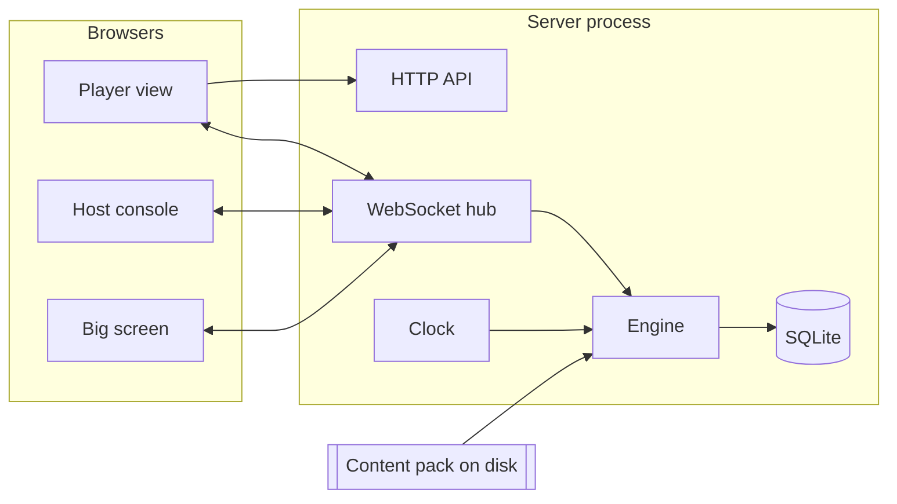

# Lab 02 game: engineering spec

This document says how the Lab 02 game is built. It covers the architecture, the content
format, the game rules as the engine runs them, the server, the player API, the screens, the art,
the tests, the deployment and the order of the build.

**Status.** Version 1.1. It adds the changes the lab director asked for after the first play of
Phase 1 (section 16, row 5). The foundation and Phase 1 are specified in full. Phase 2 and Phase 3 are
specified as far as the content format fixes them: their rules are complete, and their screens
are outlined. Section 16 lists what later steps add.

**This file is public and the game content is not.** The scenarios, the answer keys and the
tuned numbers live in a private content pack that never enters this repository. Nothing here
quotes that pack. Every example comes from the demo pack (section 5.7), which is set in a
library and shares nothing with the real scenarios.

Words used with a fixed meaning:

| Word | Meaning |
| --- | --- |
| Session | One run of the game with one room of players |
| Health system | One of the worlds a session holds. Every player belongs to one |
| Practice | What one player directs. A player and a practice are the same thing in the code |
| Host | An instructor with the host passcode |
| Big screen | The projector view |
| Phase | Planning, Development or Maintaining |
| Stage | One step of the session's timeline (section 6.3). A phase spans several stages |
| Game time | The session clock, in milliseconds. It stops when the host pauses |
| Pack | A folder of content files in the format of section 5 |
| Rung | One of the five levels of the automation ladder, from no software to an agentic system |
| Class | One of the answers a player can give for a problem in Phase 1: not a real problem, real without AI, real with one AI model, real with an agentic system. A class covers the rungs listed for it in `game.yaml` |
| Deck | The one set of slides of a session, in sections, shown on the big screen and driven from the host console (section 6.13) |
| Controller | The one host console that may change a session at a given moment (section 7.10) |
| Extra | A person of a health system who has no interview and no letter, and who walks, talks and answers clicks like everyone else |

---

## 1. The game in mechanics

A session holds up to 150 players, each on a laptop or a phone. A player joins with a link,
names a practice and is assigned to one of the health systems of the pack. The event pack has
two. The session then moves through three
phases. Each is played by everyone at once against a shared timer and is worth up to 1000 points.

1. **Planning.** The player sees a list of candidate problems and investigates the practice.
   An investigation holds part of the player's bandwidth for some seconds and then unlocks one
   evidence tile. Several can run at once while bandwidth is free, so time is the limit. The
   player sorts every problem into a class: not a real problem here, real and no AI needed,
   real and one AI model is enough, or real and in need of an agentic system. The player is
   told how many problems each class holds, in a full pack three, three, three and one, and no
   class takes more.
2. **Development.** The player fills a board of choices to design a solution for one problem.
   Pilot runs score the design on four metrics (validity, reliability, cost, complexity) and
   return one traced failure. At the end, the submitted design is tested again on a second set
   of cases.
3. **Maintaining.** A simulated year runs on a shared clock. The player funds monitors, answers
   events and may change the system. The score is the health of the system over the year.

State resets between phases, and only points carry over. A live leaderboard runs throughout.
After each phase the players see what the right answers were.

The presenter's slides are part of the game. One deck serves the whole session. The big screen
shows it, the host console drives it, and between the phases every player's screen follows it.

---

## 2. Principles

1. **The server owns all state.** A browser shows what the server sends and asks for changes.
   It never decides an outcome.
2. **The engine is pure.** Game logic is a library with no clock, no network, no storage and no
   randomness. The same state and the same commands always give the same result.
3. **Content is data.** A new scenario, number or text needs no code change. Code never names a
   content id.
4. **Keys stay on the server.** A browser receives only what section 9 allows, built field by
   field from a whitelist.
5. **Nothing is lost.** A refresh, a dropped connection or a server restart returns every
   player to where they were.
6. **Small payloads.** Static content travels once per phase over HTTP. The live connection
   carries small views. Each browser animates its own scene.
7. **One API.** The browser, the scripted bots, the load test and the LLM agent players all use
   the player API of section 8.
8. **All waits are in game time.** A time scale speeds up tests and changes nothing else.
   **Nobody just waits.** No wait blocks the screen, waits are short, and while something runs
   the player can read, decide and start other work. This holds in every phase.
9. **Laptop first, phone must work.** Every action can be done by tapping. Nothing needs a drag.
10. **Develop on the Mac.** Nothing is built or tested on a server. `scripts/deploy.sh` ships a
    finished build.

---

## 3. Architecture



One Node process serves everything. It loads one pack at start, keeps every session in memory,
and writes commands and snapshots to SQLite. A reverse proxy in front of it terminates TLS.

**Packages and what each may import**

| Package | Holds | May import |
| --- | --- | --- |
| `content-schema` | Schemas of the pack files, the loader, the validation | nothing of ours |
| `protocol` | Wire messages, view types and their strict schemas, error codes, the reference connection class | nothing of ours |
| `engine` | State, commands, time, scoring, leaderboards, and the projection from pack to public views | `content-schema`, `protocol` |
| `server` | HTTP, WebSockets, the clock, persistence, auth, logs | all three |
| `client` | The React application for players, hosts and the big screen, and the scene | `protocol` only |

The client never imports `content-schema` or `engine`. A lint rule enforces this. The types
that describe a pack with its keys therefore cannot reach client code.

**Data flow of one player action**

1. The browser sends a command with a client id (`cid`).
2. The server checks the connection, the rate limit and the shape of the message.
3. The server reads the clock, calls `advance(state, now)`, then `apply(state, command, now)`.
4. An accepted command is written to the log in the same turn. A refused one is not.
5. The server sends an `ack`, then the new view to every player whose view changed.

---

## 4. Stack and layout

| Area | Choice |
| --- | --- |
| Runtime | Node 22, on the Mac and on the server |
| Language | TypeScript 6.0, strict mode, ES modules. Not 7.0: typescript-eslint supports TypeScript below 6.1 (Step 3) |
| Workspace | npm workspaces. No other package manager |
| Schemas | Zod. YAML parsed with the `yaml` package |
| HTTP and WebSocket | Fastify, with `ws` for the sockets |
| Storage | SQLite through the built-in `node:sqlite` module, WAL mode. It runs without a flag on Node 22 and prints an experimental warning. If Step 3 finds a problem on the server, `better-sqlite3` replaces it behind the same small storage interface |
| Client | React with Vite. Zustand for state. Plain CSS with custom properties |
| Scene | PixiJS 8, one canvas |
| Tests | Vitest for unit and integration tests. Playwright for browser tests, on the Mac only, in the Chrome installed on the Mac so no browser is downloaded |
| Server bundle | esbuild, one file, so the server needs no `npm install` |

Use the latest stable release of each library at Step 3 and commit the lockfile.

```
game/
  CLAUDE.md                 rules for build sessions
  README.md                 how to run the demo on a laptop
  package.json              workspaces and the scripts of section 12
  docs/ENGINEERING_SPEC.md  this file
  packages/
    content-schema/
    protocol/
    engine/
    server/
    client/
  content-demo/             the demo pack
  scripts/                  deploy.sh, provision.sh, simulate, loadtest, parity, check-no-private
```

---

## 5. Content pack

### 5.1 Layout

The server reads one pack from the folder in `CONTENT_DIR`. The default is `content-demo`.

```
game.yaml                 global rules and numbers
palette.yaml              Phase 2 components
monitors.yaml             Phase 3 monitors
characters.yaml           the cast
systems/<id>-<slug>/
  system.yaml             premise, practice profile, calibration anchors
  problems.yaml           Phase 1 candidate problems
  insights.yaml           Phase 1 investigations and tiles
  build.yaml              Phase 2 board, cases, rules, offers
  maintain.yaml           Phase 3 start meters, actions, events
  story.yaml              briefs, letters, dialogue, announcements
teaching/
  deck.yaml               the one slide deck of the session, in sections
  report-card.yaml        rules and text of the personal report card
art/                      optional images that belong to the pack (section 11.4)
  room/                   the room of the practice and its layout
  slides/                 images that slides name
```

A pack may be partial. The loader requires `game.yaml`, `characters.yaml` and, for each health
system, `system.yaml`. A phase can be opened only when its files exist for every health system.
The host console shows which phases a pack can run. This lets a pack grow one phase at a time.

### 5.2 Conventions

- YAML, UTF-8. Ids are lowercase with hyphens and unique in the pack. Items inside a system
  carry the system id as a prefix.
- Text is plain. No Markdown and no HTML. A line break is `\n`. The client renders text as text.
- **Scores and meters** run from 0 to 100 and higher is better, for all four metrics. A high
  cost score means a cheap system. **Cost units and complexity points** are raw amounts on
  components and rules, and higher is worse.
- Every wait is in seconds of game time.

### 5.3 Public, key and mechanics

Every field of a pack belongs to one of three classes.

| Class | Where | Reaches a browser |
| --- | --- | --- |
| Public | Under a `public` field, plus the few fields listed in section 9.2 | When its trigger occurs |
| Key | Under a `key` field | Never, except the fields that a reveal sends (section 9.2) |
| Mechanics | Everything else | Never as written. Only computed results leave the server |

The projection code builds every outgoing object field by field. A field that nobody listed
cannot leak by being forgotten.

### 5.4 Loading and validation

The loader parses the files, validates them and returns one frozen `Pack` object with a content
hash. The object keeps the field names of the files, so the listings of section 5.5 describe
both. Validation has three layers.

1. **Shape.** Types, enums and required fields. It is strict wherever a typo would change a
   result: inside `public`, options, costs, effects, conditions and events, an unknown field is
   an error. Elsewhere an unknown field gives a warning with its path, and the server starts.
2. **References.** Every id that a file mentions exists: characters, problems, monitors, events,
   offers, components, choices and options inside conditions, source ids.
3. **Counts from `game.yaml`.** The number of problems, investigations and offers match what
   `game.yaml` states. The class of every problem exists, agrees with `real` and `tier`, and
   the number of problems in each class equals `class_mix` (section 5.5). Every investigation uses a bandwidth level that exists, with the seconds
   of that level, and one that its method allows. The work of all investigations of a system
   (bandwidth times seconds, summed) lies inside `total_work`.

A `key` block is read loosely. The loader types the fields that the engine or a reveal needs,
listed in section 5.5, and carries any other field without reading it. A private pack holds
more authoring fields than this document lists. A private checker, kept with that pack,
enforces the design rules: how hard the puzzle is, how the evidence fits together, how the
numbers balance. The public loader does not know those rules.

A setting that has one implemented value is validated to hold that value. For example
`join.assignment` must be `balanced`, and `phases.planning.live_leaderboard.metric` must be
`progress`. A pack cannot ask for behavior that does not exist.

`npm run check:content` loads the pack in `CONTENT_DIR` and prints every error and warning.

The loader can load a subset of the health systems (`SYSTEMS`, section 7.9). A play check uses it
while the private pack holds only some systems. The other folders still count toward the hash.
A field named `source` is accepted anywhere, because every scored item cites one.

### 5.5 Schema reference

The listings show the fields the code reads. `?` marks an optional field. `Text` is a plain
string. `SourceIds` is a list of ids from the `sources` registry of `game.yaml`.

**`game.yaml`**

```ts
type Game = {
  version: number
  game: { title: Text | null; phase_order: PhaseId[]; health_systems: SystemId[] }
  join: {
    assignment: 'balanced'; tie_order: SystemId[]
    choose_system_in_modes?: Mode[]      // session modes in which a player may pick the system (6.4)
    practice_name: { min_chars: number; max_chars: number; unique_per_session: true;
                     filter_profanity: boolean; host_can_rename: boolean; host_can_remove: boolean }
    reconnect: 'token'
    late_join: { open_until: { phase: PhaseId; month?: number }; missed_phase_points: 0;
                 mid_phase: 'full_budget_remaining_clock';
                 maintaining_after_setup: 'inherit_do_nothing' }
  }
  clock: { time_scale_default: number; warnings_seconds_left: number[]; idle_seconds?: number;
           auto_submit_at_zero: true; pause_freezes: 'all' }
  run_of_show: { start: number; end: number; segment: Segment; driver: string }[]   // minutes
  story_time?: {                         // display strings only, see below
    planning?: { span: Text; investigation_stands_for?: Record<number, Text> }   // by bandwidth level
    development?: { span: Text; pilot_run_stands_for?: Text }
    maintaining?: { span: Text; tick_stands_for?: Text }
  }
  ladder: { rung: 1|2|3|4|5; id: string; label: Text; fits_when: Text; example: Text }[]
  scoring: {
    phase_max_points: number
    normalization: { floor_points: number; max_points: number }
    four_metric_score: { weights: Record<Metric, number> }
    score_bands: { id: string; min: number; max: number
                   label?: Text }[]       // the name of the band that a player reads (6.8)
  }
  phases: { planning: PlanningRules; development: DevelopmentRules; maintaining: MaintainingRules }
  leaderboards: {
    columns: ['overall', ...PhaseId[]]; refresh_seconds: number; big_screen_rows: number
    tie_breaks: Record<'overall' | PhaseId, string[]>
    winners: { overall_top: number; per_system_top: number; top_system: number }
  }
  text_limits?: Record<string, number>   // words. Over the limit gives a warning. The loader
                                         // knows banter_line, click_line, slide_title and
                                         // slide_bullet among others
  sources: Record<string, { paper: string; locator: Text; gist: Text }>
  public_source_labels: Record<string, Text>     // by paper
}
type PhaseId = 'planning' | 'development' | 'maintaining'
type Mode = 'test' | 'rehearsal' | 'event'
type Segment = 'join' | 'intro_slides' | 'planning' | 'help_slides_1' | 'development' | 'help_slides_2'
             | 'maintaining' | 'help_slides_3' | 'reflection' | 'winners'   // each maps to stages (6.3)
type Metric = 'validity' | 'reliability' | 'cost' | 'complexity'

type PlanningRules = {
  label: Text; play_seconds: number; reveal_seconds: number
  candidates: number                                       // problems per health system
  classes: PlanningClass[]                                 // the answers a player can give
  class_order: ClassId[]                                   // the spectrum, every class once
  class_mix: Record<ClassId, number>                       // problems per class, in every system
  flagship_class: ClassId                                  // the flagship in this class earns the bonus
  show_class_mix: true                                     // the screen states the mix and counts each class
  investigations: { per_system: number
                    story?: number                          // read by the private checker only
                    bandwidth: number                       // blocks a player can commit at once
                    levels: { bandwidth: number; seconds: number }[]
                    method_levels: Record<Method, number[]>  // bandwidth levels a method may use
                    total_work: { min: number; max: number } // sum of bandwidth x seconds
                    reachable_work: number                  // read by the private checker only
                    parallel: true; cancel: 'none' }
  submission?: { letter_empty_below?: number }             // fewer problems sorted than this gets
                                                           // the `empty` line of the letter (6.11)
  live_leaderboard: { metric: 'progress'; label: Text }
  scoring: { classify: { exact: number; adjacent: number }
             flagship: { bonus: number } }
}
type PlanningClass = {
  id: ClassId; label: Text; short: Text      // `short` is the two-word name on sections and buttons
  fits_when: Text
  rungs: (1|2|3|4|5)[]                       // the ladder rungs the class covers
  capacity: number                           // the most problems the class may hold. Equals its class_mix
}
type DevelopmentRules = {
  label: Text; play_seconds: number; reveal_seconds: number
  pilot: { runs: number; seconds: number; concurrent: 1 }
  offers: { per_system: number; announce_at_seconds: number[]; claim_window_seconds: number
            claim_fraction: number }
  live_leaderboard: { label: Text }
  scoring: { pilot_weight: number; heldout_weight: number }
}
type MaintainingRules = {
  label: Text; reveal_seconds: number
  setup_seconds: number; months: number; month_seconds: number; event_response_seconds: number
  credits: number; actions_per_month: number
  live_leaderboard: { label: Text }
}
```

The classes of Phase 1 follow four rules that the loader checks. Exactly one class has empty
`rungs`. It is the class of the problems that are not real, and `class_order` lists it first.
Every rung of the ladder belongs to exactly one class. `class_mix` names every class and adds up
to `candidates`. Every class has a `capacity`, the most problems a player may put in it, and it equals the
class's share of `class_mix`, so the capacities add up to the number of problems.
`flagship_class` is the class of the flagship problem. `class_order` lists it last, and its
capacity is one.

A band of `score_bands` may carry a `label`, such as "Strong". It is the only name of a band
that a player ever reads. The `id` is for letters, the report card and the code.

`story_time` says what the play time stands for in the story, for example that a pilot run
stands for a two-week pilot. The client shows these strings next to the waits. They never affect
a score.

**`palette.yaml`**

```ts
type Palette = { components: Component[] }
type Component = {
  id: string                      // also the option id when the component sits in a slot
  public: { label: Text; short: Text; description: Text; icon: string }
  tags?: string[]
  cost?: { visible?: number; hidden?: number; year?: number }
  developers?: number; complexity?: number; delivery_runs?: number
  key?: object
}
```

The id `empty` is reserved for a slot with nothing in it, and `n/a` for a choice that does not
apply.

**`monitors.yaml`**

```ts
type Monitors = { monitors: Monitor[] }
type Monitor = {
  id: string
  public: { label: Text; description: Text; icon: string }
  credits: number
  upkeep?: Partial<Record<Metric, number>>     // meter deltas, applied once when funded
  key?: object
}
```

**`characters.yaml`**

```ts
type Character = {
  id: string; system: SystemId | 'all'
  public: { name: Text; role: Text; portrait: string }      // portrait is an art key
  extra?: boolean                 // true for a person with no interview and no letter
  click_lines?: Text[]            // what the person says when clicked. Three or more
  look?: { hair: string; hair_style: 'short' | 'long' | 'bald' | 'covered'
           skin: string; top: string; detail?: string }     // the input of the sprite (11.4)
}
```

`extra`, `click_lines` and `look` sit beside `public`. None of them is a key, and all three
travel with the cast at join. The people of a health system are the characters of
`system.public.cast` in that order, followed by every character of that system with
`extra: true` that the list does not name, in file order. A pack may list its extras in `cast`
or leave them out. The client receives all of them as one list and shows them the same way, so
nothing on a screen tells an extra from the rest. `look` holds free words. The sprite builder of
the client turns them into the person's own pixel character (section 11.4), and a word it does
not know falls back to a pick by a hash of the id. A click line is within
`text_limits.click_line` words. A character with fewer than three click lines gives a warning.

**`system.yaml`**

```ts
type System = {
  id: SystemId; slug: string
  public: { name: Text; setting: Text; premise: Text
            practice_profile: { label: Text; value: Text | number }[]
            baseline: { label: Text; value: Text | number; unit?: Text }[]
            cast: CharacterId[] }
  key: { flagship_problem: ProblemId; summary?: Text }
  calibration: Record<PhaseId, { zero: number | null; floor: number | null; ceiling: number | null
                                  provisional: boolean }>
}
```

**`problems.yaml`** is a list.

```ts
type Problem = {
  id: ProblemId
  public: { title: Text; description: Text }
  key: { real: boolean
         class: ClassId                    // the true answer of Phase 1
         tier: 1|2|3|4|5 | null            // the ladder rung of a real problem, null when not real
         flagship: boolean; rationale: Text
         burden?: { kind: string; size: string; note: Text }
         source?: SourceIds }
}
```

`class` is the id of one of `phases.planning.classes`. A problem that is not real has the class
with empty `rungs` and `tier: null`. A real problem has a `tier`, and its class is the one whose
`rungs` hold that tier. The number of problems in each class equals `class_mix`. Exactly one
problem has `flagship: true`. It sits in `flagship_class`, and it equals
`system.key.flagship_problem`. The rationale is read by the player at the reveal, so it says
what solves the problem and why the class below would fall short.

**`insights.yaml`** is a list.

```ts
type Investigation = {
  id: InvestigationId
  method: 'interview' | 'data_pull' | 'audit' | 'observation'
  character: CharacterId | null          // required for an interview
  public: { title: Text; teaser: Text }
  bandwidth: number; seconds: number      // blocks held while it runs, and for how long
  tile: Tile
  key?: object
}
type Tile =
  | { type: 'stat';  headline: Text; body: Text
      data: { value: Text | number; unit?: Text; label: Text; comparison?: Text } }
  | { type: 'chart'; headline: Text; body: Text
      data: { kind: 'bar' | 'line'; x_label: Text; y_label: Text
              series: { name: Text; points: [Text | number, number][] }[]; note?: Text } }
  | { type: 'quote'; headline: Text; body: Text
      data: { speaker: CharacterId; text: Text } }           // bubbles split on "\n"
  | { type: 'audit'; headline: Text; body: Text
      data: { sample_size: number; findings: { label: Text; count: number }[]; note?: Text } }
```

The `tile` is mechanics until the investigation completes. Then it is sent to that player.
Only an interview fixes its tile type (`quote`). Every other method may give any tile type. An
`audit` tile also serves as the tally of an observation, and its findings may then count
different things, each with its own denominator in the label.

**`build.yaml`**

```ts
type Build = {
  problem: ProblemId
  board: { nodes: { id: string; label: Text; kind: 'system' | 'person' }[]
           flow: string[]                  // node ids and slot ids, in order
           links?: [string, string][] }    // extra arrows
  budget: { cost: { par: number; ceiling: number }; complexity: { par: number; ceiling: number } }
  team: { developers: number }
  choices: Choice[]
  rules?: { id: string; when: Condition
            effects: { cost?: number; cost_year?: number; complexity?: number; developers?: number }
            key?: object }[]
  advisories?: { when: Condition; trace: Text; priority: number; source?: SourceIds }[]
  cases: Case[]
  offers?: Offer[]
  key: { reference: { design: Design; rationale: Record<ChoiceId, Text>; public_summary: Text }
         traps?: { id: string; kind: 'overbuilt' | 'underbuilt' | 'shortcut'; design: Design }[] }
}
type Choice =
  | { id: ChoiceId; kind: 'slot'; public: { label: Text; prompt?: Text }
      options: SlotOption[] }
  | { id: ChoiceId; kind: 'link' | 'tool' | 'agent_setting' | 'setting' | 'resource'
      public: { label: Text; description?: Text }
      applies_when?: Condition; default: OptionId
      options: ListOption[] }
type OptionCosts = {
  cost?: { visible?: number; hidden?: number; year?: number }
  developers?: number; complexity?: number; delivery_runs?: number
  tags?: string[]; requires_offer?: OfferId | null
}
type SlotOption = OptionCosts & { component: ComponentId; public_note?: Text }
     // a missing cost, developers, complexity or delivery_runs falls back to the palette
type ListOption = OptionCosts & { id: OptionId; public: { label: Text; description?: Text }
                                  adds_developers?: number }
type Case = {
  id: CaseId; set: 'pilot' | 'heldout'; dimension: 'validity' | 'reliability'; weight?: number
  public: { title: Text; text: Text }
  fails_when?: { when: Condition; trace: Text; priority: number; source?: SourceIds }[]
  extra_cost?: { when: Condition; cost: number; note?: Text }[]
  key?: object
}
type Offer = {
  id: OfferId; index: number            // which announcement time of game.yaml it uses, from 1
  public: { title: Text; text: Text; trade_off: Text }
  pilot_runs: number                    // change to the claimer's pilot budget
  key?: { verdict?: 'take' | 'leave' | 'depends'; rationale?: Text }
}
type Design = Record<ChoiceId, OptionId>

type Condition = {                      // every key present must hold
  choice?: ChoiceId; is?: OptionId[]; is_not?: OptionId[]; has_tag?: string
  count_tag?: string; kind?: Choice['kind']; min?: number; max?: number
  has_offer?: OfferId
  all?: Condition[]; any?: Condition[]; not?: Condition
}
```

**`maintain.yaml`**

```ts
type Maintain = {
  start: Record<Metric, number>
  monitors?: Record<MonitorId, { public: { local_note: Text } }>
  actions: Action[]
  events: GameEvent[]
}
type Action = {
  id: ActionId; kind: 'look' | 'change'
  public: { label: Text; text: Text }
  credits: number; once?: boolean                 // default true
  months?: { from?: number; to?: number }
  reveals?: EventId[]; effects?: Partial<Record<Metric, number>>
  disarms?: EventId[]; arms?: EventId[]
  key?: { verdict?: 'good' | 'depends' | 'poor'; rationale?: Text }
}
type GameEvent = {
  id: EventId; archetype: string
  requires_trigger?: boolean
  onset: { month: number } | { after_trigger: number }
  detect: { loud?: boolean; monitors?: MonitorId[]; late_after_months?: number | null }
  drift?: Partial<Record<Metric, number>>         // per month while it runs
  public: { early: { title: Text; text: Text }; late: { title: Text; text: Text } }
  default_option: OptionId
  options: {
    id: OptionId; public: { label: Text; text: Text }
    available?: 'both' | 'early' | 'late'; requires_monitor?: MonitorId | null
    effects?: Partial<Record<Metric, number>>
    stops_drift?: boolean; restore?: number       // 0 to 1
    arms?: EventId[]; disarms?: EventId[]; grants_monitor?: MonitorId | null
    key?: { verdict?: 'best' | 'acceptable' | 'poor'; rationale?: Text }
  }[]
  key?: { teaches?: Text }
}
```

**`story.yaml`**. Nothing in this file affects a score.

```ts
type Story = {
  briefs?: Partial<Record<PhaseId, { from: CharacterId; title: Text; text: Text }>>
  letters?: Partial<Record<'planning_reveal' | 'development_reveal' | 'annual_review',
            { from: CharacterId; always: Text; variants: Record<BandId, Text> }>>
  dialogue?: { id: string; speaker: CharacterId; text: Text
               trigger: { phase: PhaseId; on: string } }[]
     // on: start | idle | insight:<id> | run_result | trace:<case id> | event:<id> | month:<n> | reveal
  banter?: { id: string
             lines: { speaker: CharacterId; text: Text }[] }[]   // two or three lines an exchange
  announcements?: { id: string; phase: PhaseId; offer?: OfferId; at_seconds?: number | null
                    from: CharacterId; text: Text }[]
}
```

`briefs.planning` is the opening letter of Phase 1. It pops up when the phase starts and stays
as the first card of the evidence (section 10.4), so it states the task and explains the
bandwidth. A letter may carry the variant `empty` beside its bands. The planning reveal uses it
for a player who sorted fewer problems than `phases.planning.submission.letter_empty_below`
(section 6.11).

`banter` is small talk between the people of the practice. The scene plays one exchange at a
time (section 10.3). Every speaker is a person of that health system, an exchange has two or
three lines, and a line is within `text_limits.banter_line` words. Banter is flavor. It is sent
with the health system at join, so a pack keeps anything that bears on a score out of it. The
private checker enforces that for the private pack.

**`teaching/deck.yaml`** and **`teaching/report-card.yaml`**

```ts
type Deck = { sections: DeckSection[] }
type DeckSection = {
  id: string; title: Text
  stage: 'intro' | 'break.planning' | 'break.development' | 'break.maintaining' | 'reflection'
  slides: Slide[]                 // one or more
}
type Slide = { id: string; title: Text; bullets: Text[]
               image?: string           // a path under art/, ending in .png or .webp
               live_stat?: RoomStatId   // drawn with the room's numbers (6.10)
               notes?: Text             // for the host console only
               placeholder?: boolean }  // a slide whose text is still to be written

type ReportCard = {
  sections: { id: string; title: Text
              lines: { when: Record<string, string | number | boolean>; text: Text
                       source?: SourceIds }[] }[]
  closing: Record<BandId, Text>
  links?: { label: Text; url: string }[]
}
```

The deck is one list of slides for the whole session. It replaces `help-slides.yaml` and the
separate intro deck of earlier plans. The order of the slides is the order of the sections and,
inside a section, of its slides. `stage` is the id of the engine stage (section 6.3) in which
the deck opens at that section (section 6.13). It is one of the five stages that the run of show
gives to the presenter. A stage has one section at most, and a pack may leave a stage without
one. A slide title is within `text_limits.slide_title` words and a bullet within
`text_limits.slide_bullet`. `placeholder: true` marks a slide that stands in for one still to be
written. The host console counts the placeholders of a pack and shows the number, and an `event`
session can still be opened with them.

The loader checks of this round, beside the ones above. Every banter speaker exists and belongs
to the health system of the file or to `all`. Banter ids, section ids and slide ids are unique in
the pack. A section's `stage` is one of the five stage ids, and no two sections share one. A section
has one slide or more. An `image` and a `live_stat` name something that exists. `letter_empty_below`
lies between 0 and `candidates`. Word limits give warnings, like everywhere.

### 5.6 The content hash

The loader computes a SHA-256 over the parsed pack in a canonical order. A session stores the
hash of the pack it started with. After a restart the server resumes a session only when the
pack on disk has the same hash. Changing content between two sessions is normal. Changing it in
the middle of one is refused.

### 5.7 The demo pack

`content-demo/` lets anyone run the game from this repository. It follows the format above and
is written from scratch for the purpose.

- **Setting.** Two public library networks. The player is the digital services director of one
  branch. No medical wording anywhere.
- **Size.** Two health systems. Per system: 6 candidate problems, 5 investigations, a board of
  8 to 10 choices, 4 pilot and 4 held-out cases, 1 offer, 4 events and 3 actions. Shared: 5
  components, 3 monitors, 4 characters. Short timers, so a full game takes about six minutes at
  time scale 1.
- **Coverage.** The pack uses every feature of the format at least once: all four investigation
  methods and all four tile types, an interview, every kind of choice, `applies_when`, an
  option that needs an offer, a rule with a developers effect, an option with `delivery_runs`,
  a design that the team cannot build, a year amount that differs from the pilot amount, an
  advisory, a case with `extra_cost`, a loud event and a silent one, an event that another
  option arms, `grants_monitor`, a one-time check, a change action with a month window, every
  dialogue trigger, letters with all bands and the `empty` line, band labels, banter, click
  lines and a `look` on every person, one extra in each system, a deck with a section for every
  slide stage, a slide with a live statistic, a slide with notes, a placeholder slide, and a
  report card.
- **Phase 1 rules.** Its `game.yaml` has the four classes, a `class_mix` that adds up to its 6
  problems and uses every class (2, 2, 1 and 1), a `capacity` on every class that equals its
  share, and `test` and `rehearsal` in `join.choose_system_in_modes`.
- **Calibration.** Its anchors are estimates marked provisional until `scripts/simulate`
  exists in Step 9. From then on they are measured.
- **Growth.** The pack grows with the build: the global files and Phase 1 in Step 3, the deck,
  the banter, the click lines and the extras in Step 5, Phase 2 in Step 7, Phase 3 and the
  report card in Step 9.
- **Sources.** Its source registry holds two invented entries.

---

## 6. Engine

### 6.1 Shape

```ts
createSession(pack, opts: { code, label, mode }): SessionState
advance(state, pack, now: GameMs): Outcome
apply(state, pack, command: Command, now: GameMs): Outcome & ({ ok: true } | { ok: false; error: ErrorCode })

playerView(state, pack, playerId): PlayerView            // section 8.4
phaseContent(state, pack, playerId, phase): PhaseContent  // section 8.3
hostView(state, pack): HostView
screenView(state, pack): ScreenView

type Outcome = { dirty: PlayerId[] | 'all'; events: EngineEvent[] }
```

- `SessionState` is plain JSON data. No class instances, maps, sets or dates. A snapshot is
  `JSON.stringify(state)`.
- `advance` and `apply` change the state they are given and return what happened. They read no
  clock and use no random numbers. `now` always comes from the caller.
- `advance` is path-independent. Calling it once with a late time gives the same state as
  calling it many times on the way. It processes every timer that is due in order of its due
  time, and by a fixed key when two are due together.
- `dirty` lists the players whose view changed. `events` are things the server announces or
  logs: a stage change, an offer, a dialogue line, a leaderboard beat, a month that ended.
- All code that turns pack data into something a browser may see lives in
  `packages/engine/src/project/`. No other code reads a pack and writes a protocol type.

### 6.2 Time

`GameMs` is an integer count of milliseconds on the session clock. The server maps wall time to
game time (section 7.4). The engine sees only game time, so a pause freezes every timer and a
time scale speeds everything up without any rule changing.

### 6.3 Stages

```
lobby → intro
→ planning.play → planning.reveal → break.planning
→ development.play → development.reveal → break.development
→ maintaining.setup → maintaining.year → maintaining.reveal → break.maintaining
→ reflection → winners → closed
```

| Stage | Length | Ends |
| --- | --- | --- |
| `planning.play`, `development.play` | `play_seconds` of that phase | By itself at zero, or on `end_now` |
| `maintaining.setup` | `setup_seconds` | By itself |
| `maintaining.year` | `months` × `month_seconds` | By itself |
| Every other stage | Untimed for the engine | On the host command `next` |

The untimed stages show a guide countdown to the host: `reveal_seconds` for a reveal, and the
length from `run_of_show` for the rest. When a play stage ends, the engine submits what each
player has, computes every score of that phase, the leaderboard and the room statistics, and
moves to the reveal.

Host commands: `next`, `pause`, `resume`, `extend` (30 or 60 seconds, added to the current timed
stage, or to the current month in `maintaining.year`), `end_now`, `rename_player`,
`remove_player`, `reset_stage` and `close`. Pause and resume act on the clock, not on the engine.
`reset_stage` puts every player back at the start of the current phase and exists only outside
`event` mode. The commands of the projector and the deck are in section 6.13. Only the
controlling host console may send a command that changes the session (section 7.10).

Three words about stages are used below. A *play stage* is `planning.play`,
`development.play`, `maintaining.setup` or `maintaining.year`. A *slide stage* is a stage that
the run of show gives to the presenter: `intro`, `break.planning`, `break.development`,
`break.maintaining` and `reflection`. A section of the deck names one of these five ids. The
interface names `intro` "Intro slides" and never "Starting soon".

**Session modes**

| Mode | Time scale | Provisional anchors | `reset_stage` |
| --- | --- | --- | --- |
| `test` | Any | Allowed | Yes |
| `rehearsal` | 1 by default | Allowed, with a warning on the host console | Yes |
| `event` | 1 | Refused. The session cannot be created | No |

### 6.4 Joining

- `join` adds a player to the health system with the fewest active players. `join.tie_order`
  breaks a tie. A removed player does not count. With two health systems this sends players to
  A, B, A, B in order of arrival, so the two halves of the room differ by one player at most,
  and the balance repairs itself after the host removes someone.
- **Picking a health system.** `join.choose_system_in_modes` lists the session modes in which a
  player may choose. In a session of such a mode the join request may carry `system`, and the
  player goes there. A request without it is assigned as above, and the players who picked count
  toward the balance. An id that the session does not hold is refused with `unknown_system`. In
  a session of any other mode a `system` in the request is ignored and the player is assigned.
  The choice exists for play checks and rehearsals, where the person testing wants to play one
  side. The event pack lists `test` and `rehearsal`, so nobody picks at the event.
- The practice name is trimmed and checked for length and profanity by the server. A name
  that a practice of the session already has, compared without regard to case, is refused
  with `name_taken`. The engine never makes a second practice by adding a number, because the
  usual reason for a repeated name is a player who lost their browser and wants their practice
  back (section 7.7).
- `join` carries an `avatar`, the character the practice picked on the join page. The ids are
  a fixed list in `packages/protocol`, with at least eight characters. Two practices may pick
  the same one. A missing or unknown id is replaced by one picked from the list by a hash of
  the player id, so a bot can join without choosing. The avatar is display only and never
  enters a score.
- Joining stays open until `join.late_join.open_until`. A player who joins during a play stage
  gets the full budget of that phase and the time that is left. A phase that ended before the
  player joined scores 0. A player who joins during the year takes over a practice that did
  nothing in the earlier months (section 6.7), with the whole credit pool.

### 6.5 Phase 1: Planning

The player investigates and sorts every candidate problem into a class. The classes come from
`phases.planning.classes`, and `class_order` is the spectrum from "not a real problem" to the
class that asks for the most. Below, the *decoy class* is the class with empty `rungs`, the
*real classes* are the others, and the *flagship class* is `flagship_class`. A class holds at
most `capacity` problems, and the capacities of all classes add up to the number of problems.

**State of a player**

```ts
type PlanningState = {
  done: { id: InvestigationId; atMs: GameMs }[]            // in order of completion
  running: { id: InvestigationId; startedAtMs: GameMs; completesAtMs: GameMs }[]
                                                            // free bandwidth = total - held by these
  picks: Record<ProblemId, ClassId>                         // a problem without an entry is unsorted
  submittedAtMs: GameMs | null
  result: PlanningResult | null                             // set when the stage ends
}
type PlanningResult = {
  graded: { problem: ProblemId; picked: ClassId | null; points: number }[]   // every problem, in pack order
  classify: number; flagship: number; raw: number
}
```

**Commands**

| Command | Accepted when | Effect |
| --- | --- | --- |
| `planning.investigate {id}` | Stage is `planning.play`. Not submitted. The id is neither done nor running. Its bandwidth fits in what is free | The investigation holds its bandwidth and runs for its `seconds`. It cannot be cancelled |
| `planning.set_report {picks}` | Stage is `planning.play`. Not submitted. Every problem id and every class id exists. No class holds more problems than its `capacity` | Replaces the draft. A problem that the draft leaves out is unsorted |
| `planning.submit {}` | Stage is `planning.play`. Not submitted | Locks the board. The player waits for the stage to end |

A draft that breaks a rule is refused with `invalid_report` and changes nothing. A draft may be
empty, and any number of problems may stay unsorted.

When an investigation completes, its tile joins the player's view and its bandwidth is free
again. Any number may run at once while their bandwidth adds up to at most
`investigations.bandwidth`. Nothing is spent, so the play time is the limit. The rest of the
screen stays usable while they run.

**Interviews.** An interview has a `quote` tile whose text holds one line per speech bubble.
The engine releases the lines on a schedule, so the talk fills the wait and no text arrives
before its time. With `n` lines and a wait of `s` seconds, line `k` (from 1) is released at
`startedAt + k × s ÷ (n + 1)`. The tile completes at `startedAt + s`. The time before the first
line is the character's walk. Interviews that run at the same time release their lines
independently.

**At the end of the stage** the draft of every player who did not submit is submitted as it
stands. Investigations that are still running are dropped.

**Scoring.** Every sorted problem earns points by where the player put it.

```
points(problem) =
  exact     the picked class is the true class
  adjacent  the problem is real, the picked class is a real class, and the two classes are
            one step apart in class_order
  0         in every other case
classify = sum of points over the sorted problems
flagship = bonus if the flagship problem is in the flagship class, else 0
raw      = classify + flagship
```

A real problem that is called not real, a problem that is not real and is put in a real class,
a real problem two steps from its class, and an unsorted problem all earn 0. Nothing earns less
than 0. The most a player can reach is `candidates × exact + bonus`, which a pack sets to 1000.
Because every class is counted, a problem in the wrong class takes the place of another.

**Random play.** The floor anchor of a system (section 6.8) is the mean raw score of random
boards made like this: the problems are shuffled and dealt into the classes until every class
holds its `capacity`, every arrangement with equal chance.

**Live column.** `progress`: the number of insights unlocked plus the number of problems sorted.
Its largest value is `investigations.per_system + candidates`, and the column carries it, so a
row reads "17 of 22". A tie goes to the player who reached the value first. Every player can
reach the top, so the column shows who is how far and never who is right. Correctness stays
hidden until the reveal.

**Reveal.** Each player receives the truth of every problem (section 9.2), their own picks
graded one by one, the two parts of the score, the points, the label of the band and the
letter. The letter holds the `always` text and one more line. That line is the variant `empty`
when the letter has one and the player sorted fewer problems than
`submission.letter_empty_below`, and the variant of the player's band in every other case.

### 6.6 Phase 2: Development

Everyone designs for the flagship problem of their health system (`build.problem`).

**A design** maps each choice id to an option id. Resolving a design:

1. Slots first. A slot holds a component its options allow, or `empty`.
2. Then every other choice in file order. When its `applies_when` is false the choice holds
   `n/a`, costs nothing and matches no `is` list. Otherwise it holds the chosen option, or its
   `default`.
3. An option with `requires_offer` can be chosen only by a practice that claimed that offer.

Each resolved option has tags, three money amounts (`visible`, `hidden`, `year`), developers,
complexity points and delivery runs.

**Conditions**

| Form | True when |
| --- | --- |
| `{choice: C, is: [...]}` | The option at C is in the list |
| `{choice: C, is_not: [...]}` | The option at C is not in the list |
| `{choice: C, has_tag: T}` | The option at C carries tag T |
| `{count_tag: T, min, max, kind?}` | The number of choices whose option carries T is in range. `kind` counts one kind of choice only |
| `{has_offer: O}` | The practice claimed offer O |
| `{all: [...]}`, `{any: [...]}`, `{not: {...}}` | As named |

**Developers.** Needed is the sum over chosen options and matching rules. Available is
`team.developers` plus the `adds_developers` of chosen options. A design that needs more than
is available is **not buildable**. It cannot be run, and if it is what gets submitted it scores 0.
The board shows both numbers as the player builds.

**Scoring a design on a case set** (`pilot` or `heldout`)

1. *Validity* is 100 × the weight of the validity cases that pass ÷ the weight of all validity
   cases in the set. A case passes when none of its `fails_when` entries matches.
   *Reliability* is the same over the reliability cases.
2. *Pilot cost* is the visible and hidden money of every option, plus the `cost` of every
   matching rule, plus the mean over the cases of the set of their matching `extra_cost`.
   *Year cost* adds the `year` amount of every option and the `cost_year` of every matching
   rule. The pilot set is priced on the pilot cost and the held-out set on the year cost.
3. *Complexity* is the points of every option plus the `complexity` of every matching rule.
4. The cost score is 100 at or below `budget.cost.par`, 0 at or above the ceiling, and linear in
   between. The complexity score works the same way.
5. The design score is the four-metric score of section 6.8.
6. A design that is not buildable scores 0 on everything.

**Pilot runs**

| Command | Accepted when | Effect |
| --- | --- | --- |
| `development.set_design {design}` | Stage is `development.play` | Replaces the draft. The view returns the resolved design, which choices apply, the money on the cards, the developers, and what the next run would use up |
| `development.run {}` | No run in progress. The draft is buildable. Enough runs are left | Uses up runs and starts a run of `pilot.seconds` on a copy of the draft |
| `development.choose_run {runId or null}` | The run is the player's own and finished | Marks the design to submit. `null` returns to the default |
| `development.claim_offer {offerId}` | The offer is open for this health system and places are left | The player gets the offer |

- A run uses up 1 run, plus the `delivery_runs` of every chosen option that this practice has
  not run before. After that the option is delivered.
- A finished run stores the design and its result: the four sub-scores, the design score, the
  pilot cost and the year cost with the visible and hidden parts, the complexity points, the
  developers, and one trace.
- **The trace.** Take the first matching `fails_when` entry of every failed pilot case and every
  matching advisory. Sort by priority, highest first. Show the first whose text this player has
  not been shown. When all were shown, show the highest. When nothing matches, the client shows
  a fixed line that says no failure was traced. The trace comes with the `public` of its case.
- **Submission.** The submitted design is the finished run with the highest design score, the
  earliest on a tie, unless the player chose another. A player with no finished run when the
  stage ends has the draft run and submitted as it stands.

**Offers.** Each offer is announced to its health system at its time from
`offers.announce_at_seconds`, counted from the start of the stage. It stays open for
`claim_window_seconds`. The places are `ceil(claim_fraction × active players of that system)`,
at least 1, counted at the announcement. Claims are served in the order the server receives
them. A claim adds `pilot_runs` to the player's budget and sets a flag that conditions and
options can test.

**Scoring.** `raw = 10 × (pilot_weight × pilot score + heldout_weight × held-out score)`, both of
the submitted design.

**Live column.** The best pilot design score so far.

**Reveal.** Each player receives the held-out sub-scores of the submitted design, the two
highest-priority held-out traces, the points and the letter, and then the reference design with
its summary (section 9.2).

### 6.7 Phase 3: Maintaining

Every player runs the same system, the reference design of their health system. The four
meters start at `maintain.start`. Each player's year is separate state on a shared clock.

**Setup.** For `setup_seconds` the player may fund any monitors the credit pool affords.

**The year.** Month `m` runs from `S + (m − 1) × L` to `S + m × L`, where `S` is the start of
the stage and `L` is `month_seconds`.

1. *Month start: drift.* Every event that is armed, has started and has not been stopped adds
   its `drift` to the meters. Meters stay within 0 to 100. The engine records what was really
   applied, per event and per month.
2. *Month start: reveals.* An event that has started and is not yet revealed is revealed now in
   mode `early` when it is loud, or the practice funds one of its monitors, or a one-time check
   found it. It is revealed in mode `late` when `late_after_months` have passed since its onset.
   Reveals are decided once, on the state at the start of the month. A monitor that is funded or
   granted during a month reveals what it watches from the next month.
3. *During the month.* A revealed event can be answered for `event_response_seconds`. An answer
   applies when it arrives. The player may also take `actions_per_month` action in each month.
   An action applies when it arrives.
4. *At a deadline.* An event that was not answered takes its `default_option`.
5. *Month end.* The health of the month is the four-metric score of the true meters.

Timers that fall on the same instant run in this order: deadlines, month end, month start. The
response window may be longer than a month. An answer or a default that lands in a later month
uses that month for everything below, and the drift of that month has already been applied.

**An option** acts at once: `effects` are added to the meters, `restore` gives back that share
of the harm this event has done so far, `stops_drift` ends its drift, `arms` sets the onset of
each listed event to this month plus its `after_trigger`, `disarms` cancels listed events that
have not started, and `grants_monitor` funds a monitor and applies its upkeep. An option is
available when its `available` field allows the reveal mode and the practice funds its
`requires_monitor`.

**Actions**

| Command | Accepted when | Effect |
| --- | --- | --- |
| `maintaining.fund {monitorId}` | Setup, or no action taken yet this month. Not funded. Credits suffice | Pays the credits. The upkeep applies now. The monitor watches from the next month, or from month 1 when funded in setup |
| `maintaining.act {actionId}` | No action taken yet this month. Credits suffice. Inside its `months` window. Not taken before when `once` | Pays the credits. `effects` move the meters for the rest of the year. `reveals` marks each listed event that is running and not revealed, so that it is revealed at the next month start in mode `early`. `disarms` and `arms` work as for an option |
| `maintaining.answer {eventId, optionId}` | The event is revealed, not answered, inside its window, and the option is available | Applies the option |

**What the player sees.** The meters in the view leave out the drift of events that are not
revealed. When an event is revealed, its drift appears for every month since its onset, and the
running score drops at once. For month `k`, a seen meter is the true meter at the end of month
`k` minus the drift that events still unrevealed now had applied up to month `k`.

**A practice that does nothing** funds no monitor, takes no action and answers no event, so
every default applies at its deadline. This is the zero anchor of the phase and the history of
a late joiner.

**Scoring.** `raw = 10 × mean of the monthly health values`, always on the true meters.

**Live column.** The points that the seen meters would give so far.

**Reveal.** Each player receives the true history, each event with its onset, how and when it
was revealed, the option taken and its verdict, the events that never surfaced, the points and
the letter.

### 6.8 Scores, points and bands

**The four-metric score** serves a design in Phase 2 and a month in Phase 3. `V`, `R`, `C` and
`X` are the validity, reliability, cost and complexity scores, and `w` the weights from
`game.yaml`.

```
score = w.validity × V + w.reliability × R + (V ÷ 100) × (w.cost × C + w.complexity × X)
```

**From raw to points.** Each health system carries three anchors per phase in `system.yaml`.

```
raw ≤ zero             points = 0
zero < raw < floor     points = floor_points × (raw − zero) ÷ (floor − zero)
floor ≤ raw < ceiling  points = floor_points + (max_points − floor_points) × (raw − floor) ÷ (ceiling − floor)
raw ≥ ceiling          points = max_points
```

Points are rounded half up (`floor(x + 0.5)`), once per phase. When an anchor is missing, which
only a provisional pack allows, points are the raw score rounded and kept within 0 and
`max_points`. The band of a phase is the entry of `score_bands` that holds its points.

**What a player reads.** A player's screen shows the parts of a score, the points and the
`label` of the band. It never shows the word "raw", the word "provisional" or the id of a band.
A band without a label is not named to the player at all. Whether the anchors of a pack are
estimates is a matter for the host, so only the host console says that scores are not
calibrated yet.

**The reference scorer.** The private pack carries a Python module that is the executable
definition of these rules. The engine must return the same numbers. Section 12.2 says how the
two are compared.

### 6.9 Leaderboards

The page has four columns side by side: Overall, and one per phase. Each column is its own
ranking.

| Column | While its phase is in play | After its phase closed |
| --- | --- | --- |
| Phase 1 | Progress: insights unlocked plus problems sorted | Phase points |
| Phase 2 | Best pilot design score | Phase points |
| Phase 3 | Points from the seen meters so far | Phase points |
| Overall | Sum of the closed phases | Sum of the closed phases |

- The column of the phase in play is marked live. The engine recomputes the whole board
  every `refresh_seconds` of game time, and at every stage change. Everyone sees the same board
  between two beats.
- A live column may carry `of`, the largest value it can reach. Phase 1 sets it, and the page
  then shows a value as "17 of 22".
- A filter shows the same four columns inside one health system. A strip ranks the health
  systems. A system's score is the sum over closed phases of the mean points of its players who
  acted in that phase. A player acted when the engine accepted one command or more from them.
- Final rankings follow `leaderboards.tie_breaks`. A live column breaks ties by who reached the
  value first. The keys are `total_points`, `points`, `planning_points`, `development_points`,
  `maintaining_points`, `earlier_join`, `earlier_submit`, `fewer_pilot_runs`,
  `higher_final_month_health` and `fewer_credits_spent`. The last one ties everyone in Phase 1,
  which spends no credits. Join order breaks any tie that remains.
- A player's view carries their own rank overall, in their system and in the current phase,
  and the top three. The big screen carries the top `big_screen_rows` of each column.
- Every row carries the practice's name, avatar and health system.
- Removed players are in no ranking.

### 6.10 Room statistics

When a phase closes the engine computes the statistics the slides can show, for the room
and per health system: `flagship_hit_rate`, `most_reported_decoy` (the problem that is not real and was most often
put in a real class), `class_confusion` (true class against picked class),
`median_pilot_runs`, `most_common_trace`, `pilot_to_heldout_drop`, `share_overbuilt`,
`monitors_funded`, `silent_events_caught_early`, `most_missed_event`. A slide names one in
`live_stat`. Each is a small typed object that the big screen knows how to draw. Until Step 11
only `flagship_hit_rate` is drawn, as the share of the room that found the agent project, and the
others show nothing. Step 11 fixes
their exact shapes.

### 6.11 Story hooks

- **Briefs** open with a phase. The brief of Phase 1 is the opening letter. It pops up at the
  start of the phase and stays as the first evidence card (section 10.4).
- **Letters** arrive with a reveal. A letter is the `always` text and one variant. The variant
  is the one of the player's band, except that the planning reveal uses `empty` for a board
  with fewer problems sorted than `letter_empty_below` (section 6.5).
- **Banter and click lines** are played by the browser from what it received at join (section
  10.3). The engine does not know them, and no command or timer depends on them.
- **Dialogue.** The engine fires a line when its trigger occurs for a player, once per player.
  `idle` fires when the player has sent no command for `clock.idle_seconds` (45 when absent).
- **Announcements** go to one health system at their time, or with their offer.
- Story text reaches a player only when it fires. It never changes a score.

### 6.12 Report card

At `winners` each player gets a card: the points and band of each phase, the lines of
`report-card.yaml` whose conditions hold for that player, the closing text for the band of the
mean of the three phases, and the links. The engine computes a flat record of facts per player,
and a line's `when` is a set of fact values that must all match. Step 9 builds the card and the
facts that the scoring already produces. Step 11 fixes the full list of facts.

### 6.13 The projector and the deck

The session holds what the big screen shows and where the deck stands.

```ts
type ScreenState = {
  scene: 'auto' | 'lobby' | 'intro' | 'play' | 'reveal' | 'slides' | 'reflection' | 'winners'
       | 'spotlight'
  theme: Theme
  slide: number                    // the slide shown last, counted from 0 over the whole deck
  mirror: boolean                  // players' screens show the current slide
  filter: SystemId | null          // the health system the leaderboard shows, null for everyone
  spotlight: PlayerId | null
}
```

`auto` is "Follow the game". Any other scene is *pinned*. The projector then stays on it
through every stage change until the host picks `auto` again. The scene `help` of the first version is
now `slides`. The scenes `intro` and `reflection` are title cards, which `auto` falls back to
when the deck has no section for that stage. The host console offers five choices (section
10.8), which are Follow the game, Lobby, Leaderboard (`play`), Slides and Winners.

**What `auto` resolves to**

| Stage | The projector shows |
| --- | --- |
| `lobby` | The lobby |
| A slide stage that has a section in the deck | The slides |
| `intro` or `reflection` without a section | A title card with the name of the stage |
| A break without a section, and every play stage | The leaderboard |
| A reveal | The results of the phase for the room |
| `winners`, `closed` | The winners |

**The deck.** There is one deck and one position in it. `slide` is the slide that was shown
last, and it starts at 0. Whenever the slides come up, by `auto` or by a pin, they show the
slide at that position. The host therefore always continues where they stopped. The one
exception is the entry into a slide stage. When the session moves into a slide stage that has a
section, the scene is `auto`, and the current slide lies outside that section, the position
moves to the first slide of the section. A host who was already inside the section stays where
they were, and a pinned projector is left alone.

**Commands.** All of them come from the controlling host console.

| Command | Refused when | Effect |
| --- | --- | --- |
| `screen_scene {scene, mirror?}` | `play` before any phase has opened, and `winners` before any phase is scored (`no_scores_yet`). `slides` in a pack without a deck (`no_deck`). `mirror` true with a scene other than `slides`, or in a play stage (`not_during_play`). `spotlight` with nobody in the spotlight (`unknown_player`) | Sets the scene. The mirror is on only when the scene is `slides` and `mirror` is true |
| `screen_mirror {mirror}` | Turning it on in a play stage, or while the projector does not show the slides (`not_during_play`) | Sets the mirror |
| `slide {delta}` | The pack has no deck (`no_deck`) | Moves the position by `delta`, which is 1 or -1. It stops at the first and at the last slide |
| `slide_to {index}` | The pack has no deck (`no_deck`). The index is past the last slide (`unknown_id`) | Moves the position there. The console uses it to jump to the first slide of a section |
| `screen_theme {theme}`, `screen_filter {system}`, `spotlight {playerId}` | Never | As their names say |

`slide` and `slide_to` are accepted whether or not the slides are up, so a host can line up the
next slide before showing it.

**The mirror.** While the projector shows the slides and `mirror` is true, every player's view
carries the current slide, and the player's screen shows it in place of the game (section
10.9). The rules are few.

- In a play stage the mirror is always off. A host may still put the slides on the projector
  during a phase, and no player's screen is touched.
- When `auto` brings the slides up at the entry into a slide stage, the mirror turns on. The
  host can turn it off with `screen_mirror`.
- When the host pins the slides outside a play stage, the console asks first whether the
  players' screens should follow, and sends the answer as `mirror` in `screen_scene`.
- The mirror ends when the projector leaves the slides for any reason, and when a play stage
  starts. Every mirrored screen then returns to the game by itself.
- The mirror follows the host. A player cannot move the slides.

**Which scene the host may pick, by stage.** The host console shows an unavailable button as
such, with the reason beside it (section 10.8).

| Stage | Lobby | Leaderboard | Slides | Winners |
| --- | --- | --- | --- | --- |
| `lobby`, `intro` | Yes | No. No phase has opened, so there is nothing to rank | Yes. Asks about the mirror | No. No phase has been scored |
| `planning.play` | Yes | Yes | Yes, after a confirmation. Never mirrored | No. No phase has been scored |
| A later play stage | Yes | Yes | Yes, after a confirmation. Never mirrored | Yes, as the standings so far |
| A reveal, a break, `reflection` | Yes | Yes | Yes. Asks about the mirror | Yes, as the standings so far, and as the winners once every phase is scored |
| `winners` | Yes | Yes | Yes. Asks about the mirror | Yes, as the winners |

**Winners before the end.** The winners scene has two forms, and the view says which with
`final`. Until every phase of the session is scored it is titled "Standings so far" and shows
the overall ranking of the phases that are scored, with no podium and no fanfare. Its list of
health systems names every health system of the session, also one that has no points yet. Once every
phase is scored it is the podium of section 10.9. Before any phase is scored the scene is not
available.

**What leaves the server.** A slide is sent to the big screen, and to the players when
mirrored, only while it is the current slide and the slides are up. The host console receives
the current slide and the next one, with their notes and whether each is a placeholder. Notes
go to host consoles only. The help slides discuss the answers of the phase that just closed, so
a slide counts as protected text until it is shown (section 9.2).

---

## 7. Server

### 7.1 Process

One Node process. On start it loads and validates the pack, opens the database, restores every
open session (section 7.6), and listens. It handles `SIGTERM` by writing a snapshot of every
session and closing.

### 7.2 HTTP

| Route | Who | Does |
| --- | --- | --- |
| `GET /` and client routes | Anyone | The client application. `index.html` is never cached. Assets have hashed names and are cached for a year |
| `GET /api/session/:code` | Anyone | Label, title, mode, stage, whether joining is open, players per health system, and `pickSystem`: the health systems (id, index, name, setting) when a player may pick one in this session, else null |
| `POST /api/join` `{code, name, avatar?, system?}` | Anyone | Creates a player. Returns `{playerId, token, rejoinCode}`. Answers 409 `name_taken` when a practice of the session has that name. `system` is honored only where section 6.4 allows a pick, is ignored elsewhere, and gives 400 `unknown_system` for an id the session does not hold |
| `POST /api/rejoin` `{code, rejoinCode}` | Anyone | Returns a new token for that player, in any stage of an open session. The old token stops working |
| `GET /api/content/:phase` | Player token | The static content of that phase for the player's health system (section 8.3). 403 until the phase opens. Carries an ETag |
| `GET /pack-art/:hash/*` | Anyone | Files under the pack's `art/` folder |
| `POST /api/host/login` `{passcode}` | Anyone | Returns a host token |
| `POST /api/host/session` `{label, mode, code?}` | Host | Creates a session. `code` is the join code, 4 to 8 letters or digits, typed without regard to case. Without it the server makes one. Answers 400 `code_invalid` for a code that breaks the rule, 409 `code_taken` for one in use, and 409 `provisional_anchors` for an `event` session while the anchors of the pack are estimates |
| `GET /api/host/sessions` | Host | Lists sessions, open and closed, each with `closed` and, for a session the server cannot resume, the reason. Also what the first page says about the pack: title, phases with content, health systems, whether the anchors are estimates, the number of placeholder slides, the pick modes and the fingerprint |
| `DELETE /api/host/session/:code` | Host | Deletes a closed session with its results and logs. Answers 409 `wrong_stage` for a session that is still open |
| `GET /api/host/export/:code` | Host | Results, commands and timing as JSON or CSV |
| `POST /api/host/screen-link` `{code}` | Host | Mints a screen token and returns `/screen#<token>`. The token sits in the fragment, so it never reaches a log. Typing `/screen` without it shows one line that says to open the big screen from the host console |
| `POST /api/host/key-ticket` `{passcode}` | Host, passcode entered again | A ticket valid for 5 minutes |
| `GET /api/host/key?ticket=` | A valid ticket | The answer key page, from the file in `ANSWER_KEY_FILE` |
| `GET /healthz` | Anyone | Build id, uptime, and for each open session its stage and its number of players. Never a join code, a label or a name, because anyone can read this address |

The root URL sends a visitor to the join page of the newest open session. The QR code holds
`PUBLIC_URL/j/<code>`.

### 7.3 WebSocket

One endpoint, `/ws`. The first message must be `hello` and must arrive within 5 seconds.

- Roles: `player`, `host`, `screen`. The token in `hello` decides the role. A host token is not
  bound to a session, so a host's `hello` also names the session it drives. It carries the
  `name` of that host console, up to 40 characters, and `console`, a random id that the
  browser tab keeps (section 7.10).
- A browser sends `build` as `web-<build id>`. When it differs from the server's build, the server
  sends `reload`. A browser reloads at most once a minute, so a mismatch cannot loop. Bots send any
  other name and are never asked to reload.
- Close codes: 4001 unauthorized, 4002 superseded, 4003 removed, 4004 unknown or closed session,
  4005 no `hello` in time, 4006 send buffer full. The client stops reconnecting on 4001 to 4004.
- The server pings every 15 seconds and closes a socket that misses two.
- A message is at most 16 KB. Compression is off, because the messages are small.
- A second connection with the same player token takes over. The older one receives
  `superseded` and stops.
- A socket whose send buffer passes 1 MB is closed. The client reconnects and gets a fresh view.

### 7.4 Clock

The server keeps, per session, `gameMs`, `running` and `scale`. While running, game time
advances by wall time × scale. A tick every 250 ms of wall time calls `advance` and sends what
it returns. A command is stamped with the game time at which the server handles it.

- `pause` and `resume` stop and start the clock. Nothing else changes.
- The scale can change only in the lobby or while paused, and only outside `event` mode.
- Every 5 seconds, and at every change, the server sends `clock` to everyone. A browser counts
  down between two messages from the time it received the last one. It never trusts its own
  wall clock against the server's.
- The server decides every deadline. A browser saves drafts as the player works, so the server
  already holds what is on screen when a timer reaches zero.

### 7.5 Persistence

SQLite, one file under `DATA_DIR`, WAL mode.

| Table | Holds |
| --- | --- |
| `session` | Code, label, mode, content hash, created, closed |
| `clock` | Per session: game time, running, scale. Written every second while running |
| `command` | Every accepted command in order: sequence number, session, actor, game time, wall time, type, payload |
| `snapshot` | Session state as JSON, with the sequence number and game time it reflects |
| `auth` | Hashes of player and host tokens, the rejoin code of each player in readable form, the role and player each belongs to |
| `event_log` | What the engine announced, with game and wall time. Feeds the export and the timing report. Never used to rebuild state |

- A command is written in the same turn in which it is applied.
- A snapshot is written every 10 seconds when anything changed, at every stage change, and at
  shutdown. The newest five are kept, plus the one of each stage change.
- Tokens are stored as SHA-256 hashes. A snapshot holds no token.

### 7.6 Recovery

For each open session at start:

1. Check the content hash. On a mismatch the session stays closed to play, and the host console
   says why.
2. Load the newest snapshot.
3. Apply every later command in order: `advance` to its game time, then `apply`.
4. Set the clock from the `clock` row, `advance` to that time, and resume if it was running.

Time spent down is not played. The shared timers simply continue. Because the engine is pure,
the recovered state equals the state before the stop, up to the last second of clock time.

### 7.7 Reconnect

**A player never loses a practice by closing a browser.** The server holds everything a
practice has and has done: running investigations, tiles, picks, the design on the board, runs, months and
points. The browser holds only the token and the theme. Coming back, by any of the ways below,
returns the player to the stage the room is in, with all of it.

- **The same browser.** The player token lives in the browser's local storage. Opening the
  join link again, or any page of the game, returns the player to their practice without a
  question.
- **Another browser or device, or a browser that kept nothing** (a private window, cleared
  data, the camera's own browser after scanning the code). The player chooses "Rejoin with a
  code" on the join page and types the rejoin code of the practice. `POST /api/rejoin` gives
  a new token, and the old one stops working.
- **The rejoin code** has six characters from an alphabet without look-alikes (no 0, O, 1, I
  or L) and is typed without regard to case. The lobby shows it in large type right after
  joining, with a line that asks the player to keep it. It stays in the top bar menu for the
  whole game.
- **A lost code.** A host finds the practice by name in the host console and reads its code
  out. This is why rejoin codes are stored in readable form, unlike tokens.
- **The same name again.** A player who types the name of a practice that exists is not given
  a second practice. The join page says that the practice is already in the game and offers
  the rejoin field, or another name (section 6.4).
- Rejoining works in every stage until the session is closed, also after late joining has
  ended. Tokens and rejoin codes are in the database, so they survive a restart of the server.
- The client reconnects by itself, waiting 0.5 seconds at first and up to 5 seconds, with
  jitter. A banner says "Reconnecting". After `welcome` the client holds the full current view.
- Every command carries a `cid`. The server remembers the last 50 per player and answers a
  repeated one with the first answer, so a retry never acts twice.
- The clock keeps running for a player who is away. Timers that were running finish on the
  server, so an interview or a pilot run that ended in the meantime is waiting when the player
  returns. What the player did not do while away is not made up for.

### 7.8 Limits and logs

| Limit | Value |
| --- | --- |
| Players per session | 250 |
| Messages per connection | 20 in any 5 seconds. More are refused with `rate_limited` |
| Joins | 300 a minute per server. There is no limit per address, because a whole room shares one |
| Wrong host passcodes | Each one delays the next attempt by a second more, up to 30. No lockout |
| Rejoin attempts | 60 a minute per server, which is far too few to guess a code |

Logs are JSON lines on standard output. They never hold a token, a passcode or key content.

Responses carry a content security policy that allows only our own origin, plus
`X-Content-Type-Options: nosniff` and `Referrer-Policy: no-referrer`. The socket endpoint checks
the `Origin` header against `PUBLIC_URL`.

The game stores a practice name and what that practice did. It asks for no account, no email
and no real name, and it sets no cookie. The join page says that the practice name is shown to
the room.

### 7.9 Configuration

| Variable | Meaning | Default |
| --- | --- | --- |
| `PORT`, `HOST` | Where to listen | 3000, 127.0.0.1 |
| `CONTENT_DIR` | The pack | `./content-demo` |
| `DATA_DIR` | Database folder | `./data` |
| `HOST_PASSCODE` | Host passcode, at least 16 characters when `NODE_ENV` is `production`. The server refuses to start in production without one | `demo` in development |
| `ALLOW_WEAK_PASSCODE` | `1` lets a production server start with a passcode shorter than 16 characters, for development weeks on the event server (Step 5, at the lab director's request). The server logs a warning at start. Never set at the event | unset |
| `PUBLIC_URL` | Base of the join link | `http://localhost:3000` |
| `ANSWER_KEY_FILE` | The generated answer key page | none |
| `LOG_LEVEL` | Log detail | `info` |
| `SYSTEMS` | Load only these health systems, comma separated. For play checks while the pack is incomplete | all |
| `CLIENT_DIR` | The client build to serve. The bundled server finds `../client` next to itself | none |
| `BUILD_ID` | Set at build time by `deploy.sh`. The browser and the server compare it | `dev` |

`npm run dev` runs the game server on port 3100, because 3000 is often taken on a laptop, and the
client's dev server on 5173.

### 7.10 One controlling host

Several people may open the host console of one session, each with the passcode. Only one of
those consoles changes the session at a time. The server keeps this rule, not the engine,
because it is about sockets.

- **A console has a name.** The sign-in page asks for the passcode and for a name of the
  console, such as "Maya's laptop", up to 40 characters. The browser keeps the name, and
  each tab keeps a random console id. A host socket sends both in `hello`. The id lets the
  server know a console that comes back after a reload. Two tabs of one browser are two
  consoles.
- **The first console in holds control.** It is the *controller*. Every other console of that
  session is a *viewer*. A viewer sees everything the controller sees, live, and says at the
  top who controls ("Controlled from Maya's laptop").
- **What a viewer may do.** Watch, spectate a player, read a rejoin code, download the exports
  and open the answer key. Every command that changes the session, the clock, the projector or
  the deck is refused for a viewer with `not_in_control`. The console does not offer those
  controls to a viewer, so the refusal is a guard and not the interface.
- **Taking control.** A viewer has a "Take control" button. It asks to confirm, with the name
  of the console that would lose control. `take_control` then makes that viewer the controller.
  The former controller becomes a viewer in the same moment. The server sends `control` with
  the two names to every console of the session, and the console that lost control shows a
  notice that stays until it is closed ("Sam's laptop took control"). The notice also goes
  away by itself when that console holds control again.
- **A controller that drops.** When the controller's socket closes, control stays with that
  console for 20 seconds of wall time, so that a reload or a short network loss changes
  nothing. During that time the viewers see "The controller is reconnecting". A viewer can
  still take control, with the confirmation. After 20 seconds control is free. A free control
  goes by itself to a console that is the only one connected. With two or more connected, each
  shows "Nobody is in control" and "Take control", which then needs no confirmation.
- **The big screen is never a controller.** A screen socket sends nothing but `hello`. No key
  pressed in the projector window changes anything.
- **The first page** of the console (the list of sessions) is not under this rule. Any host
  may create a session, and any host may delete a closed one.
- Control is not stored. After a restart of the server the first console that reconnects holds
  it.

---

## 8. Player API

This is the contract for the browser, the bots, the load test and the LLM agent players.
`packages/protocol` holds the types below as strict Zod schemas and a small `GameConnection`
class that runs in a browser and in Node 22. Every client uses that class.

### 8.1 A session from a client's side

1. `POST /api/join`, keep the token.
2. Open `/ws`, send `hello`, receive `welcome`.
3. On every stage change that opens a phase, fetch `GET /api/content/<phase>`.
4. Send commands. Each returns an `ack`. Views arrive whenever the player's state changes.

### 8.2 Messages

Client to server:

| Message | Fields |
| --- | --- |
| `hello` | `token`, `build` (the client's build id), `session` (a host only) |
| `cmd` | `cid`, `type`, `payload`. The types are the commands of sections 6.5 to 6.7 |

Server to client:

| Message | When | Fields |
| --- | --- | --- |
| `welcome` | After `hello` | `protocol`, `build`, `me`, `session`, `system` (the `public` of the health system, its people with their click lines, and its banter), `ladder` (each rung with the id and the `short` label of the class it falls in), `clock`, `view` |
| `ack` | After each `cmd` | `cid`, `ok`, `error?` |
| `view` | When the player's state changed | The whole `PlayerView` |
| `clock` | Every 5 seconds and on change | `gameMs`, `running`, `scale`, `stage`, `stageEndsAtMs`, `guideEndsAtMs` |
| `standing` | On each leaderboard beat | The player's ranks and the top three per column |
| `moment` | When something should be animated | `kind` and its data: `interview_line`, `dialogue` (with the line's id), `announcement`, `offer`, `tile`, `run_result`, `event`, `month`, `letter`. The engine announces a moment by reference and the projection builds it |
| `reload` | The client's build is not the server's | none. The client reloads the page |
| `superseded` | The token connected elsewhere | none |

The `tile` of a view uses camel case like every other protocol type (`xLabel`, `sampleSize`), and
a quote carries its `lines` already split on `\n`.

A `view` is always complete. A `moment` only tells the client to animate something that the
view already holds, so a client that misses one loses nothing. A bot can ignore moments.

**Errors.** A refusal carries an error name. The name is for the code and the logs. **No
error name ever reaches a screen**, on the player screens, the join page, the host console or
the big screen. The client turns every name into one plain sentence from the table below, and
shows it at the field or the control that the refusal concerns: under the field for a form,
beside the button for a command. A sentence may name the thing at hand, such as the phase. A
name that the client does not know gets the sentence of `bad_message`. Where the client can
tell beforehand that a command would be refused, it does not offer the command and says why,
so most of these sentences are rarely seen.

| Name | Comes from | What the person reads |
| --- | --- | --- |
| `bad_message` | Any request that fails its schema | "That did not go through. Reload the page and try again." |
| `rate_limited` | Section 7.8 | "That was too fast. Wait a moment and try again." |
| `wrong_stage` | A command outside its stage | "That is not possible at this point of the game." |
| `already_submitted` | A change after sending | "You have already sent this. It can no longer be changed." |
| `busy` | A second pilot run while one runs | "A run is still going. Wait for its result." |
| `unknown_id` | An id that the pack does not hold | "The game does not know that item. Reload the page." |
| `already_done` | An investigation started twice | "You have already done this investigation." |
| `no_bandwidth` | Section 6.5 | "Not enough free bandwidth. Wait for an investigation to finish." |
| `not_enough_credits` | Section 6.7 | "You do not have enough credits for that." |
| `invalid_report` | Section 6.5 | "That class is full. Move one of its problems out first." |
| `invalid_design` | Section 6.6 | "That choice does not fit the rest of your design." |
| `not_buildable` | Section 6.6 | "Your team cannot build this design. It needs more developers than you have." |
| `no_runs_left` | Section 6.6 | "You have no pilot runs left." |
| `offer_closed` | Section 6.6 | "That offer has closed." |
| `offer_full` | Section 6.6 | "That offer was claimed by enough practices and is gone." |
| `not_available` | Something the mode, the stage or the pack does not allow | "That is not available right now." The host console replaces it with the reason of section 6.13 or 10.8 |
| `window_closed` | An answer after its deadline | "The time to answer that has passed." |
| `action_used` | Section 6.7 | "You have already used that action." |
| `removed` | A player the host removed | "The host removed this practice from the game." |
| `name_taken` | Section 6.4 | "A practice with that name is already in the game. If it is yours, rejoin with your code. If not, pick another name." |
| `name_invalid` | Section 6.4 | "A practice name needs 3 to 24 characters and no rude words." The two numbers come from `join.practice_name` |
| `join_closed` | Section 6.4 | "This game no longer takes new players." |
| `session_full` | Section 7.8 | "This game is full." |
| `unknown_player` | A host command on a player who is gone | "That player is no longer in the game." |
| `unknown_system` | Section 6.4 | "That health system is not part of this game." |
| `unknown_session` | A join code that no open session has | "There is no open game with that code. Check the code on the big screen." |
| `not_open` | Content of a phase before it opens | "That phase has not started yet." |
| `not_found` | A rejoin code that matches nobody | "That rejoin code does not match a practice in this game." |
| `unauthorized` | A missing or expired token | "Your sign-in has ended. Sign in again." |
| `wrong_passcode` | The host sign-in | "That passcode is not right." |
| `code_invalid` | A new session | "A join code needs 4 to 8 letters or digits." |
| `no_scores_yet` | Leaderboard or Winners on the projector too early | "There are no scores yet. The leaderboard opens with Phase 1, and the winners after the first phase is scored." |
| `no_deck` | Slides in a pack without a deck | "This content has no slides." |
| `not_during_play` | The mirror during a phase | "Players' screens stay on the game while a phase is running." |
| `confirm_mismatch` | Reset or end with the wrong code typed | "That is not the join code of this session. Type it exactly to confirm." |
| `pause_first` | A change of the game speed while the clock runs | "Pause the game first, then change the speed." |
| `code_taken` | A new session | "Another session already uses that join code. Pick another one." |
| `provisional_anchors` | A new `event` session | "Scores are not calibrated yet, so an event session cannot be opened. Use rehearsal or test." |
| `not_in_control` | Section 7.10 | "Another host console is in control. Take control first." |
| `no_answer_key` | The answer key | "This server has no answer key file." |
| `internal` | A fault of the server | "Something went wrong on the server. Try again, and tell the host if it happens twice." |

The first nineteen names, the six of joining and the six of the host console
(`not_in_control`, `no_scores_yet`, `no_deck`, `not_during_play`, `confirm_mismatch`,
`pause_first`) are the `ErrorCode` of the protocol. The rest come from HTTP routes.
`code_invalid` is new in this version. Until now a join code that broke the rule came back as
`bad_message`. All of the sentences live in the client's copy file, and a test fails when a name
has none (section 12.4).

### 8.3 Static content of a phase

Fetched once per phase. All of it is public by construction.

```ts
type PlanningContent = {
  brief: { from: CharacterId; title: Text; text: Text } | null    // the opening letter
  rules: { bandwidth: number
           classes: { id: ClassId; label: Text; short: Text; fitsWhen: Text
                      rungs: number[]; capacity: number }[] }   // in class_order
  problems: { id: ProblemId; title: Text; description: Text }[]
  investigations: { id: InvestigationId; method: Method; character: CharacterId | null
                    title: Text; teaser: Text; bandwidth: number; seconds: number
                    storyTime: Text | null }[]
}

type DevelopmentContent = {
  brief: ...; problem: { id: ProblemId; title: Text; description: Text }
  rules: { pilotRuns: number; pilotSeconds: number }
  board: { nodes: {...}[]; flow: string[]; links: [string, string][] }
  team: { developers: number }
  components: { id: ComponentId; label: Text; short: Text; description: Text; icon: string }[]
  choices: { id: ChoiceId; kind: ChoiceKind; label: Text; prompt?: Text; description?: Text
             default?: OptionId
             options: { id: OptionId; label: Text; note?: Text; money: number      // visible cost
                        developers: number; addsDevelopers: number; deliveryRuns: number }[] }[]
}       // options that need an offer are left out. They arrive with the offer

type MaintainingContent = {
  brief: ...
  rules: { credits: number; months: number; monthSeconds: number; setupSeconds: number
           eventResponseSeconds: number; actionsPerMonth: number }
  monitors: { id: MonitorId; label: Text; description: Text; icon: string; credits: number
              localNote?: Text }[]
  actions: { id: ActionId; kind: 'look' | 'change'; label: Text; text: Text; credits: number
             once: boolean; months?: { from?: number; to?: number } }[]
  reference: { design: Design; summary: Text }       // the system everyone now runs
}
```

### 8.4 The player view

```ts
type PlayerView = {
  rev: number                                   // grows by one with every change
  me: { id: PlayerId; name: Text; avatar: AvatarId; system: SystemId; rejoinCode: string }
  stage: StageId
  points: { planning: PhasePoints | null; development: PhasePoints | null
            maintaining: PhasePoints | null; total: number }
  planning: PlanningView | null                 // present from the phase's first stage on
  development: DevelopmentView | null
  maintaining: MaintainingView | null
  inbox: { id: string; kind: 'brief' | 'letter' | 'announcement'; from: CharacterId
           title?: Text; text: Text; atMs: GameMs }[]
  slide: SlideView | null                       // set while the host mirrors the slides (6.13)
  reportCard: ReportCardView | null             // at winners
}
type PhasePoints = { points: number
                     band: Text | null }        // the label of the band, null when it has none
type SlideView = {
  id: string
  index: number; count: number                  // "Slide 2 of 6" is index + 1 of count
  section: Text                                 // the title of its section
  title: Text; bullets: Text[]
  image: string | null                          // a URL under the pack's art
  stat: { label: Text; value: Text } | null     // the live statistic, already computed
}

type PlanningView = {
  status: 'playing' | 'submitted' | 'closed'
  bandwidthFree: number
  running: { id: InvestigationId; startedAtMs: GameMs; completesAtMs: GameMs
             lines: Text[] }[]                  // interview lines released so far
  tiles: { investigation: InvestigationId; unlockedAtMs: GameMs; tile: Tile }[]
  picks: Record<ProblemId, ClassId>             // a problem without an entry is unsorted
  reveal: {
    problems: { id: ProblemId; class: ClassId; tier: number | null; flagship: boolean
                rationale: Text; burden?: { kind: string; size: string; note: Text } }[]
    graded: { problem: ProblemId; picked: ClassId | null; points: number }[]   // every problem
    classify: number; flagship: number          // the two parts of the score
  } | null
}
```

`PhasePoints` carries neither `provisional` nor the id of a band since this version. A
player's client has no use for either, and the host view says once, for the whole pack, whether
the anchors are estimates. The reveal no longer carries `raw`. The screen adds the two parts
itself and names the sum "Board score" (section 10.4). A bot that wants the raw score adds them
the same way.

`DevelopmentView` and `MaintainingView` in outline. Steps 6 and 8 complete them.

```ts
type DevelopmentView = {
  design: Design                                // resolved, with 'empty' and 'n/a'
  applies: Record<ChoiceId, boolean>
  totals: { money: number; developersNeeded: number; developersAvailable: number
            buildable: boolean; nextRunUses: number }
  runsLeft: number
  running: { runId: string; startedAtMs: GameMs; completesAtMs: GameMs } | null
  runs: { id: string; atMs: GameMs; design: Design; used: number
          validity: number; reliability: number; cost: number; complexity: number; score: number
          costPilot: number; costYear: number; costVisible: number; costHidden: number
          complexityPoints: number
          trace: { text: Text; case: { title: Text; text: Text } | null } | null }[]
  submitRunId: string | null                    // what would be submitted now
  offers: { id: OfferId; title: Text; text: Text; tradeOff: Text; pilotRuns: number
            closesAtMs: GameMs; state: 'open' | 'claimed' | 'full' | 'closed'
            unlocks: { choice: ChoiceId; option: {...} }[] }[]
  reveal: { heldout: {...}; traces: {...}[]; raw: number
            reference: { design: Design; rationale: Record<ChoiceId, Text>; summary: Text } } | null
}

type MaintainingView = {
  part: 'setup' | 'year' | 'closed'
  month: number; monthEndsAtMs: GameMs | null
  creditsLeft: number; actionTakenThisMonth: boolean
  funded: { id: MonitorId; watchingFromMonth: number }[]
  meters: Record<Metric, number>                // as seen
  history: { month: number; meters: Record<Metric, number>; health: number }[]   // as seen
  events: { id: EventId; mode: 'early' | 'late'; title: Text; text: Text; revealedMonth: number
            deadlineMs: GameMs; options: { id: OptionId; label: Text; text: Text }[]
            answer: { option: OptionId; month: number; byDefault: boolean } | null }[]
  actionsTaken: { id: string; month: number }[]
  reveal: {...} | null
}
```

### 8.5 Host and big screen

A host socket receives `host_view` at most once a second: the session, the clock, the stage and
its guide timer, the schedule against `run_of_show`, a row per player (name, avatar, system,
connected, a one-line status for the phase, points, seconds since the last command), the
leaderboard and the room statistics. Since this version it also carries the following.

```ts
type HostViewAdditions = {
  screen: { scene: SceneId                       // what the host picked, 'auto' included
            shown: SceneId                       // what the projector shows now
            mirror: boolean                      // the slides are on every player's screen too
            slide: number; theme: Theme; filter: SystemId | null
            spotlight: PlayerId | null; screens: number
            available: { play: boolean; winners: boolean; slides: boolean } }
  preview: ScreenView                            // exactly what the projector draws
  deck: { count: number
          sections: { id: string; title: Text; stage: StageId; start: number; count: number }[]
          current: HostSlide | null; next: HostSlide | null }
  control: { you: boolean                        // this console holds control
             holder: Text | null                 // the name of the console that does, or nobody
             watchers: Text[] }                  // the names of the other consoles
  pickModes: Mode[]                              // modes in which players may pick a system
}
type HostSlide = { slide: SlideView; notes: Text | null; placeholder: boolean }
```

`screen.pinned` is not sent. A scene other than `auto` is pinned. `available` says which scenes
the stage allows (section 6.13), and the console derives the reason from the stage. `deck.count`
is 0 in a pack without a deck. `control` is filled per console by the server.

A host sends `hostcmd` messages: the host commands of section 6.3, the commands of section
6.13, plus `rejoin_code`, `spectate`, `take_control` (section 7.10) and `set_scale` (while
paused or in the lobby, not in `event` mode). A host may subscribe to one player's `PlayerView`
to spectate. When control moves, every console of the session receives
`control {from, to}` with the two console names.

A screen socket receives `screen_view` on every beat, on every stage change and on every change
of the scene or the slide: the stage, the clock, the scene to show and its theme, the
leaderboard, the counts per health system, and what the scene needs. That is the current slide
as a `SlideView` while the scene is `slides`, the results of a reveal, the winners with `final`
(false for the standings so far), or the view of the player in the spotlight. It never carries
the notes of a slide. A screen socket sends nothing but `hello`.

---

## 9. Keeping the keys

### 9.1 Rules

1. **Whitelist.** Projection code names every field it copies. It never spreads a pack object,
   never deletes fields from one and never passes one through.
2. **One place.** That code lives in `packages/engine/src/project/`. The server loads the pack
   and hands it to the engine. It never builds a message from pack data itself, and the client
   cannot import the pack types at all.
3. **Strict on the way out.** Every message to a player or to the big screen is parsed with its
   strict schema before it is sent, in production too. An unknown field stops the message and
   logs an error.
4. **Separate sockets.** Host messages go only to sockets that proved the host token. Host view
   types are in their own module of `protocol`.
5. **The answer key page** is served only by `GET /api/host/key`, only to a host who entered
   the passcode again in the last five minutes, and never to a screen socket. The host console
   opens it in a tab that the big screen route cannot reach.
6. **Not in the build.** The client bundle holds no pack data. The pack folder and the database
   are outside the folder that the web server serves.
7. **Not in the repository.** Section 12.5.

### 9.2 What reaches a browser, and when

| Content | Sent |
| --- | --- |
| Health system `public`, its people (the cast and the extras as one list, each with `public`, `look`, `extra` and the click lines), its banter, the ladder with the class of each rung, the game title | At join |
| Problem `public`. Investigation `public`, `method`, `character`, `bandwidth`, `seconds`. The classes: `label`, `short`, `fits_when`, `rungs`, `capacity` | When Phase 1 opens |
| An interview line | At its scheduled time, to that player |
| A tile | When its investigation completes, to that player |
| Problem `key`: `class`, `tier`, `flagship`, `rationale`, `burden` | At the Phase 1 reveal |
| Board, choices, option `public`, visible cost, developers, `adds_developers`, `delivery_runs`, team size, component `public` | When Phase 2 opens |
| Totals of a run: sub-scores, design score, pilot and year cost, visible and hidden parts, complexity points, developers | In the player's own run result |
| One trace and the `public` of its case | In each run result |
| Offer `public`, `pilot_runs`, and the options it unlocks | At its announcement, to that health system |
| Held-out sub-scores and two traces | At the Phase 2 reveal |
| `key.reference`: `design`, `rationale`, `public_summary` | At the Phase 2 reveal |
| `maintain.start`. Monitor `public` and `credits`. Action `public`, `credits`, `once`, `months` | When Phase 3 opens |
| Event `public.early` or `public.late`, option `public` of the available options | When the event is revealed to that player |
| Meters and history as seen | Every month and on every change |
| True history, option `key.verdict` and `rationale`, event `key.teaches`, events never revealed | At the Phase 3 reveal |
| Briefs, letters, dialogue, announcements | When they fire |
| A slide of the deck: title, bullets, image, live statistic, section title | While it is the current slide and the slides are up. To the big screen always, to players only when mirrored, and to host consoles together with the next slide |
| The notes of a slide | To host consoles only, with the slide |
| Report card lines and source labels | At winners, the player's own |

Never sent to a player or the big screen: conditions of any kind, tags, rules, advisories that
did not fire, `extra_cost`, case weights and which set a case belongs to, the hidden and year
cost of a single option, complexity points of a single option, monitor `upkeep`, event `drift`,
`detect`, `onset` before the reveal, option and action `effects`, `reveals`, `arms`, `disarms`,
`calibration`, source gists, the notes of a slide, a slide that is not the current one, and
every `key` field not listed above. A player's client receives `extra` on each person because
the scene places extras differently. No screen shows it.

Tags decide which choices apply, so the server computes that and sends the answer in `applies`.

The leak scan of Step 3 checks moments per session stage. A tile is sent to its own player only,
so Step 5 added a check per player that no text of a tile reaches anyone before their
investigation ends (an interview line only from its scheduled time), and a check that no class,
tier, rationale, burden or graded board reaches anyone before the Phase 1 reveal.

The deck adds two rules to the scan. Every title and bullet of a slide is protected text until
that slide is shown for the first time, and from then on it may appear on any socket. The notes
of a slide are protected for the whole session on every player and screen socket. Banter and
click lines are sent at join, so they are not protected, and a pack keeps answers out of them.

### 9.3 Accepted limits

A player can join twice on two devices and so see more tiles than one budget buys. Neighbours
in the same health system can talk. Both are part of a room game. The host can remove a player.

---

## 10. Views

### 10.1 Shell and design system

One React application with three entry routes: `/` and `/j/:code` and `/play` for players,
`/host` for hosts, `/screen` for the big screen.

- **Sizes.** The player view is designed at 1280 × 720 and must work from 360 × 640. Breakpoints:
  phone below 768 px, tablet from 768, laptop from 1024. The big screen is designed at
  1920 × 1080 and scales as one block.
- **Themes.** A light and a dark theme (section 11.2). Every screen works in both.
- **Type.** A blocky game face for headings, buttons, the countdown and scores, never below
  18 px. A rounded sans-serif for any text longer than a label (section 11.3). Body text is at
  least 16 px on a phone and 15 px on a laptop.
- **Touch.** Every target is at least 44 px. Nothing depends on hover, and nothing is done by
  dragging. `touch-action: manipulation` on controls.
- **Motion.** Short and functional. `prefers-reduced-motion` turns scene movement and
  transitions off.
- **Contrast.** WCAG AA for text. Color is never the only signal: a health system has a color
  and a shape, a meter has a number, a state has an icon or a word.
- **Self-contained.** Every font, script and image comes from our server. The page makes no
  request to anyone else.
- **Copy.** Words of the interface live in one file of the client. Content text comes from the
  pack. The interface says "player" for the people in the room ("1 player", "42 players") and
  never "practices" for them.
- **Refusals.** No internal name reaches a screen. Section 8.2 has the sentence for each one.
- **Wake lock.** The player view asks the browser to keep the screen on.

Shared components: button, card, chip, pips, countdown, meter, tabs, sheet, toast, speech bubble,
portrait, avatar, the four tile types as evidence cards, the card overlay, problem card, class
section, class control, ladder legend, leaderboard table, letter, slide.

**The top bar** is on every player screen: the practice's character and name with the health
system badge, the phase and its label, the countdown, the rank, a connection dot and the menu.

- **The rank** is written out with a label, "Rank 3 of 42", and never as a bare "#3". It is
  the player's overall rank once a phase has been scored, and the rank in the live column of
  the phase before that. It opens the standings (section 10.7), which say which of the two it
  is. Before the first leaderboard beat it reads "Rank –".
- **The menu** holds the settings and the help: how to play, the ladder, the rejoin code and
  the theme switch. The ladder in the menu is teaching material. It lists the five rungs and
  marks on each the class it falls in.
- **The resource of a phase** sits where it is spent. In Phase 1 the bandwidth is at the top of
  the Investigations column (section 10.4) and not in the top bar. Phases 2 and 3 keep their
  pilot runs and credits in the top bar until their sections say otherwise.
- The countdown turns amber and then red at the times in `clock.warnings_seconds_left`.

### 10.2 Join and lobby

**Join.** A picture of the town, the game title, the session label, a row of characters to pick
from with one already picked, one field for the practice name with its length limits, and a
Join button. When the pack has no title yet, the session label stands alone. A refusal appears
under the field as a sentence of section 8.2. A link opens "Rejoin with a code". A closed or
unknown session says so plainly.

**Picking a health system.** When the session allows it (`pickSystem` of section 7.2, in a test
or a rehearsal), the join page shows one more row under the name field: "Assign me", which is
picked at first, and one button per health system with its mark, its name and its setting. A
line under the row says that the choice exists only in a test or a rehearsal. In an event
session the row is absent and nothing on the page hints at it.

**Lobby.** After joining, the player sees which health system they were assigned to, with a
short reveal, and the rejoin code of the practice in large type with the line "Keep this code.
It brings your practice back on any device." Under the town strip the laptop layout has two
parts, and no part of the page is left empty.

```
┌───────────────────────────────────────────────────────────────────────────────┐
│ (the town strip, with the players of the room walking in)                     │
├──────────────────────┬────────────────────────────────────────────────────────┤
│ How to play          │ Your practice                                          │
│  1 Planning          │  (the living scene of section 10.3, as wide as this    │
│  2 Development       │   area)                                                │
│  3 Maintaining       │                                                        │
├──────────────────────┤                                                        │
│ People in your       ├────────────────────────────────────────────────────────┤
│ practice             │ Your health system                                     │
│  ▣ name, role        │  name, setting, premise                                │
│  ▣ name, role  …     │  practice profile          │ what you already know     │
└──────────────────────┴────────────────────────────────────────────────────────┘
```

- **The left column**, 300 to 340 px, holds "How to play" (the three phases in a line each, and
  that each is worth up to 1000 points) and under it **"People in your practice"**. That list
  shows every person of the health system, the cast and the extras as one list in the order of
  section 5.5, each with the portrait, the name and the role. Nothing marks an extra, and
  nothing says who has an interview to give. The list scrolls inside itself when it is long. A
  click on a row makes that person in the scene turn and say a click line.
- **The right area** takes all the width that is left. It holds **"Your practice"**, the
  scene, first, so that a player who arrives sees the living room without a scroll at
  1280 × 720. The title bar of the scene carries the name of the health system. Under the
  scene comes "Your health system" (the name, the setting and the premise, then the practice
  profile and the baseline numbers as two small tables side by side).
- **The scene is large.** It is as wide as the right area. The client picks the smallest
  whole-number scale at which the room covers that width, as long as the crop stays within 10
  percent of the room's width. Where the crop would be larger it takes the scale below and
  centres the room on a backdrop that continues the room: the wall color beside the wall and
  the floor color beside the floor, under the same day or night tint as the room. No band of
  another color ever shows beside a room, in the lobby or in the panel of section 10.4. At 1280 px this gives scale 3,
  a room of 960 × 540. A room keeps every post at least 24 px away from its left and right
  edges, so the crop never hides a person.
- A line says that the host will start the game.

On a phone the parts stack in this order: the health system, the scene at the phone crop, the
people, how to play. The same screen serves `intro`. While the host mirrors the slides, which
is the default in `intro`, the player's screen shows the current slide (section 10.9). Without
the mirror the lobby stays, with the line "Look at the big screen. Phase 1 starts soon."

### 10.3 The reading room

The reading room is a pixel-art scene of the department, drawn on one PixiJS canvas. It is
present in every phase, gives the game its place and shows what the numbers mean. Since this
version the room is alive in the lobby and in play. People move, screens change, people talk,
and a person answers a click.

- **It never gates play.** Everything a player can do in the scene can also be done from the
  panels. If WebGL is missing, a still image and ordinary HTML bubbles take its place, and
  people are HTML buttons that still answer a click.
- **The browser animates it.** The server sends no positions and no frames. The scene derives
  what to show from the view, from moments, and from the people, banter and click lines that
  came at join. Two players never see the same walk, and nothing depends on it.
- **Scale.** The scene is drawn at 320 × 180 with 16 px tiles and shown at a whole-number
  scale. The lobby and the Phase 1 panel say how the scale is picked (sections 10.2 and 10.4).
  On a phone the camera crops to the active area instead of shrinking the room: below 640 px
  the scale is 2 at least, and the room is cropped around the meeting table.
- **People.** Every person of the health system is in the room. The cast stand at the `posts`
  of the room in cast order. The extras take the posts that are left and then the reading
  stations. Each person is drawn with their own sprite (section 11.4), so no two people of a
  health system look alike. A person without a sprite gets a generic one, picked by a hash of
  the id.
- **The player.** The practice's own character (`me.avatar`) stands in the room with a "You"
  tag and walks to whatever the player starts.
- **Day and night.** The scene follows the theme (section 11.2).
- **The room is pack art.** A pack may bring `art/room/` with `room_day.png`, `room_night.png` and
  `scene.json` (size, posts of the cast in cast order, meeting table seats, the player's post, the
  door, the reading stations under `ambient`, the wall board, and optionally `places`, a list
  of points people may walk to). Without it the client draws the library of the demo pack. `build_art.py --room
  reading` draws the radiology reading room for the private pack.
  Where `scene.json` lists no `monitors`, the client finds the screens in the day image (small
  rectangles of one dark or lit color). It also reads the floor from the day image, from the
  colors under the player's post, and walks people only on floor cells, so nobody crosses a
  desk or the meeting table. The reading room of the private pack needs no new field.
- **Images decode on the main thread.** PixiJS decodes in a worker made from a blob URL, which the
  content security policy blocks, so the client turns that off. If the art does not load within
  8 seconds the still image takes over.

Scene elements and what drives them:

| Element | Shows | Driven by |
| --- | --- | --- |
| Reading stations | People at work, with screens that change | Ambient |
| People | The cast and the extras of the practice | The people sent at join |
| Meeting table | Where interviews happen, with the player's character seated | Running interviews |
| Wall board | A worklist that scrolls. The meters in Phase 3 | Ambient at rest, the view in Phase 3 |
| Speech bubbles | Interview lines, dialogue, banter, click lines | Moments, and the browser's own timers |
| Developer desks | The team of Phase 2 | Developers needed and available |
| Wall calendar and monitor lamps | The month and the funded monitors | Phase 3 view |
| Alarm light | Harm that surfaced late | A `late` reveal |

**What moves by itself**

- **Walking.** A person who is not in an interview leaves their post from time to time, walks
  to a free place (another free post, a place of `places`, the wall board or the door), stays
  for 4 to 10 seconds and walks back. A person sets out every 15 to 45 seconds, and three
  people at most walk at once. The walk uses the two walk frames in the direction of travel.
  People do not walk through the meeting table, and two people do not stop on one place.
- **The worklist** on the wall board moves up by one row every 2 to 4 seconds. A row is a
  colored bar and a short grey bar. It holds no text and no number, so it can say nothing
  about the content.
- **Monitors** at the reading stations cycle through three or four frames, each at its own
  pace. A station where somebody stands shows a brighter screen.
- **Banter.** Every 20 to 40 seconds the scene plays one exchange of `banter`. The speakers
  stop where they are and turn toward each other, and the lines appear one after the other,
  each for about 3 seconds and never for less than 2.8. The exchanges come in a shuffled order
  and none repeats until all have played. Banter never starts while an interview bubble, a
  dialogue line or a click line is up, and a line of an interview or of dialogue that arrives
  ends the exchange at once. Banter plays in the lobby, in `intro`, in every play stage and in
  the reveals.

**What a click does.** Every person in the scene is a button, with the name as its label.

- A person who has an interview on offer, in Phase 1, opens that interview, exactly as the
  Start button of its row does. The person carries a small "!" marker for as long as that is
  so.
- Any other click makes the person stop, turn to face the player, hop once and say one of
  their `click_lines` in a bubble for about 3 seconds. The lines come in order from a random
  start, so a second click gives another line. Then the person goes back to what they were
  doing.
- Extras answer a click like everyone else. The player's own character does nothing on a
  click.
- A click line never interrupts an interview line. It waits for the bubble to clear.

**Reduced motion.** With `prefers-reduced-motion` nobody walks, the worklist and the monitors
stand still, and people turn without the hop. Bubbles, banter and clicks still work, because
they are text.

**An interview** plays like this. The player clicks the person, or starts the interview from
the list. The person walks to the meeting table during the time before the first line. Each
line appears as a bubble when its moment arrives and stays for at least 2.8 seconds. Two or
three interviews at once put two or three people at the table. When the wait ends, the person
walks back and the card lands in the evidence. The same lines appear under the row of the
running investigation, in the body font, for reading and for screen readers, so the talk can be
followed with the scene collapsed.

**Bubbles.** A bubble holds one line. It opens with the speaker's portrait at small size and
their first name in bold, then the line. It is drawn over the speaker when it fits inside the
visible part of the scene and at the top of the scene when it does not. The scene queues
bubbles so that two never overlap, and a line of 16 words wraps to three rows at most at the
phone crop.

### 10.4 Phase 1 screens

Phase 1 has one screen. The player investigates, reads the evidence and writes an assessment,
and all three stay on screen together. The phase is decided by reading the insights next to
each other, so the evidence gets the most room, and nothing on an insight is clamped.

**Laptop layout.** Three columns under the top bar. Each has a title, and the three titles
stand on one line.

```
┌──────────────────────────────────────────────────────────────────────────────────────────┐
│ ☺ practice ◆ system      Phase 1 · Planning    08:12       Rank 3 of 42    ●    ☰        │
├──────────────────┬──────────────────────────────────────────┬────────────────────────────┤
│ Investigations   │ Evidence    5 of 12 insights    1 new ↓  │ Your assessment 6 of 10 Send│
│ Bandwidth ■■□    │ ┌ Reading room │ Practice facts      ⌃ ┐ │ Find the 3 … and the 1 …   │
│ 2 of 3 free      │ │ (the living scene, or the facts)     │ │ Unsorted · 4               │
│ ──────────────── │ └──────────────────────────────────────┘ │  title                     │
│ row              │ ┌───────────────┐ ┌───────────────┐      │  description               │
│ row              │ │ opening       │ │ insight       │      │  [Not] [No AI] [One] [Ag]  │
│ row              │ │ letter        │ │               │      │ Not a problem · 2 of 3     │
│ row …            │ └───────────────┘ └───────────────┘      │  title  [·][·][·][·]  ↩    │
│                  │ ┌───────────────┐ ┌───────────────┐      │ No AI · 3 of 3             │
│                  │ │ insight       │ │ insight       │      │ One model · 1 of 3         │
│                  │ └───────────────┘ └───────────────┘      │ Agentic · 0 of 1           │
└──────────────────┴──────────────────────────────────────────┴────────────────────────────┘
```

- **Investigations**, on the left, 280 to 320 px. The bandwidth on top, then the list. Nothing
  else lives in this column.
- **Evidence**, in the centre, takes all the width that is left.
- **Your assessment**, on the right, 320 to 360 px.

Each column scrolls by itself. The page never scrolls sideways. No column folds away on a
laptop, and nothing on this screen is dragged.

**The top bar** of section 10.1: the practice's character and name, the health system, "Phase
1" with its label, the countdown, "Rank 3 of 42", the connection dot and the menu.

**The opening letter.** When the phase starts, the brief of the phase pops up over the screen
as a letter with the sender's portrait, its title and its text. It states the task, the split
of the classes and what the bandwidth is. One button, "Start investigating", closes it. The
clock runs while it is open, and the letter says so in a line. It pops up once for a player. A
reload in the middle of the phase does not bring it back. The same letter stays as the first
card of the evidence, so a player can read it again at any time.

**Investigations.** The column opens with the bandwidth: the blocks, held and free, the words
"2 of 3 free", and one line, "An investigation holds its blocks until it ends." Blocks that
come free flash once. Under it, one row per investigation, in pack order.

- A row shows the method icon, the title, the teaser, the bandwidth it holds as blocks, the
  wait in seconds with its story time, and a Start button. An interview row also shows the
  person's portrait, name and role.
- Start is one click, because nothing is spent. A started investigation cannot be cancelled,
  and the column says so before the first one is started.
- States: available, not enough free bandwidth (dimmed, says how many blocks it needs and when
  the next ones come free), running (a bar with the seconds left, and for an interview the
  lines released so far), done (a check and a link that scrolls the evidence to its card).
  Several rows can be running.
- After the assessment is sent, every row is locked.

**Evidence.** The title line carries the count ("5 of 12 insights") and, when a card arrived
outside the visible part, a button "1 new ↓" that scrolls to it. The notice sits on the title
line and never over a card.

*The panel.* At the top of the column, as wide as the column, sits one panel with two views
and a switch between them. It does not scroll away with the cards.

- **"Reading room"** shows the living scene of section 10.3, with its people, bubbles and
  clicks. The scale is picked as in the lobby: the smallest whole-number scale that covers the
  panel's width with a crop of 10 percent at most, else the scale below on a backdrop. The
  panel is about 215 px high on a screen under 800 px high (a bar of 34 px and a view of 180 px,
  as in the mockups, so that a full row of cards still shows under it at 1280 x 720) and up to
  300 px from there on, and the camera crops the room to that height around the meeting table.
- **"Practice facts"** lists every line of `practice_profile` and `baseline` with its unit, in
  two columns, at the same height, and scrolls inside itself. Some evidence is read against one
  of these lines, so the facts stay one click away for the whole phase.
- **Collapse.** One control folds the panel to a bar of 34 px that keeps the switch and the
  control. With the panel collapsed the player sees only the cards. Picking a view on the bar
  opens the panel again on that view.
- The panel never changes its view or its state by itself. The browser remembers both. The
  panel starts open on "Reading room" on a laptop and collapsed on a phone.
- The practice facts are no longer a card of the evidence.

*The cards.* Under the panel, a grid of cards.

- **Columns.** Two cards per row when the column is 560 px wide or more, one below that. There
  is no control for it and never a third column.
- **A card shows everything at reading size**: a colored strip with the method and the title of
  the investigation it came from, the headline, the chart or the findings or the speech bubbles
  or the number, then the body and the note with their bold and italic marks. Nothing is
  clamped, cut or hidden behind a click. Body text is 14 px or more. The cards of a row start
  at the same height and may end at different heights.
- **Order.** The opening letter is first. The insight cards follow in order of arrival, and a
  card never changes its place afterwards, so a player finds it again where it was. The count
  on the title line counts insights and leaves the letter out.
- **Arrival.** A new card appears with a short highlight and a "New" tag that goes when the
  card has been on screen for a few seconds.
- **Open large.** A click on a card, or Enter while it has the focus, opens it in an overlay
  with larger type (18 px body), a larger chart and the same content. Escape, the close button
  or a click outside closes it, and the focus returns to the card. The left and right arrow
  keys and two buttons move to the previous and the next card without closing. On a laptop the
  overlay covers Investigations and Evidence and leaves Your assessment free, so a player can
  read a card large and sort at the same time. On a phone it fills the screen.
- **Empty.** Before the first insight the column shows the letter and one line that says how
  to get the first insight.

| Tile | The card shows |
| --- | --- |
| `stat` | The value and unit large, the label, the comparison under it |
| `chart` | A bar or line chart drawn as SVG, axis labels, a legend when there are two series or more, the note |
| `quote` | The speaker's portrait, name and role, and the lines |
| `audit` | The sample size, each finding as a labelled bar with its count, the note |

**Your assessment.** The title line shows how many problems are sorted ("6 of 10") and the Send
button. Under it one line states the task. It is built from the classes and their capacities. A
class is named by the ladder rungs it covers, which are the game's own: no rungs "are not
real", rungs up to 2 "need no AI", up to 4 "need one AI model", rung 5 "needs an agentic
system". Two classes that would read alike fall back to their short names. In a full pack:
"Find the 3 problems that are not real, the 3 that need no AI, the 3 that need one AI model and
the 1 that needs an agentic system."

The rest of the column is one list with five sections. There are no drop targets, no empty
places to fill and no dragging, on any screen size.

- **Unsorted** comes first and holds every problem at the start, in pack order. Its header
  shows how many are left ("Unsorted · 4"). A card here shows the title, the whole description
  and the class control.
- **The four classes** follow in `class_order`. Each header shows the `short` name of the class
  and its count against its capacity, "No AI · 2 of 3", and marks a class that is full. A tap
  on the header opens the `fits_when` of the class and the rungs of the ladder it covers. A
  class with nothing in it shows its header and one quiet line.
- **The class control** is on every card: one button per class in `class_order`, labelled with
  the `short` name. A press moves the card into that section. The card settles at the end of
  the section, the list keeps its place on screen, and the card is marked for a moment so the
  eye finds it.
- **A sorted card is compact**: the title and the class control, with the button of its class
  marked, and a small "Back to Unsorted" control. A click on the title opens the description
  in place and a second click closes it.
- **Changing one's mind.** Until the assessment is sent, a sorted card goes straight to
  another class by a press on that class, or back to Unsorted by its control. A card that
  returns to Unsorted takes its place in pack order.
- **A full class.** A class never holds more problems than its capacity. A press on a full
  class asks one question, "No AI is full. Which problem goes back to Unsorted?", and lists the
  problems of that class and Cancel. The chosen one returns to Unsorted and the pressed card
  takes its place in the class. This holds the same way for a card that comes from Unsorted and
  for one that comes from another class.
- **Keys.** With a card in focus the keys 1 to 4 pick the class in `class_order` and 0 sends
  the card back to Unsorted. The Tab key walks the cards in the order of the list.
- **When Unsorted is empty** its section shrinks to one line, "Everything is sorted. You can
  still change any card until you send."
- **Saving.** Every change is saved to the server after 300 ms without a change. A refusal puts
  the list back to what the server holds and says why in a sentence.
- **Send** opens a sheet that lists the assessment by class, names the problems that are still
  unsorted and says that they will score nothing, and asks to confirm. After sending, the
  column is locked and says that it was sent. The evidence stays readable.

The engine rules behind this column did not change with the screen. `planning.set_report`
still carries the whole draft, a class over its capacity is still refused, the scoring is the
same and the parity vectors stand (section 6.5).

**Phone layout.** Below 1024 px the three columns become three tabs at the bottom, with the
titles "Investigations", "Evidence" and "Assessment". A tab carries a count: the investigations
running, a badge for a new insight, and "6 of 10". The top bar shrinks to the countdown and the
rank. Evidence is one column of full cards under the panel, which starts collapsed. The
bandwidth stays at the top of the Investigations tab. The assessment is the same list of five
sections with the same class control, so a phone and a laptop work the same way. The opening
letter fills the screen until it is closed.

**End of the stage.** A full-width notice says that time is up and that the assessment was
sent as it stood. Two notices warn before, at the times in `clock.warnings_seconds_left`.

**Reveal.** One screen with no part left empty. Every row is as wide as the page, so no
column can end before its neighbor.

```
┌──────────────────────────────────────────────────────────┬───────────────────────────┐
│ A letter for you                                         │ Your score                │
│  ▣ sender                                                │  Sorting          525     │
│  the always text                                         │  Agent project    250     │
│  the line for this player                                │  Board score      775     │
│                                                          │  Phase 1 points   742     │
│                                                          │  Strong                   │
├──────────────────────────────────────────────────────────┴───────────────────────────┤
│ The corrected assessment                                                             │
│ ┌ Real, and it takes an agentic system ────────────────────────────────────────────┐ │
│ │ title   The agent project   your pick · points                                   │ │
│ │ why it needs an agent                    │ what it costs (the burden, the rung)  │ │
│ └──────────────────────────────────────────────────────────────────────────────────┘ │
│ ┌ Not a real problem ──────┐ ┌ Real, no AI ─────────────┐ ┌ One model ─────────────┐ │
│ │ problem  pick  pts       │ │ problem  pick  pts       │ │ …                      │ │
│ │ problem  pick  pts       │ │ …                        │ │                        │ │
│ └──────────────────────────┘ └──────────────────────────┘ └────────────────────────┘ │
├──────────────────────────────────────────────────────────────────────────────────────┤
│ Next, every practice builds for: (the problem)                                       │
└──────────────────────────────────────────────────────────────────────────────────────┘
```

1. **The letter and the score** make the first row. The letter takes about two thirds of the
   width, with the sender's portrait, the `always` text and the one line for this player
   (section 6.5). The score takes the rest. The two boxes always have the same height, which
   is the height of the taller one.
2. **The score** shows the two parts ("Sorting" and "Agent project"), their sum as "Board
   score", the points of the phase and the `label` of the band. When the points equal the
   board score, the box shows the points once. When they differ, one line says that points put
   both health systems on one scale. The words "raw" and "provisional" and the id of a band
   never appear (section 6.8).
3. **The corrected assessment** is the second row, across the whole page. **The agent
   project** spans its full width. It is the flagship class with its one problem, opened. The
   row shows the title with the tag "The agent project", the player's own pick and its points,
   and then two blocks side by side: the rationale on the left, and on the right the burden
   under "What it costs the practice" with the rung of the ladder.
4. **The other three classes** sit in one row under it, in three columns of equal width and
   equal height, each with the `label` of the class and its problems. Each problem carries a
   mark for the player's own pick: right, one class off, wrong, or not sorted, with the class
   the player chose and the points it earned. Opening a problem shows its rationale, its burden
   and, for a real problem, its rung on the ladder.
5. A closing line across the page names the problem that everyone builds for next.

On a phone the parts stack in the same order: the letter, the score, the corrected assessment
with the two blocks of the agent project one under the other, the three classes, the closing
line.

**An empty assessment.** When the player sorted nothing, one sentence at the top of the
corrected assessment says so, "You sent an empty assessment, so no problem scored." The ten
rows then carry no "not sorted" mark and no "0 points", and the letter uses its `empty` line.

The same screen stays during the break. While the host mirrors the slides the player sees the
current slide with a button "Back to my board", and the board then offers "Back to the slides"
(section 10.9).

**Notes from the first full-size pack (Step 4).** The first real Phase 1 content was written
after the first version of this section. It asks for the following.

- **Practice numbers stay in reach.** Some evidence is read against a line of the practice
  profile or the baseline. Both are in the "Practice facts" view of the panel above the cards,
  on a laptop and on a phone. The wall board in the scene does not replace it.
- **Nothing a player needs is clamped.** A card always shows its whole body, its findings and
  its note. A problem card shows its whole description on every screen size. The play time has
  no room for a click on every card.
- **Two inline marks.** The body and the note of a tile, a brief and a letter may carry
  `**bold**` and `*italic*`, so that a player can skim for the number that matters. The client
  renders these two marks and nothing else. Every other character is shown as text, and no
  HTML is ever interpreted. A pack uses them on two to four places in a tile.
- **Sizes to design for.** A system has 10 problem cards and 12 investigations. A problem has a
  title of up to 8 words and a description of up to 35. A headline has up to 10 words and a
  body up to 45. An `audit` tile has up to 7 findings with labels of up to 12 words and a note
  of up to 20 words. A `chart` tile has up to 3 series and up to 8 points in a series. An
  interview has 3 lines of up to 16 words. An investigation row has a title of up to 9 words
  and a teaser of up to 13. The evidence must stay readable with 12 insight cards and the
  opening letter in it. The opening letter has up to 105 words. A person has three to five
  click lines of up to 14 words, and an exchange of banter has two or three lines of up to 16
  words.
- **`audit` tiles.** The bars are scaled to the largest count on the tile and never to
  `sample_size`, because the findings of a tally can count different things. The sample size is
  a caption. A label wraps and is never cut.
- **`chart` tiles.** The x values are often text, such as quarters or the names of groups. A bar
  chart with several series is drawn as grouped bars with the value on each bar. A line chart
  starts its y axis at zero, and at the smallest card width it may show every second x label.
  A series whose points all share one value is a yardstick, such as a target. It is drawn as
  a dashed line without markers and keeps its name in the legend. The note sits under the
  chart in body text.
- **`quote` tiles.** The body is one or two sentences about the speaker and comes before the
  lines. A bubble in the scene wraps a line of 16 words to three rows at most at the phone crop.
  The row of the running interview always holds every line released so far.
- **Reveal.** A rationale runs to about 120 words and a burden note to about 40. The corrected
  assessment keeps both behind the opening of a problem, except for the agent project, which
  is open across the full row.

### 10.5 Phase 2 screens (outline)

- **The dev board.** The nodes and slots of `board.flow` from left to right on a laptop and top
  to bottom on a phone, with the extra arrows of `board.links`. A link choice sits on the arrow
  between its two steps. Tool and setting choices sit under the slot they belong to and appear
  only when `applies` says so. Resource choices have their own strip.
- **Choosing.** Clicking a slot opens its options as cards. A card shows the label, the short
  text, money, developers and, when it has any, the delivery runs. Other choices open a list of
  their options with the same two prices.
- **The counters.** Money on the board, developers needed against developers available, runs
  left, and what the next run will use. When the design is not buildable the Run button is
  disabled and says why.
- **A run.** The button starts a run. The scene shows the pilot while it runs, and the board
  stays open, so the player keeps changing the draft for the next run. The result
  panel shows the four sub-scores as meters, the design score, the pilot bill and the projected
  year bill with their visible and hidden parts, the complexity points, and the trace with its
  case.
- **Run history.** Every run with its score. A run can be loaded back onto the board or chosen
  for submission. The one that would be submitted is marked.
- **Offers.** An announcement with a countdown and a Claim button. It then shows claimed, full
  or closed.
- **Reveal.** The letter, the pilot score against the held-out score, the two traces, the
  points, and the reference design next to the player's.

Step 6 completes this section when the board content exists.

### 10.6 Phase 3 screens (outline)

- **Setup.** The reference design as a reminder, the monitors as cards with their credits, the
  credit pool and a countdown.
- **The year.** The four meters with their numbers, the month on a twelve-step track, the
  credit pool, the funded monitors, and the two shelves of actions (look and change). One
  action a month, and the shelves say when it is used. Months are short, and every month
  brings every player news to read or a choice to make. The pack is checked for that.
- **Events.** A card per revealed event with its text, its options and the time left. A late
  reveal looks different from an early one and sets off the alarm in the scene. Answered events
  fold into a log.
- **History.** The health of each month as a small chart. A reveal that rewrites earlier months
  shows the change.
- **Reveal.** The letter, the seen year against the true year, each event with how it was found
  and the verdict on the option taken, and what never surfaced.

Step 8 completes this section when the Phase 3 content exists.

### 10.7 Standings, winners and the report card

- **Standings sheet.** Opened from the rank in the top bar. The player's rank overall, in their
  health system and in the current phase, the top three of each column, and the ranking of the
  health systems. It says in words which rank the top bar shows.
- **Winners.** The player's final rank and points per phase.
- **Report card.** The points and the label of the band per phase, the lines that apply with
  their source labels, the closing text and the links.

### 10.8 Host console

Opened at `/host`. Laptop only. It has a sign-in, a first page with the sessions, a page for
one session, and a manual. Every control on it carries one line that says what it does, and
every refusal is a sentence of section 8.2 at the control it concerns.

**Sign-in.** Two fields, the passcode and "Name of this console" with the hint "Shown to other
hosts, for example Maya's laptop". The browser remembers the name.

**First page**

| Area | Holds |
| --- | --- |
| Content | What the server has loaded, in plain words: "Content loaded: Phase 1, two health systems", with the game title when the pack has one. When the anchors are estimates a second line says "Scores are not calibrated yet, so only test and rehearsal sessions can be opened." When the deck has placeholders a third says "The deck has 14 placeholder slides." A small detail line under them holds the fingerprint of the content |
| New session | "Label" with an example. "Mode", a styled control with the three modes, spaced like the other fields. "Join code" with the hint "Players type this to join. Leave it empty and the game picks one." and the rule "4 to 8 letters or digits" under the field. Create |
| Sessions | The open sessions, each with its join code, label, mode, stage and "1 player" or "42 players", and Open. Closed sessions are hidden behind "Show closed sessions (3)" |

- The join code is checked while the host types. A code that breaks the rule marks the field
  and disables Create. A code in use is refused under the field.
- A line under the mode control explains the picked mode: what it is for, whether the game
  speed can change, and whether players may pick their health system.
- "event" cannot be picked while scores are not calibrated. The option is shown as unavailable
  with the reason beside it, so the host never picks a mode that the server would refuse.
- A closed session shows its downloads and Delete. Delete asks to confirm and says that the
  results and the logs of that session go with it. A session that cannot be resumed because the
  content changed says so in a sentence: "This session was started on older content and cannot
  be opened again."
- A link opens the manual.

**Session page**

| Area | Holds |
| --- | --- |
| Session bar | Label, join code, mode, the name of the stage, the clock, players and connections per health system, a badge when the game speed is not 1×, and who is in control |
| Stage controls | Next (labelled with the stage it leads to), Pause or Resume, +30 s, +60 s, End now |
| Schedule | The run of show against real time, and how far ahead or behind the session is. The stage `intro` is named "Intro slides" |
| Players | A table that can be filtered by health system: character, name, system, connected, status, points per phase, total, time since the last command. Per row: spectate, spotlight, rename, remove, rejoin code. The filter says "Everyone", then the health systems |
| Projector | See below |
| Room | The leaderboard and, after each phase, the room statistics |
| Answer key | Asks for the passcode again, then opens the answer key page. Never on the projector |
| Downloads, Rehearsal tools, End the session | See below |
| Manual | A link that opens the manual in a panel beside the console |

**The projector panel** has two groups with headings, and one line under every control.

*What the projector shows.* Five buttons. The one in use is marked.

| Button | The line under it |
| --- | --- |
| Follow the game | "The normal setting. The projector changes by itself as the game moves." |
| Lobby | "The join code, the link and the QR code. For people who walk in late." |
| Leaderboard | "The live ranking." Beside it sits the filter, with "Everyone" and one entry per health system |
| Slides | "The slide deck, at the slide you showed last." |
| Winners | "The podium. Before the last phase is scored it shows the standings so far." |

- **A pinned view is called out.** Any button but the first pins the projector. While a view
  is pinned, a banner in the panel says "Pinned to Lobby. The projector will not follow the
  game." with one button, "Follow the game".
- **An unavailable button** is shown as such and says why: "No scores yet. The leaderboard
  opens with Phase 1.", "No phase has been scored yet.", "This content has no slides."
- **Slides during a phase** ask first: "Phase 1 is running. The projector will leave the
  leaderboard. Players' screens are not touched." with "Show the slides" and Cancel.
- **Slides outside a phase** ask first: "Show the slides on every player's screen too?" with
  "Yes, on every screen", "No, only the projector" and Cancel.
- **A live preview.** A small picture of what the projector shows now, drawn with the big
  screen's own components from `preview`. Under it "1 projector window open", or "No
  projector window is open" in the warning color.
- **The link** "Open the big screen in a new window" has the line "Opens the projector view
  for this session. Drag it to the projector and make it full screen."
- **The theme switch** ("Day" and "Night", the one in use marked) stands apart from both
  groups, with the line "For a bright or a dim room."

*Slides.* Previous and Next, the count "Slide 2 of 6", the title of the section, and a menu
"Go to section" that jumps to the first slide of a section. Under them two small previews, the
current slide and the next one, a "Placeholder" tag on a slide that is one, and the notes of
the current slide. The notes appear here and nowhere else. A switch "Players' screens follow
the slides" shows the mirror and is unavailable during a phase, with the reason. The left and
right arrow keys move the slides while no field has the focus. The group is unavailable in a
pack without a deck.

The table says what each button does in each stage. Section 6.13 has the rule behind every
cell.

| Stage | Follow the game shows | Leaderboard | Slides | Winners |
| --- | --- | --- | --- | --- |
| People are joining | The lobby | Unavailable. No scores yet | Opens the deck where it stands. Asks whether players' screens follow | Unavailable. No phase scored |
| Intro slides | The deck at the intro section, on every player's screen too | Unavailable. No scores yet | Already up. A pin keeps it up through the next stage | Unavailable. No phase scored |
| A phase is being played | The leaderboard | The leaderboard | Asks to confirm. Shows the slides on the projector only | Phase 1: unavailable. Later: the standings so far |
| A reveal | The results of the room | The leaderboard | Opens the deck where it stands. Asks whether players' screens follow | The standings so far |
| A help break | The deck at the section of the break, on every player's screen too | The leaderboard | Already up | The standings so far, and the winners after the last phase |
| Reflection | The deck at the reflection section, on every player's screen too | The leaderboard | Already up | The winners |
| Winners | The podium | The leaderboard | Opens the deck where it stands. Asks whether players' screens follow | The podium |

"Lobby" works in every stage and shows the join view. A break or a reflection without a
section in the deck shows the leaderboard or a title card in place of the slides.

**Downloads.** Three buttons with plain names and one line each.

| Button | The line under it |
| --- | --- |
| Results table (CSV) | "One row per player with the points of each phase. Keep this after the event." |
| Timing table (CSV) | "When each stage started and ended against the schedule, and how fast players acted." |
| Full activity log (JSON) | "Everything players and hosts did, for replay and for finding a fault." |

**Rehearsal tools.** This box is absent in an `event` session.

- **Game speed**, with the line "Rehearsal only. 10× runs a ten-minute phase in one minute."
  Four buttons, 1×, 5×, 10× and 50×, the one in use marked. The speed changes only in the lobby
  or while the game is paused, and the box says so. A badge in the session bar shows the speed
  whenever it is not 1×.
- **Reset this phase.** Before it asks to confirm it says exactly what is lost: "This puts all
  42 players back at the start of Phase 1. Their investigations, insights and assessments in
  this phase are erased. Points of earlier phases stay." The host types the join code to
  confirm.

**End the session** stands apart from everything else. Before it asks to confirm it says:
"This ends the session for all 42 players. Nobody can join or play again. The downloads stay
available." The host types the join code to confirm.

**Several hosts.** Section 7.10 has the rule. A viewer's console shows a bar at the top,
"Controlled from Maya's laptop. You are watching.", with "Take control". Its controls for the
stage, the projector, the slides, the players, the rehearsal tools and the end of the session
are shown as unavailable. Spectate, rejoin codes, downloads, the answer key and the manual
work. The controller sees the names of the consoles that watch.

**The players table.** At 1280 px every column and every action of a row is fully inside the
table, and nothing is cut at its edge. The actions of a row sit behind one "Actions" menu when
they do not fit in one line. The cell "In this phase" is one short line, such as "3 insights ·
1 running · 6 sorted". The top bar of a console that is watching shows "Watching" where the
console in control shows "You have control", and never an empty box.

**The manual.** The console shows `docs/HOST_MANUAL.md` of this repository, which the client
build includes as text. It opens in a panel beside the console, so the host reads and acts at
once, and it can open in a window of its own. The client renders headings, paragraphs, lists,
tables and bold from that file and nothing else. The manual holds no content of a pack.

### 10.9 Big screen

Opened from the host console with "Open the big screen in a new window". The link carries the
session in its fragment (section 7.2), so there is no address to type. The big screen follows
the game unless the host pins a scene (section 6.13). It takes no input. No key and no click
in its window changes anything.

| Scene | Shows |
| --- | --- |
| Lobby | The QR code, the join link, the join code, the game title, players appearing by health system, the count |
| Play (the leaderboard) | The countdown, the four-column leaderboard, the health system strip, and a line of room activity |
| Reveal | The results of the phase for the room: the points of the players who played, in steps of 100, and per health system the mean points and, after Phase 1, the share that found the flagship (`ScreenView.reveal`) |
| Slides | The current slide of the deck |
| Intro, Reflection | A title card with the name of the stage, when the deck has no section for it |
| Winners | Once every phase is scored: the top players overall, the top player of each health system, the top health system. Before that: "Standings so far", the overall ranking of the scored phases as a plain table |
| Spotlight | One player's screen, read-only |

**A slide** fills the screen: the title in the heading face, the bullets in large body type,
the image when it has one, and the live statistic drawn with the room's numbers. A corner
holds the title of the section and "2 of 6". The projector never shows the notes and never
marks a placeholder. The slide scales as one block, like every scene.

**A slide on a player's screen.** While the host mirrors the slides (section 6.13) the
player's screen shows the same slide in place of the game, laid out for the size of that
screen, with the line "The host is presenting." The slide fills the area under the top bar,
like the slide on the projector: the type grows with the screen, and a laptop never shows a
small slide box above an empty page. It follows the host from slide to slide, and
the player cannot move it. When the player has a board of their own behind the slide, which is
the case in a reveal and in a break, a button "Back to my board" shows the reveal screen, and
that screen then carries "Back to the slides". The choice lives in the browser and ends with
the mirror. When the host leaves the slides, or a phase starts, the slide goes away by itself.

**The leaderboard.** Four columns side by side, each with the top `big_screen_rows` rows: rank,
the player's character, practice name, health system badge, value. The live column has a
"Live" tag and the label from `live_leaderboard.label`. A live column that carries `of` shows a
value as "17 of 22". A column whose phase has not opened is empty. With the filter set, the
board shows one health system and says which.

---

## 11. Art direction

### 11.1 The look

A small, bright town drawn as pixel art and seen from above, in the manner of the 16-bit town
games. Each practice is a room in that town. The real pack shows a radiology reading room and
the demo pack shows a library branch. The light theme shows the town by day. The dark theme
shows the same town at night, with the windows and the monitors lit. The interface around the
scene is bold and plain, with saturated color, thick outlines and hard shadows, so that it
reads as part of the game and not as a dashboard.

- **Sprites.** A 16 px tile grid. A character is one tile, 16 × 16. Whole-number scaling only,
  nearest neighbour, no smoothing.
- **Characters.** Every person of a health system, cast and extras alike, has a sprite of
  their own with a face, and no two people of one health system look alike. Every practice has
  a character of its own as well (section 6.4). It stands in the room and sits beside the
  practice name wherever that name is listed.
- **Portraits.** The portrait of a person is that person's sprite seen from the front, the
  idle frame, drawn large at a whole-number scale with hard pixels (48 px in a list, 64 px on a
  letter and on an interview card, 24 px in a bubble). The same picture is used wherever a
  person appears: the list in the lobby, an interview row and card, a letter, a bubble. A
  person is never shown as initials.
- **Animation.** Idle, and a two-frame walk in four directions. A speaker is marked by the
  bubble, not by a mouth. A person who is clicked turns to the front and hops by 2 px once.
  Ambient loops on screens and lamps, and the worklist on the wall scrolls.
- **Panels.** A 3 px outline in `--line`, square corners, and one hard shadow, 4 px down and
  4 px right in `--shade`, with no blur. No gradients. A panel that stands for a kind of thing
  has a colored header band: audit `--go`, data pull `--sun`, interview `--sky`, observation
  `--lav`.
- **Buttons.** The same outline and shadow. The main action of a screen is filled with `--go`
  and written in `--on`. A pressed button moves 2 px and loses its shadow.
- **Bubbles and tags.** A speech bubble is white with a dark outline in both themes. It opens
  with the speaker's small portrait and first name in bold, then the line. A person carries no
  tag at rest. The name appears as a small white tag while the pointer is over the person or
  the person has the keyboard focus. A person with an interview on offer carries a "!" marker.
  The player's own character carries a tag that says "You" on `--sun`.

### 11.2 Themes and color

There are two themes. The client follows `prefers-color-scheme` on the first visit, the menu
has a switch, and the choice is kept in the browser. The host sets the theme of the big screen
from the console. The tokens are CSS custom properties on the root element.

| Token | Use | Light | Dark |
| --- | --- | --- | --- |
| `--bg` | Page | `#e6e9fb` | `#17172e` |
| `--panel` | Panels and cards | `#ffffff` | `#262748` |
| `--inset` | Wells, tracks, idle buttons | `#f1f2fc` | `#1d1e3a` |
| `--ink` | Text | `#2b2d4f` | `#f1f0ff` |
| `--muted` | Secondary text | `#5c6278` | `#b3b2d6` |
| `--line` | Outlines | `#2b2d4f` | `#8f8cc4` |
| `--soft` | Quiet outlines, such as an unpicked choice | `#c9cdea` | `#3c3d68` |
| `--shade` | The hard shadow | `#a09cca` | `#0b0b1c` |
| `--bar` | The top bar | `#3a3c6e` | `#0f0f24` |
| `--go` | The main action, passing, done | `#2ec4a6` | `#38cbab` |
| `--sun` | The countdown, the player's own marks, a warning | `#ffb93c` | `#ffc145` |
| `--sky` | Interviews, what is running now | `#4fb4dc` | `#64c0e1` |
| `--lav` | Observations, quiet accents | `#a09cca` | `#8f8cc4` |
| `--good` | Text and outline of a good result | `#177a66` | `#42dfab` |
| `--bad` | Text and outline of a failure or harm, the last 30 seconds | `#b83a36` | `#ff8a80` |
| `--on` | Text on `--go`, `--sun`, `--sky` and `--lav` | `#1d2140` | `#1d2140` |

Each of `--go`, `--sun`, `--sky`, `--lav` and `--bad` has a pale background of its own for
chips and filled tracks. Light: `#d5f5ec`, `#fff0cf`, `#dbf1fa`, `#ebe9fa`, `#ffe1dc`. Dark:
`#173f3c`, `#453618`, `#1c3a52`, `#30315a`, `#4a2530`.

Health systems, each a color and a shape, used on badges and rows: blue circle `#4f8fe6`,
orange square `#f08a3c`, pink triangle `#e0609e`, green diamond `#3fb58f`. A pack with two
health systems uses the first two. The four metrics have
fixed icons and always appear in the same order: validity, reliability, cost, complexity. A
meter is filled with `--go`, with `--sun` when it needs attention and with `#e2605a` when it is
failing.

The scene has a day and a night version of every room and street. Night is the same tile map
with a darker palette and a layer of lit windows, lamps and monitors. Step 3 checks every pair
of text and background in both themes against WCAG AA and adjusts a value that fails.

### 11.3 Type

Two typefaces, both under the SIL Open Font License and both served from our server as WOFF2
files with their license files beside them.

- **Jersey 25** for headings, buttons, tabs, the countdown and scores. It is a blocky game
  face with ordinary letter shapes and digits that cannot be mistaken for one another, which
  matters for scores and for the rejoin code. It is never set below 18 px.
- **Nunito** for everything a player has to read, and for the small labels: name tags, bubble
  initials and chips, in its extra bold weight.

The countdown and the score columns have a fixed width, so the digits do not move as they
change.

### 11.4 Assets and licenses

- The repository is MIT-licensed. Art in it is CC0 or made for this project. Fonts may be under
  the SIL Open Font License. Each third-party asset keeps its license file next to it, and
  `packages/client/ART.md` lists the source of every file.
- The first art set is the CC0 RPG Urban Pack by Kenney for characters and street tiles, with
  rooms drawn for this project in the same palette. The reading room is drawn by us as well, so the
  LimeZu interiors were not bought (Step 3). Each character of the sheet has an idle frame and two
  walk frames in four directions. Twelve recolored characters serve as the avatars. A script
  builds the day and night scenes and the character images from the tile sheet, so a change of
  palette is one run.
- **One sprite per person, from `look`.** A sprite builder turns the words of a person's `look`
  into a sprite strip of the same layout as the sheet (idle and two walk frames in four
  directions). It picks a base character by `hair_style`, recolors the hair, the skin and the
  top to the named colors, and adds the `detail` when it knows it (glasses, a hat, a badge, a
  white coat). The builder knows a short list of color words and maps any other word to the
  nearest one, or to a pick by a hash of the id. It runs in the browser on the base sheet that
  ships with the client, once per person at load, so a pack brings words and no image, and the
  people of a private pack never enter the repository. The builder then checks the people of a
  health system against each other and against the twelve avatars, and shifts a color when two
  would look the same.
- Art under a license that does not allow redistribution never enters the repository. It can
  only come from the `art/` folder of a pack that lives outside the repository.
- Art that belongs to a pack lives in the pack's `art/` folder: the room under `art/room/`,
  the images of slides under `art/slides/`, and optionally `art/portraits/<key>.png` (48 × 48)
  for a drawn portrait that then replaces the front frame of the sprite. Everything in that
  folder is public by definition.
- **Art never blocks content.** A person without a `look` gets a generic sprite, picked by a
  hash of the id, and the portrait is its front frame. A missing image of a slide leaves the
  slide without one. A missing icon becomes a default. Nothing falls back to initials.
- There is no sound.

---

## 12. Test plan

### 12.1 Commands

| Command | Runs | Where |
| --- | --- | --- |
| `npm run check` | Type check, lint, unit and integration tests on the demo pack | Mac, before every merge |
| `npm run e2e` | Playwright on the demo pack, at laptop and phone size | Mac |
| `npm run check:content` | The loader on `CONTENT_DIR` | Mac |
| `npm run test:parity` | Engine against the reference scorer on `CONTENT_DIR`, with `SCORER` set to the path of the scorer | Mac, with the private pack |
| `npm run test:leak` | The leak scan on `CONTENT_DIR` | Mac, with the private pack |
| `npm run check:no-private` | Scans the repository for text of the private pack | Mac, before every merge |
| `npm run simulate` | Headless games with scripted strategies | Mac |
| `npm run loadtest` | Bot clients against a server | From the Mac, against the event server |

The repository has no hosted test runner, because this folder is one lab inside a shared
repository. The checks run on the Mac before each merge.

### 12.2 Engine

- **Parity with the reference scorer.** `packages/engine/test/vectors/reference.json` holds
  requests and expected results that the reference scorer computed on a neutral toy pack. It is
  generated by the private tool and committed. The engine must reproduce every vector: the same
  numbers within 1e-9, the same failing cases in the same order, the same rules, the same trace,
  and a refusal wherever the reference refuses. The reference marks its one fixed line, for a
  design that is not buildable, with a `kind`, and there the engine matches the kind and the
  two developer counts. `test:parity` does the same on the pack in
  `CONTENT_DIR` with random reports, designs and years, by sending requests to the scorer.
- **The year in real time.** The reference plays a year in whole months, in this order inside a
  month: answers to the events revealed that month in file order, late answers in file order,
  the action. The engine matches it when commands arrive in that order. Other orders have their
  own tests.
- **Path independence.** For random states and command lists, one `advance` to the end equals
  many small ones.
- **Rules.** Each command has a test for every refusal in its table. Late joining, the offer
  race, pause and extend, tie-breaks, rounding half up, missing anchors.
- **Sorting.** The planning vectors hold every pair of true class and picked class, the
  flagship bonus with the flagship in and out of the flagship class, an empty board, a board
  with problems left unsorted, a draft with two problems in the flagship class (refused), a
  draft with one problem more than the capacity of a class (refused) and a draft with an
  unknown class (refused). The vectors did not change with the screen of this version. `test:parity` sends random boards made by the rule of
  section 6.5. The live value is insights plus sorted problems and never moves on a refusal.
- **Joining.** With two health systems ten joins alternate A, B. After a removal the next join
  goes to the smaller system. In a `test` and in a `rehearsal` session a join with `system`
  lands there, and later joins without it restore the balance. In an `event` session a join
  with `system` is assigned as if it carried none. An unknown system id is refused.
- **The deck.** `slide` stops at both ends. `slide_to` reaches the first slide of every
  section and refuses an index past the end. The position survives every change of scene, so
  the slides come back at the slide shown last. Entering a slide stage with `auto` moves the
  position to its section unless it is already inside, and leaves a pinned projector alone. A
  pack without a deck refuses `slides` with `no_deck`.
- **The mirror.** It turns on when `auto` brings the slides up in a slide stage, cannot be
  turned on in a play stage, and ends when the scene leaves the slides and when a play stage
  starts. A player's view carries `slide` exactly while the mirror is on, and the slide equals
  the one on the screen view.
- **Scenes by stage.** Every cell of the table of section 6.13: `play` and `winners` are
  refused with `no_scores_yet` before their time, and `winners.final` turns true only when
  every phase is scored.
- **The letter.** A player with fewer problems sorted than `letter_empty_below` receives the
  `empty` line, a player at the threshold receives the line of their band, and a letter without
  an `empty` variant falls back to the band.
- **Property.** No points outside 0 to `max_points`. A meter never leaves 0 to 100.

### 12.3 Content and projection

- The demo pack loads without errors or warnings.
- A folder of broken packs, one fault each, fails with the right path in the message. For the
  classes: a problem whose class disagrees with its tier, a mix that the problems do not match,
  a class whose capacity differs from its share of the mix, a class without a capacity, a rung
  that no class covers, a flagship outside the flagship class. For this version: a banter line
  whose speaker belongs to another health system, an exchange with one line, two sections of
  the deck on one stage, a section with a stage that is not a slide stage, a section without
  slides, a slide id used twice, a letter variant that is neither a band nor `empty`, and a
  `letter_empty_below` above the number of problems. A person with two click lines gives a
  warning and still loads.
- Every projection output passes its strict schema. A snapshot test lists the field names of
  every outgoing type, so a new field shows up in review.
- **The leak scan.** The loader can list every string of a pack that must not leave the server,
  with the moment from which it may: never, or after a given reveal. The test plays whole games
  with bots, records every byte sent to player and screen sockets and every HTTP response to
  them, and fails if a listed string of 12 characters or more appears before its moment. It
  runs on the demo pack in `check` and on the private pack in `test:leak`.
- **Slides in the leak scan.** The bots' host walks the deck in every way the console allows:
  with `auto`, with a pin during a phase, with the mirror on and off. The scan fails when a
  title or a bullet of a slide reaches a player or a screen socket before that slide is shown
  for the first time, when a slide reaches a player while the mirror is off or a phase is in
  play, and when the notes of any slide reach a player or a screen socket at any time. The
  banter and the click lines are not protected, and the scan still checks that they hold no
  protected string of the pack.

### 12.4 Server

- **A whole game.** An in-process server and 40 headless clients play the demo pack from join
  to winners at time scale 50.
- **Restart.** The same game with the server stopped and started at random points gives the
  same final results as the game without stops.
- **Reconnect.** Clients drop and return in the middle of every stage and lose nothing. A
  repeated `cid` acts once.
- **Coming back.** In the middle of each phase a client throws its token away and rejoins with
  the code. Its view equals the view it had, apart from the clock, and the old token is
  refused. A join with a name that exists is refused with `name_taken` and creates nothing. A
  rejoin after a restart of the server works.
- **Limits.** Rate limit, oversized message, wrong token, a player command on a host socket.
- **One controller.** Two host sockets on one session. The first holds control. Every command
  that changes the session is refused for the second with `not_in_control`, while spectate and
  a rejoin code work. `take_control` moves control, both consoles receive `control`, and the
  first is refused from then on. A controller that drops and returns within 20 seconds with
  the same console id still holds control. After 20 seconds a single connected console holds
  it by itself. A screen socket that sends a command is closed.
- **Sessions.** A join code of 3 characters, of 9, and one with a hyphen are refused with
  `code_invalid`. A code in use is refused with `code_taken`. An `event` session is refused
  with `provisional_anchors` while an anchor is an estimate. A closed session can be deleted
  and an open one cannot.
- **Error sentences.** A unit test of the client walks every name of `ErrorCode` and every
  name an HTTP route can answer with, and fails when the copy file has no sentence for one. A
  browser test triggers a refusal on the join page, on the new session form and on the Phase 1
  screen, and fails when the text of the page holds a name with an underscore.

### 12.5 Keeping the private pack out of the repository

`check:no-private` reads the private pack when `CONTENT_DIR` points to one, takes every text of
25 characters or more, and searches the working tree of the repository for it, including test
fixtures and snapshots. It also fails on any file under a `content` or `review` folder that is
not the demo pack. Screenshots and recordings of the real content are never committed and never
attached to a pull request.

### 12.6 Browser

Playwright plays the demo pack at 1280 × 720 and 390 × 844: join, lobby, each phase as it is
built, a refresh in the middle of a phase, a closed browser that returns with the rejoin code
in a fresh one, the host console driving the stages, and the big screen following. It checks that nothing overflows and that every action works by tap.

For the Phase 1 screen it also checks, at both sizes unless said otherwise:

- The three titles, "Investigations", "Evidence" and "Your assessment", stand on one line, and
  the bandwidth is at the top of the Investigations column (laptop). The three tabs carry their
  counts (phone).
- The opening letter pops up at the start of the phase, closes with its button, does not come
  back after a reload, and is the first card of the evidence.
- The panel shows the reading room, switches to the practice facts and back, collapses to its
  bar and opens again, and keeps its state across a reload. It starts collapsed on a phone.
- The assessment starts with every problem under Unsorted and the line that names the split. A
  press on a class button moves a card into that section and the header counts it. The card
  goes straight to another class by one press and back to Unsorted by its control. The keys 1
  to 4 and 0 do the same (laptop). Nothing on the screen can be dragged.
- A press on a full class asks which problem goes back to Unsorted, the chosen one returns
  there, and the pressed card takes its place. No path leaves a class with more problems than
  its capacity.
- With all 12 investigations of a full-size fixture done, the evidence shows 13 cards, two per
  row at 1280 px and one per row on a phone, no card is cut, no text on a card is smaller than
  14 px, and there is no control for the number of cards in a row.
- A card opens large on a click and on Enter, the arrow keys reach its neighbours, Escape
  closes it and returns the focus, and a problem can be sorted while a card is open (laptop).
- The notice of a new insight sits on the title line of the evidence and covers no card.
- A refresh in the middle of sorting brings the same assessment back.
- The reveal shows the agent project across the full row and the other three classes in one
  row under it. Its text holds no "raw", no "provisional" and no band id. A player who sent an
  empty assessment reads the one sentence at the top and the `empty` line of the letter.
- In a rehearsal session the join page offers the health systems and the player lands in the
  one picked. In an event session the row is absent.

For the scene, the lobby and the people:

- The lobby shows "People in your practice" under "How to play", with every person of the
  health system and a portrait that is a pixel character. No element on any player screen
  shows initials in place of a person.
- A click on a person shows one of that person's click lines, and a second click shows
  another. A click on a person with an interview on offer starts the interview. An exchange of
  banter appears within a minute at time scale 1. With reduced motion nobody moves and the
  lines still appear.

For the host console, with two host windows and one big screen window:

- The first page hides closed sessions until asked, refuses a short join code under the field
  while the host types, and does not offer "event" while scores are not calibrated.
- Every button of the projector panel has a line under it. Pinning the lobby shows the banner,
  and "Follow the game" removes it. The preview matches the big screen.
- Slides: Next and Previous move the big screen, the count reads "Slide 2 of 6", leaving and
  coming back shows the same slide, and a jump to a section lands on its first slide. Outside a
  phase the console asks about the players' screens, and with "yes" a player's screen shows the
  slide and follows it. During a phase the console asks to confirm and the player's screen
  stays on the game.
- Winners is unavailable before a phase is scored, shows "Standings so far" after Phase 1, and
  the podium at the end.
- The second window is a viewer, shows who controls, cannot press Next, takes control after a
  confirmation, and the first window then shows the notice.
- The rehearsal tools are absent in an event session of the demo pack with measured anchors,
  and the badge shows a game speed other than 1×.
- The manual opens beside the console.

The fixture is a neutral pack of full size (10 problems, 12 investigations, texts at their word
limits, ten people in a health system, a deck of 20 slides) that lives with the tests, so that
the layout is proven without the private pack. Step 5 ran its first checks on the demo pack
(`e2e/phase1.spec.ts`) and checked the layout of the full-size private pack at 1280 × 720,
1440 × 900 and 390 × 844 in both themes with a script kept outside the repository. The
full-size fixture is still to be written.

### 12.7 Load and timing

- **Load.** 150 bot clients on the event server play a full game at time scale 1 and again at
  4. Pass when no client is lost, the server's handling time per command stays under 20 ms at
  the 95th percentile, the ack arrives within 300 ms at the 95th percentile from the Mac, and a
  restart in the middle returns every client.
- **Timing.** The export gives, per player and stage: time to the first command, time between
  commands, the longest idle time, and whether the player finished before the timer. A fast
  test run and a real rehearsal use the same export.

---

## 13. Deployment

### 13.1 The event server

A dedicated VPS with Ubuntu 26.04 LTS. `scripts/provision.sh <domain>`, run once from the Mac over
SSH, sets it up: Node 22 from the official binaries (checksum verified), Caddy from Ubuntu as the
reverse proxy with automatic TLS and a redirect from `www`, a `lab02` user, a systemd unit, a
firewall that opens 22, 80 and 443 for IPv4 and IPv6, and automatic security updates. It
generates the host passcode into `env` on the server; the passcode is never on the Mac.

```
/opt/lab02/
  releases/<time>/        server bundle and client build
  current -> releases/…   the release in use
  content/                the pack, readable only by the lab02 user
  private/answer-key.html
  data/                   the database
  env                     passcode and settings, root, mode 600 (systemd reads it before it drops to lab02)
```

Neither the server's address nor any secret is in the repository. `deploy.sh` reaches the server
through the SSH host alias `lab02-event`.

### 13.2 `scripts/deploy.sh`

1. Runs `npm ci`, `npm run check` and `npm run check:no-private` on the Mac. Any failure stops.
2. Builds the server bundle and the client.
3. Copies the build to a new release folder. With `--content <folder>` it also copies a pack
   and, when present, the answer key page (`review/answer-key.html` beside the pack). `--demo`
   copies the demo pack. `SYSTEMS` in the environment is written to the server's `env`.
4. Switches `current`, restarts the service, and waits for `/healthz` to report the new build.
5. Keeps the last three releases. `--rollback` switches back to the one before.

It refuses to deploy while a session is in a play stage unless called with `--force`.
`--pull-data` copies the database to the Mac.

### 13.3 Running on a laptop

`npm run dev` starts the server with the demo pack and the client with hot reload. `npm start`
runs the built server. The same build serves a room from a laptop on a local network, which is
the fallback if the event server cannot be reached.

---

## 14. Performance budgets

| Item | Budget |
| --- | --- |
| First load of the player view, compressed | 700 KB of script and style, 1.5 MB of art |
| Everything a later phase needs | Loaded during the lobby |
| A `view` message | 16 KB at most, 3 KB typical |
| Static content of a phase, compressed | 30 KB |
| Server handling time per command | Under 5 ms typical |
| Scene | 60 frames a second on a 2020 laptop, 30 on a phone. It pauses when the tab is hidden |

---

## 15. Build order

Each step ends with `npm run check` passing, a merge and a play check by the lab director. A
step builds its part completely, on the demo pack first and then on the private pack.

**Step 3. Foundation**

1. Workspace, lint rules for the import limits, the scripts of section 12.1.
2. `content-schema`: all schemas of section 5.5, the loader, the three validation layers, the
   content hash, the list of protected strings. The demo pack: its global files and Phase 1.
3. `protocol`: messages, views, strict schemas, error codes, `GameConnection`.
4. `engine`: session, stages, joining, time, the leaderboard with its four columns and beats,
   normalization and bands. The phases as stubs that open and close.
5. `server`: HTTP, sockets, the clock with the time scale, persistence, recovery, reconnect,
   limits, host and screen sockets.
6. `client`: the shell and design system, join, lobby, the reading room at rest with the cast,
   the standings sheet, the host console (session, stage controls, players, export), the big
   screen (lobby with QR code, play with the leaderboard, winners).
7. `deploy.sh`, `provision.sh`, the first deploy.

Done when a laptop and a phone can join a session, see the lobby and the reading room, survive
a refresh and a server restart, and the host can drive every stage with the big screen following.

**Step 5. Phase 1**

1. `content-schema`: the planning rules and the problem key of section 5.5 (classes, mix,
   `class`, `choose_system_in_modes`), their loader checks, and the demo pack brought to the
   new format.
2. `protocol`: `PlanningContent.rules`, `PlanningView.picks` and its reveal, the class on each
   ladder rung, `pickSystem` and `system` on the join routes, `of` on a live column.
3. `engine`: the planning rules of section 6.5, the progress column, the pick of a health
   system at join (section 6.4), and the parity vectors for planning and normalization, which
   the private tool regenerates for the classification.
4. `client`: the first Phase 1 screen, which the second round below replaced, the picker on
   the join page, interviews in the scene,
   the brief, the letter and the reveal, dialogue triggers for the phase, the big screen
   reveal.

Done when Phase 1 of the private pack plays from brief to reveal on a laptop and a phone, and
the leak scan and parity pass on it.

**Step 5, second round.** The lab director played the first build and asked for the changes
that this version of the document describes. They are built in the same step, in this order.

1. Errors in plain words on every screen (section 8.2), and the join code rule on the new
   session form.
2. The host console: the first page, the session tools, the projector panel with its stage
   rules, and one controlling host (sections 6.13, 7.10 and 10.8).
3. `content-schema` and the demo pack: the people fields, banter, the deck, band labels and
   the `empty` line of the letter (section 5.5).
4. The lobby layout, the living scene and one sprite per person (sections 10.2, 10.3 and 11).
5. The deck on the big screen, on the host console and mirrored to the players (sections 6.13
   and 10.9).
6. The Phase 1 screen with its three columns, the panel, the opening letter and the assessment
   without dragging, and the reveal layout (section 10.4).
7. The host manual inside the console.

Done when the lab director has played Phase 1 of both health systems again, driven a session
from the host console with a second console watching, and walked the dummy deck on the
projector.

**Step 7. Phase 2**

The development rules of section 6.6, the parity vectors for designs, the screens of section
10.5 as completed in Step 6, offers, the held-out reveal and the reference design. The demo
pack gains its Phase 2 files.

Done when Phases 1 and 2 of the private pack play in a row on a laptop and a phone.

**Step 9. Phase 3 and the whole game**

The maintaining rules of section 6.7, the parity vectors for years, the screens of section 10.6
as completed in Step 8, the annual review, the winners screen, the report card, the room
statistics on the slides that name one, and `scripts/simulate`. The demo pack gains its
Phase 3 files and its report card, and its anchors are measured.

Done when one full game of the private pack plays from join to winners.

**Step 12. Balance and playtests.** Scripted strategies in `simulate` measure the anchors of
every system and phase. LLM agent players connect through `GameConnection`, receive what a
player receives, and log why they chose what they chose. The timing export feeds the timing
report.

**Step 13. Load and failure tests.** Section 12.7, on the event server.

---

## 16. What later steps add to this document

| Step | Adds |
| --- | --- |
| 4 | Any Phase 1 screen note that the first real content calls for. Added at the end of section 10.4 and under `insights.yaml` in section 5.5. The review of that content also turned Phase 1 from a ladder report into a sorting board with four classes, cut the pack to two health systems and added the pick of a health system in tests and rehearsals (sections 1, 5.5, 6.4, 6.5, 6.9, 7.2, 8.3, 8.4, 9.2, 10.2, 10.4 and 12) |
| 5 | The second round after the first play of Phase 1: slides inside the game as one deck with a mirror to the players, one controlling host, errors in plain words, a living scene with banter, click lines and extras, one sprite per person, a Phase 1 screen of three titled columns with an assessment that is not dragged, a reveal without empty space, and a rewritten host console with its manual in `docs/HOST_MANUAL.md` (sections 1, 5.1, 5.5, 5.7, 6.3, 6.5, 6.8, 6.11, 6.13, 7.2, 7.3, 7.10, 8.2, 8.4, 8.5, 9.2, 10.1 to 10.4, 10.7 to 10.9, 11.1, 11.4, 12 and 15) |
| 6 | Section 10.5 in full, and the final `DevelopmentView` |
| 8 | Section 10.6 in full, the final `MaintainingView`, the reveal payloads of Phase 3 |
| 11 | The shapes of the room statistics and the list of report card facts |
| 15 | The real slides of the deck. The format does not change |

A build session that needs to depart from this document changes the document in the same pull
request and says why.
