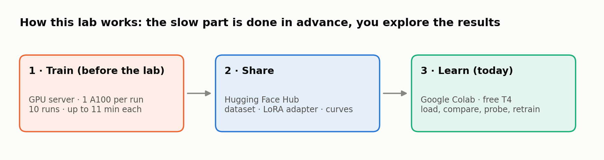

# Lab 07: How to Fine Tune a Vision-Language Model

**RSNA 2026 Deep Learning Lab**

| | |
| --- | --- |
| **Date** | Wednesday, December 2, 2026 |
| **Time** | 8:00 – 9:00 AM (U.S. Central Time) |
| **Level** | Advanced |

> Dates and times may change. Please check the official RSNA 2026 Annual Meeting program for the latest schedule.

## Faculty

- **Moderator:** Ali Ganjizadeh, MD MBA — Elucid Biomedical; Mayo Clinic
- **Presenter:** Kalina Slavkova, PhD — Protege
- **Presenter:** Julie Bauml, MD — 4DMedical; Imagen; Vanderbilt

## Overview

This hands-on workshop provides a practical, end-to-end walkthrough of fine-tuning large vision-language models (LVLMs) for radiology applications. As general-purpose foundation models become more capable, the ability to adapt them to domain-specific clinical tasks, such as report generation, visual question answering, and findings classification, is a critical skill for radiology AI practitioners. Participants will learn how LVLMs process and integrate visual and textual information, and why fine-tuning is needed to bridge the gap between general pretraining and reliable clinical performance.

The session covers the full fine-tuning pipeline, from dataset preparation and annotation best practices through parameter-efficient training techniques to evaluation and failure analysis. Using a guided, pre-configured notebook, attendees will fine-tune an open-weight vision-language model on a representative radiology dataset, experiment with hyperparameter choices, and assess output quality.

No advanced programming experience is required, though basic familiarity with Python is helpful. The course is designed for radiologists, imaging informaticists, and researchers who want to move beyond off-the-shelf models toward building customized, task-specific AI tools for their own clinical and research environments.

## Learning Objectives

By the end of this session, participants will be able to:

1. Define what large vision-language models (LVLMs) are and explain how they differ from traditional vision-only or text-only AI models in radiology.
2. Describe the key fine-tuning strategies, including full fine-tuning, LoRA, and prompt tuning, and identify when each approach is appropriate for a given clinical use case.
3. Explain the critical role of data curation, annotation quality, and dataset composition in determining fine-tuning outcomes and model reliability.
4. Fine-tune a large vision-language model on a radiology dataset using a guided, hands-on coding notebook in a cloud-based compute environment.
5. Evaluate fine-tuned model performance using task-appropriate metrics and identify common failure modes such as hallucination, catastrophic forgetting, and overfitting.

## Materials

| Material | Link |
| --- | --- |
| Notebook | [](https://colab.research.google.com/github/RSNA/AI-Deep-Learning-Lab-2026/blob/main/07-Fine-Tuning-Vision-Language-Models/Lab07_Fine_Tune_a_VLM.ipynb) |
| Dataset (FracAtlas, 512 px, with report text) | [magnooj/fracatlas-vlm-512](https://huggingface.co/datasets/magnooj/fracatlas-vlm-512) |
| Fine-tuned LoRA adapter and precomputed results | [magnooj/qwen3-vl-2b-fracatlas-lora](https://huggingface.co/magnooj/qwen3-vl-2b-fracatlas-lora) |
| Slides for the talks (open in a browser after downloading the folder; arrow keys move, **N** shows speaker notes, Print saves a PDF) | [`Lab07_Slides.html`](./Lab07_Slides.html) |
| Training and evaluation scripts | [`training/`](./training) |
| Diagrams used in the notebook | [`figures/`](./figures) |



In the notebook we teach [Qwen3-VL-2B-Instruct](https://huggingface.co/Qwen/Qwen3-VL-2B-Instruct), a small open vision-language model, to read a musculoskeletal X-ray and fill in a four-line report (body part, view, hardware, fracture). The training runs were done before the lab; the notebook downloads the results, so every part runs in a few seconds, even without a GPU. With a free Colab T4 GPU you can also ask the model your own questions and fine-tune your own small adapter in about two minutes.

| Part | Topic |
| --- | --- |
| Before the code | A clinical view: when to fine-tune, how data and labels decide the result, how to judge a model |
| 1–2 | What a vision-language model is; full fine-tuning, LoRA and prompt tuning |
| 3–4 | Inside the model; the data, its splits and hidden duplicates |
| 5–6 | The untrained model; fine-tune your own adapter |
| 7–8 | Before vs after; learning rate, rank, data size and overfitting |
| 9–10 | Failure probes (hallucination, shortcuts, forgetting); a clinical read |

### Reproduce the training (optional, needs a large GPU)

```bash
pip install -r training/requirements.txt   # install torch for your CUDA first (see the file)
# download FracAtlas from https://doi.org/10.6084/m9.figshare.22363012 into data/raw/FracAtlas
python training/prepare_data.py --src data/raw/FracAtlas --out data/fracatlas_vlm
python training/train_lora.py --data data/fracatlas_vlm/hf --out runs/main
python training/evaluate.py --adapter runs/main/adapter --data data/fracatlas_vlm/hf --split test --out results/main_test.jsonl
```

The main run takes about 11 minutes on one 80 GB A100. On a smaller GPU, lower `--batch-size` and raise `--grad-accum` so their product stays 8.

**For teaching only. The models and results here are not for clinical use.**

## Before the Session

- Bring a laptop with a recent version of the [Chrome browser](https://www.google.com/chrome/).
- Make sure you can sign in to a Google account, which you need to run notebooks in [Google Colab](https://colab.research.google.com/).
- No Hugging Face account or token is needed. In Colab, choose **Runtime → Change runtime type → T4 GPU** to use the optional live parts.

---

[← Back to all labs](../README.md)
