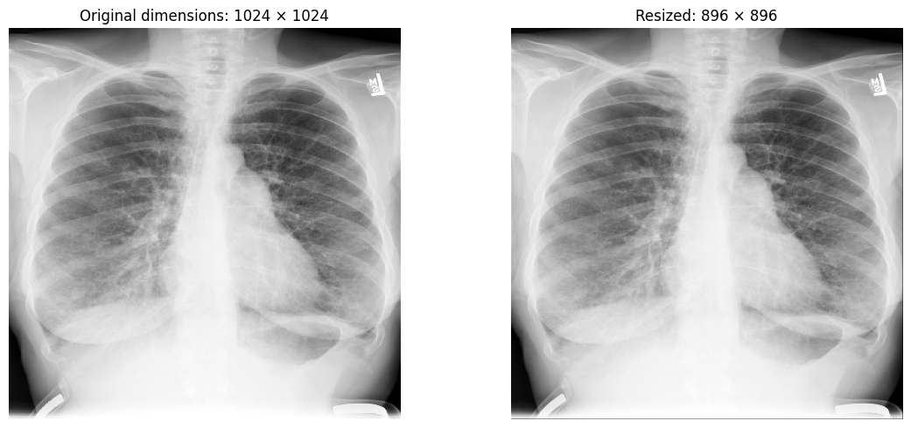
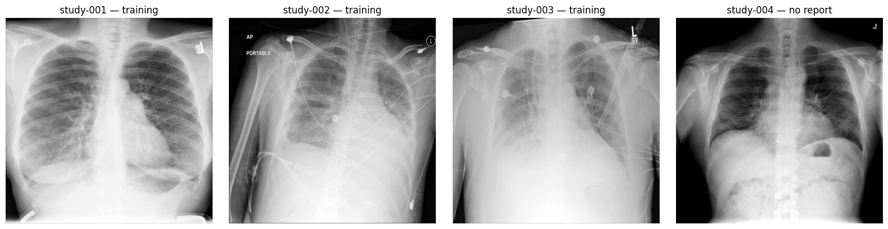

# Backup walkthrough — expected results

Download this guide and its two linked images before the session. Use it if the network fails; the main
notebook's two embedded recovery points also let participants finish one case without the hospital.
These are results from the November 20 rehearsal against the public teaching hospital, not live API responses.

| Section | Request / action | Expected checkpoint |
| --- | --- | --- |
| 1–3 | FHIR connection and authentication | HTTPS request with an assigned bearer token in a header; never show the credential on a slide. |
| 4 | `GET /fhir/R4/Patient` | A Bundle of resources; select pat-001, John Parker. |
| 5 | `GET /fhir/R4/ImagingStudy?patient=pat-001` | Select study-001 and retain its DICOM StudyInstanceUID. |
| 6 | Read the study's ServiceRequest and Encounter references | order-001, enc-001; age at examination, administrative gender and visit reason. |
| 7 | Search DiagnosticReport and compare candidates | report-001 validated by accession, order and FHIR study links. Ambiguous matches require review. |
| 8 | Decode presentedForm; extract Findings | Impression excluded; original CXR RPT-2006, CT RPT-2001 and mammography RPT-2004 demonstrate template variation. |
| 9 | QIDO series/instances then WADO instance retrieval | One selected series and instance; DICOM patient, accession and study/series/instance IDs agree. |
| 10 | Decode, transform intensities and resize | Original dimensions 1024 × 1024; canonical training image 896 × 896. |
| 11 | Save image and inspect input/target | Image path plus clinical-context prompt, separate Findings target; provenance retained. |
| 12 | Repeat for four selected studies | Three training pairs; study-002 uses report-002 (corrected); study-004 has no finalized report. |

## Resolution exercise



Ask what detail becomes less visible at 448, 224 and 112 pixels. The preview switch leaves the training
export unchanged. Full-resolution display still includes intensity transforms; it is not raw DICOM data.

## One complete example

Input prompt:

```text
Draft the findings section of this chest X-ray report. Do not include an impression.
Age at examination: 75 years.
Administrative gender: male.
Reason for visit: Cough for three days.
```

Reference target:

```text
Pulmonary opacity is present.
```

## Cohort exercise



`VIEW = "all"` shows four cached radiographs. `VIEW = "training"` shows study-001, study-002 and study-003.
Study-004 can be an inference candidate, but has no reference target for supervised training.
The preview does not repeat requests or rewrite the JSONL dataset.

## If the hospital is unavailable

Run the imports, recovery helper and FHIR recovery switch to resume at section 8. Enable DICOM recovery to
resume at section 10 using the same case. Skip the live cohort and use the results above for discussion.
The complementary notebook needs the hospital; optional Arena inference additionally needs external capacity.

Original image sources and modifications: [attribution](assets/ATTRIBUTION.md).
Alessia's separate slides can supplement this guide when supplied; this walkthrough does not reproduce them.
