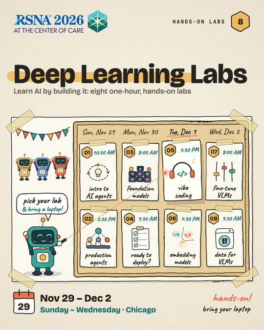
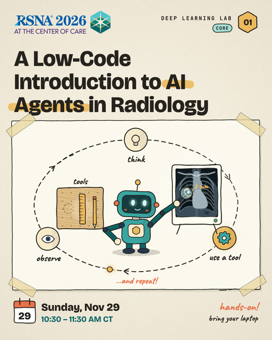
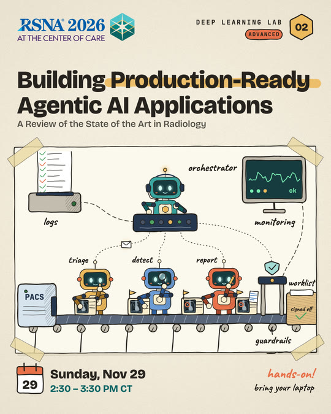
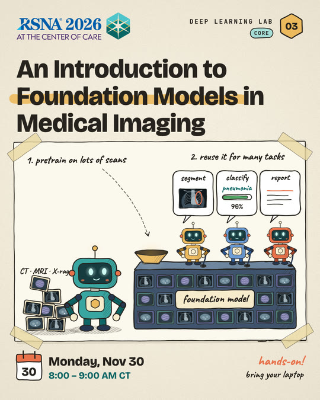
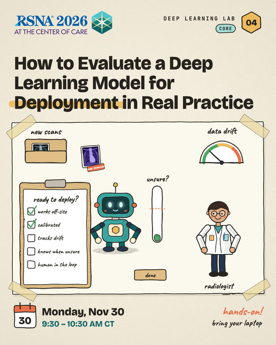
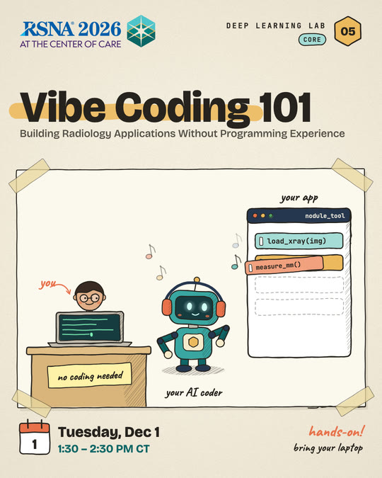
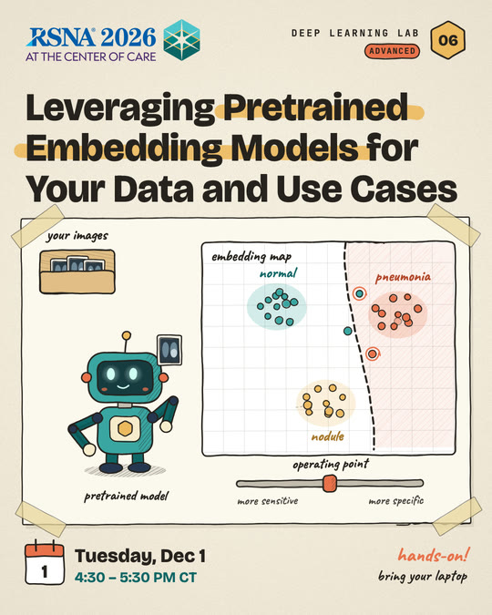
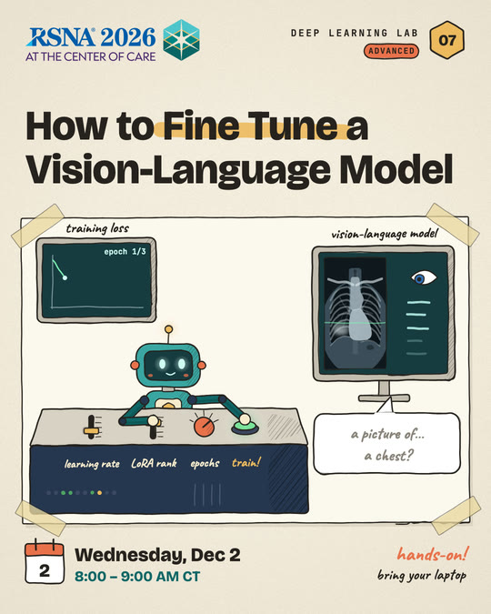
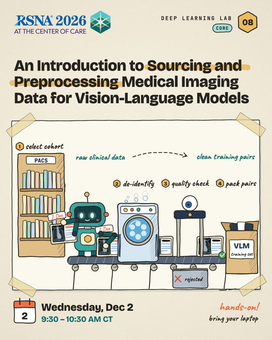

# Promotional Social Media Posts

These are the animated posters and post copy we used to promote the RSNA 2026 Deep Learning Labs on LinkedIn and X: one welcome post and one post per lab. Every poster is drawn entirely with code. There are no image files except the RSNA 2026 logo. A small JavaScript library draws wobbly, hand-inked lines on an HTML canvas, and each lab has a short animated scene starring the series robot.

This folder holds the source code, the post text and a style guide, so you can rebuild these posters or make new ones in the same style.

## Download the videos

**To download the finished MP4s (for LinkedIn) and GIFs (for X), use the download kit: <https://rsna2026-dll-social-kit.vercel.app>**

The kit page also has copy buttons for every LinkedIn post and X thread. The videos are not stored in this repository to keep it small, but you can rebuild them exactly from the code here (see [Rebuild the posters](#rebuild-the-posters)).

## The posters

| | | |
| :---: | :---: | :---: |
| <br>**Welcome post** | <br>**Lab 01** · AI Agents | <br>**Lab 02** · Production-Ready Agents |
| <br>**Lab 03** · Foundation Models | <br>**Lab 04** · Evaluating for Deployment | <br>**Lab 05** · Vibe Coding 101 |
| <br>**Lab 06** · Pretrained Embeddings | <br>**Lab 07** · Fine-Tuning VLMs | <br>**Lab 08** · Data for VLMs |

## What's in this folder

```text
Promotional-Social-Media-Posts/
├── README.md          this page
├── STYLE_GUIDE.md     how the posters look and how the posts are written
├── POSTS.md           the LinkedIn and X text for every poster
├── CLAUDE.md          instructions for an AI coding assistant to rebuild or extend the posters
├── previews/          one still frame of each poster (small JPGs)
└── code/
    ├── poster.html    loads everything and draws one frame on a 1080 x 1350 canvas
    ├── render.js      renders all frames in a headless browser, then encodes them with ffmpeg
    ├── labs.js        the text on each poster: title, highlighted words, level, date and time
    ├── lib/
    │   ├── sketch.js  hand-drawn drawing library (wobbly lines, fills, text, paper texture)
    │   ├── frame.js   the shared poster layout: header, title, taped sketch sheet, footer
    │   ├── robot.js   the series mascot and its props
    │   └── xray.js    a small, soft chest X-ray used in several scenes
    ├── scenes/        one animated scene per poster (lab00.js is the welcome post)
    │   └── _template.js   a starter scene for a new poster
    ├── fonts/         Bricolage Grotesque, Caveat and JetBrains Mono (SIL Open Font License)
    └── assets/        the official RSNA 2026 logo lockup
```

## Rebuild the posters

You need [Node.js](https://nodejs.org) 18 or newer and [ffmpeg](https://ffmpeg.org).

```bash
cd Promotional-Social-Media-Posts/code
npm ci                              # installs Playwright
npx playwright install chromium     # downloads the headless browser Playwright uses
node render.js 01                   # renders Lab 01; use 00 for the welcome post
```

Each render writes three files to `code/out/`:

| File | Use | Format |
| --- | --- | --- |
| `RSNA2026_DLL_Lab01.mp4` | LinkedIn | 1080 x 1350, 24 fps, the 8-second loop played 3 times |
| `RSNA2026_DLL_Lab01_X.gif` | X | 864 x 1080, 128 colours, loops forever |
| `RSNA2026_DLL_Lab01_still.png` | thumbnail or preview | one frame from the middle of the loop |

Rendering is deterministic. With the same ffmpeg build, the code reproduces the files in the download kit byte for byte. A full render takes a few seconds per poster.

For a quick look without encoding, render single frames with `node render.js 01 --still 0,40,80`. To watch a poster play live, serve the folder and open it in a browser:

```bash
cd Promotional-Social-Media-Posts/code
python3 -m http.server 8000
# then open http://localhost:8000/poster.html?lab=01&play
```

## Make a new poster

1. **Add the poster text.** In `labs.js`, add an entry with the title, the words to highlight in gold, the level, the date and the time. Copy an existing entry and edit it.
2. **Draw the scene.** Copy `scenes/_template.js` to a new file, for example `scenes/lab09.js`. Change `window.SCENES.template` to a new name such as `window.SCENES.lab09`, and set `scene: 'lab09'` in your `labs.js` entry. The comments in the template explain the drawing and timing helpers. The existing scenes show more involved examples.
3. **Load the scene.** Add `<script src="scenes/lab09.js"></script>` to `poster.html`, next to the other scenes.
4. **Preview and render.** Use the live preview while you work, then run `node render.js 09`.

Read [STYLE_GUIDE.md](STYLE_GUIDE.md) before you start, so a new poster fits the series.

## Credits and licenses

- The code in this folder is released under the repository's [MIT License](../LICENSE).
- The fonts are licensed under the SIL Open Font License 1.1. The license texts are in [`code/fonts/`](code/fonts/).
- The RSNA 2026 logo belongs to RSNA. Use it only for RSNA materials, following RSNA's brand guidelines.
